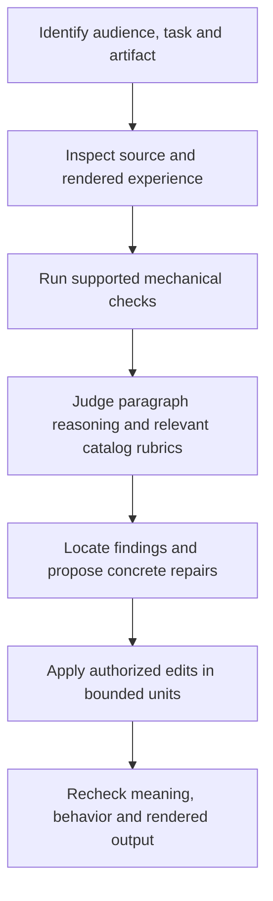

# Make Copy and Media Human

Strip the machine accent from anything outward-facing. This skill catalogs the
tells per model dialect and per medium, detects them in two layers, strikes them,
and hands you a line-item fix plan as one self-contained HTML file.

## Read this first

For every public-facing draft or rewrite, apply the connected-prose review below
and load [connected-prose.md](references/connected-prose.md). This includes short
marketing copy, product strings, social posts, documentation and long chapters.
These are drafting defaults as well as review questions.

For an existing document, web app, native app or manuscript, load
[existing-artifact-review.md](references/existing-artifact-review.md). Audit the
reader's task and rendered experience, record located findings, edit in bounded
units and verify the result in context. A sample review does not establish
coverage of unread chapters or unvisited screens.

When the problem is a missing customer journey, a mismatch with audience
knowledge, or a marketing page that fails to make the buying case, use
`product-reality-reviewer` first. Return here to make the resulting public copy
clear and natural.

You are going to find things. Before you act on them, understand what a finding
means, because the evidence here is uncomfortable and the skill is built around
it.

A study of seven detectors found substantial false-positive rates on non-native
English essays. That result concerns those detectors and that corpus; it does
not establish the probability that any particular author used AI. Fonts, colors,
punctuation, and teaching mistakes cannot settle authorship either.

That is why this skill edits and never accuses. Each proposed fix must improve the artifact for its intended reader, which means you never
have to answer the authorship question to do the work. If someone asks you to
determine whether a colleague or a student used AI, decline and offer to edit the
text instead. `references/fairness-and-false-positives.md` has the full argument
and the citations, and you should read it before your first review.

## Three laws

**No topical keyword lists.** Phrase-level tropes get judged by you against a
rubric, never by substring matching over free text. Three narrow exceptions are
allowed because they are not about topic or taste. The first is a closed set of
<!-- humanize:ignore-start -->closed syntactic residues from metadata or transport, such
as `oaicite` tokens or a `utm_source=chatgpt.com` parameter.<!-- humanize:ignore-end --> The second is closed sets of grammatical
forms measured as a rate, like sentence-final participles or nominalization
suffixes, which carry published effect sizes. Local sentence-run checks may also
locate low-severity review candidates; their cutoffs are editorial heuristics,
and their findings require contextual review. The third is the era-versioned
excess-vocabulary marker list, reported as density against a baseline and always
labelled with its era. Everything else belongs to the judge pass.

**Judge the delta, not the absolute.** This is the law that makes the skill fair
and also makes it work. Rhythm signals such as em-dash rate, comma rate,
contraction rate and sentence-length variance are fluency proxies, and they
overlap badly between people and models. Melville runs more em dashes than
GPT-4-class output does. Llama runs none at all. One anti-slop linter measured
its em-dash rule warning on roughly 64% of legitimate technical blog posts before
recalibration. So pass `--baseline` with a few pieces of the author's own prior
writing whenever you can get it. Without a baseline the script caps that whole
family at low severity, on purpose.

**The output has to pass its own review.** The report uses Georgia and Menlo, an
oxide-red accent, nothing under 14px, no emoji, no indigo. Review the bundle with its own scripts and report residual findings explicitly. If this skill's own artifacts looked generated, nothing it says would
land.

## Classify the evidence

Use `residue` for transport artifacts, `form` for grammatical and comprehension
rubrics, `rhythm` for baseline-sensitive style cues, `shape` for assembly, `code`
for engineering artifacts, and `defect` for reproduced failures. Verify citations
as factual claims. Work reproduced defects and false claims before weak style
cues. Load `references/reader-context-and-evidence.md` when deciding which family
or evidence standard applies. A machine tell never establishes authorship.

## The one rubric that matters most

If you only ever run one judge question, run this one: **what detail in this
passage could only have come from this author, this reader, or this thing?**

Five communities arrived at it independently, in their own vocabularies. People
flagging LinkedIn slop call it generic abstraction. Researchers studying fake
reviews call it emphasizing generic product merits over idiosyncratic
experience. Reddit moderators, cold-email testers and dating-app users all
describe the same failure. It's the rubric behind `specificity-starvation`,
`textureless-anecdote`, `substitutable-reply`, `synthetic-review-shape` and
`mirror-back-research-opener`, and it survives every model improvement, because
the thing it asks for is knowledge the model doesn't have.

## Keep the reasoning visible in public copy

Write connected sentences that let the intended reader follow the thought on
first reading. Name the actor and action, and supply the cause, condition or
consequence when the reader needs it. Use because, so, if, when or but when those
words express the actual relation. A connective must not turn a sequence or a
correlation into an unsupported causal claim.

State the claim directly. Remove stock negation-and-reveal frames, empty teaser
openings, and short closing slogans. Preserve a contrast when it distinguishes
real cases or corrects a plausible misunderstanding. End a paragraph when its
last useful fact, implication or action is complete; do not add a punchline to
make it sound finished.

Let sentence and paragraph lengths follow the material. Never insert fragments,
alternate short and long sentences, or manufacture one-line paragraphs to raise
"burstiness." Join clauses when their relationship belongs in one sentence;
split them when each step stays clear. Complete short sentences, useful parallel
cases, colons that introduce explanations, and concise UI labels can all work.
These defaults take priority over generic advice to make prose punchy, vary its
rhythm, or drop names as punchlines in a paired voice skill.

For results, supply the expectation or comparison needed to understand them.
For promises beside a CTA, keep material conditions beside the claim and verify
that the next screen delivers it. Never invent measurements, mechanisms,
personal experiences or product commitments to make a rewrite more specific.

Use familiar verbs and nouns. Unpack improvised noun stacks and compound labels
when the reader has to decode them; bring a distant subject and verb together.
Make a vague this, that or it explicit when two referents are plausible. Supply
the literal mechanism when an analogy leaves it unstated. Keep useful technical
terms, clear pronouns and explanatory metaphors.

Before handing over copy, read each paragraph as a reader arriving without the
conversation. List the inferences needed to reach its claim. Check which are
already established for this audience; write out the missing ones that affect
understanding or action. Then check its final sentence for an unexplained verdict
or a decorative restatement. This paragraph review is required even when the
structural checker returns no findings.

Record each confirmed problem with the source line, excerpt, missing relation
or reader consequence, and a concrete repair. A missing proof step or misleading
promise can be high severity. A short sentence or absent connective alone cannot.
Use [the research note](references/connected-prose-research.md) to distinguish
published findings, preliminary results and house preferences, and
[the examples](examples/before-after-connected-prose.md) to calibrate the edits.

## Check the reader's context

When a page has placeholder content or an explanation assumes private context,
load `references/reader-context-and-evidence.md`. Supply the missing product facts
or prerequisite reasoning before polishing the layout or prose.

## Set severity by reader harm

Do not convert estimated AI prevalence on a platform into editing severity.
A broken exercise, fabricated reference, or inaccessible control matters because
of its effect on the reader. A fashionable font or an unusually tidy paragraph
is at most a review cue. Findings need a location, an observable consequence,
a counterexample, and a repair; uncertain authorship adds none of these.

## Teach a concept before spending it

For lessons, academic books, tutorials, research explanations, and study notes,
load `references/educational-exposition.md` and
`references/education-and-chrome-research.md`. Record the intended reader's prior
knowledge and the next task they should be able to do. Then trace each hard
concept from its definition through a worked instance to an independent attempt.
A definition alone does not make the concept available for later reasoning.

Use the **close-the-page test**: can a learner explain the key step, distinguish
an example from a near miss, and solve a changed case without the answer visible?
Treat that as a proposed assessment until an actual learner attempts it. Readable
prose, a completed annotation map, and a model's self-review do not prove learning.

The route depends on purpose. A reference manual may point to a prerequisite
lesson. An expert chapter may omit elementary practice. A novice lesson normally
needs a complete worked example, reduced guidance, and a later retrieval task.
Keep the hard step visible; remove repetition of what the learner already knows.

## Give each title layer a job

An eyebrow, title, subtitle, and introductory line are four opportunities to say
something useful, not four slots that must be filled. For each, name the distinct
job: locating the reader, naming the subject, narrowing the scope, or supplying a
constraint. Temporarily remove it. If the reader loses neither information nor
orientation, cut it. If useful scope is lost, move that scope into the surviving
heading or opening sentence.

This applies to web heroes, note templates, slide titles, LaTeX chapter openings,
and repeated figure/title/caption stacks. Three layers is a **local review cue**,
not a research-derived limit. Keep useful section labels, venue-required titles,
accessible headings, theorem labels, and captions that explain a figure.
`references/content-chrome.md` contains the decision tree and counterexamples.
For web UI, also apply the whole-composition deletion pass in
`references/existing-artifact-review.md`, including embedded controls and open states.

```bash
python3 scripts/review_learning_structure.py chapter.md page.html chapter.tex \
    --out structure-findings.json
python3 scripts/humanize_review.py chapter.md --findings structure-findings.json \
    --out report.html
```

The first script finds structural title-stack candidates, not redundant meaning.
Its optional learning-map mode checks explicit reviewer annotations; it cannot
infer mastery from chapter text. See its module documentation and
`templates/learning-map.json` for the input contract. Replace its illustrative
source path and line numbers with reviewed locations; the validator checks the
annotation structure, not whether those locations establish learning. A model reviewer must still
check teaching quality and the rendered page or PDF.

## Review process



For an existing artifact, follow `references/existing-artifact-review.md`.
For commands, medium-specific routing, finding JSON, baselines, browser checks,
catalog maintenance and validation, load `references/review-workflow.md`.
Run the paragraph review even when no mechanical finding fires. Deliver the
revised artifact when requested, located findings and the self-contained HTML
report, with explicit coverage and remaining uncertainty.

## The references

Every generated file opens with a decision diagram for when it applies and an
index of its contents. Load the one the router pointed at; you do not need the
rest.

| Reference | Load when |
|---|---|
| `references/review-workflow.md` | Medium routing, commands, evidence layers, report delivery and catalog maintenance |
| `references/reader-context-and-evidence.md` | Finding families, placeholder input, private context and audience depth |
| `references/activation-examples.md` | Selection boundaries between copy editing, product review and unrelated requests |
| `references/fairness-and-false-positives.md` | Before your first review, and any time someone asks you to judge authorship |
| `references/connected-prose.md` | Every public-facing draft: missing relations, repetitive rhetoric, comparisons, referents and compressed syntax |
| `references/connected-prose-research.md` | Evidence boundaries, corrections to the Claude audit, and what the checker actually implements |
| `references/existing-artifact-review.md` | Auditing and repairing an existing document, web app, native app or book with explicit coverage |
| `references/educational-exposition.md` | Teaching progression, worked examples, retrieval, transfer, research reasoning, and instructional media |
| `references/content-chrome.md` | Semantic duplication across rendered page/component layers, title stacks and useful navigation |
| `references/education-and-chrome-research.md` | Evidence strength, study boundaries, source audit, and evaluation plan |
| `references/review-decisions.md` | Detailed progression and title-layer decision trees, genre exceptions, and medium coverage |
| `references/instructional-media-and-notes.md` | Video, audio, diagrams, notebooks and notes whose task fidelity needs direct inspection |
| `references/source-audit-2026-09-19.json` | Dated inventory of source-note review and explicitly bounded live verification |
| `references/catalog.json` | Machine-readable details for the selected lane, thresholds and false positives |
| `references/claudeisms.md` | Text suspected from Claude: staccato, dashes, negation frames, escalating compliments · **37 items** |
| `references/gptisms-codexisms.md` | READMEs, code comments, service-voice copy, emoji headers · **34 items** |
| `references/other-model-dialects.md` | Gemini caveat stacks, DeepSeek and Qwen register, Grok voice, register leveling · **14 items** |
| `references/visual-design-tells.md` | Web UI and landing pages: the defaults nobody chose, clustering together · **33 items** |
| `references/document-and-deck-structure.md` | Long documents, READMEs and slide decks — how the thing was assembled, independent of any sentence in it · **28 items** |
| `references/marketing-and-platform-tells.md` | Landing copy, social posts, cold email, listings, résumés — venues with a house form · **30 items** |
| `references/generated-media-tells.md` | A generated image, video or audio clip — provenance first, pixels last · **11 items** |
| `references/fiction-and-narrative-tells.md` | Fiction, narrative, and anything told as a story; the strongest tells in the catalog live here · **6 items** |
| `references/web-build-defects.md` | Any web page, before anything else: responsive, semantics, contrast, scaffold residue · **36 items** |
| `references/engineering-artifact-tells.md` | Commits, PRs, code review, tests, docs, source files · **27 items** |
| `references/unopened-surfaces.md` | Navigation, i18n, docs sites, commerce, email templates, print and PDF — the surfaces a model has no way to open · **36 items** |
| `references/dark-patterns-the-model-inherits.md` | Consent banners, countdowns, activity counters, cancellation and checkout: shapes the commercial web supplied, several of them unlawful · **9 items** |
| `references/tool-fingerprints.md` | Asked which tool built a page, or about to report a generator string as a finding — read the first two items before the other nineteen · **21 items** |
| `references/five-minute-manual-pass.md` | Reviewing any web page for accessibility — eleven keyboard and screen-reader steps, written for someone who has never used one |
| `references/accessibility-beyond-the-checklist.md` | After the manual pass, or when an automated scan came back clean and you need the other 70% · **40 items** |
| `references/product-ux-writing.md` | Any string a logged-in user reads mid-task: errors, empty states, button labels, confirmations, notifications, field hints · **35 items** |
| `references/typographic-craft-and-tokens.md` | Reviewing a stylesheet or a design system: leading, tracking, scale, weight, numerals, colour roles, tokens · **38 items** |
| `references/performance-budget-and-folklore.md` | Before any performance finding — eleven budget numbers a designer can hold, and ten pieces of folklore to drop |
| `references/performance-as-a-design-tell.md` | Images, fonts, video, libraries and the head stack: where the source is right and the delivery is not · **29 items** |
| `references/interaction-and-motion.md` | Any page with animation, scroll effects or hover styling: duration, easing, reduced motion, and what a touchscreen does with a hover state · **26 items** |
| `references/forms-and-input.md` | Any form: the disabled submit, autocomplete tokens, mobile keyboards, error handling and what survives a failed submit · **25 items** |
| `references/research-papers.md` | A manuscript, preprint, abstract or referee report — checks that point outward at the world rather than inward at style · **28 items** |
| `references/latex-source.md` | A `.tex` or `.bib` file — it compiled, and nobody opened the PDF · **30 items** |
| `references/scientific-figures.md` | A plot, chart or panel, and the `.py`/`.R` that drew it — most of it is checkable in the code · **29 items** |
| `references/sources.md` | When you need citations |
| `templates/output-template.md` | Drafting a judge-pass finding or the delivery summary |
| `agents/openai.yaml` | Delegating a review to a subagent |

## Shibboleths

- **A concept mentioned is not a concept taught.** Name the learner action that
  makes it safe to use the concept in the next argument.
- **An example is worked when the difficult decision is visible.** Showing the
  answer after "simplifying" is not enough when simplification is the lesson.
- **Comfort is not mastery.** Ask for an unaided explanation or changed problem;
  do not use a fluent recap or a confidence rating as the exit criterion.
- **A heading names content; it does not justify the page's existence.** Keep
  scope and orientation, cut promotional restatement.
- **Count title layers, then judge their jobs.** Never infer redundancy from
  capitalization, a missing digit, or a font choice.
- **A caption is part of the argument.** Preserve assumptions, scales, and
  uncertainty when trimming decorative text.
- **Evidence about learning is not evidence about AI prevalence.** A classic
  pedagogy experiment supports a repair, not a claim that models uniquely fail.


A rate is a cue, not a verdict. Compare punctuation and rhythm against the
author and genre; change them only when the passage benefits.

A pull quote should excerpt or accurately attribute something. Preserve a
clearly labeled original aphorism; repair a falsely attributed quotation.

Defaults can cluster in deliberate design systems. Inspect whether the layout,
type and color serve the content before proposing a change.

A comment that repeats an obvious operation adds little. Explain the constraint
or remove the repetition, regardless of who wrote the code.

Parallel lists can be easier to compare. Break their symmetry only when it
hides real differences in importance or content.

A sentence that announces significance should state the mechanism or evidence.
A number, proper noun or participial clause is neither necessary nor sufficient
for a useful sentence.

## Anti-pattern: manufacturing a human rhythm

**Novice:** Insert fragments, punchlines or arbitrary length changes to sound human.
**Expert:** Preserve the actor, action and necessary relation; let length follow
those needs. A numerical cadence cue is not a drafting target.
**Detection:** The rewrite raises variety while deleting a cause or consequence.

For rewrite safeguards, voice restoration and known failure modes, load
`references/review-workflow.md`.

<!-- humanize:ignore-start -->
<!-- BEGIN BUNDLE INDEX (auto: index_references.py) -->

## Skill Bundle Index

*Every file in this skill, and when to open it. Auto-generated. Maintainers: from the source repository root, run
`python3 skills/skill-architect/scripts/index_references.py skills/make_copy_and_media_human --fix`.*

**root**
- [`CHANGELOG.md`](CHANGELOG.md) — Changelog — <!-- humanize:ignore-start A changelog is heading-and-bullet dense by design, which is the documented false positive for heading-spam and bu
- [`README.md`](README.md) — Make Copy and Media Human — Strip the machine accent from copy, web UI, slides, READMEs, commits, PRs, marketing pages, lessons, academic books, notebooks, and generate
- [`humanize-report.html`](humanize-report.html)

**`agents/`**
- [`agents/openai.yaml`](agents/openai.yaml) — openai (data/schema)

**`examples/`**
- [`examples/INDEX.md`](examples/INDEX.md) — examples for make_copy_and_media_human — Imported supporting material.
- [`examples/before-after-connected-prose.md`](examples/before-after-connected-prose.md) — Connected prose: examples and counterexamples — These are synthetic editorial examples.
- [`examples/before-after-landing-page.md`](examples/before-after-landing-page.md) — Before / After — Landing Page (the v0 look, token by token) — Verified by running `scripts/humanize_review.py` against the Before block above.
- [`examples/before-after-learning-and-chrome.md`](examples/before-after-learning-and-chrome.md) — Before / After — Learning, Research, and Title Chrome — These specimens are synthetic teaching data and editorial demonstrations.
- [`examples/before-after-prose.md`](examples/before-after-prose.md) — Before / After — Launch Announcement — The same announcement, machine accent vs.
- [`examples/sample-report.html`](examples/sample-report.html)

**`references/`**
- [`references/INDEX.md`](references/INDEX.md) — references for make_copy_and_media_human — Imported supporting material.
- [`references/accessibility-beyond-the-checklist.md`](references/accessibility-beyond-the-checklist.md) — Accessibility beyond the checklist — Everything in this file is in the part of accessibility that automation cannot reach.
- [`references/activation-examples.md`](references/activation-examples.md) — Selection examples — These are reviewed selection fixtures, not a measured runtime activation test.
- [`references/catalog.json`](references/catalog.json) — catalog (data/schema)
- [`references/claudeisms.md`](references/claudeisms.md) — Claudeisms — and the generic prose tells Claude amplifies — Tells most associated with Claude-family output, plus the cross-model prose tells that show up strongest in Claude registers.
- [`references/connected-prose-research.md`](references/connected-prose-research.md) — Evidence for connected public copy — This note responds to the supplied Claude artifact, "Why the prose reads clipped, and how to check for it." Its strongest diagnosis is that
- [`references/connected-prose.md`](references/connected-prose.md) — Connected prose and public-copy cadence — Review sentence relationships before polishing rhythm.
- [`references/content-chrome.md`](references/content-chrome.md) — Title layers and content chrome — Count visible layers, then ask what each contributes.
- [`references/dark-patterns-the-model-inherits.md`](references/dark-patterns-the-model-inherits.md) — Dark patterns the model inherits — A model that produces a fake countdown or an asymmetric cookie banner is not choosing to deceive.
- [`references/document-and-deck-structure.md`](references/document-and-deck-structure.md) — Document and deck structure — how the thing was assembled — Document-shape tells: how generated long-form docs, READMEs and slide decks are put together, independent of any sentence in them.
- [`references/education-and-chrome-research.md`](references/education-and-chrome-research.md) — Education, semantic progression, and chrome — This memo adds an education and interface-structure lens to the humanization research.
- [`references/educational-exposition.md`](references/educational-exposition.md) — Educational exposition and concept progression — Audit what a reader can do with an idea before later material depends on it.
- [`references/engineering-artifact-tells.md`](references/engineering-artifact-tells.md) — Engineering-artifact tells — commits, PRs, reviews, code, tests, docs — What generated engineering work looks like in the artifacts maintainers actually read.
- [`references/existing-artifact-review.md`](references/existing-artifact-review.md) — Reviewing an existing document, app or manuscript — Use this workflow when the artifact already has a structure, voice, design or reader journey.
- [`references/fairness-and-false-positives.md`](references/fairness-and-false-positives.md) — Fairness and false positives — read this before you act on any finding — Hand-written, not generated from the catalog.
- [`references/fiction-and-narrative-tells.md`](references/fiction-and-narrative-tells.md) — Fiction and narrative tells — What generated fiction does at the level of story rather than sentence.
- [`references/five-minute-manual-pass.md`](references/five-minute-manual-pass.md) — The five-minute manual pass — Written for someone who has never used a screen reader.
- [`references/forms-and-input.md`](references/forms-and-input.md) — Forms and input — where the output is the start of the user's work — A form is the one surface where the model's output is the BEGINNING of the user's work rather than the end of it.
- [`references/generated-media-tells.md`](references/generated-media-tells.md) — Generated images, video and audio — provenance first — A separate file because the REVIEW ORDER is different.
- [`references/gptisms-codexisms.md`](references/gptisms-codexisms.md) — GPT-isms and Codexisms — ChatGPT's service voice and README register, and the code-comment tells of Codex/Copilot-shaped generation.
- [`references/instructional-media-and-notes.md`](references/instructional-media-and-notes.md) — Instructional media and source-bound notes — Review generated diagrams, video, audio, notebooks and notes against the task they claim to serve.
- [`references/interaction-and-motion.md`](references/interaction-and-motion.md) — Interaction and motion — the property a generator cannot watch — Motion is the one design property whose entire quality lives in TIME, and a generator emits it as a static string it can never watch run.
- [`references/latex-source.md`](references/latex-source.md) — LaTeX source — it compiled, and nobody opened the PDF — LaTeX source is a program nobody in the loop has run — and the tell is never that it failed to compile.
- [`references/marketing-and-platform-tells.md`](references/marketing-and-platform-tells.md) — Marketing copy and platform posts — written to a template — Landing-page copy, social posts, cold email, listings and résumés.
- [`references/other-model-dialects.md`](references/other-model-dialects.md) — Other model dialects — Gemini, Kimi, DeepSeek, Qwen, Llama, Grok — and cross-model translationese — Distinctive tics per model family, plus the affect and register tells that mark any machine output regardless of vendor.
- [`references/performance-as-a-design-tell.md`](references/performance-as-a-design-tell.md) — Performance and payload as a design tell — **The organising idea.** A generator can see the markup it is writing.
- [`references/performance-budget-and-folklore.md`](references/performance-budget-and-folklore.md) — A performance budget a designer can hold, and the folklore to drop — Two things in one file, because they are the same argument.
- [`references/product-ux-writing.md`](references/product-ux-writing.md) — UX writing inside the product — The strings a logged-in user reads mid-task: errors, empty states, button labels, confirmations, notifications, field hints.
- [`references/reader-context-and-evidence.md`](references/reader-context-and-evidence.md) — Reader context and evidence families — Load this file when distinguishing kinds of evidence, diagnosing placeholder content, or deciding how an explanation fits its audience.
- [`references/research-papers.md`](references/research-papers.md) — Research papers — checks that point outward, at the world — A paper's sentences and its checkable commitments come out of the same machinery at the same confidence, and nothing in the finished artifac
- [`references/review-decisions.md`](references/review-decisions.md) — Review decisions — learning sequence and title chrome — This reference turns two high-confusion findings into editorial decisions.
- [`references/review-workflow.md`](references/review-workflow.md) — Review workflow and maintenance — Load this file when running a review, selecting medium-specific checks, writing findings or maintaining the catalog.
- [`references/scientific-figures.md`](references/scientific-figures.md) — Scientific figures — checked in the code that drew them — A figure is produced by code, and the render sits on the other side of a step the author never watched.
- [`references/source-audit-2026-09-19.json`](references/source-audit-2026-09-19.json) — source audit 2026 09 19 (data/schema)
- [`references/sources.md`](references/sources.md) — Sources — Published catalogs, stylometry research, and essays the catalog draws on.
- [`references/structure-and-deck-tells.md`](references/structure-and-deck-tells.md) — Structure, deck, and marketing-copy navigation — This former combined catalog has been split.
- [`references/tool-fingerprints.md`](references/tool-fingerprints.md) — Tool fingerprints — provenance, and the few that are also defects — Read the first two items in this file before the other nineteen, because they are the rules the rest depends on.
- [`references/typographic-craft-and-tokens.md`](references/typographic-craft-and-tokens.md) — Typographic craft and design-system structure — **The governing mechanism, and the thing to say when you report any item here.** A generator emits a stylesheet that is internally consisten
- [`references/unopened-surfaces.md`](references/unopened-surfaces.md) — Unopened surfaces — navigation, i18n, docs, commerce, email, print — Everything in this file is about a surface that was never opened.
- [`references/visual-design-tells.md`](references/visual-design-tells.md) — Visual design tells — the v0/Lovable look — What makes a UI read as generated: the defaults nobody chose, clustering together.
- [`references/web-build-defects.md`](references/web-build-defects.md) — Web build defects — the half you can reproduce — A different KIND of finding from the rest of this catalog.

**`scripts/`**
- [`scripts/INDEX.md`](scripts/INDEX.md) — scripts for make_copy_and_media_human — Imported supporting material.
- [`scripts/humanize_review.py`](scripts/humanize_review.py) — humanize_review.py — flag AI-isms in copy/media and emit a static HTML fix plan.
- [`scripts/implemented_checks.py`](scripts/implemented_checks.py) — Inventory finding emissions, excluding examples, comments and thresholds.
- [`scripts/regenerate_references.py`](scripts/regenerate_references.py) — Regenerate reference Markdown views from references/catalog.json. Stdlib only.
- [`scripts/render_check.py`](scripts/render_check.py) — render_check.py — open a page at real viewports and report what breaks.
- [`scripts/review_learning_structure.py`](scripts/review_learning_structure.py) — Offline structure and learning-map review for the humanization skill.
- [`scripts/test_connected_prose.py`](scripts/test_connected_prose.py) — Offline regressions for local cadence and honest automation claims.
- [`scripts/test_learning_structure.py`](scripts/test_learning_structure.py) — In-memory tests for review_learning_structure.py; no temporary files needed.
- [`scripts/test_review_regressions.py`](scripts/test_review_regressions.py) — Regressions for semantic overreach; no network, model, or temporary files.

**`templates/`**
- [`templates/INDEX.md`](templates/INDEX.md) — templates for make_copy_and_media_human — Imported supporting material.
- [`templates/learning-map.json`](templates/learning-map.json) — learning map (data/schema)
- [`templates/output-template.md`](templates/output-template.md) — Judge-Pass Finding + Delivery Template — Fill this in during step 3 (judge pass) and step 4 (delivery) of the process in `SKILL.md`.
- [`templates/rewrite-checklist.md`](templates/rewrite-checklist.md) — Rewrite Checklist — run after every humanizing pass — Work the report top-down, highest severity first, then verify each line below.

<!-- END BUNDLE INDEX -->
<!-- humanize:ignore-end -->
