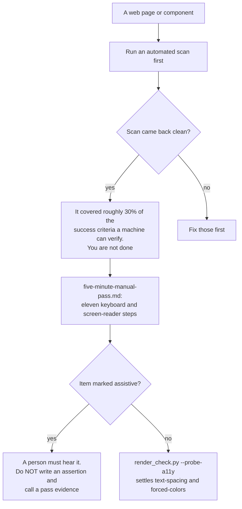

# Accessibility beyond the checklist

Everything in this file is in the part of accessibility that automation cannot reach. The most generous coverage number any vendor publishes is axe-core's own — 57.38% of issues BY VOLUME, and that figure is high precisely because the things automation catches (missing alt, low contrast, unlabelled fields) are the most numerous. Counted as distinct success criteria a machine can fully verify, coverage is around 30%: roughly 15 of WCAG 2.1 AA's 50.

So a green automated scan is the START of an accessibility review and never the end. Note the `assistive` detection type, which exists only in this file: about a third of these cannot be settled by a headless browser, because the finding is what a person HEARS. Filing those as `rendered` would invite someone to write an assertion, watch it pass, and launder a manual check into a green tick — which is the exact failure this whole skill exists to name.

**Most of this reads UNREVIEWED rather than machine-written.** A hand-built 2011 jQuery site fails most of it too, and saying so is part of reporting it honestly. What IS distinctively model-flavoured is a smaller set with one shape: the model produces the APPEARANCE of accessibility work. An `aria-label` on a div. A redundant role on a semantic element. A role promised with no behaviour behind it. A live region that is conditionally rendered and therefore silent. Alt text that describes the photograph instead of doing its job. An accessibility statement asserting a conformance level nobody measured. Those six are the ones to weight, and there is a number behind them: WebAIM's 2026 crawl found home pages WITH ARIA averaging 59.1 errors against 42 for pages without, with more ARIA correlating with more errors. That is not causal, but it is a 17-error penalty attached to exactly the behaviour a model performs when you ask it to make something accessible.

Before working through this file, do the eleven steps in `references/five-minute-manual-pass.md`. It is written for someone who has never used a screen reader, it finds the majority of what is here, and every step of it passes axe.

_40 items. Generated from catalog.json — edit there, then re-run `scripts/regenerate_references.py`. Do not hand-edit this file._

_Every item carries a **False positive when** line. Read it before you act on the item: these are cues for an editor, not evidence about an author._

<!-- humanize:ignore-start
     The diagram and index below quote the tells they document, and a
     mermaid label is not a sentence. -->

## When this file applies

## What is in this file

Severity reflects the consequence for the intended reader, never how sure you should be about who wrote it. **Automated** means these scripts implement the check; *no* means it is yours to ask in the judge pass.

| item | severity | family | automated |
| --- | --- | --- | --- |
| [`accessibility-overlay-installed`](#accessibility-overlay-installed) | HIGH | residue | yes |
| [`accessible-name-does-not-match-the-visible-label`](#accessible-name-does-not-match-the-visible-label) | HIGH | defect | yes |
| [`background-not-inert-behind-the-overlay`](#background-not-inert-behind-the-overlay) | HIGH | defect | **no** |
| [`conditionally-rendered-live-region`](#conditionally-rendered-live-region) | HIGH | defect | yes |
| [`focus-never-enters-the-dialog`](#focus-never-enters-the-dialog) | HIGH | defect | **no** |
| [`focus-not-restored-on-dismiss`](#focus-not-restored-on-dismiss) | HIGH | defect | **no** |
| [`focus-obscured-by-sticky-chrome`](#focus-obscured-by-sticky-chrome) | HIGH | defect | **no** |
| [`focus-order-diverges-from-reading-order`](#focus-order-diverges-from-reading-order) | HIGH | defect | **no** |
| [`form-errors-visible-but-never-spoken`](#form-errors-visible-but-never-spoken) | HIGH | defect | **no** |
| [`heading-levels-chosen-for-size`](#heading-levels-chosen-for-size) | HIGH | defect | yes |
| [`promised-role-with-no-behaviour`](#promised-role-with-no-behaviour) | HIGH | defect | yes |
| [`reflow-failure-at-320-css-pixels`](#reflow-failure-at-320-css-pixels) | HIGH | defect | **no** |
| [`spa-route-change-focus-lost`](#spa-route-change-focus-lost) | HIGH | defect | **no** |
| [`toast-carries-a-control-a-screen-reader-cannot-reach`](#toast-carries-a-control-a-screen-reader-cannot-reach) | HIGH | defect | **no** |
| [`accessibility-statement-without-an-audit`](#accessibility-statement-without-an-audit) | med | shape | n/a |
| [`aria-label-cloaks-the-text-that-was-already-there`](#aria-label-cloaks-the-text-that-was-already-there) | med | defect | yes |
| [`aria-label-on-a-generic-element`](#aria-label-on-a-generic-element) | med | residue | yes |
| [`aria-reference-that-resolves-to-nothing-at-runtime`](#aria-reference-that-resolves-to-nothing-at-runtime) | med | defect | **no** |
| [`auto-advancing-content-with-no-pause`](#auto-advancing-content-with-no-pause) | med | defect | yes |
| [`automation-covers-a-third-of-this`](#automation-covers-a-third-of-this) | med | shape | **no** |
| [`data-rendered-as-divs-with-no-header-association`](#data-rendered-as-divs-with-no-header-association) | med | defect | yes |
| [`drag-only-interaction`](#drag-only-interaction) | med | defect | **no** |
| [`error-message-names-the-failure-not-the-remedy`](#error-message-names-the-failure-not-the-remedy) | med | form | **no** |
| [`escape-not-wired-on-the-inner-layer`](#escape-not-wired-on-the-inner-layer) | med | defect | **no** |
| [`focus-lands-on-the-container-not-a-control`](#focus-lands-on-the-container-not-a-control) | med | defect | n/a |
| [`forced-colors-mode-erases-the-interface`](#forced-colors-mode-erases-the-interface) | med | defect | yes |
| [`infinite-scroll-with-no-announcement-and-no-reachable-end`](#infinite-scroll-with-no-announcement-and-no-reachable-end) | med | defect | **no** |
| [`instructions-live-only-in-the-placeholder`](#instructions-live-only-in-the-placeholder) | med | defect | yes |
| [`landmarks-duplicated-and-unnamed`](#landmarks-duplicated-and-unnamed) | med | defect | yes |
| [`link-text-that-only-works-next-to-its-picture`](#link-text-that-only-works-next-to-its-picture) | med | shape | yes |
| [`loading-state-with-no-status-role`](#loading-state-with-no-status-role) | med | defect | **no** |
| [`narrating-alt-text`](#narrating-alt-text) | med | form | yes |
| [`results-change-silently-under-a-filter`](#results-change-silently-under-a-filter) | med | defect | n/a |
| [`skip-link-that-moves-nothing`](#skip-link-that-moves-nothing) | med | defect | **no** |
| [`text-spacing-override-breaks-the-layout`](#text-spacing-override-breaks-the-layout) | med | defect | yes |
| [`time-limit-with-no-warning-and-no-extension`](#time-limit-with-no-warning-and-no-extension) | med | defect | **no** |
| [`type-sized-in-viewport-units`](#type-sized-in-viewport-units) | med | defect | yes |
| [`validation-fires-on-every-keystroke`](#validation-fires-on-every-keystroke) | med | defect | **no** |
| [`whole-card-wrapped-in-one-link`](#whole-card-wrapped-in-one-link) | med | defect | **no** |
| [`redundant-role-on-a-semantic-element`](#redundant-role-on-a-semantic-element) | low | residue | yes |

<!-- humanize:ignore-end -->

<!-- humanize:ignore-start
     Everything below is a specimen catalog. It quotes the tells it documents,
     including literal machine residue, so reviewing it with humanize_review.py
     would flag the exhibits rather than the writing. -->

### `accessibility-overlay-installed`  ·  high · generic-llm · web-ui · structural · family: residue · lane: accessibility

**Automated here:** yes, these scripts implement it.

A third-party widget added in place of fixing anything: a person-in-a-circle button in the corner offering font size, contrast and "screen reader mode" controls that the user's actual assistive technology already provides better. Its presence is a RECEIPT — the accessibility problem was recognised and then outsourced to a script rather than fixed.

**Why it reads AI:** Not model-generated, but strongly correlated with the same posture, and it belongs here for the same reason unmodified design tokens do: it is evidence about PROCESS, not about authorship. An overlay is what "make this site accessible" looks like when the answer is procurement rather than engineering — the same substitution a generated aria-label on a div makes at the code level. On a generated site the pairing is common and diagnostic: cargo-culted ARIA in the markup, an overlay in the head.

**Detect:** Static, and the cheapest high-confidence check in this whole lane: grep the served HTML and all script sources for the vendor hostnames, the global-variable footprints and the injected DOM roots.

**Fix:** Remove it and fix the source. Note the specific technical reason it cannot work on this stack: component-based interfaces change state independently of the overlay, leaving it unable to fix JavaScript-driven changes to content — so the overlay is LEAST effective on exactly the architecture generated sites use.

**False positive when:** Be careful and be fair. A user-controlled preference panel you built yourself — a theme, contrast or font-size switcher native to the product — is not an overlay and is often genuinely good. Some of these vendors also sell real audit work, so the script does not prove nothing else was done. Text-to-speech products in education and government are used sincerely and are sometimes procurement-mandated. And the site owner may have been sold this in good faith: the finding is about the site, never about their motives.

**Evidence:** A US regulator approved a $1M order against one vendor in April 2025, alleging the plug-in failed to make basic components accessible and that the company placed articles on third-party sites formatted to look like impartial reviews. A lawsuit tracker recorded 4,928 US web accessibility suits in 2025, roughly 28% of them against sites that already had an overlay installed, with the overlay cited as a barrier rather than a remedy. In a practitioner survey 67% rated these tools not at all or not very effective, rising to 72% among respondents with disabilities.

**Before**

> an overlay vendor's script in the head, initialised on load

**After**

> the script deleted, and the findings in this file actually fixed

### `accessible-name-does-not-match-the-visible-label`  ·  high · generic-llm · web-ui · structural · family: defect · lane: accessibility

**Automated here:** yes, these scripts implement it.

The button says "Get started". Its aria-label says "Navigate to signup page". A voice-control user says "click Get started" and nothing happens, because the name the machine knows is not the name on the screen. WCAG 2.2 SC 2.5.3, and the single most overlooked criterion in generated code because everyone assumes aria-label can only help.

**Why it reads AI:** Partly model-flavoured. A model asked to improve accessibility adds descriptive labels that read beautifully in source and silently break speech input. The failure is caused BY the accessibility effort, which is this lane's signature shape.

**Detect:** Static, and the comparison is exact: for every element with both visible text and an aria-label or aria-labelledby, normalise both and flag when the accessible name does not CONTAIN the visible string. Automated engines have a rule for this but it is tagged experimental and is off in most default configurations — check your config before assuming it is covered.

**Fix:** The accessible name must contain the visible text, ideally starting with it. If you need more context use aria-describedby for the extra, or extend rather than replace.

**False positive when:** Icon-only controls have no visible text and are out of scope. Where the visible label is an image of text, compare against its alt. Non-Latin scripts and transliterated labels legitimately diverge. Controls whose visible text is a truncated form of the full name pass if the accessible name contains the untruncated string.

**Before**

> <button aria-label="Submit registration form">Create account</button>

**After**

> <button>Create account</button> — or aria-label="Create account — free, no card required"

### `background-not-inert-behind-the-overlay`  ·  high · generic-llm · web-ui · rendered · family: defect · lane: accessibility

**Automated here:** no — decidable mechanically, but this bundle does not implement it. Ask it yourself in the judge pass.

The modal is open, focus is trapped correctly, and the content behind it is still in the accessibility tree. A screen reader user in browse mode — arrow keys, not Tab — walks straight out of the dialog into the page underneath with no indication they have left.

**Why it reads AI:** Unreviewed. aria-modal alone is widely treated as sufficient, but APG conditions it on application code already preventing all interaction outside the dialog — which is the thing that was not done.

**Detect:** Rendered: with the dialog open, assert EITHER it is a native <dialog> opened via showModal() (the top layer handles it) OR every sibling of the dialog's root carries inert or aria-hidden="true". Note the asymmetry with automated tooling: aria-hidden on a focusable element IS caught; the missed case is the inverse, where nothing is hidden at all and no rule fires because no rule knows what "open" means.

**Fix:** <dialog> + showModal(), which puts the dialog in the top layer and makes everything else inert with no code. Otherwise set inert on the app root while open, which handles focus AND the accessibility tree; aria-hidden alone handles only the tree and leaves the background tabbable.

**False positive when:** Non-modal dialogs, drawers and popovers are SUPPOSED to leave the background live. Toast containers and consent banners are not modals. And on a native <dialog> the absence of inert and aria-hidden is correct — do not flag it.

**Before**

> aria-modal="true" on an overlay div, with the page behind it untouched

**After**

> the app root carrying inert while the dialog is open, or a native <dialog>

### `conditionally-rendered-live-region`  ·  high · generic-llm · web-ui · assistive · family: defect · lane: accessibility

The container and its text arrive in the DOM in the same tick, so the screen reader never observes a CHANGE to a region it was watching, and says nothing. The markup is textbook-correct and the behaviour is silence. Undetectable by every static and every rendered-DOM check, because the attribute is present and the text is present.

**Why it reads AI:** Genuinely model-flavoured, and the purest instance in this lane of a model producing the APPEARANCE of accessibility. Conditional-render-the-whole-thing is the idiomatic component shape and the one a generator reaches for by default; aria-live is what it adds when you ask for accessibility. The two combine into something that reads as careful work and does nothing.

**Detect:** Static pre-filter, unusually high-precision in component code: a conditional guard immediately wrapping an element that carries aria-live — {x && 
 {saved && 
Saved!
}

**After**

> a mounted 
 whose text is set to "Saved" when the save completes

### `focus-never-enters-the-dialog`  ·  high · generic-llm · web-ui · rendered · family: defect · lane: accessibility

**Automated here:** no — decidable mechanically, but this bundle does not implement it. Ask it yourself in the judge pass.

A modal opens visually and focus stays behind it on the trigger, so Tab then walks the page UNDERNEATH the overlay. Distinct from escape-and-focus-declared-not-wired, which is declared behaviour failing at runtime; this is behaviour that was never declared.

**Why it reads AI:** Model-flavoured enough to say so, on a clean panel design: across roughly three thousand driven trials, 24% of generated modals put focus inside on a bare prompt, rising to 66% with explicit guidance; only 12% fully held focus, rising to 64% guided. Per-model leak rates on bare prompts ran from 7% to 33%.

**Detect:** Rendered: open by keyboard and assert the dialog contains document.activeElement. Then Tab past the focusable count inside and assert focus never lands outside the dialog.

**Fix:** Native <dialog> opened with showModal(), which does this for free, or a maintained primitive. If hand-rolled must stay, focus the first meaningful control on open — not the dialog container.

**False positive when:** Non-modal dialogs and popovers deliberately leave focus alone until the user Tabs in. A dialog opened programmatically without user action — a session-expiry warning — may correctly not steal focus mid-typing, though it must then announce. Stacked dialogs move focus to the topmost layer on purpose.

**Before**

> a conditionally rendered overlay with role="dialog" and no effect that focuses anything

**After**

> <dialog ref={ref}> opened with ref.current.showModal()

### `focus-not-restored-on-dismiss`  ·  high · generic-llm · web-ui · rendered · family: defect · lane: accessibility

**Automated here:** no — decidable mechanically, but this bundle does not implement it. Ask it yourself in the judge pass.

The dialog, drawer, menu or command palette closes and focus is dropped to the body. The keyboard user is teleported to the top of the page and has to Tab back. Sighted keyboard users describe this as the most disorienting bug in modern web apps, and it is invisible in a screenshot.

**Why it reads AI:** Unreviewed. The open path gets tested because you can see it work; the close path does not, because visually nothing is wrong.

**Detect:** Rendered: record document.activeElement before opening; close by EACH available route — Escape, the close button, a backdrop click — and assert focus returned to the recorded element every time. Generated code frequently restores on the button and not on Escape.

**Fix:** APG is explicit: focus returns to the invoking element unless that element no longer exists, in which case it goes somewhere that provides logical workflow. Native <dialog> restores automatically. If the trigger was destroyed by the action, focus the nearest surviving sibling or the container heading — never nothing.

**False positive when:** When closing completes a flow that moves the user elsewhere on purpose. A create-item modal that closes and focuses the newly created row is BETTER than restoring to the trigger. Do not flag intentional forward motion.

**Before**

> const close = () => setOpen(false)

**After**

> const close = () => { setOpen(false); triggerRef.current?.focus(); } — with a fallback for when the trigger is gone

### `focus-obscured-by-sticky-chrome`  ·  high · generic-llm · layout · rendered · family: defect · lane: accessibility

**Automated here:** no — decidable mechanically, but this bundle does not implement it. Ask it yourself in the judge pass.

Tab down the page and the focus ring slides under the sticky header, the sticky footer CTA or the consent banner. The focused control is entirely hidden and the keyboard user is operating something they cannot see. WCAG 2.2 SC 2.4.11 exists for exactly this, it is new enough that almost nothing implements it, and no automated engine can measure it.

**Why it reads AI:** Unreviewed. Sticky headers are the default generated page furniture and nobody Tabs past them. Worth noting the compound: sticky header plus smooth scrolling plus in-page anchors is the standard generated one-pager, and all three interact badly here.

**Detect:** Rendered: Tab through every focusable element and compare its rect against every position:fixed or sticky element above it in the stacking order. Full occlusion fails 2.4.11 at AA; partial occlusion is 2.4.12 at AAA and is not an AA finding. Static pre-filter: position:sticky or fixed on a header or footer, combined with no scroll-padding-top anywhere in the stylesheet.

**Fix:** scroll-padding-top set to the header's height on the root element, which fixes both anchor jumps and focus scrolling in one line. The criterion's own alternatives: make the banner modal, or auto-dismiss notifications when focus leaves them.

**False positive when:** Content the USER opened may obscure focus if they can reveal it without dismissing it — only the initial position of user-movable content is tested. Headers that hide on scroll often clear focus naturally. Partial occlusion passes at AA.

**Before**

> header { position: sticky; top: 0; height: 72px } with no scroll-padding

**After**

> :root { scroll-padding-top: 5rem } — then confirm by Tabbing, because a hard-coded value drifts when the header grows

### `focus-order-diverges-from-reading-order`  ·  high · generic-llm · layout · rendered · family: defect · lane: accessibility

**Automated here:** no — decidable mechanically, but this bundle does not implement it. Ask it yourself in the judge pass.

Tab order does not follow the order things are read. Two causes, and only one is greppable: a positive tabindex, or — far more common in generated code — CSS that visually reorders content while DOM order stays as written.

**Why it reads AI:** Unreviewed. A model asked for "the image on the right on desktop and above the text on mobile" reaches for order-1 lg:order-2, because that is the framework idiom, and nobody Tabs the result. The tell is not the CSS; it is that no person ever pressed Tab.

**Detect:** Static for the cheap half: any positive tabindex; and order:, flex-direction:*-reverse or grid placement on containers holding interactive children. Rendered for the half that matters: walk the DOM in source order, compare against the sequence Tab actually produces, and flag any pair whose focus order inverts their on-screen top-then-left order by more than one position. axe flags positive tabindex and stops; it has no concept of visual order.

**Fix:** Change the DOM order and delete the order utility. Where a visual swap is genuinely needed at one breakpoint, keep the interactive elements in reading order and reorder the non-interactive wrappers around them. Never use tabindex above 0 — W3C's F44 names it as a documented failure of 2.4.3.

**False positive when:** order on presentational wrappers containing no focusable children is harmless. A single deliberate swap between two prose columns is fine. Positive tabindex inside a third-party embed is not your finding. And a rendered check dispatching synthetic Tab produces garbage inside roving-tabindex composites — exclude anything within role=grid, toolbar, tablist or tree.

**Before**

> 
<Form/><Copy/>
 — the submit button is reached before the label text explaining it

**After**

> 
<Copy/><Form/>
, with the arrangement handled by source order

### `form-errors-visible-but-never-spoken`  ·  high · generic-llm · web-ui · rendered · family: defect · lane: accessibility

**Automated here:** no — decidable mechanically, but this bundle does not implement it. Ask it yourself in the judge pass.

Submit fails. Red text appears under three fields, and to a screen reader user nothing happened — the button just did not work. No error summary, no focus move, no live region, no aria-invalid.

**Why it reads AI:** Unreviewed. Generated validation reliably produces a conditional red span: visually complete, semantically inert. Note the compound — this plus conditionally-rendered-live-region is the standard generated form, and each makes the other invisible.

**Detect:** Rendered: submit an invalid form and assert at least one of — focus moved to an error summary or the first invalid field; a live region's text changed; a node with role="alert" was inserted. Also assert aria-invalid appears on the failing controls and each message id appears in that control's aria-describedby. Automated engines cannot do this; they do not submit forms.

**Fix:** An error summary at the top of the form listing each failure as a link to its field, with focus moved to the summary on submit; aria-invalid on each failing control; each message associated by aria-describedby. Keep the describedby relationship active only while an error is present, or the hidden error text gets announced on a clean form.

**False positive when:** Native constraint validation announces through the browser's own bubble and needs none of this. Single-field inline forms where focus is already on the field and the message is describedby-associated are fine without a summary. Server-rendered forms that reload with errors at the top and a changed title are also fine.

**Before**

> {errors.email && 
{errors.email}
}

**After**

> a focusable error summary listing "There are 3 problems" with links to each field, plus aria-invalid and aria-describedby on the controls

### `heading-levels-chosen-for-size`  ·  high · generic-llm · structure · structural · family: defect · lane: accessibility

**Automated here:** yes, these scripts implement it.

Headings picked by how big they should look — an h3 for the section title because h2 was too large, a bold div where a heading belonged. The visual page has a structure; the NAVIGABLE page does not. This matters more than almost anything else here, because 71.6% of screen reader users navigate long pages by headings as their primary method, against 3.7% for landmarks.

**Why it reads AI:** Unreviewed. Generated marketing pages produce heading-per-section reliably; generated APP INTERIORS produce div-with-big-text reliably, because in an app the visual hierarchy lives in utility classes and headings never come up.

**Detect:** Static for the skip — skipped heading levels appear on 41.8% of home pages. Rendered plus judge for the part that matters: extract the heading tree AND the computed size of every text node, then flag any non-heading whose size and weight exceed a real h3 on the same page, and any heading whose level does not match its visual rank. Judge prompt: read the outline as a table of contents — does it describe the page?

**Fix:** Set the level by position in the outline and the size with CSS. One h1, no skipped levels, and a real heading for every visually distinct section even if it is visually hidden — a screen reader outline with named sections is worth more than a visually tidy one.

**False positive when:** Display text that is genuinely not a heading — a pull quote, a big statistic, a hero price — should stay a div or p, and flagging those is the classic over-correction. Card titles in a grid are a real judgement call. Levels that skip DOWN are a violation; jumping back UP is fine and normal.

**Before**

> 
Billing history

**After**

> <h2 class="text-2xl font-semibold">Billing history</h2>

### `promised-role-with-no-behaviour`  ·  high · generic-llm · web-ui · structural · family: defect · lane: accessibility

**Automated here:** yes, these scripts implement it.

role="tablist" on a div with no arrow-key handling. role="switch" with no aria-checked that ever changes. role="menu" on a list of plain links. The role is a PROMISE to assistive technology about how the widget will behave; the promise is broken, and the user is worse off than if it had never been made, because their screen reader has switched them into an interaction mode the widget does not support.

**Why it reads AI:** Model-flavoured, and the mechanism behind the ARIA-correlates-with-errors finding. A generator that has read the authoring practices produces the role vocabulary fluently and the interaction code sporadically. The APG's own framing: unlike HTML elements, ARIA roles do not cause browsers to provide keyboard behaviour, and failing the promise is like making a "Place Order" button that empties the cart.

**Detect:** Static for the shape: a widget role with none of its required companions — tablist with no aria-selected and no key handler; switch or checkbox with no aria-checked; menu with no aria-haspopup on a trigger; combobox with no aria-expanded. Assistive to settle, because the failure is a mode mismatch you have to hear. Automated rules catch some missing STATES; nothing catches missing keyboard BEHAVIOUR.

**Fix:** Delete the role, or implement the full pattern, or adopt a primitive that already has. For tabs: roving tabindex, Left/Right arrows, Home/End, aria-selected, aria-controls, and a tabpanel that is focusable. If you are not going to do all of it, plain buttons and headings are strictly better than a half-built tablist.

**False positive when:** Roles inside a component library whose keyboard handling lives in a hook a regex cannot see — resolve by driving the widget, not by reading it. Roles applied to static content as a documented AT workaround. role="presentation" and role="none" are not promises and are out of scope.

**Before**

> 
{tabs.map(t => 
{t}
)}

**After**

> a maintained tabs primitive, or a disclosure pattern of <button aria-expanded> plus panels — which is simpler and often the right answer anyway

### `reflow-failure-at-320-css-pixels`  ·  high · generic-llm · layout · rendered · family: defect · lane: accessibility

**Automated here:** no — decidable mechanically, but this bundle does not implement it. Ask it yourself in the judge pass.

At 400% browser zoom on a 1280px window — equivalently a 320 CSS pixel viewport — the page needs scrolling in two directions to read a line of text. The catalog's framework-look-without-responsive covers the no-responsive-CSS-at-all case; this is the case where breakpoints exist and stop at 375px.

**Why it reads AI:** Unreviewed. Generated responsive CSS reliably handles the standard phone widths because those are the framework's named breakpoints; 320px is below the smallest of them and nothing tests there. Zoom is not a device, so no device-preview workflow catches it.

**Detect:** Rendered: set the viewport to 320 CSS px and assert the document does not scroll horizontally, and separately that no text is clipped inside an overflow-hidden box. Static pre-filter: min-width above 320px on containers, pixel widths on layout elements, nowrap on long strings, and media-query sets whose smallest breakpoint is above 320.

**Fix:** Test at 320, not at 375. Replace fixed widths with max-width plus width:100%. Give tables their own horizontally scrollable, focusable, named wrapper rather than letting the table widen the page. Let long strings break.

**False positive when:** The criterion has real exceptions for content requiring two-dimensional layout: data tables, maps, diagrams, video, games, and interfaces needing a persistent toolbar. The exception applies only to that section; the surrounding page must still reflow. A horizontal scrollbar on a deliberately scrollable inner container is not a page-level failure.

**Before**

> .sidebar { width: 280px } beside main { min-width: 640px }

**After**

> stack below 640px and set main { min-width: 0 } — the flex-item default of min-width: auto is the usual hidden culprit

### `spa-route-change-focus-lost`  ·  high · generic-llm · web-ui · rendered · family: defect · lane: accessibility

**Automated here:** no — decidable mechanically, but this bundle does not implement it. Ask it yourself in the judge pass.

Client-side navigation swaps the view; focus stays on the link that was clicked or is dumped to the body, the document title does not change, and nothing is announced. To a screen reader user the page did not navigate — it went quiet.

**Why it reads AI:** Unreviewed, and a framework gap rather than a model one — client-side routing has had this hole since 2014. It earns its place because generated apps are overwhelmingly SPAs by default, so the BASE RATE in generated work is near total while hand-built work at least sometimes noticed.

**Detect:** Rendered: focus a nav link, press Enter, read document.activeElement; flag body, html, or the originating link. Snapshot document.title before and after and flag if unchanged. Static pre-filter only: a router import with zero .focus() calls and no title-setting anywhere in the route components. No automated engine can see this — axe scans one DOM snapshot and a route change is just a different snapshot.

**Fix:** In ONE layout-level component, not scattered per route: on route change set document.title, then move focus to the new view's h1 carrying tabindex="-1". Do not announce AND move focus — moving focus to a heading makes the screen reader read it, which is the announcement.

**False positive when:** Frameworks that already do this — check for the built-in before filing. Modal-like and drawer routes legitimately keep focus where it is. A "route change" that only updates a query param and filters a list in place should NOT move focus; that is the silent-results finding instead.

**Before**

> a route element with no focus or title handling anywhere in the tree

**After**

> a route announcer in the layout that sets document.title and focuses the main heading on pathname change

### `toast-carries-a-control-a-screen-reader-cannot-reach`  ·  high · generic-llm · web-ui · structural · family: defect · lane: accessibility

**Automated here:** no — decidable mechanically, but this bundle does not implement it. Ask it yourself in the judge pass.

A toast with an Undo button, in a live region, auto-dismissing after four seconds. The screen reader announces the text as one flat string — the button's semantics are stripped and focus never goes there — and by the time the user has worked out what happened it is gone. The Undo is real for mouse users and imaginary for everyone else.

**Why it reads AI:** Unreviewed. Toast-with-undo is the default of every popular toast library and it is copied intact.

**Detect:** Static for the shape: a role="alert", role="status" or aria-live container whose subtree contains a button, link or role="button". Pair with a dismissal timer.

**Fix:** The rule is blunt and correct: if a notification contains an interactive element, it should not be a live region, and it should not be a toast. Either drop the action and put Undo in the page, or make it an alertdialog that takes focus, or render a persistent focusable notification region. And on timing: auto-dismissal after a few seconds is a 2.2.1 failure — the user must be able to turn the limit off, adjust it or extend it.

**False positive when:** Toasts with no interactive content and no time-critical information are a much smaller problem — flag those at low severity for the timing criterion only. Toasts that pause on hover AND on keyboard focus and are reachable by a documented shortcut are defensible. Native <output> for a calculation result is not a toast.

**Before**

> toast("Item deleted", { action: { label: "Undo", onClick: undo }, duration: 4000 })

**After**

> no auto-dismiss; a persistent inline "Item deleted — Undo" row above the list, announced politely and reachable by Tab

### `accessibility-statement-without-an-audit`  ·  medium · generic-llm · content · llm-judge · family: shape · lane: accessibility

A generated accessibility page asserting conformance — "This site conforms to WCAG 2.1 Level AA", "tested and found compliant" — on a site that fails half the items in this file. Often the only accessibility artefact present.

**Why it reads AI:** Genuinely model-flavoured, and the purest example of the pattern in this lane. An accessibility statement is PROSE. A model asked to add one writes an excellent one — fluent, well structured, warmly worded, and resting on facts it has no access to. The page performs the audit without the audit having happened. It is the same failure as aria-label on a div, in English rather than HTML, and it carries legal exposure the site owner does not know they have taken on.

**Detect:** Judge over the statement, cross-referenced against the site's own measured findings: does it make a conformance CLAIM (asserting a level is met) or a conformance EFFORT statement (describing goals and known gaps)? If it claims conformance, does it name an evaluation date, an evaluator, a scope and a feedback route? Static pre-filter: an accessibility page containing a WCAG version, a level and the word conform or compliant, and containing no date, no evaluator and no contact route.

**Fix:** Either do the audit or do not make the claim. The honest form is an EFFORT statement: what standard you target, what you have tested and how, what you know is broken, when you last checked, and how to report a problem with a response commitment. A statement naming three known gaps is worth more to a disabled user — and stands up better legally — than one claiming perfection.

**False positive when:** Many organisations are legally REQUIRED to publish a statement and their statements follow a mandated template that reads boilerplate because it is mandated — check for the regulatory framing before reading formulaic language as generated. A statement accompanying a real, dated third-party audit or a published conformance report is the genuine article. And "committed to accessibility" as an ASPIRATION is not a conformance claim; only flag assertions that a level is met.

**Before**

> "Acme is committed to ensuring digital accessibility for people with disabilities… Acme conforms to WCAG 2.1 Level AA."

**After**

> "We aim to meet WCAG 2.2 Level AA. We last reviewed the site on 3 March 2026 using keyboard and screen-reader testing plus an automated scan. We know these are not yet met: the data table on /reports has no header associations, and the onboarding carousel has no pause control. Email access@acme.com and we will reply within five working days."

### `aria-label-cloaks-the-text-that-was-already-there`  ·  medium · generic-llm · web-ui · structural · family: defect · lane: accessibility

**Automated here:** yes, these scripts implement it.

aria-label does not add; it REPLACES. A link whose visible text is a full, specific sentence given a short generic label means the screen reader user now gets a worse, vaguer link than the sighted user — and the author believed they were helping.

**Why it reads AI:** Model-flavoured. The APG names the mechanism precisely — ARIA cloaks as readily as it enhances — and cloaking is what a generator does when it treats aria-label as a universal accessibility additive.

**Detect:** Static: flag any element where aria-label is present and the element's own text content is longer than the label. Judge pass for the rest: does this aria-label give a screen reader user MORE information than the visible text, or less?

**Fix:** Delete it. If the visible text genuinely is inadequate, fix the visible text, which helps the sighted user who also cannot tell what "Learn more" means. Reach for aria-describedby when you want to ADD.

**False positive when:** Controls whose visible text is genuinely uninformative and cannot be changed for layout reasons — a bare close glyph, a chevron — legitimately need a label. Icon-plus-truncated-text patterns where CSS truncates and the label carries the full string are correct. A localised site where the label is the source-language string is a build bug, not this.

**Before**

> <a href="/pricing" aria-label="Pricing">Compare all plans and find the one that fits your team</a>

**After**

> <a href="/pricing">Compare all plans and find the one that fits your team</a>

### `aria-label-on-a-generic-element`  ·  medium · generic-llm · web-ui · structural · family: residue · lane: accessibility

**Automated here:** yes, these scripts implement it.

aria-label on a bare div or span. The generic role is on ARIA's name-prohibited list, so depending on the screen reader the label is ignored entirely or announced as a spurious "group" — either nothing or noise. It never does the thing it looks like it does.

**Why it reads AI:** The flagship model-flavoured tell of the lane. aria-label="hero section" is not a thing a person who has used a screen reader writes. It is what pattern completion produces when the prompt contains the word "accessible" — decoration in the shape of accessibility. Tested results make the emptiness concrete: given a labelled div, several screen readers announce only the text content and disregard the label, while others say "News, group". Three different outcomes, none useful.

**Detect:** Static, and the highest-precision check in this lane: a div or span carrying aria-label or aria-labelledby and NO role attribute. Extend the element list to the full name-prohibited set: caption, code, deletion, emphasis, generic, insertion, paragraph, presentation, strong, subscript, superscript.

**Fix:** If it is a region worth naming, make it one — <section aria-label="Testimonials">, where the label changes the role from generic to region and creates a real landmark. If it is not worth naming, delete the attribute. Never name a div in place.

**False positive when:** A div with a valid nameable role is fine and must be excluded. A popover div gets an implicit group role and is nameable. And browsers mostly DO expose these labels even though the spec prohibits them, so file this as evidence of unreviewed ARIA rather than as a user-facing catastrophe.

**Before**

> 

**After**

> <section aria-labelledby="hero-h"><h1 id="hero-h">… — or the attribute simply deleted

### `aria-reference-that-resolves-to-nothing-at-runtime`  ·  medium · generic-llm · web-ui · rendered · family: defect · lane: accessibility

**Automated here:** no — decidable mechanically, but this bundle does not implement it. Ask it yourself in the judge pass.

aria-describedby pointing at a hint that is conditionally rendered and currently unmounted; aria-labelledby pointing at an id that was renamed; aria-controls pointing at a panel that only exists when open. The attribute is present, the audit tool sees it, and the reference dangles.

**Why it reads AI:** Unreviewed, with a framework seam: conditional rendering plus id-based ARIA references is a structural mismatch that component frameworks make easy to write and impossible to verify by reading.

**Detect:** Rendered, which is the point: a static check over source finds the ids that exist in the FILE and a single DOM snapshot finds the ids that exist AT LOAD. Neither catches the conditional case. Drive the component through its states and assert at each that every ARIA id reference resolves to a live node.

**Fix:** Keep the referenced node mounted and toggle its TEXT rather than its existence — the same fix as the conditional live region and for the same reason. Where a reference is genuinely conditional, set the attribute conditionally too rather than leaving it dangling. Use generated stable ids so renames cannot break the pair.

**False positive when:** aria-controls is widely reported as poorly supported and some teams deliberately omit it — a judgement call, not a bug. Multi-token aria-labelledby where SOME tokens resolve is degraded rather than broken. Shadow DOM breaks id references across boundaries by design.

**Before**

> <input aria-describedby="pw-rules" />{focused && 
8+ characters
}

**After**

> <input aria-describedby={showRules ? 'pw-rules' : undefined} />
8+ characters

### `auto-advancing-content-with-no-pause`  ·  medium · generic-llm · web-ui · structural · family: defect · lane: accessibility

**Automated here:** yes, these scripts implement it.

A hero carousel rotating every four seconds. An auto-scrolling logo marquee. A testimonial slider that moves while you are reading it. WCAG 2.2.2 is Level A, not AA: anything moving for more than five seconds must be pausable, stoppable or hideable. The pause control is missing far more often than the carousel is.

**Why it reads AI:** Unreviewed. Autoplay is the library default and nobody turns it off. Note that a reduced-motion guard does NOT satisfy this — a user who has not set that preference still needs a control, and vestibular-safe is not the same requirement as attention-safe.

**Detect:** Static pre-filter: a carousel dependency with autoplay truthy, a setInterval driving an index, or an infinite marquee animation — and no element whose accessible name matches pause, stop or play inside the same component. Rendered to confirm the control actually stops it; pause-on-hover alone does not satisfy the criterion.

**Fix:** Turn autoplay off. If it must stay: a visible, keyboard-reachable Pause button that is not hover-only, pausing on focus as well as hover, with the paused state persisted.

**False positive when:** Motion under five seconds is exempt. Loading indicators are exempt as essential. Content the user initiated and can stop by the same means is fine. A carousel that only advances on user action is out of scope. And a marquee wrapped in a reduced-motion guard still fails for everyone else — do not let that guard suppress this check.

**Before**

> <Swiper autoplay={{ delay: 4000 }} loop>

**After**

> autoplay disabled while paused, plus <button aria-pressed={paused}>Pause slideshow</button>

### `automation-covers-a-third-of-this`  ·  medium · generic-llm · web-ui · structural · family: shape · lane: accessibility

**Automated here:** no — decidable mechanically, but this bundle does not implement it. Ask it yourself in the judge pass.

The frame for this whole lane, and the reason it exists. The most generous number any vendor publishes is Deque's own: axe-core surfaces 57.38% of issues BY VOLUME — high precisely because the things automation catches (missing alt, low contrast, unlabelled fields) are the most numerous. Measured by distinct success criteria a machine can fully verify, coverage is about 30%, roughly 15 of WCAG 2.1 AA's 50. Everything in this file sits in the other 70%.

**Why it reads AI:** Mostly UNREVIEWED rather than machine-written. A hand-built 2011 jQuery site fails most of this too. What IS distinctively model-flavoured is a smaller set, and it has one shape: the model produces the APPEARANCE of accessibility work. An aria-label on a div, a redundant role on a semantic element, a role promised with no behaviour behind it, a live region that is conditionally rendered and therefore silent, alt text that describes the photograph instead of doing its job, and an accessibility statement asserting a conformance level nobody measured. Those six are the ones to weight.

**Detect:** Not a check. A routing rule: a green automated scan is the START of an accessibility review, never the end, and a report that consists of a passing axe run has established almost nothing. Where an item here is marked assistive, a headless browser cannot settle it — the finding is what a person HEARS.

**Fix:** Run the automated pass, then do the five-minute manual pass in references/five-minute-manual-pass.md, which is written for someone who has never used a screen reader. It finds the majority of what this lane covers and every step of it passes axe.

**False positive when:** None — this is a framing item, not a detector. Note the number cuts both ways: automated tooling is genuinely valuable for the numerous, mechanical failures, and skipping it because it is incomplete would be worse.

**Evidence:** From the disability community's side of the same fact, on the Overlay Fact Sheet: "There are 0 automated tools that can detect accessibility problems accurately at anything above 30% of the time." And the correlation that makes the cargo-culted-ARIA entries defensible rather than aesthetic — WebAIM Million 2026: home pages WITH ARIA averaged 59.1 errors against 42 for pages without, and "the more ARIA attributes that were present, the more detected accessibility errors could be expected". ARIA use rose 27% in a year to 133 attributes per page. Correlation, not cause — but it is a 17-error penalty attached to exactly the behaviour a model performs when asked to make something accessible.

**Before**

> "Accessibility: axe reports 0 violations."

**After**

> "axe reports 0 violations, which covers about a third of the criteria. Eleven minutes of keyboard and screen-reader testing found six things it structurally cannot see."

### `data-rendered-as-divs-with-no-header-association`  ·  medium · generic-llm · web-ui · structural · family: defect · lane: accessibility

**Automated here:** yes, these scripts implement it.

A table built from a CSS grid of divs, or a real table whose header row is data cells, or headers with no scope. A screen reader user reads "Acme, 4,200, Active" with no idea which column is which, and the ability to ask "what column am I in?" is gone. Also the CSS variant: a real table given display:grid or display:block for responsiveness, which strips its semantics in most browsers.

**Why it reads AI:** Unreviewed. Utility-class grid is the path of least resistance, and a generator asked for "a clean data table" produces divs. Overlaps div-soup-no-semantics but is narrower and more consequential: a div nav is annoying, a div table is unreadable.

**Detect:** Static: a table with no header cells; header cells with no scope in a table with both row and column headers; a table whose CSS sets display to anything other than a table value without compensating roles; and a uniform grid of divs at least three by three with no table or grid role — that last one is a heuristic and should be judge-confirmed.

**Fix:** A real table with scope on the header cells. If responsive collapse is needed, keep the table element and inject header text via CSS rather than destroying the semantics. If display must change, re-apply the roles explicitly.

**False positive when:** Layout grids that are not tabular data — a card gallery, a dashboard of widgets — must NOT be tables, and this check will fire on them, which is the main false-positive source: require uniform cell structure and a header-like first row. Virtualised data grids using proper grid roles are correct without a table element. Two-column key/value layouts are usually better as a definition list.

**Before**

> 
{rows.map(…)}

**After**

> <table><thead><tr><th scope="col">Customer</th>…<tbody><tr><th scope="row">Acme</th><td>4,200</td>

### `drag-only-interaction`  ·  medium · generic-llm · web-ui · structural · family: defect · lane: accessibility

**Automated here:** no — decidable mechanically, but this bundle does not implement it. Ask it yourself in the judge pass.

Reorder-by-drag lists, kanban columns, a slider you can only drag, an image cropper, a slide-to-confirm. WCAG 2.2 SC 2.5.7 requires a single-pointer alternative — and note the trap: KEYBOARD ACCESS DOES NOT SATISFY IT. The criterion is about pointer users: someone with a head pointer, an eye tracker, a trackball, or one hand with a tremor, who can click but cannot drag. Teams that add keyboard support believe they are done and are not.

**Why it reads AI:** Unreviewed. Drag-and-drop is a delightful interaction a generator produces enthusiastically; the click alternative is extra work with no visual payoff. The criterion is new enough (WCAG 2.2, late 2023) that it is under-represented in training data relative to the pattern it governs.

**Detect:** Static pre-filter: a drag-and-drop dependency, raw dragstart or pointermove handlers, or a range input with the paired number input removed. Then check for the alternative: up/down buttons, a "move to…" menu, a position field, steppers. Judge to confirm the alternative achieves the same outcome.

**Fix:** Every draggable gets a non-drag route: a move-up/move-down pair, a menu with "Move to…", or a numeric position field. For sliders, pair with a number input. Keep the drag — just do not make it the only way. Check target size on the handles you add, since drag handles are habitually tiny.

**False positive when:** The criterion exempts cases where dragging is ESSENTIAL to the function — drawing, handwriting, signature capture, panning a map, free-form canvas positioning. Path-based gestures are covered by a different criterion. Drag that is purely an enhancement over an already complete click interaction is fine.

**Before**

> a drag context with handles and nothing else

**After**

> the same, plus each row exposing Move up and Move down buttons and a "Move to…" menu

### `error-message-names-the-failure-not-the-remedy`  ·  medium · generic-llm · content · structural · family: form · lane: accessibility

**Automated here:** no — decidable mechanically, but this bundle does not implement it. Ask it yourself in the judge pass.

"Invalid input." "Something went wrong." "Error: 422." The user is told they failed and not told what would succeed. WCAG 3.3.3 requires a suggestion when one is known. The highest-frequency cognitive-accessibility failure on the web, and entirely invisible to automated tooling, which can only confirm that SOME text appeared.

**Why it reads AI:** Unreviewed, plus a library default: "Invalid input" is what schema validators emit unmodified, and generated forms ship the defaults. Worth flagging alongside the copy entries because it is a CONTENT failure disguised as an engineering one.

**Detect:** Judge, with a static stoplist pre-filter: invalid, error, something went wrong, please check, required field, try again, and bare HTTP status codes. Judge prompt: does the message tell the user what to DO — the required format, the allowed range, the next step — or only that something is wrong?

**Fix:** Say the rule and give an example. Put the format in a persistent hint BEFORE the error, associated with aria-describedby. And where the system knows the correction, offer it.

**False positive when:** Security contexts deliberately withhold specifics — "Email or password is incorrect" is correct and must not be made more helpful. Errors where no suggestion is knowable satisfy the criterion as written. Server 500s are not form validation.

**Before**

> "Invalid email"

**After**

> "Enter an email address in the format name@example.com"

### `escape-not-wired-on-the-inner-layer`  ·  medium · generic-llm · web-ui · rendered · family: defect · lane: accessibility

**Automated here:** no — decidable mechanically, but this bundle does not implement it. Ask it yourself in the judge pass.

Escape is handled once, at the outermost layer. Open a custom dropdown inside a modal, press Escape to close the dropdown, and the whole modal closes and the form is lost. The inverse also occurs: the inner layer swallows Escape and the modal can never be dismissed.

**Why it reads AI:** Unreviewed, but it is the archetypal failure mode of ASSEMBLING generated components: each component was generated in isolation and each is individually correct, and the bug exists only in composition. The canonical anecdote is exactly this — someone pressed Escape to collapse a select and closed the expense form containing it, because whoever built the dropdown remembered that dropdowns dismiss on Escape and never tested it in context.

**Detect:** Rendered: for every nested dismissible pair on the page — a modal containing a select, combobox, menu, date picker or tooltip — open both, press Escape once, and assert exactly the inner one closed.

**Fix:** Handle Escape on the component root rather than on document, and stop propagation when the inner layer consumes it. Or delegate to a primitive library whose layering is already solved instead of composing hand-rolled ones.

**False positive when:** Some patterns deliberately close everything on Escape — a full-screen command palette. A native <select> inside a <dialog> is handled by the browser and needs no code. If the page uses one primitive library throughout, its layer manager has almost certainly handled this.

**Before**

> a document-level keydown listener for Escape in BOTH the modal and the dropdown

**After**

> onKeyDown on each component's own root, with the inner handler stopping propagation

### `focus-lands-on-the-container-not-a-control`  ·  medium · generic-llm · web-ui · assistive · family: defect · lane: accessibility

Focus is moved on open — to the dialog div itself, or a wrapper carrying tabindex="-1" — rather than to the first control. The screen reader reads the dialog's name and the user is then standing on a non-interactive box. It looks correct in code review and passes an activeElement assertion, which is exactly why it survives.

**Why it reads AI:** Unreviewed, and specifically over-corrected: this is the shape of a fix applied from a half-remembered rule ("move focus to the dialog") without the second half of it.

**Detect:** Rendered pre-filter: document.activeElement after open matches a dialog role or has tabindex="-1" with no widget role. Assistive to settle: open with a screen reader running and listen — you should hear the dialog name and THEN a control, not the name followed by the whole body read as one block.

**Fix:** Focus the first interactive element. Focus the container only when the dialog is long enough that reading from the top matters, and then give it both tabindex="-1" and an accessible name.

**False positive when:** Long-content dialogs — legal text, changelogs — where starting at the top is correct. Alert dialogs with a single OK button. Destructive-action confirmations where focusing Cancel rather than the first control is a deliberate safety choice.

**Before**

> dialogRef.current.focus() on a 

**After**

> firstFieldRef.current.focus(), with the dialog named by aria-labelledby

### `forced-colors-mode-erases-the-interface`  ·  medium · generic-llm · color · rendered · family: defect · lane: accessibility

**Automated here:** yes, these scripts implement it.

In forced-colors mode the OS overrides colours: gradient backgrounds vanish, box-shadow-only card boundaries disappear, SVG icons with hard-coded fills become invisible, a selected tab loses its only indicator, and focus rings drawn with box-shadow stop existing. The page becomes a wall of undifferentiated text.

**Why it reads AI:** Unreviewed. Forced colors is invisible unless you are on the platform with the setting on, which nobody on the team is. Generated UI leans entirely on shadow and gradient for structure, which is precisely what forced colors strips.

**Detect:** Rendered: emulate forced-colors: active, screenshot, and diff against the normal render — flag when the number of distinguishable regions collapses. Static pre-filter, cheap and effective: the stylesheet contains gradients, box-shadows or hard-coded SVG fills and contains ZERO forced-colors media blocks and no forced-color-adjust.

**Fix:** Use currentColor on SVG fills and strokes. Convey state with something forced colors preserves — a border, an underline, text. Add one forced-colors block setting the few things that matter using system colour keywords. For focus rings use outline, which is preserved, not box-shadow, which is not.

**False positive when:** Purely decorative gradients disappearing is fine and intended — only flag when the gradient or shadow was the ONLY carrier of a boundary or a state. Sites with a genuine high-contrast theme responding to prefers-contrast have addressed the need another way. forced-color-adjust: none is correct on colour pickers, swatches and charts where colour IS the data.

**Before**

> .tab[aria-selected="true"] { background: linear-gradient(…); box-shadow: 0 1px 2px rgba(0,0,0,.1) }

**After**

> add a real border for the selected state, and a forced-colors block setting its colour to Highlight

### `infinite-scroll-with-no-announcement-and-no-reachable-end`  ·  medium · generic-llm · layout · rendered · family: defect · lane: accessibility

**Automated here:** no — decidable mechanically, but this bundle does not implement it. Ask it yourself in the judge pass.

Content loads on scroll. Nothing announces that more arrived. And because new content appends faster than a keyboard user can Tab, the footer — with the contact link, the privacy policy, the account settings — becomes permanently unreachable.

**Why it reads AI:** Unreviewed. Infinite scroll is a product decision rather than a model one, but generated feeds default to it and never ship the load-more fallback.

**Detect:** Static pre-filter: an IntersectionObserver on a sentinel near the list end, or an infinite-query hook with a scroll trigger, with no role="feed" and no live region. Rendered: scroll to the bottom repeatedly and assert the footer becomes reachable by Tab within a bounded number of presses.

**Fix:** A "Load more" button is the accessible pattern and costs nothing. If infinite scroll must stay: role="feed" with aria-busy on load and position/size attributes on articles, a polite announcement of what loaded, and — critically — move the footer's essential links somewhere reachable. Note that role="feed" only addresses browse-mode screen reader users and does nothing for keyboard-only or cognitive load.

**False positive when:** Infinite scroll on a page with no footer content of consequence is a much smaller problem. Virtualised lists inside a bounded focusable scroll container with proper grid or feed semantics are a legitimate pattern. Some products deliberately have no footer.

**Before**

> an observed sentinel div that calls fetchNextPage()

**After**

> <button>Load 20 more</button> plus a visually hidden status: "20 more items loaded, 60 of 340"

### `instructions-live-only-in-the-placeholder`  ·  medium · generic-llm · web-ui · structural · family: defect · lane: accessibility

**Automated here:** yes, these scripts implement it.

The format rule exists only as placeholder text, which vanishes the moment the user starts typing — exactly when they need it. Distinct from input-without-label: here a real label DOES exist and the INSTRUCTIONS are the thing that disappears.

**Why it reads AI:** Unreviewed. Placeholder-as-hint is a decade-old design-system habit and generated forms reproduce it faithfully.

**Detect:** Static: flag placeholders longer than about fifteen characters, or containing format tokens or digits, where the input has no aria-describedby and no sibling hint element. Also flag placeholders identical to the label — pure redundancy, and a low-contrast grey duplicate.

**Thresholds** (read by `scripts/humanize_review.py`): `min_chars` = 16

**Fix:** A persistent hint element between label and input, wired with aria-describedby. Keep the placeholder only for a genuine example value, and accept that it may still be invisible to low-vision users at typical placeholder contrast.

**False positive when:** Search fields whose placeholder duplicates a visually hidden label and carries no instruction are conventional and fine. Single-character placeholders and pure example values alongside a real hint are fine. And the reverse over-correction is real: a hint repeating the label verbatim adds announcement noise without adding information.

**Before**

> <label>Expiry</label><input placeholder="MM/YYYY" />

**After**

> <label for="exp">Expiry</label>
Use the format MM/YYYY, for example 03/2028
<input id="exp" aria-describedby="exp-h" />

### `landmarks-duplicated-and-unnamed`  ·  medium · generic-llm · structure · structural · family: defect · lane: accessibility

**Automated here:** yes, these scripts implement it.

Three <nav> elements — primary, breadcrumb, footer — all announcing as "navigation" with no name, so the landmarks list reads "navigation, navigation, navigation" and is useless. Adjacent and worse: content that sits outside every landmark and therefore cannot be reached by landmark navigation at all.

**Why it reads AI:** Unreviewed — but there is a hard number. Measuring LLM-generated UI code, "all page content must be contained by landmarks" was violated an average of 894 times per base-model output, and "document should have one main landmark" 164 times. A documented, quantified property of generated markup.

**Detect:** Static: count elements per landmark role and flag any role appearing more than once with fewer distinct accessible names than instances. Separately flag top-level text content that is not inside main, header, footer, nav, aside or a named region. Automated engines have rules for both but they live in the best-practice tag set and are commonly disabled.

**Fix:** Name each one, without including the word "navigation" in the label, and prefer aria-labelledby pointing at the section's existing heading. Wrap orphan content in <main>.

**False positive when:** Two landmarks with IDENTICAL content — a nav repeated top and bottom — should share the same label, not different ones, so flagging that is wrong. A single nav needs no label at all. A <section> without an accessible name is not a landmark and should not be counted.

**Before**

> three unnamed <nav> elements

**After**

> <nav aria-label="Main">, <nav aria-label="Breadcrumb">, <nav aria-label="Legal">

### `link-text-that-only-works-next-to-its-picture`  ·  medium · generic-llm · content · structural · family: shape · lane: accessibility

**Automated here:** yes, these scripts implement it.

"Learn more" twelve times. "Read more" on every card. Screen reader users pull up a links list to scan a page; this page's links list is twelve identical entries. An automated engine will never flag it — the link has text, the text is non-empty, the rule passes.

**Why it reads AI:** Unreviewed rather than machine-written, though generated card grids produce the uniform-CTA shape by construction so the base rate is high. Overlaps cta-names-the-click-not-the-outcome, but this is the repetition-in-a-list failure and the fix is different.

**Detect:** Static, cheap, and genuinely uncatchable by automation: normalise every link's accessible name, count duplicates, and flag any name appearing three or more times with DIFFERENT destinations, plus a stoplist (learn more, read more, click here, more, details, here, see more, view). Judge for the harder half: read the link texts with no other context — for each, can you tell where it goes?

**Thresholds** (read by `scripts/humanize_review.py`): `min_repeats` = 3

**Fix:** Make the link text the destination. If the design demands a uniform "Learn more", wrap the card HEADING in the link and make the rest of the card clickable with a pseudo-element overlay — do not paper over it with aria-label, which then breaks Label in Name.

**False positive when:** Repeated identical links that genuinely go to the SAME place — a logo in header and footer — are fine and are excluded by the differing-destination condition. Pagination and breadcrumbs are correct as-is. Icon links with aria-label are a different finding.

**Before**

> twelve links all reading "Learn more"

**After**

> <h3><a href="/features/sso">Single sign-on</a></h3>, with the card surface made clickable in CSS

### `loading-state-with-no-status-role`  ·  medium · generic-llm · web-ui · structural · family: defect · lane: accessibility

**Automated here:** no — decidable mechanically, but this bundle does not implement it. Ask it yourself in the judge pass.

A spinner, a shimmer skeleton, or a disabled button with a rotating icon. Visually the page is obviously working; to a screen reader user they pressed a button and the page went silent for as long as the request takes. They will press it again.

**Why it reads AI:** Unreviewed. Skeleton loaders are a visual-design convention that arrived with no accessibility convention attached, and generated code inherits the gap wholesale. Skeletons are the worst case: to a screen reader they are either nothing at all or a burst of meaningless empty list items.

**Detect:** Static pre-filter: a spin or pulse animation class, a skeleton class, or a spinner component, with no role="status", no aria-live, no aria-busy on an ancestor and no visually hidden text. Assistive to confirm the silence.

**Fix:** A role="status" wrapper carrying visually hidden text ("Loading results") with the spinner aria-hidden, and aria-busy on the region being replaced, removed when content lands. Announce completion too, so the user knows the silence ended.

**False positive when:** Sub-300ms loads should NOT announce — an announcement that fires and is immediately replaced is noise. Ambient decorative animation is not a loading state. Inline button spinners where the button's own accessible name changes to "Saving…" are already handled.

**Before**

> {loading ? 
 : <Results/>}

**After**

> 
Loading results<Spinner aria-hidden="true"/>

### `narrating-alt-text`  ·  medium · generic-llm · content · structural · family: form · lane: accessibility

**Automated here:** yes, these scripts implement it.

Not MISSING alt — alt that is present, fluent, forty words long, and describes the picture instead of doing its job. Also the decorative variant: every image gets a lovingly generated description including the ones that are background texture and should carry an empty alt.

**Why it reads AI:** Genuinely model-flavoured, and one of the few tells here that is nearly diagnostic. A vision model DESCRIBES an image; alt text NAMES ITS FUNCTION. The gap between those is exactly the gap between a generated description and an authored one, and the "diverse team collaborating in a bright modern office" register is unmistakable.

**Detect:** Static thresholds plus judge. Static: flag alt over about 125 characters; flag alt beginning "image of", "picture of", "photo of", "graphic of", "screenshot of", "an illustration of"; flag alt inside a link that duplicates the adjacent link text. Judge: does the alt convey what the image is FOR in this context, or does it describe the pixels — and should the image be decorative instead?

**Thresholds** (read by `scripts/humanize_review.py`): `max_chars` = 125

**Fix:** Ask what the image is doing. Decorative gets an empty alt. Functional — an icon in a link — names the destination, not the glyph. Informative gets the shortest sentence carrying what the sighted reader gets. If the image is described in adjacent text, empty alt. Never start with "image of"; the screen reader already said "graphic".

**False positive when:** IMPORTANT. Long alt is correct for charts, diagrams, maps, infographics and artworks, where the description IS the content — the length threshold must exempt those. Museum, archive and educational contexts have much longer conventions. And machine-generated alt is BETTER THAN NOTHING and a genuine win at scale for user-generated content: never frame its presence as a failure, only its register on authored pages. Does not transplant to a journal figure. A PDF figure has no alt attribute and its accessible description IS the caption, which is required to be long and to state the finding -- the 125-character threshold here would flag a correct caption. The figure-lane counterpart fires on the opposite failure, a caption that only restates the axes.

**Before**

> alt="A diverse team of professionals collaborating around a laptop in a bright modern office space, smiling and pointing at a screen showing colorful data visualizations"

**After**

> alt="" — it is a decorative hero photograph and the h1 beside it carries the meaning

### `results-change-silently-under-a-filter`  ·  medium · generic-llm · web-ui · assistive · family: defect · lane: accessibility

You toggle a facet, change a sort or type in a search box and the list updates. Nothing says how many results there are now, or that anything happened. For a sighted user the change is obvious; for a screen reader user the page is identical until they go and re-read the list.

**Why it reads AI:** Unreviewed. The state management is correct and the announcement layer simply does not exist, because nothing in a framework tutorial mentions it.

**Detect:** Toggle each filter control and assert some live region's text changed within about a second. For comboboxes additionally assert aria-expanded flips on the input and aria-controls points at the listbox. The typeahead variant — suggestions appearing with no announcement — is the same bug and is very common in generated command palettes.

**Fix:** A role="status" region receiving "24 results" on every settled query, debounced so typing does not machine-gun the user. For typeaheads use the full combobox pattern rather than a bare live region, so the user can arrow into the suggestions rather than merely hearing about them.

**False positive when:** Filter-as-you-type where the only update is a shrinking list the user is actively reading can be OVER-announced; politeness and debouncing matter more than presence. Pages that move focus into a results heading on submit do not also need a live region.

**Before**

> an input and a list, with nothing between them

**After**

> a visually hidden role="status" carrying the result count, plus combobox wiring for suggestions

### `skip-link-that-moves-nothing`  ·  medium · generic-llm · web-ui · rendered · family: defect · lane: accessibility

**Automated here:** no — decidable mechanically, but this bundle does not implement it. Ask it yourself in the judge pass.

The skip link exists, the anchor resolves, the page scrolls — and focus stays on the link. Press Tab and you are in the header nav you were trying to skip. The community name is the phantom jump.

**Why it reads AI:** Unreviewed. Skip links are copied from templates more than any other accessibility construct, and the tabindex="-1" half gets lost in the copy.

**Detect:** Rendered: activate the first focusable element with Enter and assert document.activeElement is now the target or inside it. Static catches only the dead-target variant: extract the first anchor's fragment and assert a matching id exists. Automated rules check the target exists and is visible; they do not check that focus moves, which is the link's entire function.

**Fix:** Put tabindex="-1" on the target and verify by keyboard rather than by reading the markup. One platform caveat: tabindex="-1" on <main> has been reported to interfere with the back gesture on iOS, so test there if mobile Safari matters.

**False positive when:** Browsers have been improving :target focus behaviour and several now handle this natively — test in the browsers you care about before filing. Single-view apps with no repeated nav block need no skip link. A permanently visible skip link may route focus differently by design.

**Before**

> <a href="#main">Skip to content</a> … <main id="main">

**After**

> <main id="main" tabindex="-1">

### `text-spacing-override-breaks-the-layout`  ·  medium · generic-llm · layout · rendered · family: defect · lane: accessibility

**Automated here:** yes, these scripts implement it.

A reader with dyslexia applies a stylesheet raising line height to 1.5, paragraph spacing to 2, letter spacing to 0.12em and word spacing to 0.16em — the WCAG 1.4.12 values. Buttons clip their own labels, card titles overlap the body, nav items collide. Nobody tests this, and it is a sixty-second check.

**Why it reads AI:** Unreviewed. Fixed heights are what you write when matching a design mock, and a fixed height on a button is the generated default everywhere.

**Detect:** Rendered: inject the four values, then assert no element overflows a hidden-overflow box and no two text-bearing boxes overlap. Static pre-filter, unusually good: a pixel height (rather than min-height) on any element containing text; overflow:hidden on a text container; line-height in px; fixed-height utility classes on buttons containing text.

**Fix:** min-height instead of height; unitless line-height; padding to set control height rather than a fixed height; and never overflow:hidden on a text container unless you also ellipsise deliberately.

**False positive when:** The criterion applies to languages and scripts that USE these properties — it explicitly does not apply where word spacing has no meaning, and letter-spacing overrides break some scripts, so a deliberate exclusion there is correct. Single-line truncation with a visible expand affordance is a design choice. Icon-only controls are out of scope.

**Before**

> .btn { height: 40px; line-height: 40px; overflow: hidden }

**After**

> .btn { min-height: 2.5rem; padding-block: .5rem; line-height: 1.5 }

### `time-limit-with-no-warning-and-no-extension`  ·  medium · generic-llm · web-ui · structural · family: defect · lane: accessibility

**Automated here:** no — decidable mechanically, but this bundle does not implement it. Ask it yourself in the judge pass.

A session that expires and dumps the form. A checkout timer. A one-time-code window. WCAG 2.2.1 requires the user be able to turn off, adjust or extend the limit, with a warning of at least twenty seconds and a simple way to extend. A screen reader user, a switch user, or anyone reading slowly needs several times the design's assumed duration.

**Why it reads AI:** Unreviewed. Session timeout is a security requirement implemented on a backend, and the warning UI is a frontend requirement nobody assigns.

**Detect:** Static: a timeout above about a minute that triggers logout, navigation or state destruction, with no accompanying warning component and no extend path; or a session max-age config with no idle-warning component. Rendered to confirm.

**Fix:** A warning dialog at least twenty seconds out that takes focus and announces, with "Continue session" as the default action — and the part usually missed, preserve the user's in-progress input across re-authentication. Redundant Entry is the adjacent requirement: do not make them type it all again.

**False positive when:** Real-time events — an auction closing, a live exam — are explicitly exempt. Limits longer than twenty hours are exempt. Server-enforced limits essential for security have a narrower exception but still require the warning. A token refreshed transparently in the background is not a user-facing time limit.

**Before**

> setTimeout(() => signOut(), 15 * 60 * 1000)

**After**

> a warning at 13 minutes, focus into an alertdialog, a "Stay signed in" button, and form state persisted before any redirect

### `type-sized-in-viewport-units`  ·  medium · generic-llm · typography · structural · family: defect · lane: accessibility

**Automated here:** yes, these scripts implement it.

Body text sized in viewport units, or a clamp whose preferred term is pure vw. Fluid type looks sophisticated and quietly opts the user out of controlling their own text size: at a fixed viewport, raising the browser's default font size does nothing.

**Why it reads AI:** Unreviewed. Fluid type is a CSS technique that circulated widely as "modern" with the accessibility caveat detached from it in transit.

**Detect:** Static: a font-size declaration containing vw, an arbitrary-value utility with vw, and clamp() expressions whose middle term uses vw with no rem addend. The safe form is clamp(1rem, 1rem + 1vw, 2rem) — the rem addend is what preserves user scaling.

**Fix:** Always include a rem term inside clamp() so user font-size preference still moves the result. Reserve pure viewport sizing for display type where a user override does not matter. Express media-query breakpoints in em for the same reason.

**False positive when:** Display and hero type, where the size is art direction and the content is short, is a defensible use. Fully fluid design systems that pair viewport sizing with an explicit user-controlled scale factor are fine. Viewport units on non-text properties are not this tell.

**Before**

> h1 { font-size: 5vw }

**After**

> h1 { font-size: clamp(2rem, 1.5rem + 2vw, 4rem) }

### `validation-fires-on-every-keystroke`  ·  medium · generic-llm · web-ui · structural · family: defect · lane: accessibility

**Automated here:** no — decidable mechanically, but this bundle does not implement it. Ask it yourself in the judge pass.

Validation wired to a live region on every change, so typing an email address announces "Please enter a valid email address" after every character. The user cannot hear their own typing. This is the OVER-correction of silent errors and it is arguably worse, because it looks like the accessibility work was done.

**Why it reads AI:** Unreviewed, with a model-flavoured seam: "validate as the user types" and "announce errors to screen readers" are two separately good instructions a generator satisfies independently and never reconciles.

**Detect:** Static, high precision in the common form stacks: mode: 'onChange' or validateOnChange: true co-occurring with role="alert" or aria-live in the same component. Assistive to settle: type an invalid value one character at a time with a screen reader on and count the announcements.

**Fix:** Validate on blur, or on submit and thereafter on change for fields already in error — reward early, punish late. The ideal in-line message appears once focus has moved to the next field.

**False positive when:** Positive progressive feedback is different and is GOOD: a password-strength meter or a "3 of 8 requirements met" checklist in a polite, debounced region helps. Character counters near a limit likewise. Flag punitive per-keystroke errors, not progress indicators.

**Before**

> useForm({ mode: 'onChange' }) with {errors.email?.message}

**After**

> useForm({ mode: 'onTouched' }) — validate on blur first, then live on subsequent edits

### `whole-card-wrapped-in-one-link`  ·  medium · generic-llm · layout · structural · family: defect · lane: accessibility

**Automated here:** no — decidable mechanically, but this bundle does not implement it. Ask it yourself in the judge pass.

An anchor wrapping the entire card — image, heading, three lines of description, a tag list, a date and a "Learn more". The screen reader reads the whole lot as a single link name, then says "link". Multiply by twelve cards. The variant with a nested button inside the wrapping anchor is invalid HTML and behaves unpredictably.

**Why it reads AI:** Unreviewed. Wrapping the card is the one-line way to make the whole thing clickable and it is what every generated card grid does.

**Detect:** Static: flag any anchor or role="link" whose accessible name computes to more than about 80 characters, or whose subtree contains a heading plus a paragraph plus another interactive element. Nested-interactive is caught by automation; the long-name case is not.

**Fix:** Link the heading only and expand its hit area with a pseudo-element covering the card. The accessible name becomes the heading, secondary controls inside the card stay individually reachable, and the mouse behaviour is unchanged.

**False positive when:** Small cards whose entire content IS the label are fine wrapped. Product tiles where the image alt is genuinely part of the name. Some design systems ship a card primitive that already does the pseudo-element trick.

**Before**

> <a href="/post/1" class="block card"><h3>…</h3>
…
Learn more</a>

**After**

> <article class="card relative"><h3><a href="/post/1" class="after:absolute after:inset-0">…</a></h3>
…
</article>

### `redundant-role-on-a-semantic-element`  ·  low · generic-llm · web-ui · structural · family: residue · lane: accessibility

**Automated here:** yes, these scripts implement it.

<button role="button">, <nav role="navigation">, <main role="main">, <header role="banner">. Harmless in isolation and, as a population, the clearest possible fingerprint of ARIA added by someone who does not know what ARIA is for.

**Why it reads AI:** Model-flavoured, and the best cheap tell here. Redundant roles are what "add ARIA for accessibility" produces when the generator does not distinguish ARIA from semantics. It is exactly what the First Rule of ARIA Use forbids: if a native element with the semantics you need already exists, use it.

**Detect:** Static and trivial: a table of element to implicit role, then flag any element carrying its own implicit role explicitly. Low as a defect and HIGH as a signal — use it to decide whether to run the expensive checks in this lane at all, because a page with six redundant roles will have real ARIA bugs. Automated engines do not flag this; some linters do, so a repo with one configured is partly protected.

**Fix:** Delete them all — it is one search and replace. Then look at what ARIA remains, because that is now the interesting part.

**False positive when:** <ul role="list"> is a DELIBERATE and correct workaround for one browser stripping list semantics from lists with list-style:none — do not flag it and do not let anyone "fix" it. role="presentation" or "none" on a semantic element is intentional semantic removal. Some design systems add explicit roles for older-AT parity and document why.

**Before**

> <nav role="navigation" aria-label="Main navigation">

**After**

> <nav aria-label="Main"> — the label loses the word "navigation" too, because screen readers append the role themselves and the original announces "Main navigation navigation"

<!-- humanize:ignore-end -->
