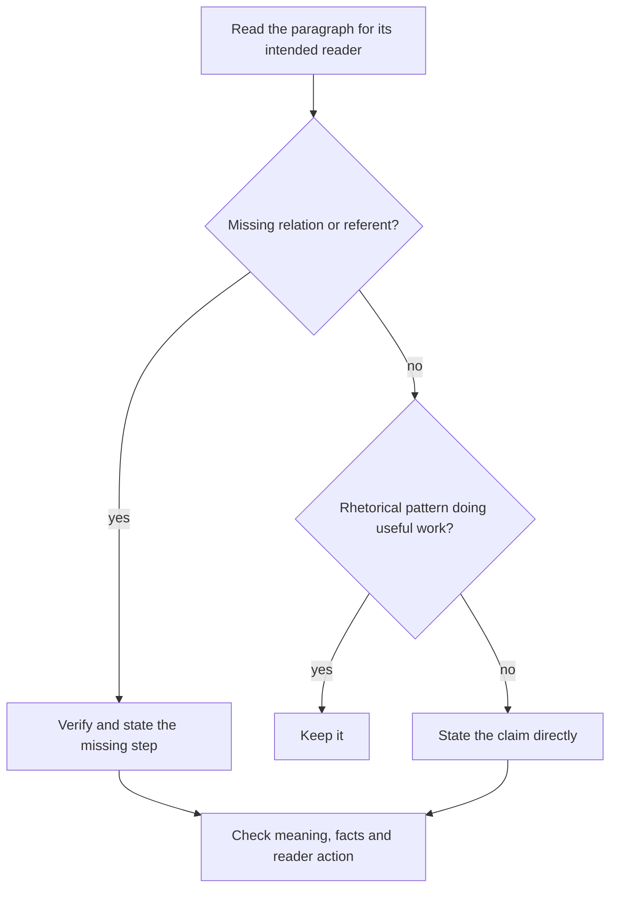

# Connected prose and public-copy cadence

Review sentence relationships before polishing rhythm. These editorial rubrics cover missing causes, consequences, comparisons and referents, along with repetitive rhetoric and compressed syntax. Read connected-prose-research.md for evidence boundaries and examples/before-after-connected-prose.md for repairs. Meaning-based findings require a reader; numerical cutoffs locate candidates only.

_14 items. Generated from catalog.json — edit there, then re-run `scripts/regenerate_references.py`. Do not hand-edit this file._

_Every item carries a **False positive when** line. Read it before you act on the item: these are cues for an editor, not evidence about an author._

<!-- humanize:ignore-start
     The diagram and index below quote the tells they document, and a
     mermaid label is not a sentence. -->

## When this file applies

## What is in this file

Severity reflects the consequence for the intended reader, never how sure you should be about who wrote it. **Automated** means these scripts implement the check; *no* means it is yours to ask in the judge pass.

| item | severity | family | automated |
| --- | --- | --- | --- |
| [`missing-causal-step`](#missing-causal-step) | HIGH | form | n/a |
| [`qualification-detached-from-promise`](#qualification-detached-from-promise) | HIGH | form | n/a |
| [`result-without-reference-value`](#result-without-reference-value) | HIGH | form | n/a |
| [`ambiguous-demonstrative`](#ambiguous-demonstrative) | med | form | n/a |
| [`aphoristic-closer-without-explanation`](#aphoristic-closer-without-explanation) | med | form | n/a |
| [`compressed-noun-phrase`](#compressed-noun-phrase) | med | form | n/a |
| [`emphasis-only-fragment`](#emphasis-only-fragment) | med | form | n/a |
| [`invented-compound-label`](#invented-compound-label) | med | form | n/a |
| [`metaphor-hides-mechanism`](#metaphor-hides-mechanism) | med | form | n/a |
| [`negation-contrast-frame`](#negation-contrast-frame) | med | form | n/a |
| [`ornamental-parallelism`](#ornamental-parallelism) | med | form | n/a |
| [`short-pair-hides-relation`](#short-pair-hides-relation) | med | form | n/a |
| [`suspense-frame-before-claim`](#suspense-frame-before-claim) | med | form | n/a |
| [`staccato-fragment-triplet`](#staccato-fragment-triplet) | low | rhythm | yes |

<!-- humanize:ignore-end -->

<!-- humanize:ignore-start
     Everything below is a specimen catalog. It quotes the tells it documents,
     including literal machine residue, so reviewing it with humanize_review.py
     would flag the exhibits rather than the writing. -->

### `missing-causal-step`  ·  high · generic-llm · prose · llm-judge · family: form · lane: connected-prose

A passage gives events or verdicts without the premise, mechanism or consequence needed to connect them.

**Detect:** Judge: For each inference the intended reader must make, is the necessary step stated or established? Do not equate the absence of a connective with a missing step, and do not infer causation from sequence.

**Fix:** State the missing premise, operation or consequence and use the connective that matches the verified relation. If the source establishes only sequence or correlation, say that or flag the causal claim as unresolved.

**False positive when:** Implicit relations are normal when easily recoverable. Reader expertise and established premises can make an extra sentence redundant. A connective cannot repair an unsupported causal claim.

**Evidence:** The Penn Discourse Treebank represents both explicit and implicit relations; its categories are not a list of writing faults.

**Before**

> The core never reads the revocation record. It issues both cards.

**After**

> Because the core never reads the revocation record, it accepts both offers and issues cards whose parent has already been revoked.

### `qualification-detached-from-promise`  ·  high · generic-llm · prose · llm-judge · family: form · lane: connected-prose

A promise omits or separates a material condition that changes what the reader can expect at the point of decision.

**Detect:** Judge: Does the claim beside the CTA agree with the destination and product behavior, including price, eligibility, timing and next actor? Has an estimate, example or test result become an unconditional guarantee?

**Fix:** Put the relevant verified condition next to the promise, name what happens after the action and who acts next, and retain uncertainty. If behavior is unknown, flag the claim rather than inventing a timeline.

**False positive when:** A condition may already be visible at the decision point, and concise navigation labels need not repeat every term. Preserve genuinely verified immediate outcomes.

**Evidence:** Editorial rubric for reader comprehension; no validated AI-prevalence estimate or numerical fault threshold.

**Before**

> Get an instant quote. [The button opens a request form; staff quote the following business day.]

**After**

> Request a quote. We’ll email it the next business day. [Use this timeline only if verified.]

### `result-without-reference-value`  ·  high · generic-llm · prose · llm-judge · family: form · lane: connected-prose

A result, change or verdict is hard to interpret because the relevant expectation, comparator, unit or intended outcome is missing.

**Detect:** Judge: Can the intended reader tell why the observed result succeeds or fails from this passage and its established context? For worked examples, compare actual and expected outcomes under the same conditions.

**Fix:** Name the comparison needed to interpret the result, using verified values or clearly hypothetical symbols. Do not invent a number, target or control condition to make prose sound specific.

**False positive when:** The expectation may already be established nearby, a reference entry may only need the value, and some observations have no meaningful target.

**Evidence:** Editorial rubric for reader comprehension; no validated AI-prevalence estimate or numerical fault threshold.

**Before**

> Both calls run, and the counter has moved by one.

**After**

> After two increments, the counter holds v+1 instead of the required v+2, so one increment has been lost.

### `ambiguous-demonstrative`  ·  medium · generic-llm · prose · llm-judge · family: form · lane: connected-prose

A bare this, that, it or they has competing plausible referents or compresses several different claims into one.

**Detect:** Judge: Can a new reader identify the referent without rereading or choosing between plausible antecedents? Check sentence openings but do not assume every bare demonstrative is ambiguous.

**Fix:** Add the relevant noun or restate the specific event. Keep a pronoun whose antecedent is clear; do not replace every pronoun with an awkward repeated name.

**False positive when:** A demonstrative can clearly refer to a proposition, a visible object or an immediately preceding event. Judge ambiguity in context.

**Evidence:** Editorial rubric for reader comprehension; no validated AI-prevalence estimate or numerical fault threshold.

**Before**

> The review ends before the write. This prevents it.

**After**

> An atomic check-and-write step prevents the lost update.

### `aphoristic-closer-without-explanation`  ·  medium · generic-llm · prose · llm-judge · family: form · lane: connected-prose

A paragraph ends on a maxim, slogan or compressed diagnosis that replaces a needed fact, reference event or consequence.

**Detect:** Judge: What does the closing line add, and does it name the event or mechanism on which its claim depends? A sentence of ten words or fewer is only a manual search cue; overlap of words cannot decide novelty.

**Fix:** End on the last useful fact or action. Expand a compressed diagnosis when its missing detail matters; delete an ornamental recap. Do not append a punchline after the explanation is complete.

**False positive when:** A concise recap can orient readers after a complex section, and slogans, attributed quotations and literary narration can intentionally use maxims. Judge the information the audience needs.

**Evidence:** Editorial rubric for reader comprehension; no validated AI-prevalence estimate or numerical fault threshold.

**Before**

> The lock was a promise. The epoch was the proof.

**After**

> The broker rejects epoch 104 because it has already accepted epoch 105 for the resource.

### `compressed-noun-phrase`  ·  medium · generic-llm · prose · llm-judge · family: form · lane: connected-prose

Stacked nouns, omitted relative words or distant subject–verb pairs save words while forcing the reader to unpack a relation.

**Detect:** Judge: Can the intended reader assign each noun its role on first reading and connect the subject to its main verb? Is a familiar technical term being used, or an improvised label?

**Fix:** Use a verb or an ordinary of, for or that phrase to expose the relation; put the subject near its verb. Preserve established technical terms and exact identifiers.

**False positive when:** Established terms, concise headings, specialist reference material and code identifiers may need noun compounds. Edit only when unpacking improves comprehension.

**Evidence:** Clark, Martin & Mahowald, arXiv:2610.29162v1 (2026), is a preprint measuring processing-related features, with model and domain differences; it does not validate this rubric as a detector.

**Before**

> Cross-session authority state reconciliation enables continuity.

**After**

> The service compares authority records across sessions so work can continue from the current record.

### `emphasis-only-fragment`  ·  medium · generic-llm · prose · llm-judge · family: form · lane: connected-prose

A prose explanation inserts a detached phrase for emphasis where the reader needs an actor, action or relation.

**Detect:** Judge: Does the fragment omit information the reader needs, or only replay a slogan? Identify the grammatical context before calling it a fragment; imperatives have an understood subject.

**Fix:** Restore the subject and finite verb when needed, or attach the phrase to the sentence whose condition or consequence it expresses. Delete emphasis-only additions.

**False positive when:** Headings, labels, buttons, captions, equations, dialogue, deliberate ellipsis and imperatives such as Now count have legitimate shortened forms.

**Evidence:** Editorial rubric for reader comprehension; no validated AI-prevalence estimate or numerical fault threshold.

**Before**

> The names differed. By luck alone.

**After**

> Different names happened to block this offer, but independently chosen names can also coincide, so the names cannot reliably prevent redirection.

### `invented-compound-label`  ·  medium · generic-llm · prose · llm-judge · family: form · lane: connected-prose

An improvised compound or branded abstraction replaces a familiar description and makes a simple action sound like a new concept.

**Detect:** Judge: Does this label name a stable concept that the reader needs to reuse, or must the reader decode it just to learn an ordinary action?

**Fix:** Use the familiar verb and object. Define a genuinely useful new term on first use. Do not create replacement jargon while removing another label.

**False positive when:** Established domain terminology, exact product names and a carefully defined concept reused later can justify a compact label.

**Evidence:** Editorial rubric for reader comprehension; no validated AI-prevalence estimate or numerical fault threshold.

**Before**

> Run a reader-intent alignment pass.

**After**

> Check whether the copy answers the reader’s question.

### `metaphor-hides-mechanism`  ·  medium · generic-llm · prose · llm-judge · family: form · lane: connected-prose

An image or analogy occupies the place where the reader needs a literal action, ordering, quantity or cause.

**Detect:** Judge: Can the reader explain the actual event from this passage, or does the figure leave the mechanism unspecified? Does the analogy state which properties carry over?

**Fix:** Supply the literal relation first. Keep an analogy only when its mapping helps this audience and its limits are clear. Temporal wording can be underspecified without being a metaphor.

**False positive when:** An explanatory metaphor with a clear mapping, or intentional literary writing, can aid understanding. Do not remove useful imagery solely because literal language also exists.

**Evidence:** Editorial rubric for reader comprehension; no validated AI-prevalence estimate or numerical fault threshold.

**Before**

> The stale write slips through the cracks.

**After**

> The server accepts the stale write because it never compares the write’s epoch with the current epoch.

### `negation-contrast-frame`  ·  medium · generic-llm · prose · llm-judge · family: form · lane: connected-prose

Antithesis or correction used as a stock reveal: not X but Y, X not Y, not only X but also Y, or a negated sentence followed by a short correction. Antithesis is the broader category; epanorthosis applies when a speaker revises a formulation.

**Why it reads AI:** It manufactures a reframe-reveal cadence that feels profound but frequently promises a revelation and delivers a synonym. Readers clock the formula because the X is rarely real.

**Detect:** Judge: does the contrast resolve a plausible reader misunderstanding or distinguish relevant cases? Does a two-sentence correction repeat a formula without explaining the actual mechanism? Review paragraph endings as well as sentence-internal frames.

**Fix:** State the positive claim directly. Keep a relevant correction when the reader needs the distinction, and explain the consequence. Do not invent a mistaken belief or add a not-X frame during revision.

**False positive when:** Necessary negations, mathematical distinctions, real product comparisons and corrections of plausible misconceptions can require contrast. Preserve the distinction when deleting it would change or obscure the claim.

**Evidence:** Boggia, arXiv:2607.21498v2, is a preliminary one-family study with register-dependent results; it does not establish universal overuse. Our direct-claim default is an editorial preference.

**Before**

> Neither review was wrong. Each came too early.

**After**

> Both reviews used the initial counter value. Each review finished before the other worker wrote, so neither could account for that write.

### `ornamental-parallelism`  ·  medium · generic-llm · prose · llm-judge · family: form · lane: connected-prose

Repeated openings (anaphora) or balanced clauses (isocolon) create symmetry without a useful comparison.

**Detect:** Judge: Does each repeated clause supply a distinct fact, or are terms being swapped to fill a rhetorical pattern? Does symmetry hide differences in evidence, importance or consequences?

**Fix:** Keep genuinely parallel cases and make their differences explicit. Remove redundant clauses; use a table or list when comparison helps the reader.

**False positive when:** Proof cases, instructions, accessible repeated labels and comparison lists often benefit from consistent syntax. Two short sentences are not automatically anaphora or isocolon.

**Evidence:** Editorial rubric for reader comprehension; no validated AI-prevalence estimate or numerical fault threshold.

**Before**

> Built for clarity. Built for confidence. Built for what comes next.

**After**

> The dashboard shows who changed each setting and when.

### `short-pair-hides-relation`  ·  medium · generic-llm · prose · llm-judge · family: form · lane: connected-prose

Short-sentence parataxis leaves a needed relation implicit. Asyndeton describes omitted conjunctions; short adjacency by itself does not prove a missing relation.

**Detect:** Judge: For adjacent short sentences, can the intended reader identify why B follows A? Inspect closing pairs even inside a long chapter. Seven words per sentence is an optional manual search cue, never a fault threshold.

**Fix:** Combine the steps or state the necessary relation. Preserve independent facts and avoid inserting because unless the source supports causation.

**False positive when:** Independent observations, clear event sequences, dialogue and complete procedural steps can be adjacent without an explicit connective.

**Evidence:** Editorial rubric for reader comprehension; no validated AI-prevalence estimate or numerical fault threshold.

**Before**

> Both read v. Each proposes to write v+1.

**After**

> Both workers read v, so each proposes to write v+1.

### `suspense-frame-before-claim`  ·  medium · generic-llm · prose · llm-judge · family: form · lane: connected-prose

An empty setup, teaser colon or pseudo-cleft delays a claim the reader could understand directly.

**Detect:** Judge: Does the material before the colon or the what-X-does-is frame supply necessary context, or only announce a revelation? Is the same setup recurring?

**Fix:** Lead with the claim or condition. Keep colons that introduce useful examples, lists, definitions or explanations. Keep a pseudo-cleft when its focus resolves a real contrast.

**False positive when:** Colons and pseudo-clefts can make scope, contrast and emphasis clearer. Neither punctuation nor grammatical form alone establishes empty suspense.

**Evidence:** Editorial rubric for reader comprehension; no validated AI-prevalence estimate or numerical fault threshold.

**Before**

> The reason is simple: the cache stores repeated results.

**After**

> The cache stores repeated results.

### `staccato-fragment-triplet`  ·  low · generic-llm · prose · structural · family: rhythm · lane: connected-prose

**Automated here:** yes, these scripts implement it.

Three or more adjacent period-terminated sentences of four words or fewer within one prose paragraph. This locates chopped cadence; it does not establish that the sentences are fragments.

**Why it reads AI:** Repeated chopping can substitute emphasis for explanation. The three-sentence and four-word limits are local editorial candidate thresholds, not research-calibrated evidence of authorship.

**Detect:** Structural: report each maximal local run at its first source line, excluding headings, lists, quoted examples, code, common TeX non-prose environments, proof labels and proof-end symbols. HTML runs require a rendered or DOM-aware review. The small source scanner is not a TeX engine or grammatical parser.

**Thresholds** (read by `scripts/humanize_review.py`): `min_run` = 3, `max_words` = 4

**Fix:** Check whether the run states useful steps. Join dependent clauses with the words that express their actual relation and delete emphasis-only fragments. Never impose a fragment allowance or a length quota.

**False positive when:** Complete procedural steps, intentional literary cadence, dialogue, parallel conditions and terse product copy can use short sentences well. Keep them when the relationship is clear; the automated finding stays low severity.

**Before**

> Both workers read v. Each writes v+1. Both writes finish.

**After**

> Both workers read v, so each writes v+1. After both writes finish, the counter holds v+1 even though two increments should leave v+2.

<!-- humanize:ignore-end -->
