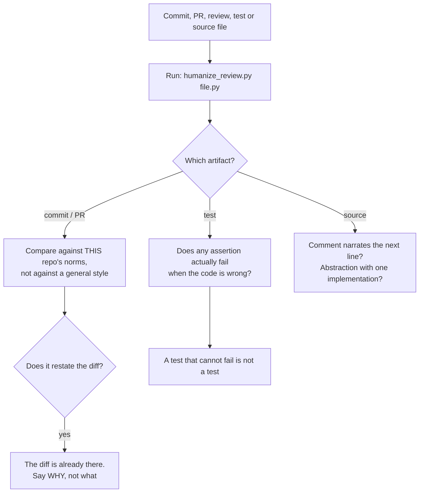

# Engineering-artifact tells — commits, PRs, reviews, code, tests, docs

What generated engineering work looks like in the artifacts maintainers actually read. The highest-precision checks in this file are all RELATIVE — drift from the repo's own log, idiom, or PR norm — because those need no word list, do not age as models change, and a contributor who read the surrounding code passes them automatically.

_27 items. Generated from catalog.json — edit there, then re-run `scripts/regenerate_references.py`. Do not hand-edit this file._

_Every item carries a **False positive when** line. Read it before you act on the item: these are cues for an editor, not evidence about an author._

<!-- humanize:ignore-start
     The diagram and index below quote the tells they document, and a
     mermaid label is not a sentence. -->

## When this file applies

## What is in this file

Severity reflects the consequence for the intended reader, never how sure you should be about who wrote it. **Automated** means these scripts implement the check; *no* means it is yours to ask in the judge pass.

| item | severity | family | automated |
| --- | --- | --- | --- |
| [`comment-narrates-next-line`](#comment-narrates-next-line) | HIGH | code | yes |
| [`commit-body-restates-diff`](#commit-body-restates-diff) | HIGH | code | **no** |
| [`confident-wrong-security-finding`](#confident-wrong-security-finding) | HIGH | code | n/a |
| [`convention-drift-in-commit-style`](#convention-drift-in-commit-style) | HIGH | code | **no** |
| [`dead-internal-cross-reference`](#dead-internal-cross-reference) | HIGH | residue | **no** |
| [`fabricated-doc-claims`](#fabricated-doc-claims) | HIGH | code | n/a |
| [`hallucinated-import-or-api`](#hallucinated-import-or-api) | HIGH | residue | **no** |
| [`hollow-assertion`](#hollow-assertion) | HIGH | code | **no** |
| [`how-it-works-that-says-what`](#how-it-works-that-says-what) | HIGH | form | n/a |
| [`idiom-drift-within-file`](#idiom-drift-within-file) | HIGH | code | **no** |
| [`mock-assertion-test`](#mock-assertion-test) | HIGH | code | **no** |
| [`placeholder-stub-residue`](#placeholder-stub-residue) | HIGH | code | yes |
| [`pr-scaffold-without-template`](#pr-scaffold-without-template) | HIGH | code | **no** |
| [`review-restates-the-diff`](#review-restates-the-diff) | HIGH | code | n/a |
| [`swallow-exception-pass`](#swallow-exception-pass) | HIGH | code | yes |
| [`unverified-test-plan`](#unverified-test-plan) | HIGH | code | n/a |
| [`agent-attribution-trailer`](#agent-attribution-trailer) | med | residue | **no** |
| [`commit-subject-scale-adjective`](#commit-subject-scale-adjective) | med | code | **no** |
| [`docstring-restates-signature`](#docstring-restates-signature) | med | code | yes |
| [`stale-training-api`](#stale-training-api) | med | code | n/a |
| [`trailing-example-usage-block`](#trailing-example-usage-block) | med | code | **no** |
| [`try-catch-just-in-case`](#try-catch-just-in-case) | med | code | **no** |
| [`unwired-badge-row`](#unwired-badge-row) | med | code | **no** |
| [`verbosity-disproportionate-to-diff`](#verbosity-disproportionate-to-diff) | med | code | **no** |
| [`decorative-section-divider`](#decorative-section-divider) | low | code | yes |
| [`emoji-in-code`](#emoji-in-code) | low | code | yes |
| [`single-impl-abstraction`](#single-impl-abstraction) | low | code | **no** |

<!-- humanize:ignore-end -->

<!-- humanize:ignore-start
     Everything below is a specimen catalog. It quotes the tells it documents,
     including literal machine residue, so reviewing it with humanize_review.py
     would flag the exhibits rather than the writing. -->

### `comment-narrates-next-line`  ·  high · codex · code-comments · structural · family: code

**Automated here:** yes, these scripts implement it.

Inline comments that restate exactly what the following statement does in English: `// increment counter`, `# loop through items`, `// return the result`. The comment adds zero information beyond reading the line.

**Why it reads AI:** Codex/Copilot learned the comment-then-code pattern from tutorials and emits narration by default. Experienced devs comment the why, not the what.

**Detect:** structural: for each comment line, compare its tokens to the immediately following code line; flag when the comment is a verb-phrase paraphrase of the next statement. A high ratio of such comments per file is the signal.

**Thresholds** (read by `scripts/humanize_review.py`): `min_count` = 2, `overlap` = 0.6

**Fix:** Delete comments that paraphrase the code. Keep comments for non-obvious rationale, edge cases, units, or ticket links. Often a clearer name is the better fix.

**False positive when:** Teaching code, tutorial repositories and beginner-facing examples narrate deliberately and correctly. Check what the file is for.

**Before**

> // increment the retry counter
> retries += 1
> // check if we hit the max
> if retries > MAX: ...

**After**

> retries += 1
> if retries > MAX:  # give up; upstream 503s have been seen to last ~30s

### `commit-body-restates-diff`  ·  high · generic-llm · commit-message · structural · family: code

**Automated here:** no — decidable mechanically, but this bundle does not implement it. Ask it yourself in the judge pass.

A commit body enumerating, file by file, what the diff already shows, instead of explaining why the change exists.

**Why it reads AI:** The model has the diff in context and nothing else, so restating it is the only content it can safely produce. Humans write commit bodies precisely for the information that is NOT in the diff.

**Detect:** Compare the body's content lines against the changed file and symbol names from git show --stat. High one-to-one overlap plus no causal connective (because, so that, was breaking) is the flag. Also flag bodies whose bullets are '- **<filename>**: <restated change>'.

**Fix:** Delete the enumeration. Keep one paragraph: the problem, why this approach, what you rejected. If the body only restates the diff, use a one-line subject and no body.

**False positive when:** A long body is correct on a large or subtle change. The tell is restatement, not length.

**Evidence:** grain anti-slop linter rules VAGUE_COMMIT / NO_CONTEXT; astronomer-cosmos AGENTS.md ('explain what and why, not how').

**Before**

> This commit introduces a comprehensive authentication system.
> - **auth/login.py**: Added the login() function
> - **auth/models.py**: Added the User model

**After**

> Add password login
>
> Sessions were cookie-only, so the mobile client had no way in. Issues a 24h JWT; refresh comes in a follow-up.

### `confident-wrong-security-finding`  ·  high · generic-llm · code-review · llm-judge · family: code

A security or correctness finding, stated with full confidence and correct-sounding vocabulary, that is wrong about this codebase.

**Why it reads AI:** Security vocabulary is highly patterned, so it generates fluently without any of the reasoning that would make it true. This has been costly enough that curl's maintainer publicly documented the burden of AI bug-bounty slop.

**Detect:** Judge: does the finding cite a specific line, a specific reachable input, and a specific consequence? Generated findings name a vulnerability CLASS and assert it applies.

**Fix:** Require a proof of reachability before filing: the input, the path, the observed effect. If you cannot produce one, do not file it.

**False positive when:** Real findings also sound confident. Judge the presence of a reachability proof, not the tone.

**Evidence:** Daniel Stenberg's public accounts of AI-generated curl bug-bounty reports.

**Before**

> This code is vulnerable to SQL injection via string concatenation.  (the line uses a parameterized query)

**After**

> (not filed — the query is parameterized at db/users.py:42)

### `convention-drift-in-commit-style`  ·  high · generic-llm · commit-message · structural · family: code

**Automated here:** no — decidable mechanically, but this bundle does not implement it. Ask it yourself in the judge pass.

Conventional Commits appearing in a repo whose history does not use them — or a bare sentence subject in a repo that enforces them. The mismatch is the tell, never the format.

**Why it reads AI:** Conventional Commits dominate training data, so it is the model's default whatever the repo does. A human reads git log before their first commit; a model does not unless told.

**Detect:** Share of the last 200 subjects matching the conventional-commit prefix. If that share is under 15% and the new commit matches, flag; if over 85% and it does not, flag. Same test for capitalization, trailing period, and imperative-versus-past mood.

**Thresholds** (read by `scripts/humanize_review.py`): `history` = 200, `low_share` = 0.15, `high_share` = 0.85

**Fix:** Run git log --oneline -30 and match the house format exactly, including case and mood.

**False positive when:** Conventional Commits in a repo that uses Conventional Commits is correct and often hook-enforced. Only drift from the repo's own log is a tell — which is exactly why this check is near-zero false positive.

**Evidence:** astronomer-cosmos AGENTS.md forbids the prefixes; flclash enforces them via commit-msg hook. Both are right for their repo.

**Before**

> (in a repo whose log is all 'Fix crash when profile is missing') feat(profiles): add per-profile override script support

**After**

> Add per-profile override scripts

### `dead-internal-cross-reference`  ·  high · generic-llm · docs · structural · family: residue

**Automated here:** no — decidable mechanically, but this bundle does not implement it. Ask it yourself in the judge pass.

'See the section on X' where there is no section on X; a link to an anchor that does not exist; a reference to a page that was never written.

**Why it reads AI:** The model refers to the document it would have written. Nothing in the loop resolves the reference against the document that exists.

**Detect:** Pure name and link resolution: every internal anchor, every 'see the X section', every relative link. Zero judgment required, and it belongs in CI.

**Thresholds** (read by `scripts/humanize_review.py`): `min_count` = 1

**Fix:** Resolve every internal reference mechanically and fix or delete each miss. This is the highest yield-per-effort check in the whole exposition family because it needs no taste at all.

**False positive when:** Documents generated into a larger site where anchors resolve at build time rather than in source. Resolve against the built output in that case.

**Before**

> See the configuration section below for details. [there is no configuration section]

**After**

> [section written, or the sentence deleted]

### `fabricated-doc-claims`  ·  high · generic-llm · docs · llm-judge · family: code

Documentation describing an architecture the code does not have, platforms nobody tested, or features that are restatements of function names.

**Why it reads AI:** The model documents the system it would have built. Nothing in the generation loop checks the doc against the repo.

**Detect:** Judge each claim against the code. Feature bullets that are function names with spaces inserted are the reliable structural signal.

**Fix:** Delete every claim you have not personally verified. A short true README beats a long aspirational one.

**False positive when:** Roadmap sections clearly marked as planned. The tell is aspiration presented in the present tense.

**Evidence:** Widely reported in maintainer AI-contribution policies.

**Before**

> ## Features
> - Robust caching layer
> - Seamless cross-platform support (Windows, macOS, Linux, BSD)

**After**

> ## Features
> - In-memory cache with a 60s TTL
> - Tested on macOS 15 and Ubuntu 24.04. Windows is untested.

### `hallucinated-import-or-api`  ·  high · codex · code · structural · family: residue

**Automated here:** no — decidable mechanically, but this bundle does not implement it. Ask it yourself in the judge pass.

Calls to functions, flags, endpoints or packages that do not exist — including imports of packages never published, which is the attack surface behind slopsquatting.

**Why it reads AI:** The model generates the API it expects to exist. Plausible names are exactly what it is good at.

**Detect:** Resolve every import against the lockfile and every called symbol against the installed package. Fully mechanical.

**Fix:** Run the resolver. Then check the package actually exists on the registry and is the one you meant — a hallucinated import name is a supply-chain hazard, not just a bug.

**False positive when:** Optional dependencies behind a try/except ImportError, and symbols added in a newer version than the lockfile pins.

**Evidence:** aicodeaudit ACA4xx rule class; published slopsquatting research.

**Before**

> from requests.utils import parse_retry_after

**After**

> from urllib3.util.retry import Retry

### `hollow-assertion`  ·  high · codex · code · structural · family: code

**Automated here:** no — decidable mechanically, but this bundle does not implement it. Ask it yourself in the judge pass.

Assertions that cannot fail: assert True, assert result == result, assert x is not None as the only check, tests with no assertion at all.

**Why it reads AI:** Test-shaped output. The file satisfies a coverage target and proves nothing.

**Detect:** Mechanical pattern match on the assertion expression.

**Fix:** Assert the value you expect. If you do not know what to expect, you do not yet know what the function is for.

**False positive when:** A smoke test whose only job is 'this import does not explode' is legitimate, if it says so.

**Evidence:** slop_scan P-class hollow-assertion rules.

**Before**

> result = parse(payload)
> assert result is not None

**After**

> assert parse(payload).currency == 'EUR'

### `how-it-works-that-says-what`  ·  high · generic-llm · docs · llm-judge · family: form

A 'How it works' section that describes what the system does rather than how or why, restating the feature list in longer sentences.

**Why it reads AI:** Template completion. The heading is a slot and the model fills it from what it has, which is the feature list. Mechanism requires knowing the implementation; capability can be inferred from the name.

**Detect:** Judge, or compute: the ratio of sentences stating a mechanism or a reason to sentences restating a capability. This is the single most-quoted complaint in the reader corpus.

**Fix:** Every sentence under that heading should answer how or why. If a sentence would survive unchanged under the heading 'Features', it belongs there instead or nowhere. Name the data path, the decision, the trade-off you took.

**False positive when:** Marketing pages where the section is deliberately non-technical, and products whose mechanism is genuinely proprietary — though in that case say so rather than filling the space.

**Before**

> ## How it works
>
> Flowstate automatically syncs your data and keeps everything up to date in real time.

**After**

> ## How it works
>
> We hold a logical replication slot on your primary and stream the WAL. That means we see a row change about 200ms after your database does, and it also means we cannot see anything that never hits the WAL, like a truncate.

### `idiom-drift-within-file`  ·  high · generic-llm · code · structural · family: code

**Automated here:** no — decidable mechanically, but this bundle does not implement it. Ask it yourself in the judge pass.

A block of code whose idiom does not match the file around it: different naming convention, different error handling, different import style, different comment density.

**Why it reads AI:** The model writes its own idiom rather than the file's, because it optimizes the snippet rather than the codebase. A human who reads the surrounding code passes this automatically.

**Detect:** Compare the changed hunk's conventions against the rest of the file: naming case, quote style, type-annotation coverage, comment density, error-handling shape. Purely relative.

**Fix:** Read fifty lines above and below, then rewrite the hunk in that idiom.

**False positive when:** Deliberate modernization is real, and a file mid-migration is legitimately mixed. Check whether the drift is toward a documented target.

**Evidence:** One of the three highest-precision relative checks in the engineering survey; kubb's deslop skill frames the whole class as making the diff 'match the surrounding file and this repo's conventions'.

**Before**

> A snake_case file gaining a camelCase helper with full type hints and a docstring, where nothing else is annotated.

**After**

> The same helper, snake_case, unannotated, matching its neighbours.

### `mock-assertion-test`  ·  high · codex · code · structural · family: code

**Automated here:** no — decidable mechanically, but this bundle does not implement it. Ask it yourself in the judge pass.

Tests that assert a mock was called rather than that behavior happened.

**Why it reads AI:** The model can see the implementation and mirrors it. The test then passes for any refactor that keeps the call and breaks the behavior — which is the exact inverse of what a test is for.

**Detect:** Count assertions that are assert_called / toHaveBeenCalled against assertions on returned values or observable state.

**Fix:** Assert the outcome. If the outcome is unobservable, the seam is in the wrong place.

**False positive when:** Verifying an interaction with a genuine external boundary (an email really was queued, a webhook really fired) is legitimate mock assertion.

**Evidence:** slop_scan and grain test-quality rules.

**Before**

> assert mock_send.assert_called_once_with(user.email)

**After**

> assert outbox[0].to == 'sam@example.com'

### `placeholder-stub-residue`  ·  high · codex · code-comments · structural · family: code

**Automated here:** yes, these scripts implement it.

Generated scaffolding left in place: placeholder identifiers (foo, bar, MyComponent, doSomething, example_function), `# TODO: implement` / `throw new Error('Not implemented')` bodies, and dummy return values never filled in.

**Why it reads AI:** These are literal artifacts of the model emitting a template it expected a human to finish. Placeholder names and unfilled stubs in committed code signal nobody wrote the logic.

**Detect:** structural: scan code for the placeholder identifier set, bodies consisting only of TODO/FIXME/NotImplemented/pass, and 'TODO: implement'. Flag if any ship in non-scaffold files. (Operates on code identifiers, not free-text prose.)

**Thresholds** (read by `scripts/humanize_review.py`): `min_count` = 2

**Fix:** Name things after their real domain role; implement the body or delete the stub. If genuinely deferring, write a TODO with an owner, ticket link, and what's missing.

**False positive when:** Template repositories, scaffolding generators and example configs contain placeholders on purpose.

**Before**

> function MyComponent() {
>   // TODO: implement
>   return null;
> }

**After**

> function InvoiceRow({ invoice }) {
>   return <tr><td>{invoice.number}</td><td>{formatCents(invoice.totalCents)}</td></tr>;
> }

### `pr-scaffold-without-template`  ·  high · generic-llm · pr-description · structural · family: code

**Automated here:** no — decidable mechanically, but this bundle does not implement it. Ask it yourself in the judge pass.

The Summary / Changes / Test Plan scaffold appearing in a repo with no pull-request template asking for it, often where the repo's other PRs are two sentences.

**Why it reads AI:** It is the default scaffold baked into agent PR-authoring prompts. It reads as ceremony imported from another repo, which is what it is.

**Detect:** Check for .github/pull_request_template.md. If absent, flag bodies carrying two or more of the canonical headings. Second signal: heading count against the median of the repo's last 20 merged PRs.

**Fix:** Read three recently merged PRs and match them. Most repos want what changed, why, and how you know it works — as prose.

**False positive when:** A repo WITH that template, obviously — and long descriptions on genuinely large changes. The check is against the repo's own norm.

**Evidence:** Aurelia's AI stance: 'Tell us what changed and how you know it works.' llama.cpp rejects fully-generated PR descriptions outright.

**Before**

> ## Summary / ## Changes (7 bullets) / ## Test plan / ## Related, in a repo whose merged PRs average 30 words.

**After**

> Sessions expired at 24h regardless of remember_me. Reads the flag now and sets 30d. Verified by logging in with the box ticked and checking the cookie's Max-Age.

### `review-restates-the-diff`  ·  high · generic-llm · code-review · llm-judge · family: code

A review comment that describes back what the diff does, or praises it, without taking a position on whether it is right.

**Why it reads AI:** The model has the diff and no stake. Restating is the only safe output. 'LGTM! Great work!' on a 600-line change is the pure form.

**Detect:** Judge: does this comment contain a claim the author could disagree with? If not, it is not review.

**Fix:** Delete it. A review comment should name a risk, a question, or a required change.

**False positive when:** A short genuine approval after a real read is fine, and some teams require an explicit LGTM to unblock the queue. The tell is approval plus summary plus nothing else.

**Evidence:** Maintainer commentary across HN threads on AI review bots; grain THANKS_OPENER rule.

**Before**

> LGTM! Great work on this refactor — the new structure is much cleaner.

**After**

> This drops the retry on 429. Was that deliberate? The upstream rate-limits us at 50rps.

### `swallow-exception-pass`  ·  high · codex · code-comments · structural · family: code

**Automated here:** yes, these scripts implement it.

Error handling that catches broadly and discards: `try: ... except Exception: pass`, or catches only to print and continue with no rethrow, no context. Often paired with an over-apologetic comment.

**Why it reads AI:** Models produce defensively-shaped but functionally hollow error handling to make the snippet run. Swallowing every exception silently is flagged immediately by senior reviewers.

**Detect:** structural: AST/regex scan for bare or broad except whose body is only `pass`, a log/print, or `return None`; and JS `catch(e){ console.log(...) }` with no rethrow. Count per file.

**Thresholds** (read by `scripts/humanize_review.py`): `min_count` = 1

**Fix:** Catch the specific exception you can handle; let the rest propagate. Log with context and rethrow, or convert to a domain error. Never `except Exception: pass`.

**False positive when:** A deliberately ignored exception with a comment saying why (a best-effort cleanup, an optional import probe) is correct. The tell is the bare, unexplained one.

**Before**

> try:
>     data = fetch(url)
> except Exception as e:
>     print('Error:', e)  # something went wrong

**After**

> try:
>     data = fetch(url)
> except requests.Timeout:
>     raise UpstreamUnavailable(url) from None  # caller retries with backoff

### `unverified-test-plan`  ·  high · generic-llm · pr-description · llm-judge · family: code

A Test Plan of ticked checkboxes where nothing was run, or where the 'tests' restate the change rather than record an execution.

**Why it reads AI:** The model cannot run anything, so it writes the SHAPE of verification. A ticked box is an affirmative claim a maintainer will act on, which is why this is the tell that actually burns trust.

**Detect:** Structural pre-filter: ticked boxes under a Test heading with no CI run, no pasted command output, no attached artifact. Then judge: does each ticked line name a command, an environment, and an observed result?

**Fix:** Only tick what you ran. Paste the command and its output. If you could not run it, say so explicitly — that direction of honesty is itself strong evidence a person wrote it.

**False positive when:** A thorough test plan naming real commands, versions and what could NOT be verified is the opposite of a tell. Never flag a plan for being long.

**Evidence:** Maintainer complaints across llama.cpp, curl and RPCS3 threads; the honest counter-example is codex-authored PR phodal/routa#158.

**Before**

> - [x] All 25 existing tests pass
> - [x] Backward compatibility maintained

**After**

> Ran `pytest tests/auth -q`: 25 passed in 3.1s. Did NOT run the e2e suite — no Docker in this environment.

### `agent-attribution-trailer`  ·  medium · generic-llm · commit-message · structural · family: residue

**Automated here:** no — decidable mechanically, but this bundle does not implement it. Ask it yourself in the judge pass.

Agent signature footers left in commits and PR bodies: 'Generated with <tool>', 'Co-Authored-By: <agent>', 'Assisted-by:', 'Codex Task'.

**Why it reads AI:** It is a literal signature. It also injects a non-person into git shortlog and the repository's contributor graph.

**Detect:** Literal-string grep. Zero false positives on detection — but this is a POLICY question, not a quality one, so detect and ask rather than strip.

**Thresholds** (read by `scripts/humanize_review.py`): `min_count` = 1

**Fix:** Check the repo first: grep -ri 'co-authored-by|generated with|assisted-by' AGENTS.md CLAUDE.md CONTRIBUTING.md .github/. Strip if unmentioned or banned; keep if mandated. Removing an honest disclosure line can violate a project's policy — roughly forty projects in the public contribution-policy survey REQUIRE disclosure.

**False positive when:** Repos that mandate the trailer. This entry exists to make you look it up, not to make you delete it.

**Evidence:** matecat CLAUDE.md bans all AI references; libusb/hidapi AGENTS.md mandates an Assisted-by line; astronomer-cosmos wants visible credit. The correct behavior is repo-dependent.

**Before**

> Co-Authored-By: <agent> <noreply@example.com>

**After**

> (removed, or replaced with the repo's mandated form, e.g. Assisted-by: <tool>:<model>)

### `commit-subject-scale-adjective`  ·  medium · generic-llm · commit-message · structural · family: code

**Automated here:** no — decidable mechanically, but this bundle does not implement it. Ask it yourself in the judge pass.

A commit subject reaching for scale words the diff does not earn: comprehensive, robust, enhanced, complete, production-ready, streamlined, optimal.

**Why it reads AI:** Models self-grade inside the artifact. 'Comprehensive' is a confidence assertion rather than a description, and it appears at a rate no human log matches.

**Detect:** Closed scale-adjective set matched against git log --format=%s, joined with diff size. One of these words on a diff under ~50 lines is near-certain. Subjects over 72 characters are a second signal.

**Thresholds** (read by `scripts/humanize_review.py`): `max_diff_lines` = 50

**Fix:** Cut every adjective. Verb, object, imperative, under 50 characters.

**False positive when:** A genuinely comprehensive change can say so. Check the diff size before believing the adjective — that join is the whole detector.

**Evidence:** grain VAGUE_COMMIT; NetExec AI policy on generated verbosity.

**Before**

> feat(retry): implement comprehensive and robust retry mechanism for enhanced reliability

**After**

> Retry failed uploads with backoff

### `docstring-restates-signature`  ·  medium · codex · code-comments · llm-judge · family: code

Docstrings that re-enumerate the signature with no added meaning: 'This function takes a and b and returns the result.' Args/Returns sections that just retype parameter names and types already visible in the declaration.

**Why it reads AI:** The model fills the docstring slot because the template demands one, paraphrasing the signature rather than documenting behavior. Humans omit a docstring before writing a contentless one.

**Detect:** llm-judge: 'Does the docstring only paraphrase the signature, omitting units, valid ranges, failure modes, side effects, or examples?'

**Thresholds** (read by `scripts/humanize_review.py`): `min_count` = 1

**Fix:** Document what the signature can't say: units, ranges, what raises, side effects, an example. If there's nothing beyond the signature, delete the docstring.

**False positive when:** Codebases with a documented-everything policy and doc-generation tooling require a docstring on every public symbol, and a thin one is better than none.

**Before**

> def divide(a: float, b: float) -> float:
>     """Divide a by b and return the result.
>     Args: a: the first number; b: the second number
>     Returns: the result"""

**After**

> def divide(a: float, b: float) -> float:
>     """Raises ZeroDivisionError when b == 0; callers must guard. Result is not rounded."""

### `stale-training-api`  ·  medium · codex · code · llm-judge · family: code

Code written against an API version that was current in the training data and has since changed — deprecated call signatures, removed flags, superseded client libraries.

**Why it reads AI:** The model's knowledge has a date. It writes the most-represented version, which is the most-documented one, which is rarely the newest.

**Detect:** Judge against the installed version's changelog. Deprecation warnings at runtime are the cheapest structural signal.

**Fix:** Check the installed version's docs, not the first search result. Pin the version in the file's header comment if the API is volatile.

**False positive when:** Deliberately pinned old versions, and compatibility shims that support both.

**Evidence:** aicodeaudit ACA3xx stale-training-data API rule class.

**Before**

> openai.ChatCompletion.create(...)

**After**

> client.chat.completions.create(...)

### `trailing-example-usage-block`  ·  medium · codex · code-comments · structural · family: code

**Automated here:** no — decidable mechanically, but this bundle does not implement it. Ask it yourself in the judge pass.

A library module ends with a tacked-on demonstration: an `if __name__ == '__main__':` block or a `// Example usage:` comment with sample calls that print a canned result, added reflexively even when the module is imported elsewhere.

**Why it reads AI:** Codex appends a runnable demo because training examples (tutorials, gists) ended that way. In a real codebase the example belongs in tests or docs.

**Detect:** structural: flag a trailing `if __name__ == '__main__'` or example-usage block in a file that is clearly a library module (exports symbols, imported by others), especially when it just prints or calls functions with literal args.

**Fix:** Move example usage into the test suite or README. A library module should expose its API and stop. Keep `__main__` only for genuine CLI entry points.

**False positive when:** `if __name__ == '__main__':` is idiomatic Python for a module that is also runnable, and is correct for CLI entry points, teaching code, and smoke tests. Flag it on a library module imported elsewhere, where the block only prints a canned result.

**Before**

> # ... module code ...
> # Example usage:
> if __name__ == '__main__':
>     print(add(2, 3))  # 5

**After**

> # (module ends after its definitions; an example lives in tests/test_add.py)

### `try-catch-just-in-case`  ·  medium · codex · code · structural · family: code

**Automated here:** no — decidable mechanically, but this bundle does not implement it. Ask it yourself in the judge pass.

Defensive exception handling wrapped around code that cannot meaningfully fail, or that should fail loudly.

**Why it reads AI:** The model cannot run the code, so it hedges. The result converts a crash you could debug into a silence you cannot.

**Detect:** Count broad handlers (except Exception, catch (e)) per file; three or more in one file is the documented working threshold. Join with whether the wrapped call touches a real boundary.

**Thresholds** (read by `scripts/humanize_review.py`): `per_file` = 3

**Fix:** Validate at boundaries, trust types internally. Handle the exception you can actually name.

**False positive when:** Network, IPC, subprocess, file I/O and user-input parsing all need handling. The rule is 'no try/catch just in case', not 'no try/catch'.

**Evidence:** slop_scan P1 threshold (>=3 except Exception per file); Paseo's contributor rules.

**Before**

> try:
>     total = a + b
> except Exception:
>     total = 0

**After**

> total = a + b

### `unwired-badge-row`  ·  medium · generic-llm · docs · structural · family: code

**Automated here:** no — decidable mechanically, but this bundle does not implement it. Ask it yourself in the judge pass.

A README badge row advertising CI, coverage, npm version or a license that is not wired up, points at a different repo, or renders broken.

**Why it reads AI:** Badges are the most-represented README ornament in training data, so they generate whether or not the services exist.

**Detect:** Resolve each badge URL and each link target. Mechanical.

**Fix:** Delete any badge whose service you have not configured. A broken badge is worse than no badge.

**False positive when:** Badges for services that are configured but temporarily failing. Check the target, not the color.

**Before**

> 

**After**

> (removed until CI exists)

### `verbosity-disproportionate-to-diff`  ·  medium · generic-llm · pr-description · structural · family: code

**Automated here:** no — decidable mechanically, but this bundle does not implement it. Ask it yourself in the judge pass.

A PR description whose length bears no relation to the size or subtlety of the change.

**Why it reads AI:** Generated prose has no cost function for length, so it defaults to thorough. Human effort tracks stakes.

**Detect:** Ratio of description words to changed lines, against the repo's own median. A ratio, never a length cap.

**Fix:** Cut to what a reviewer needs in order to start reading the diff.

**False positive when:** 900 words on a 4,000-line migration is proportionate. This is a ratio check and breaks immediately if used as a word limit.

**Evidence:** Identified in the engineering-lane survey as one of three highest-precision relative checks.

**Before**

> 900 words on a 4-line config change.

**After**

> Bumps the pool size from 5 to 20. We were queueing at 12 concurrent requests.

### `decorative-section-divider`  ·  low · codex · code-comments · structural · family: code

**Automated here:** yes, these scripts implement it.

ASCII-art banner comments partitioning a source file into labelled sections.

**Why it reads AI:** The generated outline made visible. The model organizes a file the way it organizes a document, with signposting rather than structure.

**Detect:** Count comment lines made of runs of =, *, ~ or - , with or without a centered label.

**Thresholds** (read by `scripts/humanize_review.py`): `min_count` = 2

**Fix:** Check the surrounding files first. If they have no banners, delete these; if a file needs sectioning this badly, it needs splitting.

**False positive when:** Many long-standing C and Python codebases use banner comments as house style. This is only a tell as drift from the repo's own convention, which is why it is low severity.

**Evidence:** Rule OBVIOUS_HEADER in the grain anti-slop linter; corroborated by maintainer style guides.

**Before**

> # ============ HELPER FUNCTIONS ============

**After**

> (no banner; the helpers live in their own module)

### `emoji-in-code`  ·  low · codex · code-comments · structural · family: code

**Automated here:** yes, these scripts implement it.

Emoji in source files — log strings, comments, commit-adjacent scaffolding.

**Why it reads AI:** Generated code decorates its own output. A human adds an emoji to a log line when the team already does; a generator adds one because the training data did.

**Detect:** Emoji codepoints on non-docstring source lines.

**Thresholds** (read by `scripts/humanize_review.py`): `min_count` = 1

**Fix:** Check the repo's own convention first. If there isn't one, remove them — they break alignment in terminals and grep output.

**False positive when:** Repos that mandate emoji in conventional-commit types or log levels are following their own documented spec. Flag only on introduction into a file or repo without the convention.

**Evidence:** Rule set of the grain anti-slop linter; several repos' commit specs mandate the opposite.

**Before**

> print("✅ Migration complete!")

**After**

> print("migration complete: 412 rows, 2.1s")

### `single-impl-abstraction`  ·  low · codex · code · structural · family: code

**Automated here:** no — decidable mechanically, but this bundle does not implement it. Ask it yourself in the judge pass.

An interface, abstract base class or strategy pattern with exactly one implementation and no named second one coming.

**Why it reads AI:** Generated code performs architecture. The abstraction is a pattern the model has seen rather than a seam the problem has.

**Detect:** Count concrete subclasses or implementors per declared interface.

**Fix:** Inline it. Add the interface when the second implementation exists.

**False positive when:** A plugin interface with one bundled implementation plus a real external one is justified, and test doubles count as a second implementor. This is a warning in every linter that ships it, for exactly that reason.

**Evidence:** grain SINGLE_IMPL_ABC (severity: warn).

**Before**

> class StorageBackend(ABC): ...  # one subclass: LocalStorage

**After**

> class LocalStorage: ...

<!-- humanize:ignore-end -->
