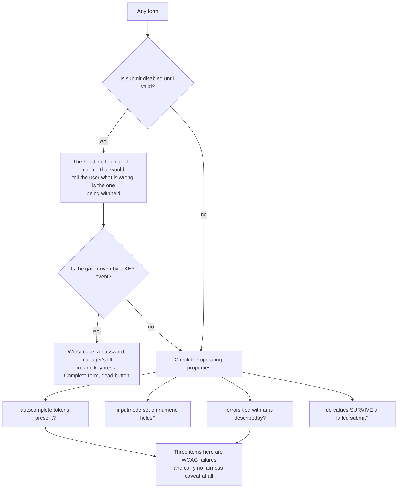

# Forms and input — where the output is the start of the user's work

A form is the one surface where the model's output is the BEGINNING of the user's work rather than the end of it. Everything else a generator produces is read; a form is operated — on a phone keyboard, through a password manager, after an error, under time pressure. None of those conditions exist in the markup, so the tells cluster exactly at the properties that only come into being while somebody is using it: the keyboard that opens, the value autofill puts in, what survives a failed submit.

`submit-disabled-until-valid` is the headline and deserves its own paragraph. It is the most reproduced form pattern in generated code, it comes from a clean and testable sentence — "disable submit until the form is valid" — and it produces an interface where the control that would tell the user what is wrong is the control being withheld. Practitioners have argued against it for over a decade. Its worst instance is `validity-gate-misses-the-password-manager`: the gate listens for keyup, a password manager's fill does not produce one, and the user is left with a visibly complete form and a dead button having done everything right.

Three items here are WCAG failures in their own right and are not inferences about authorship at all: missing autocomplete tokens (1.3.5 Identify Input Purpose, Level AA), errors not programmatically tied to their fields, and paste blocked on a password field (3.3.8 Accessible Authentication). Act on those with full confidence.

Where this file gives numbers they come from published research rather than from this catalog: Google reports correct autocomplete cutting checkout time by up to about 30%, and Baymard attributes 18% of checkout abandonment to a long or complicated process against a tracked ~70% overall rate. The GOV.UK error-summary pattern is the reference implementation for the error half, built for people completing services under stress.

_25 items. Generated from catalog.json — edit there, then re-run `scripts/regenerate_references.py`. Do not hand-edit this file._

_Every item carries a **False positive when** line. Read it before you act on the item: these are cues for an editor, not evidence about an author._

<!-- humanize:ignore-start
     The diagram and index below quote the tells they document, and a
     mermaid label is not a sentence. -->

## When this file applies

## What is in this file

Severity reflects the consequence for the intended reader, never how sure you should be about who wrote it. **Automated** means these scripts implement the check; *no* means it is yours to ask in the judge pass.

| item | severity | family | automated |
| --- | --- | --- | --- |
| [`error-not-tied-to-its-field`](#error-not-tied-to-its-field) | HIGH | defect | yes |
| [`focus-not-moved-after-a-failed-submit`](#focus-not-moved-after-a-failed-submit) | HIGH | defect | yes |
| [`form-clears-on-validation-failure`](#form-clears-on-validation-failure) | HIGH | defect | yes |
| [`missing-autofill-attributes`](#missing-autofill-attributes) | HIGH | defect | yes |
| [`paste-blocked-on-a-password-or-code-field`](#paste-blocked-on-a-password-or-code-field) | HIGH | defect | yes |
| [`submit-disabled-until-valid`](#submit-disabled-until-valid) | HIGH | defect | yes |
| [`validity-gate-misses-the-password-manager`](#validity-gate-misses-the-password-manager) | HIGH | defect | yes |
| [`autocomplete-off-on-personal-fields`](#autocomplete-off-on-personal-fields) | med | defect | yes |
| [`captcha-as-the-only-route-past-the-form`](#captcha-as-the-only-route-past-the-form) | med | defect | yes |
| [`email-regex-rejects-valid-addresses`](#email-regex-rejects-valid-addresses) | med | defect | yes |
| [`inputmode-absent-on-a-numeric-field`](#inputmode-absent-on-a-numeric-field) | med | defect | yes |
| [`label-that-only-exists-while-empty`](#label-that-only-exists-while-empty) | med | defect | yes |
| [`multi-step-form-with-no-back-or-progress`](#multi-step-form-with-no-back-or-progress) | med | defect | yes |
| [`native-and-custom-validation-both-firing`](#native-and-custom-validation-both-firing) | med | defect | yes |
| [`no-error-summary-on-a-long-form`](#no-error-summary-on-a-long-form) | med | defect | yes |
| [`number-input-for-a-non-number`](#number-input-for-a-non-number) | med | defect | yes |
| [`password-rules-revealed-after-failure`](#password-rules-revealed-after-failure) | med | form | yes |
| [`autofocus-on-page-load`](#autofocus-on-page-load) | low | form | yes |
| [`character-counter-that-is-never-announced`](#character-counter-that-is-never-announced) | low | defect | yes |
| [`date-entered-as-three-selects`](#date-entered-as-three-selects) | low | form | yes |
| [`no-enterkeyhint-on-a-multi-field-form`](#no-enterkeyhint-on-a-multi-field-form) | low | form | yes |
| [`no-show-password-control`](#no-show-password-control) | low | form | yes |
| [`required-marking-with-no-key`](#required-marking-with-no-key) | low | form | yes |
| [`search-field-with-no-clear-and-no-search-type`](#search-field-with-no-clear-and-no-search-type) | low | form | yes |
| [`select-for-a-two-option-choice`](#select-for-a-two-option-choice) | low | form | yes |

<!-- humanize:ignore-end -->

<!-- humanize:ignore-start
     Everything below is a specimen catalog. It quotes the tells it documents,
     including literal machine residue, so reviewing it with humanize_review.py
     would flag the exhibits rather than the writing. -->

### `error-not-tied-to-its-field`  ·  high · generic-llm · web-ui · structural · family: defect · lane: forms-and-input

**Automated here:** yes, these scripts implement it.

The message is rendered next to the input and not connected to it -- no aria-describedby, no aria-invalid. Visually it is beside the field; programmatically it is an unrelated piece of text, so a screen-reader user focused on the input hears the label and nothing about what went wrong.

**Why it reads AI:** Unreviewed with a model-flavoured seam. Proximity in the markup reads as association, and the association is an attribute nobody looked for.

**Detect:** Static: an error element rendered conditionally near an input, where the input carries no aria-describedby pointing at the error's id and no aria-invalid.

**Fix:** Give the error an id, point aria-describedby at it, and set aria-invalid="true" on the field while it is in error. Both attributes are conditional on the error, not permanent.

**False positive when:** A summary-only pattern that moves focus to the message is a valid alternative. The finding is an in-line message with no programmatic link at all.

**Before**

> <input id="email" />Enter a valid email

**After**

> <input id="email" aria-invalid="true" aria-describedby="email-err" />...

### `focus-not-moved-after-a-failed-submit`  ·  high · generic-llm · web-ui · structural · family: defect · lane: forms-and-input

**Automated here:** yes, these scripts implement it.

The form fails validation and focus stays on the submit button at the bottom. Nothing announces the failure, and the user has to go looking for what changed above them. For a keyboard or screen-reader user the submit appeared to do nothing.

**Why it reads AI:** Unreviewed. A sighted mouse user sees the red appear; the failure only exists for someone whose attention is where the focus is.

**Detect:** Static: a submit handler that sets error state with no focus() call on the summary, the first invalid field, or a live region.

**Fix:** Move focus to the error summary if you have one, or to the first invalid field. Give the summary tabindex="-1" so it can take focus.

**False positive when:** A live region that reliably announces the failure is an acceptable alternative for the announcement, though focus still helps everyone reach the problem.

**Before**

> setErrors(next) and nothing else

**After**

> setErrors(next); summaryRef.current.focus()

### `form-clears-on-validation-failure`  ·  high · generic-llm · web-ui · structural · family: defect · lane: forms-and-input

**Automated here:** yes, these scripts implement it.

One field is wrong and the form comes back empty, or the password fields do. Everything the user typed is gone and they start again -- and the longer the form, the more likely they abandon rather than retype. Baymard puts checkout abandonment attributable to a long or complicated process at 18%, against a 70% overall rate.

**Why it reads AI:** Unreviewed. The error path is the branch least likely to be exercised while building, and clearing is what a naive re-render does for free.

**Detect:** Static: a reset(), setState to initial values, or an uncontrolled re-mount in the error path of a submit handler. Rendered to settle: submit with one bad field and read the other fields' values back.

**Fix:** Preserve every value across a failed submit, including passwords. Re-render the same state with errors attached.

**False positive when:** A successful submit SHOULD clear. And a deliberate clear on an explicitly destructive path is not this. Restrict the finding to the validation-failure branch.

**Before**

> catch { reset() }

**After**

> catch { setErrors(e) } -- values untouched

### `missing-autofill-attributes`  ·  high · generic-llm · web-ui · structural · family: defect · lane: forms-and-input

**Automated here:** yes, these scripts implement it.

Fields collecting a name, email, phone, address or payment detail carry no autocomplete attribute, so the browser cannot fill them and assistive tooling cannot identify their purpose. It is a WCAG 2.1 failure in its own right -- 1.3.5 Identify Input Purpose, Level AA -- and Google reports correct autocomplete cutting checkout time by up to about 30%.

**Why it reads AI:** Unreviewed. The attribute changes nothing the author can see, so nothing about writing or reviewing the markup surfaces its absence.

**Detect:** Static: inputs whose name, id or placeholder matches a known personal-data purpose (email, tel, given-name, family-name, street-address, postal-code, cc-number) with no autocomplete attribute. A broader count-based fallback covers files whose field purposes cannot be identified.

**Thresholds** (read by `scripts/humanize_review.py`): `min_inputs` = 3

**Fix:** Add the specific token, not the generic one: autocomplete="given-name", "email", "tel", "street-address", "postal-code", "cc-number". The token list is fixed; invented values do nothing.

**False positive when:** A field with no standard token -- a project name, a free-text note -- correctly has none. Only fields whose purpose maps to the published token list are counted.

**Before**

> <input type="text" placeholder="Email">

**After**

> <input type="email" autocomplete="email" inputmode="email" id="email">

### `paste-blocked-on-a-password-or-code-field`  ·  high · generic-llm · web-ui · structural · family: defect · lane: forms-and-input

**Automated here:** yes, these scripts implement it.

onPaste is blocked, usually with a preventDefault. It stops password managers, it stops copying a one-time code out of a message, and the security rationale it is offered under is the reverse of the truth -- blocking paste pushes people toward passwords short enough to type. The UK NCSC has advised against it for years, and WCAG 2.2's 3.3.8 treats obstructing password managers as an authentication barrier.

**Why it reads AI:** Model-flavoured. It is copied from a large body of security folklore in the corpus and the folklore is stated with confidence.

**Detect:** Static: an onPaste or 'paste' listener calling preventDefault on an input, especially type="password" or a code field.

**Fix:** Delete the handler. If you need to catch a mis-paste, validate the value instead of refusing it.

**False positive when:** Trimming or normalising pasted content is legitimate; the finding is refusing the paste entirely.

**Before**

> onPaste={e => e.preventDefault()}

**After**

> paste allowed; validate the resulting value

### `submit-disabled-until-valid`  ·  high · generic-llm · web-ui · structural · family: defect · lane: forms-and-input

**Automated here:** yes, these scripts implement it.

The submit button is disabled until every field validates. It is the most reproduced form pattern in generated code and practitioners have argued against it for over a decade: the control that would tell the user what is wrong is the control being withheld. Fix one of three errors and the button stays dead with no indication that anything improved, so the interface reads as broken rather than as strict.

**Why it reads AI:** Model-flavoured. "Disable submit until the form is valid" is a clean, testable sentence that produces a demonstrably wrong interface, and it is emitted almost every time a form is requested.

**Detect:** Static: a disabled attribute or prop on a submit control bound to a validity expression (!isValid, !formState.isValid, errors.length > 0, a required-fields-filled boolean).

**Fix:** Leave the button enabled. Validate on submit, render an error summary, move focus to it, and link each message to its field. If you must indicate an unready state use aria-disabled, which stays focusable and announceable.

**False positive when:** A genuinely irreversible action gated on an explicit confirmation checkbox is a different contract, and a disabled pagination control is the case aria-disabled exists for. The finding is validity-gated submission.

**Before**

> <button type="submit" disabled={!isValid}>

**After**

> <button type="submit"> -- validate on submit, summarise, move focus

### `validity-gate-misses-the-password-manager`  ·  high · generic-llm · web-ui · structural · family: defect · lane: forms-and-input

**Automated here:** yes, these scripts implement it.

The enable-on-valid logic listens for keyup, and a password manager's fill does not produce one. The fields are visibly populated, the form is visibly complete, and the button is still dead -- with nothing on screen explaining why. It is the disabled-submit pattern's worst instance because the user has done everything right.

**Why it reads AI:** Model-flavoured. keyup is the corpus-typical way to say "as the user types", and it encodes an assumption that all input comes from a keyboard.

**Detect:** Static: a keyup or keypress listener driving form validity where an input event would be required. Rendered to settle: set the field's value programmatically, dispatch input, and check whether the control enabled.

**Fix:** Listen for input, not keyup -- it fires for autofill, paste and speech. Better, stop gating the button at all. Blocking password managers also puts WCAG 2.2's 3.3.8 Accessible Authentication in play.

**False positive when:** A field genuinely handling key semantics (a shortcut, a keyboard-driven combobox) legitimately reads keyup. The finding is validity state derived from keyup.

**Before**

> input.addEventListener('keyup', checkValidity)

**After**

> input.addEventListener('input', checkValidity)

### `autocomplete-off-on-personal-fields`  ·  medium · generic-llm · web-ui · structural · family: defect · lane: forms-and-input

**Automated here:** yes, these scripts implement it.

autocomplete="off" is set on fields the browser should be filling. Browsers now ignore it for passwords precisely because sites overused it, but for names, addresses and payment fields it still works, and its effect is to make every user type by hand what their browser already knows.

**Why it reads AI:** Model-flavoured. It is a widely copied line justified by an obsolete security rationale, and a generator reproduces the rationale with the line.

**Detect:** Static: autocomplete="off" or autoComplete={false} on an input whose purpose matches a personal-data token, or on the form element wrapping them.

**Fix:** Remove it and set the real token. If a field genuinely must not be stored -- a one-time code -- use autocomplete="one-time-code", which is the correct expression of that intent.

**False positive when:** A shared kiosk or a field holding a value that must never persist is a real reason. The finding is a blanket off on an ordinary form.

**Before**

> <form autocomplete="off"> around a checkout

**After**

> per-field tokens; one-time-code where it applies

### `captcha-as-the-only-route-past-the-form`  ·  medium · generic-llm · web-ui · structural · family: defect · lane: forms-and-input

**Automated here:** yes, these scripts implement it.

A visual challenge with no audio alternative, no token-based fallback, and no path for a user who fails it. It is a WCAG 1.1.1 problem and a hard stop: the user cannot contact anyone about being unable to contact anyone.

**Why it reads AI:** Unreviewed. Spam handling is a real requirement answered with the corpus-standard widget, and the alternative path is a separate requirement nobody stated.

**Detect:** Static: a captcha widget script with no alternative challenge configured and no non-captcha contact route elsewhere on the page.

**Fix:** Prefer an invisible or token-based check. Where a challenge is needed, offer an audio alternative and publish a second contact route -- an email address, a phone number -- that does not pass through it.

**False positive when:** An invisible risk-scored check that only challenges on suspicion is much less likely to strand anyone. The finding is an unconditional visual challenge.

**Before**

> a single image challenge, required, no alternative

**After**

> a token-based check, plus a published address that bypasses it

### `email-regex-rejects-valid-addresses`  ·  medium · generic-llm · web-ui · structural · family: defect · lane: forms-and-input

**Automated here:** yes, these scripts implement it.

A hand-rolled email pattern that rejects plus-addressing, apostrophes, long or new top-level domains, or anything but a two-to-four-letter TLD. The user has a working address the form insists is invalid, and there is no route past it.

**Why it reads AI:** Model-flavoured. Email regexes are abundant in the corpus, most of them are wrong in the same ways, and the wrongness is invisible against the addresses a developer tests with.

**Detect:** Static: a pattern attribute or regex literal validating email with a restrictive TLD class ({2,4}, {2,3}), no plus in the local part, or an explicit domain allowlist.

**Fix:** Use type="email" and let the browser do the syntactic check, then verify by sending mail. If you must pattern-match, require an @ with something on each side and stop there.

**False positive when:** A deliberate restriction to a corporate domain is a business rule, not a bug -- but it should say so in the message.

**Before**

> pattern="[a-z0-9._%+-]+@[a-z0-9.-]+\\.[a-z]{2,4}$"

**After**

> type="email" and a confirmation mail

### `inputmode-absent-on-a-numeric-field`  ·  medium · generic-llm · web-ui · structural · family: defect · lane: forms-and-input

**Automated here:** yes, these scripts implement it.

A numeric field is type="text" with no inputmode, so a phone user gets the full QWERTY keyboard and has to find the number layer to type a postcode or a verification code. The attribute is one word and it changes the keyboard that opens.

**Why it reads AI:** Unreviewed. The keyboard is a property of a device the page was never opened on.

**Detect:** Static: input type="text" whose name or label marks it numeric, with no inputmode attribute.

**Fix:** inputmode="numeric" for digit strings, "decimal" for amounts, "tel" for phone numbers, "email" and "url" for those -- and enterkeyhint to label the return key.

**False positive when:** A field that genuinely takes mixed input (a reference that may contain letters) correctly has no numeric inputmode.

**Before**

> <input type="text" name="verificationCode">

**After**

> <input type="text" inputmode="numeric" autocomplete="one-time-code" enterkeyhint="done">

### `label-that-only-exists-while-empty`  ·  medium · generic-llm · web-ui · structural · family: defect · lane: forms-and-input

**Automated here:** yes, these scripts implement it.

A floating label that animates into the border, or a placeholder acting as the label, so once there is a value the field's name is gone or is four-point type in a gap. The user reviewing a completed form cannot tell what any field is, and neither can anyone returning to fix one error.

**Why it reads AI:** Model-flavoured. The floating label is a well-represented pattern that demos beautifully on an empty form, which is the only state a generator renders.

**Detect:** Static: a label positioned over the input and transformed on :not(:placeholder-shown) or on a focused/filled class, ending below a legibility threshold; or an input with a placeholder and no label element at all.

**Fix:** Keep a persistent visible label above the field. If you keep the float, check the shrunken size and contrast against the same thresholds as any other text.

**False positive when:** A well-executed float that settles at a legible size and contrast is acceptable. Measure the end state rather than flagging the technique.

**Before**

> label shrinking to 10px inside the border on focus

**After**

> a persistent label above the field at body size

### `multi-step-form-with-no-back-or-progress`  ·  medium · generic-llm · web-ui · structural · family: defect · lane: forms-and-input

**Automated here:** yes, these scripts implement it.

A wizard that shows one step at a time with no indication of how many there are and no way back. The user cannot tell whether they are near the end, and correcting something from two steps ago means starting over or losing the session.

**Why it reads AI:** Unreviewed. Forward is the path the happy demo takes, and back is a branch that only matters once someone makes a mistake.

**Detect:** Static: a step/wizard state machine advancing an index with no decrement path rendered and no step count or progress element.

**Fix:** Show "Step 2 of 4", provide a real Back control that preserves entered values, and put the step in the URL so the browser's own back button works.

**False positive when:** A two-step flow with an obvious single path is less affected. And a deliberately linear irreversible flow (a payment capture) may restrict back on purpose -- but it should still show progress.

**Before**

> const [step, setStep] = useState(0) with only setStep(step + 1)

**After**

> step in the URL, a Back control, and a visible step count

### `native-and-custom-validation-both-firing`  ·  medium · generic-llm · web-ui · structural · family: defect · lane: forms-and-input

**Automated here:** yes, these scripts implement it.

The form has required and pattern attributes and a JavaScript validator, with no novalidate. The browser's bubble appears on some paths and the styled in-line messages on others, they disagree about what is wrong, and which one the user sees depends on how they submitted.

**Why it reads AI:** Unreviewed with a model-flavoured seam. Native constraints and a validation library are two separately correct answers to "validate this form", and nothing makes one of them defer.

**Detect:** Static: a form with constraint attributes on its inputs AND a custom validation handler, with no noValidate on the form element.

**Fix:** Pick one. Keep the attributes for semantics and set noValidate so your own messages are the only ones shown, or drop the custom layer and style :user-invalid.

**False positive when:** Using the Constraint Validation API deliberately -- reading validity and rendering your own message from it -- is one coherent system, not two.

**Before**

> <form onSubmit={validate}> with required and pattern on every input

**After**

> <form noValidate onSubmit={validate}> -- attributes kept for semantics

### `no-error-summary-on-a-long-form`  ·  medium · generic-llm · web-ui · structural · family: defect · lane: forms-and-input

**Automated here:** yes, these scripts implement it.

Submission fails and the errors are only in-line beside their fields, some of them off screen. The user gets no count, no list and no route to the first problem -- they scroll hunting for red. The GOV.UK pattern, built for people completing services under stress, pairs an in-line message with a summary at the top of the page that links to each field.

**Why it reads AI:** Unreviewed. In-line errors are the visible half and they look complete when the whole form fits on the reviewer's screen.

**Detect:** Static: a form with more than the threshold number of fields (default 5) rendering per-field errors with no summary region carrying links to them.

**Fix:** On failure render a summary at the top: a count, a heading, and a link per error whose text is the message and whose target is the field. Move focus to the summary.

**False positive when:** A two- or three-field form is short enough that in-line messages suffice. Threshold it on field count.

**Before**

> per-field  and nothing else

**After**

> an error summary listing and linking each failure, focused on submit

### `number-input-for-a-non-number`  ·  medium · generic-llm · web-ui · structural · family: defect · lane: forms-and-input

**Automated here:** yes, these scripts implement it.

type="number" is used for a credit card, phone number, postcode, OTP or account number. The spec says this type is for numbers you would do arithmetic on, and for identifiers it actively breaks things: leading zeros are dropped, the field silently rejects spaces and dashes people type, a scroll over a focused field changes the value, and the spinner arrows are a hazard on desktop.

**Why it reads AI:** Model-flavoured. "It contains digits, so it is a number" is a reasonable inference from the name of the type and wrong about what the type means.

**Detect:** Static: input type="number" whose name, id or label matches an identifier pattern (card, cc, phone, tel, zip, postal, postcode, otp, code, pin, account, ssn).

**Fix:** Use type="text" with inputmode="numeric" and a pattern, plus the right autocomplete token. type="tel" for phone numbers. Keep type="number" for quantities and amounts.

**False positive when:** A genuine quantity, age, price or rating is what the type is for. Match on the field's purpose, not on the presence of digits.

**Before**

> <input type="number" name="zip">

**After**

> <input type="text" inputmode="numeric" pattern="[0-9]{5}" autocomplete="postal-code">

### `password-rules-revealed-after-failure`  ·  medium · generic-llm · web-ui · structural · family: form · lane: forms-and-input

**Automated here:** yes, these scripts implement it.

The password requirements appear only once the user has submitted something that broke them. They guess, fail, guess again -- and each round is an error message that reads as a reprimand for not knowing a rule that was never stated.

**Why it reads AI:** Unreviewed. The rule lives in the validator, which is where the generator was asked to put it, and stating it in the interface is a second, separate instruction.

**Detect:** Static: a password field whose constraints exist only in a validation message or a regex, with no requirements text or list rendered near the field before submit.

**Fix:** Show the requirements next to the field before anyone types, and tick them off as they are met. Tie the list to the field with aria-describedby.

**False positive when:** A single obvious rule (a minimum length stated in the label) needs no separate list.

**Before**

> an onSubmit regex and the message "Password does not meet requirements"

**After**

> a visible checklist, described-by the field, updating as the user types

### `autofocus-on-page-load`  ·  low · generic-llm · web-ui · structural · family: form · lane: forms-and-input

**Automated here:** yes, these scripts implement it.

autofocus on the first field. It moves the viewport on a phone and opens the keyboard over the content, it skips past anything above the field including the page heading, and for a screen-reader user it starts the page partway through with no announcement of what was skipped.

**Why it reads AI:** Model-flavoured. It reads as helpfulness and its cost is a device behaviour absent from the markup.

**Detect:** Static: an autofocus attribute or a focus() in a mount effect on a page that is not a dedicated single-purpose form.

**Fix:** Keep it for a page whose only purpose is that one field -- a search page, a login page, a one-field step. Drop it anywhere the user needs to read something first.

**False positive when:** A search-only page or a modal whose purpose is the field should focus it. Judge by what else is on the page.

**Before**

> <input autofocus /> at the top of a long content page

**After**

> no autofocus; or autofocus only on a dedicated single-field page

### `character-counter-that-is-never-announced`  ·  low · generic-llm · web-ui · structural · family: defect · lane: forms-and-input

**Automated here:** yes, these scripts implement it.

A live character count rendered as plain text. A sighted user watches it approach the limit; everyone else types past it and finds out at submit. Or the reverse failure: it is wired to an assertive live region and interrupts every keystroke.

**Why it reads AI:** Unreviewed. The counter is visual by construction and the announcement is a separate consideration.

**Detect:** Static: a counter element bound to input length with no aria-live, or with aria-live="assertive" and no debounce.

**Fix:** Put it in a polite live region, debounce it, and only announce near the limit -- the remaining count at the last twenty characters rather than every character. Tie it to the field with aria-describedby.

**False positive when:** A soft counter on a field with no enforced limit matters less. The severity rises when the limit is enforced at submit.

**Before**

> {value.length}/280

**After**

> 20 characters remaining, debounced, described-by

### `date-entered-as-three-selects`  ·  low · generic-llm · web-ui · structural · family: form · lane: forms-and-input

**Automated here:** yes, these scripts implement it.

A date of birth collected as three dropdowns. Selecting a year from a list of ninety is slow with a mouse, worse on a phone, and the pattern consistently tests badly against three short text inputs, which is why GOV.UK ships the text-input version for dates people know.

**Why it reads AI:** Model-flavoured. The three-select date is heavily represented in older form corpora and requires no date library, so it is the cheap answer.

**Detect:** Static: three select elements in one field group whose options are days, months and years.

**Fix:** Three labelled text inputs with inputmode="numeric" for a remembered date, and a date picker only for choosing a date from a calendar -- booking, scheduling -- where the calendar is the point.

**False positive when:** Picking a date from a calendar (an appointment, a stay) is a different task and wants a picker. The finding is a date the user already knows.

**Before**

> <select name="day">...<select name="month">...<select name="year">

**After**

> Day / Month / Year as three numeric text inputs in a fieldset

### `no-enterkeyhint-on-a-multi-field-form`  ·  low · generic-llm · web-ui · structural · family: form · lane: forms-and-input

**Automated here:** yes, these scripts implement it.

Every field's on-screen return key says the same thing. On a phone the user cannot tell whether return will move to the next field or submit the form, so they submit halfway through or tap Next on the last field and nothing happens.

**Why it reads AI:** Unreviewed. The key's label is a phone-keyboard property invisible in the markup and on the desktop it was built on.

**Detect:** Static: a form with more than the threshold number of inputs (default 3) where no input carries enterkeyhint.

**Fix:** enterkeyhint="next" on every field but the last, "done" or "send" on the last. One attribute per input.

**False positive when:** A single-field form has nothing to disambiguate, and a form whose fields are all selects or checkboxes never opens a keyboard for the hint to label. Only flag forms with several text-entry fields in sequence.

**Before**

> five inputs, no enterkeyhint anywhere

**After**

> enterkeyhint="next" through the form, "done" on the final field

### `no-show-password-control`  ·  low · generic-llm · web-ui · structural · family: form · lane: forms-and-input

**Automated here:** yes, these scripts implement it.

A password field with no reveal toggle. The user cannot check what they typed, which on a phone keyboard is where most password entry failures come from, and the cost of the mistake is an error message that cannot tell them which character was wrong.

**Why it reads AI:** Unreviewed. The field works, and the gap is a control that is not required for it to work.

**Detect:** Static: input type="password" with no sibling control toggling its type, and no autocomplete="current-password"/"new-password" pairing that would let a manager handle it.

**Fix:** Add a toggle button -- a real <button type="button"> with an accessible name that changes with state, not an icon with a title. Keep focus in place when it is pressed.

**False positive when:** A field in a flow where shoulder-surfing is the dominant risk may deliberately omit it. Low severity for that reason.

**Before**

> <input type="password" />

**After**

> <input type="password" /> + <button aria-pressed="false">Show password</button>

### `required-marking-with-no-key`  ·  low · generic-llm · web-ui · structural · family: form · lane: forms-and-input

**Automated here:** yes, these scripts implement it.

Asterisks mark required fields and nothing says so. The convention is widespread and it is still a convention -- it is not announced usefully, and on a form where most fields are required it marks the wrong set.

**Why it reads AI:** Unreviewed. The asterisk is the corpus-standard visual and the sentence explaining it is a separate element nobody asked for.

**Detect:** Static: an asterisk or a required indicator in a label with no legend text explaining it anywhere in the form, and no required/aria-required attribute on the input.

**Fix:** State the convention once at the top of the form, and put required on the input so it is announced. Where most fields are required, mark the optional ones instead -- it is less ink and more information.

**False positive when:** A form where every field is required and says so needs no marking at all.

**Before**

> <label>Email *</label>

**After**

> "Fields marked * are required" once, plus required on each input

### `search-field-with-no-clear-and-no-search-type`  ·  low · generic-llm · web-ui · structural · family: form · lane: forms-and-input

**Automated here:** yes, these scripts implement it.

A search box built as type="text" with no way to empty it in one action. The user clears a query by holding backspace, and the field gets none of the platform behaviour -- no clear affordance, no search keyboard, no history.

**Why it reads AI:** Unreviewed. type="text" works, so nothing about the page failing surfaces the gap.

**Detect:** Static: an input whose name, id, label or placeholder marks it as search, typed text, with no clear control rendered and no role="search" landmark around it.

**Fix:** type="search" inside a role="search" landmark, with an explicit clear button that also returns focus to the field.

**False positive when:** A filter input inside a component with its own reset control is already covered by that control.

**Before**

> <input type="text" placeholder="Search...">

**After**

> <form role="search"><input type="search" aria-label="Search"> + a clear button

### `select-for-a-two-option-choice`  ·  low · generic-llm · web-ui · structural · family: form · lane: forms-and-input

**Automated here:** yes, these scripts implement it.

A dropdown with two options. It takes two interactions to reveal one bit of information, hides the choice until opened, and on a phone opens a full-height wheel to pick between yes and no.

**Why it reads AI:** Model-flavoured. select is the general-purpose answer to "a choice" and generalises without regard to cardinality.

**Detect:** Static: a select element with two or three option children, or a controlled equivalent with a two-item list.

**Fix:** Radio buttons for two to about five options -- all visible, one tap each. A checkbox where the choice is genuinely binary and the default is off.

**False positive when:** A two-option select inside a dense toolbar or a table row where space is genuinely scarce can be the right call.

**Before**

> <select><option>Yes</option><option>No</option></select>

**After**

> <fieldset><legend>...</legend> two radios

<!-- humanize:ignore-end -->
