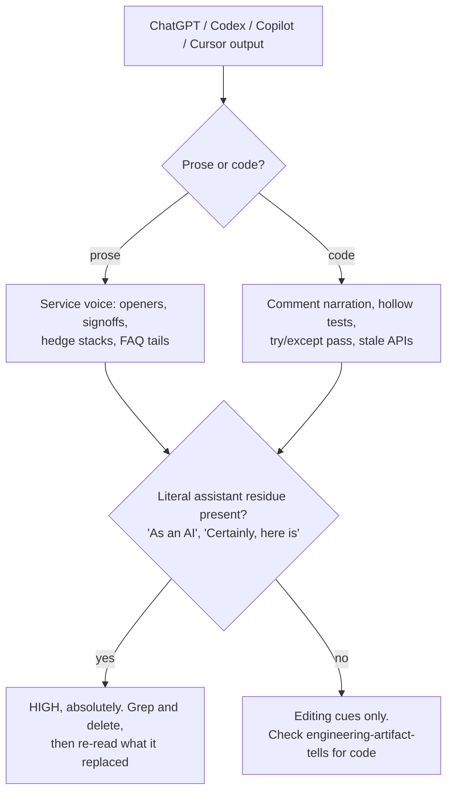

# GPT-isms and Codexisms

ChatGPT's service voice and README register, and the code-comment tells of Codex/Copilot-shaped generation.

_34 items. Generated from catalog.json — edit there, then re-run `scripts/regenerate_references.py`. Do not hand-edit this file._

_Every item carries a **False positive when** line. Read it before you act on the item: these are cues for an editor, not evidence about an author._

<!-- humanize:ignore-start
     The diagram and index below quote the tells they document, and a
     mermaid label is not a sentence. -->

## When this file applies



## What is in this file

Severity reflects the consequence for the intended reader, never how sure you should be about who wrote it. **Automated** means these scripts implement the check; *no* means it is yours to ask in the judge pass.

| item | severity | family | automated |
| --- | --- | --- | --- |
| [`comment-narrates-next-line`](#comment-narrates-next-line) | HIGH | code | yes |
| [`emoji-section-headers`](#emoji-section-headers) | HIGH | shape | yes |
| [`h2-spam-full-sentence-headings`](#h2-spam-full-sentence-headings) | HIGH | shape | **no** |
| [`hallucinated-import-or-api`](#hallucinated-import-or-api) | HIGH | residue | **no** |
| [`hollow-assertion`](#hollow-assertion) | HIGH | code | **no** |
| [`key-takeaways-box-everywhere`](#key-takeaways-box-everywhere) | HIGH | shape | **no** |
| [`linkedin-broetry-one-line-runs`](#linkedin-broetry-one-line-runs) | HIGH | shape | yes |
| [`markdown-leak-in-unrendered-medium`](#markdown-leak-in-unrendered-medium) | HIGH | form | yes |
| [`mock-assertion-test`](#mock-assertion-test) | HIGH | code | **no** |
| [`model-markup-residue`](#model-markup-residue) | HIGH | residue | yes |
| [`placeholder-stub-residue`](#placeholder-stub-residue) | HIGH | code | yes |
| [`service-voice-bookends`](#service-voice-bookends) | HIGH | form | **no** |
| [`swallow-exception-pass`](#swallow-exception-pass) | HIGH | code | yes |
| [`tracking-param-residue`](#tracking-param-residue) | HIGH | residue | yes |
| [`unsolicited-faq-section`](#unsolicited-faq-section) | HIGH | shape | n/a |
| [`amber-white-balance-cast`](#amber-white-balance-cast) | med | visual | **no** |
| [`checkmark-bullet-grid`](#checkmark-bullet-grid) | med | form | yes |
| [`dive-delve-openers`](#dive-delve-openers) | med | form | n/a |
| [`docstring-restates-signature`](#docstring-restates-signature) | med | code | yes |
| [`email-pleasantry-boilerplate`](#email-pleasantry-boilerplate) | med | form | n/a |
| [`hedged-disclaimer-ending`](#hedged-disclaimer-ending) | med | form | n/a |
| [`markdown-bold-title-case-scaffold`](#markdown-bold-title-case-scaffold) | med | shape | **no** |
| [`over-apologetic-error-explanation`](#over-apologetic-error-explanation) | med | form | n/a |
| [`problem-agitate-solve-by-template`](#problem-agitate-solve-by-template) | med | shape | n/a |
| [`readme-boilerplate-shape`](#readme-boilerplate-shape) | med | shape | n/a |
| [`rhetorical-question-hook`](#rhetorical-question-hook) | med | shape | n/a |
| [`stale-training-api`](#stale-training-api) | med | code | n/a |
| [`tables-for-non-tabular-content`](#tables-for-non-tabular-content) | med | shape | **no** |
| [`trailing-example-usage-block`](#trailing-example-usage-block) | med | code | **no** |
| [`try-catch-just-in-case`](#try-catch-just-in-case) | med | code | **no** |
| [`decorative-section-divider`](#decorative-section-divider) | low | code | yes |
| [`emoji-in-code`](#emoji-in-code) | low | code | yes |
| [`single-impl-abstraction`](#single-impl-abstraction) | low | code | **no** |
| [`title-case-heading-uniformity`](#title-case-heading-uniformity) | low | form | yes |

<!-- humanize:ignore-end -->

<!-- humanize:ignore-start
     Everything below is a specimen catalog. It quotes the tells it documents,
     including literal machine residue, so reviewing it with humanize_review.py
     would flag the exhibits rather than the writing. -->

<a id="comment-narrates-next-line"></a>
### `comment-narrates-next-line`  ·  high · codex · code-comments · structural · family: code

**Automated here:** yes, these scripts implement it.

Inline comments that restate exactly what the following statement does in English: `// increment counter`, `# loop through items`, `// return the result`. The comment adds zero information beyond reading the line.

**Why it reads AI:** Codex/Copilot learned the comment-then-code pattern from tutorials and emits narration by default. Experienced devs comment the why, not the what.

**Detect:** structural: for each comment line, compare its tokens to the immediately following code line; flag when the comment is a verb-phrase paraphrase of the next statement. A high ratio of such comments per file is the signal.

**Thresholds** (read by `scripts/humanize_review.py`): `min_count` = 2, `overlap` = 0.6

**Fix:** Delete comments that paraphrase the code. Keep comments for non-obvious rationale, edge cases, units, or ticket links. Often a clearer name is the better fix.

**False positive when:** Teaching code, tutorial repositories and beginner-facing examples narrate deliberately and correctly. Check what the file is for.

**Before**

> // increment the retry counter
> retries += 1
> // check if we hit the max
> if retries > MAX: ...

**After**

> retries += 1
> if retries > MAX:  # give up; upstream 503s have been seen to last ~30s

<a id="emoji-section-headers"></a>
### `emoji-section-headers`  ·  high · chatgpt · structure · structural · family: shape

**Automated here:** yes, these scripts implement it.

Headings and list items prefixed with a decorative emoji mapped to topic: rocket Getting Started, sparkles Features, wrench Configuration, package Installation, bulb Tips. Especially common in READMEs and release notes.

**Why it reads AI:** The rocket-for-getting-started, sparkles-for-features mapping is a near-deterministic GPT habit; the specific emoji-to-section pairing is rarely how individual maintainers decorate docs.

**Detect:** structural: regex headings and bullet leads for a leading emoji codepoint (U+1F300-1FAFF, U+2600-27BF) plus VS16. Flag if >=2 headers carry a leading emoji, or the rocket/sparkles/wrench/package set appears as header decoration.

**Thresholds** (read by `scripts/humanize_review.py`): `min_count` = 2

**Fix:** Remove emoji from headers; rely on heading hierarchy and whitespace for scanning. Reserve emoji for genuine human asides in prose.

**False positive when:** Some projects mandate emoji in their own heading or commit conventions. Flag on introduction into a property that does not already use them.

**Before**

> ## 🚀 Getting Started
> ## ✨ Features
> ## 🔧 Configuration

**After**

> ## Getting Started
> ## Features
> ## Configuration

<a id="h2-spam-full-sentence-headings"></a>
### `h2-spam-full-sentence-headings`  ·  high · chatgpt · structure · structural · family: shape

**Automated here:** no — decidable mechanically, but this bundle does not implement it. Ask it yourself in the judge pass.

A heading appears every one to two paragraphs, and the headings are full title-case sentences ('How To Structure Your Onboarding For Maximum Retention') rather than short labels. Heading density approaches paragraph density.

**Why it reads AI:** SEO/AEO scaffolding pushes the model to chunk everything under semantic headers. Humans write multi-paragraph sections under terse labels.

**Detect:** structural: compute the heading-to-paragraph ratio and heading length; flag a ratio near 1:2 combined with sentence-length, title-cased headings, or any heading whose section is a single paragraph.

**Fix:** Target a heading every 4-6 paragraphs. Make headings short noun phrases in sentence case. Delete any heading whose section is one paragraph.

**False positive when:** Reference documentation legitimately has high heading density, accessibility guidance favours descriptive headings over bare labels, and question-shaped headings are a deliberate choice in help content. Flag a heading every one or two paragraphs in a narrative piece.

**Before**

> ## Why Choosing The Right CRM Matters For Your Growing Team
> A CRM keeps your data in one place.
> ## How To Evaluate CRM Pricing Tiers Effectively
> Look at per-seat costs.

**After**

> ## Choosing a CRM
> A CRM keeps customer data in one place, which matters more than the feature checklist most vendors push. Start with pricing: per-seat costs balloon once your team crosses ten people, so model the 18-month bill, not the sticker.

<a id="hallucinated-import-or-api"></a>
### `hallucinated-import-or-api`  ·  high · codex · code · structural · family: residue

**Automated here:** no — decidable mechanically, but this bundle does not implement it. Ask it yourself in the judge pass.

Calls to functions, flags, endpoints or packages that do not exist — including imports of packages never published, which is the attack surface behind slopsquatting.

**Why it reads AI:** The model generates the API it expects to exist. Plausible names are exactly what it is good at.

**Detect:** Resolve every import against the lockfile and every called symbol against the installed package. Fully mechanical.

**Fix:** Run the resolver. Then check the package actually exists on the registry and is the one you meant — a hallucinated import name is a supply-chain hazard, not just a bug.

**False positive when:** Optional dependencies behind a try/except ImportError, and symbols added in a newer version than the lockfile pins.

**Evidence:** aicodeaudit ACA4xx rule class; published slopsquatting research.

**Before**

> from requests.utils import parse_retry_after

**After**

> from urllib3.util.retry import Retry

<a id="hollow-assertion"></a>
### `hollow-assertion`  ·  high · codex · code · structural · family: code

**Automated here:** no — decidable mechanically, but this bundle does not implement it. Ask it yourself in the judge pass.

Assertions that cannot fail: assert True, assert result == result, assert x is not None as the only check, tests with no assertion at all.

**Why it reads AI:** Test-shaped output. The file satisfies a coverage target and proves nothing.

**Detect:** Mechanical pattern match on the assertion expression.

**Fix:** Assert the value you expect. If you do not know what to expect, you do not yet know what the function is for.

**False positive when:** A smoke test whose only job is 'this import does not explode' is legitimate, if it says so.

**Evidence:** slop_scan P-class hollow-assertion rules.

**Before**

> result = parse(payload)
> assert result is not None

**After**

> assert parse(payload).currency == 'EUR'

<a id="key-takeaways-box-everywhere"></a>
### `key-takeaways-box-everywhere`  ·  high · chatgpt · structure · structural · family: shape

**Automated here:** no — decidable mechanically, but this bundle does not implement it. Ask it yourself in the judge pass.

A 'Key Takeaways,' 'TL;DR,' or 'In Summary' box bolted onto every section, not just the document top, often restating the heading and the paragraph just above it.

**Why it reads AI:** Answer-engine-optimization advice trains models to front-load standalone bullets after every heading, producing a document that summarizes itself at every level, which no human does mid-flow.

**Detect:** structural: count standalone summary/TL;DR/takeaways blocks per document and per H2; flag when they appear after most sections rather than once, especially with high n-gram overlap with the section above.

**Fix:** Keep at most one summary, at the top or bottom, never per-section. If a section needs a recap, it's too long; split or tighten it.

**False positive when:** Per-section summaries are a documented comprehension aid and are standard in textbooks, journalism and technical documentation. Flag a box on EVERY section, especially one restating the heading immediately above it.

**Before**

> ## Pricing
> We moved to usage-based billing in March...
> **Key Takeaways:**
> - We use usage-based billing
> - It started in March

**After**

> ## Pricing
> We moved to usage-based billing in March. Every plan now meters API calls instead of seats, which is why your invoice line items changed shape.

<a id="linkedin-broetry-one-line-runs"></a>
### `linkedin-broetry-one-line-runs`  ·  high · chatgpt · marketing-copy · structural · family: shape

**Automated here:** yes, these scripts implement it.

A post built as a vertical stack of one-line paragraphs separated by blank lines, opening with a contrarian hook and building to a 'here's what it taught me' payoff. Each line is a fragment; no paragraph exceeds one sentence.

**Why it reads AI:** Humans cluster sentences into uneven blocks; the metronomic one-line-paragraph stack with a manufactured hook-and-lesson arc reads as engagement-bait template.

**Detect:** structural: measure the run length of consecutive single-sentence paragraphs and paragraph-length variance; broetry shows runs of 8+ one-line paragraphs and near-zero length variance.

**Thresholds** (read by `scripts/humanize_review.py`): `min_run` = 4, `max_words_per_line` = 14

**Fix:** Write it as 2-3 real paragraphs first. Keep line breaks only where a genuine beat lands. Drop the manufactured arc; tell what actually happened, including the part that doesn't generalize.

**False positive when:** Poetry, song lyrics, and deliberately staccato personal essays. Also: broetry predates LLMs by years — it is a human LinkedIn convention that models learned, so on LinkedIn specifically it is weak evidence.

**Before**

> I got rejected 40 times.
>
> Then everything changed.
>
> Here's what failure taught me about success.
>
> Lesson 1: Never give up. 🧵

**After**

> I got rejected by 40 companies before the 41st said yes — and the 41st only happened because a friend forwarded my resume past the screener. The lesson isn't 'never give up.' It's that the application pile is a lottery you win by knowing someone.

<a id="markdown-leak-in-unrendered-medium"></a>
### `markdown-leak-in-unrendered-medium`  ·  high · chatgpt · structure · structural · family: form

**Automated here:** yes, these scripts implement it.

Markdown syntax pasted into a medium that does not render it — a LinkedIn post, an email body, a Slack message, a YouTube description — so the reader sees literal asterisks and hashes.

**Why it reads AI:** Nobody typing into that box would produce them. The syntax is a fossil of the interface the text was generated in, and it survives only because no one previewed the result.

**Detect:** Count **bold** spans and ATX headings in files whose extension does not render markdown.

**Thresholds** (read by `scripts/humanize_review.py`): `min_count` = 3

**Fix:** Strip the syntax and carry the emphasis in the words. If the emphasis cannot survive that, it was decoration.

**False positive when:** Plain-text files destined for a markdown renderer, and anything in a repo where .txt files are processed. Check the destination before flagging.

**Evidence:** Widely reported by social-platform users; the literal-asterisk artifact is among the most-named giveaways in platform folklore.

**Before**

> **Key takeaway:** we shipped it. ## What's next

**After**

> The key takeaway is that we shipped it. Here's what's next.

<a id="mock-assertion-test"></a>
### `mock-assertion-test`  ·  high · codex · code · structural · family: code

**Automated here:** no — decidable mechanically, but this bundle does not implement it. Ask it yourself in the judge pass.

Tests that assert a mock was called rather than that behavior happened.

**Why it reads AI:** The model can see the implementation and mirrors it. The test then passes for any refactor that keeps the call and breaks the behavior — which is the exact inverse of what a test is for.

**Detect:** Count assertions that are assert_called / toHaveBeenCalled against assertions on returned values or observable state.

**Fix:** Assert the outcome. If the outcome is unobservable, the seam is in the wrong place.

**False positive when:** Verifying an interaction with a genuine external boundary (an email really was queued, a webhook really fired) is legitimate mock assertion.

**Evidence:** slop_scan and grain test-quality rules.

**Before**

> assert mock_send.assert_called_once_with(user.email)

**After**

> assert outbox[0].to == 'sam@example.com'

<a id="model-markup-residue"></a>
### `model-markup-residue`  ·  high · chatgpt · structure · structural · family: residue

**Automated here:** yes, these scripts implement it.

Vendor scaffolding tokens leaking into shipped text: oaicite, contentReference, turn0search0, attributableIndex (ChatGPT); [cite_start] and (start_span) (Gemini); grok_render_citation_card_json (Grok); ppl-ai-file-upload (Perplexity); lenticular brackets in DeepSeek output.

**Why it reads AI:** These are the model's own internal citation and rendering markup. Nobody writes them; they survive a copy-paste that nobody proofread.

**Detect:** Literal token match against the closed vendor list. Essentially zero false positives outside a document about this very topic.

**Thresholds** (read by `scripts/humanize_review.py`): `min_count` = 1

**Fix:** Grep and delete. Then check whether the citation each token was attached to points at anything real, because it frequently does not.

**False positive when:** Documentation about AI output artifacts (including this catalog) contains these strings deliberately. Wrap such passages in the ignore markers.

**Evidence:** Wikipedia:Signs of AI writing maintains the per-vendor token list.

**Before**

> The study found a 40% reduction :contentReference[oaicite:0]{index=0}.

**After**

> Kobak et al. found a 40% reduction.

<a id="placeholder-stub-residue"></a>
### `placeholder-stub-residue`  ·  high · codex · code-comments · structural · family: code

**Automated here:** yes, these scripts implement it.

Generated scaffolding left in place: placeholder identifiers (foo, bar, MyComponent, doSomething, example_function), `# TODO: implement` / `throw new Error('Not implemented')` bodies, and dummy return values never filled in.

**Why it reads AI:** These are literal artifacts of the model emitting a template it expected a human to finish. Placeholder names and unfilled stubs in committed code signal nobody wrote the logic.

**Detect:** structural: scan code for the placeholder identifier set, bodies consisting only of TODO/FIXME/NotImplemented/pass, and 'TODO: implement'. Flag if any ship in non-scaffold files. (Operates on code identifiers, not free-text prose.)

**Thresholds** (read by `scripts/humanize_review.py`): `min_count` = 2

**Fix:** Name things after their real domain role; implement the body or delete the stub. If genuinely deferring, write a TODO with an owner, ticket link, and what's missing.

**False positive when:** Template repositories, scaffolding generators and example configs contain placeholders on purpose.

**Before**

> function MyComponent() {
>   // TODO: implement
>   return null;
> }

**After**

> function InvoiceRow({ invoice }) {
>   return <tr><td>{invoice.number}</td><td>{formatCents(invoice.totalCents)}</td></tr>;
> }

<a id="service-voice-bookends"></a>
### `service-voice-bookends`  ·  high · chatgpt · prose · structural · family: form

**Automated here:** no — decidable mechanically, but this bundle does not implement it. Ask it yourself in the judge pass.

Replies open with an eager exclamatory affirmation ('Certainly!', 'Great question!', 'Absolutely!') and close with a customer-service signoff ('I hope this helps!', 'Let me know if you have any questions!'). The substance is sandwiched between concierge phrases.

**Why it reads AI:** The relentless upbeat helpfulness is RLHF assistant-persona residue; humans answering a colleague don't preface with praise for the question or sign off like a support ticket.

**Detect:** structural: flag when the first sentence is a standalone exclamatory affirmation under 5 words ending in '!', and/or the final paragraph is a single sentence that is an offer of further help. Count of these positional bookends per document.

**Fix:** Delete the opener and closer. Start with the answer's first real claim; end on the last substantive point. If a handoff is genuinely needed, make it specific.

**False positive when:** This is the correct and expected register in actual customer-service and support writing, where the house style calls for it. Flag it where the medium is a document, an essay, a commit message or a report.

**Before**

> Great question! Configuring the cache is straightforward. [answer] I hope this helps! Let me know if you have any other questions.

**After**

> Cache config lives in two places, and the second one usually bites people: the per-route TTL silently overrides the global default.

<a id="swallow-exception-pass"></a>
### `swallow-exception-pass`  ·  high · codex · code-comments · structural · family: code

**Automated here:** yes, these scripts implement it.

Error handling that catches broadly and discards: `try: ... except Exception: pass`, or catches only to print and continue with no rethrow, no context. Often paired with an over-apologetic comment.

**Why it reads AI:** Models produce defensively-shaped but functionally hollow error handling to make the snippet run. Swallowing every exception silently is flagged immediately by senior reviewers.

**Detect:** structural: AST/regex scan for bare or broad except whose body is only `pass`, a log/print, or `return None`; and JS `catch(e){ console.log(...) }` with no rethrow. Count per file.

**Thresholds** (read by `scripts/humanize_review.py`): `min_count` = 1

**Fix:** Catch the specific exception you can handle; let the rest propagate. Log with context and rethrow, or convert to a domain error. Never `except Exception: pass`.

**False positive when:** A deliberately ignored exception with a comment saying why (a best-effort cleanup, an optional import probe) is correct. The tell is the bare, unexplained one.

**Before**

> try:
>     data = fetch(url)
> except Exception as e:
>     print('Error:', e)  # something went wrong

**After**

> try:
>     data = fetch(url)
> except requests.Timeout:
>     raise UpstreamUnavailable(url) from None  # caller retries with backoff

<a id="tracking-param-residue"></a>
### `tracking-param-residue`  ·  high · chatgpt · structure · structural · family: residue

**Automated here:** yes, these scripts implement it.

URLs carrying utm_source=chatgpt.com, utm_source=perplexity, or a sibling attribution parameter, pasted straight out of a chat UI.

**Why it reads AI:** The chat product appends the parameter to links it surfaces. The person pasting never strips it because they never looked at the URL.

**Detect:** Regex over URLs for utm_source=(chatgpt|openai|perplexity|copilot|claude). A literal fingerprint, not a stylistic inference.

**Thresholds** (read by `scripts/humanize_review.py`): `min_count` = 1

**Fix:** Strip query parameters from every URL before shipping. While you are in there, open each link and check it says what the sentence claims.

**False positive when:** A genuine analytics campaign could in principle use the same parameter value, but no real campaign names itself after a chatbot. Treat a hit as reliable.

**Evidence:** Wikipedia:Signs of AI writing lists utm_source parameters among citation artifacts.

**Before**

> See the report at https://example.org/report?utm_source=chatgpt.com

**After**

> See the report at https://example.org/report

<a id="unsolicited-faq-section"></a>
### `unsolicited-faq-section`  ·  high · chatgpt · structure · llm-judge · family: shape

A document, email, or landing page ends with an 'FAQ' section no actual user asked, inventing well-formed questions that map one-to-one to points already made above.

**Why it reads AI:** Q&A blocks are recommended for answer-engine retrieval, so models append them by default. The questions read as reverse-engineered from the body, not from real confusion.

**Detect:** llm-judge: 'Are the FAQ questions reverse-engineered from the body (What is X? Why does X matter? How do I get started?) rather than drawn from real, recurring user confusion?'

**Fix:** Cut the FAQ unless you have logged real recurring questions. If kept, use the actual words users asked and answer only what the body didn't cover.

**False positive when:** An FAQ built from real support tickets is genuinely useful and is one of the highest-value things a docs site can carry. Flag questions invented to map one-to-one onto points already made above.

**Before**

> ## Frequently Asked Questions
> **What is our analytics platform?** It is a tool for tracking metrics.
> **Why is analytics important?** It helps you make decisions.

**After**

> ## Questions we actually get
> **Does this double-count sessions across subdomains?** No. We key on the root domain, which is why your numbers dropped ~8% after the migration.

<a id="amber-white-balance-cast"></a>
### `amber-white-balance-cast`  ·  medium · chatgpt · image · structural · family: visual

**Automated here:** no — decidable mechanically, but this bundle does not implement it. Ask it yourself in the judge pass.

A global warm cast across generated images: whites drifting to cream, shadows muddy brown, skin pushed slightly yellow. It compounds, adding a layer with each edit round.

**Why it reads AI:** No camera and no photographer produces the same white balance across a kitchen, a beach and an office. A cast invariant to the scene implies a single rendering stage.

**Detect:** Compute the chromaticity of the brightest 1% of pixels. Neutral highlights sit near equal R/G/B; this skews R>G>B. A consistent cast across unrelated subjects from one source is close to conclusive.

**Fix:** Neutralize white balance in post by sampling a known-white object and correcting globally. Prompting alone is unreliable, because the cast is applied late in rendering.

**False positive when:** Golden-hour photography, tungsten interiors, deliberate warm grading across most commercial and film work, film-emulation looks, and anything shot under sodium light. The tell is a warm cast INVARIANT TO THE SCENE, not a warm cast. It is also trivially corrected, so its absence means nothing.

**Before**

> Product shot on a white seamless that samples at #F6EEDC.

**After**

> Same shot with the seamless corrected to #FAFAFA.

<a id="checkmark-bullet-grid"></a>
### `checkmark-bullet-grid`  ·  medium · chatgpt · structure · structural · family: form

**Automated here:** yes, these scripts implement it.

List items led by status glyphs — checkmarks, crosses, warning triangles, target and lightbulb emoji — turning every claim into a satisfied requirement.

**Why it reads AI:** It reads as a compliance table rather than as writing. The glyph asserts that each line has been verified, which is exactly the claim the document has not earned.

**Detect:** Count list lines whose first character is a status dingbat. Kept separate from emoji headings because a single checkmark is a much milder tell than an emoji H2.

**Thresholds** (read by `scripts/humanize_review.py`): `min_count` = 3

**Fix:** Use a plain list, or a real table if the items genuinely compare along an axis.

**False positive when:** Migration checklists, test matrices and compatibility tables use these glyphs correctly and legibly. The tell is using them for claims, not for states.

**Evidence:** Observed across README and marketing-copy generation; sibling of emoji-section-headers.

**Before**

> ✅ Fast
> ✅ Secure
> ✅ Scalable

**After**

> It handles about 4,000 requests a second, runs in our SOC 2 boundary, and has survived two regional failovers.

<a id="dive-delve-openers"></a>
### `dive-delve-openers`  ·  medium · chatgpt · prose · llm-judge · family: form

Sections and intros launch with movement-metaphor throat-clearing: 'Let's dive in,' 'Let's delve into,' 'When it comes to X,' 'In today's fast-paced world.' The opener announces that discussion is about to happen instead of discussing.

**Why it reads AI:** These are the statistically safest connective openers a model picks; they're so associated with ChatGPT they appear in academic-fraud studies of paper abstracts.

**Detect:** llm-judge: 'Does the paragraph or section open with a runway phrase (let's dive in, when it comes to, in today's world) that announces the topic rather than starting on the actual content?'

**Fix:** Cut the runway. Open on the actual content or a concrete specific.

**False positive when:** 'Delve' is ordinary English and is measurably commoner in Nigerian, South Asian and other second-language Englishes, so treating it as a machine marker penalises exactly the writers detectors are already documented to penalise. Flag the opener that announces discussion instead of discussing, never the vocabulary alone.

**Before**

> Let's dive into the world of authentication. When it comes to securing your API, there are several key factors to consider.

**After**

> API auth fails in two ways that matter: stolen tokens and replayed requests. Short-lived tokens fix the first; nonces fix the second.

<a id="docstring-restates-signature"></a>
### `docstring-restates-signature`  ·  medium · codex · code-comments · llm-judge · family: code

Docstrings that re-enumerate the signature with no added meaning: 'This function takes a and b and returns the result.' Args/Returns sections that just retype parameter names and types already visible in the declaration.

**Why it reads AI:** The model fills the docstring slot because the template demands one, paraphrasing the signature rather than documenting behavior. Humans omit a docstring before writing a contentless one.

**Detect:** llm-judge: 'Does the docstring only paraphrase the signature, omitting units, valid ranges, failure modes, side effects, or examples?'

**Thresholds** (read by `scripts/humanize_review.py`): `min_count` = 1

**Fix:** Document what the signature can't say: units, ranges, what raises, side effects, an example. If there's nothing beyond the signature, delete the docstring.

**False positive when:** Codebases with a documented-everything policy and doc-generation tooling require a docstring on every public symbol, and a thin one is better than none.

**Before**

> def divide(a: float, b: float) -> float:
>     """Divide a by b and return the result.
>     Args: a: the first number; b: the second number
>     Returns: the result"""

**After**

> def divide(a: float, b: float) -> float:
>     """Raises ZeroDivisionError when b == 0; callers must guard. Result is not rounded."""

<a id="email-pleasantry-boilerplate"></a>
### `email-pleasantry-boilerplate`  ·  medium · chatgpt · prose · llm-judge · family: form

Emails open with 'I hope this email finds you well' / 'Just circling back' and over-structure a simple request with bolded deadlines and numbered sub-asks.

**Why it reads AI:** These openers are the blandest possible phrasings a model optimizes toward; the mismatch between a trivial request and an elaborately scaffolded format is the giveaway.

**Detect:** llm-judge: 'Does the email use the blandest inoffensive openers and over-scaffold a trivial request with bolded action items, mismatching format to the size of the ask?'

**Fix:** Open with the actual reason for writing. Cut 'hope this finds you well.' Match structure to size: a one-line ask gets one line.

**False positive when:** Opening pleasantries are required politeness in many business cultures and languages, and omitting them reads as brusque or rude in much of the world. Flag over-structure of a simple request, not the greeting.

**Before**

> Hi Sarah,
> I hope this email finds you well! I wanted to circle back regarding the report.
> **Action Items:**
> 1. Please review the document
> 2. **Deadline: Friday**

**After**

> Hi Sarah,
> Can you look over the report by Friday? Mainly want your eyes on the revenue section before it goes to the board.

<a id="hedged-disclaimer-ending"></a>
### `hedged-disclaimer-ending`  ·  medium · chatgpt · prose · llm-judge · family: form

Closes with a defensive caveat hedging that the answer might not fit: 'Note that you may need to adjust this based on your specific setup,' 'requirements may vary,' 'this is a general example and should be adapted.'

**Why it reads AI:** The model disclaims to avoid being wrong, producing a liability-shield sentence with no information. Humans either name the specific thing to adjust or trust the reader to adapt.

**Detect:** llm-judge: 'Does the piece end with a generic non-informative caveat telling the reader to adapt it, rather than naming the specific variable that actually changes between setups?'

**Fix:** Replace the generic hedge with the one concrete variable that changes between setups, or delete it.

**False positive when:** Documentation that does NOT say a step is environment-dependent can mislead, so the caveat is correct wherever the answer genuinely varies by setup. Flag it where the answer does not vary and the hedge is insurance against being wrong.

**Before**

> This should work for most cases. Note that you may need to adjust the configuration based on your specific environment and requirements.

**After**

> This assumes Redis on the default port; if yours is TLS-only, add rediss:// and the CA path — nothing else changes.

<a id="markdown-bold-title-case-scaffold"></a>
### `markdown-bold-title-case-scaffold`  ·  medium · chatgpt · structure · structural · family: shape

**Automated here:** no — decidable mechanically, but this bundle does not implement it. Ask it yourself in the judge pass.

Structural over-formatting carried into contexts that don't call for it: bolded **key terms** mid-sentence, Title Case On Every Heading, and a recurring intro/numbered-points/'In conclusion' skeleton. Raw markdown (** and #) leaking into plain-text or wiki fields is a hard tell.

**Why it reads AI:** The bold-and-bullet scaffold is the visual signature of a chat response pasted into a document. Humans writing prose rarely bold individual terms or title-case every heading.

**Detect:** structural: count bold spans per 100 words (>2 in prose is suspicious), detect Title Case in >50% of headings, and flag literal markdown syntax where the medium renders differently (e.g. ** in a plain-text or wikitext field).

**Fix:** Strip mid-sentence bold; emphasis belongs in word choice. Use sentence case for headings. Remove 'In conclusion' wrap-ups and convert bold-lead bullet lists to prose unless genuinely a reference list.

**False positive when:** Title Case headings are house style at many publications, and bolded key terms are standard in textbooks, glossaries and reference documentation. Flag raw markdown leaking into a medium that does not render it, and formatting applied where no structure exists.

**Before**

> ## Key Benefits Of Our Approach
> - **Speed:** It is very fast.
> - **Reliability:** It rarely fails.
> In conclusion, our solution delivers **significant value**.

**After**

> ## What you get
> It's fast and it rarely falls over. That's the whole pitch.

<a id="over-apologetic-error-explanation"></a>
### `over-apologetic-error-explanation`  ·  medium · chatgpt · prose · llm-judge · family: form

When explaining a bug or correction, the response over-apologizes: 'I apologize for the confusion,' 'You're absolutely right, my mistake,' 'Apologies for any inconvenience' — repeated and disproportionate to the issue.

**Why it reads AI:** Assistant-tuning over-weights deference, producing ritual apology. Humans correct course with a brief acknowledgement and move on.

**Detect:** llm-judge: 'Is the apology-to-substance ratio high — ritual contrition that precedes or replaces the actual correction?'

**Fix:** Acknowledge once, briefly and specifically, then spend the words on the fix.

**False positive when:** One proportionate apology for a real mistake is correct and professional. Flag repetition and disproportion -- three apologies for a typo -- not the presence of an apology.

**Before**

> I sincerely apologize for the confusion and any inconvenience caused. You're absolutely right, and I apologize for my mistake. Let me correct that.

**After**

> You're right — the loop should stop at len-1, not len. Fixed bound below.

<a id="problem-agitate-solve-by-template"></a>
### `problem-agitate-solve-by-template`  ·  medium · chatgpt · marketing-copy · llm-judge · family: shape

Landing copy mechanically executes Problem-Agitate-Solve: a rhetorical-question problem ('Tired of X?'), an agitation paragraph of stacked pain points, the product as savior, and a generic CTA ('Get Started Today').

**Why it reads AI:** PAS is the most-templated copy framework in the training set, so the model reproduces its skeleton, including the throwaway CTA, without the specificity that earns any beat.

**Detect:** llm-judge: 'Does the copy reproduce the PAS skeleton verbatim — Tired-of opener, pain pile-on, product-as-savior, throwaway Get-Started-Today CTA — without specificity in any beat?'

**Fix:** Keep the logic but break the visible scaffolding. Open with a specific scene, not 'Tired of...?'. Make the CTA describe the actual next action. Skip the agitation pile-on.

**False positive when:** PAS is a legitimate, taught copywriting framework that demonstrably works, and a real problem deserves to be named. Flag the mechanical execution where the pain points are invented and the CTA is generic.

**Before**

> Tired of wasting time on manual reports?
> Frustrated by errors? Drowning in spreadsheets?
> Our platform changes everything.
> [Get Started Today]

**After**

> Last month your team rebuilt the same revenue report 14 times because the source numbers kept moving. This connects to the source once, so the report updates itself.
> [Connect your data — takes 2 minutes]

<a id="readme-boilerplate-shape"></a>
### `readme-boilerplate-shape`  ·  medium · chatgpt · structure · llm-judge · family: shape

A README with a fixed, project-agnostic skeleton: badge row, one-line tagline, then Features / Installation / Usage / Contributing / License in that order, every section generic and nothing specific to what the project does or why it exists.

**Why it reads AI:** The model emits the average README. Real projects front-load a quirky motivation, skip Contributing, or have idiosyncratic Usage; uniform template plus zero specifics is the tell.

**Detect:** llm-judge: 'Is this the modal open-source README template with zero project-specific motivation, examples, or quirks — interchangeable with any other repo's readme?'

**Fix:** Lead with the problem this project solves and one real example of output. Keep only sections you have content for. Delete a Contributing section that just says 'PRs welcome'.

**False positive when:** That section order is the community convention and it is genuinely good for discoverability -- a reader knows where to look. Flag a README where every section is generic, not one that follows the standard shape with specific content in it.

**Before**

> # Project
> ![badges]
> A powerful and flexible tool.
> ## Features
> - Fast
> - Easy to use
> ## Installation
> ## Usage
> ## Contributing
> ## License

**After**

> # pg-slowlog
> Finds the 10 queries eating your Postgres CPU and shows the missing index for each.
> ```
> $ pg-slowlog --since 1h
> ```
> ## Install / ## Caveats (it only reads pg_stat_statements)

<a id="rhetorical-question-hook"></a>
### `rhetorical-question-hook`  ·  medium · chatgpt · marketing-copy · llm-judge · family: shape

An opening question the reader did not ask and cannot answer: 'Ever wonder why some teams ship faster than others?'

**Why it reads AI:** It is the safest possible opener: it commits to nothing and flatters the reader's curiosity. Models default to it because it never offends.

**Detect:** Judge whether the piece opens by asserting something or by asking permission to assert it.

**Fix:** Open with the claim the question was circling.

**False positive when:** A genuine question the piece then genuinely answers is a legitimate and old device.

**Before**

> Ever wonder why some teams ship faster than others?

**After**

> Teams that ship fast almost always have fewer people in the approval chain, not better engineers.

<a id="stale-training-api"></a>
### `stale-training-api`  ·  medium · codex · code · llm-judge · family: code

Code written against an API version that was current in the training data and has since changed — deprecated call signatures, removed flags, superseded client libraries.

**Why it reads AI:** The model's knowledge has a date. It writes the most-represented version, which is the most-documented one, which is rarely the newest.

**Detect:** Judge against the installed version's changelog. Deprecation warnings at runtime are the cheapest structural signal.

**Fix:** Check the installed version's docs, not the first search result. Pin the version in the file's header comment if the API is volatile.

**False positive when:** Deliberately pinned old versions, and compatibility shims that support both.

**Evidence:** aicodeaudit ACA3xx stale-training-data API rule class.

**Before**

> openai.ChatCompletion.create(...)

**After**

> client.chat.completions.create(...)

<a id="tables-for-non-tabular-content"></a>
### `tables-for-non-tabular-content`  ·  medium · chatgpt · structure · structural · family: shape

**Automated here:** no — decidable mechanically, but this bundle does not implement it. Ask it yourself in the judge pass.

A two-column markdown table used for things that aren't comparative data: a single concept's pros against a one-item cons, a three-row Term/Definition gloss, or prose forced into 'Aspect | Description' cells.

**Why it reads AI:** Models learned that tables 'win' in AI readability guidance, so they reach for a grid even when the content has no second axis to compare. A one-column table betrays the reflex.

**Detect:** structural: flag tables with only one data column, or rows whose cells are full sentences, or an 'Aspect | Description' header where there is no second axis to compare across.

**Fix:** Use a table only when 2+ items are compared across 2+ shared attributes. For a term gloss use a definition list or inline bold; for one concept's tradeoffs use a short paragraph.

**False positive when:** A two-column term/definition table is a legitimate glossary format, and a comparison table with two real alternatives is tabular. Flag prose forced into 'Aspect | Description' cells and one-row tables.

**Before**

> | Aspect | Description |
> |---|---|
> | Speed | The system is fast |
> | Reliability | It rarely goes down |
> | Cost | It is affordable |

**After**

> The system is fast and rarely goes down, and it stays affordable because we run it on spot instances. The tradeoff: those spot instances are why the 2am batch job occasionally slips an hour.

<a id="trailing-example-usage-block"></a>
### `trailing-example-usage-block`  ·  medium · codex · code-comments · structural · family: code

**Automated here:** no — decidable mechanically, but this bundle does not implement it. Ask it yourself in the judge pass.

A library module ends with a tacked-on demonstration: an `if __name__ == '__main__':` block or a `// Example usage:` comment with sample calls that print a canned result, added reflexively even when the module is imported elsewhere.

**Why it reads AI:** Codex appends a runnable demo because training examples (tutorials, gists) ended that way. In a real codebase the example belongs in tests or docs.

**Detect:** structural: flag a trailing `if __name__ == '__main__'` or example-usage block in a file that is clearly a library module (exports symbols, imported by others), especially when it just prints or calls functions with literal args.

**Fix:** Move example usage into the test suite or README. A library module should expose its API and stop. Keep `__main__` only for genuine CLI entry points.

**False positive when:** `if __name__ == '__main__':` is idiomatic Python for a module that is also runnable, and is correct for CLI entry points, teaching code, and smoke tests. Flag it on a library module imported elsewhere, where the block only prints a canned result.

**Before**

> # ... module code ...
> # Example usage:
> if __name__ == '__main__':
>     print(add(2, 3))  # 5

**After**

> # (module ends after its definitions; an example lives in tests/test_add.py)

<a id="try-catch-just-in-case"></a>
### `try-catch-just-in-case`  ·  medium · codex · code · structural · family: code

**Automated here:** no — decidable mechanically, but this bundle does not implement it. Ask it yourself in the judge pass.

Defensive exception handling wrapped around code that cannot meaningfully fail, or that should fail loudly.

**Why it reads AI:** The model cannot run the code, so it hedges. The result converts a crash you could debug into a silence you cannot.

**Detect:** Count broad handlers (except Exception, catch (e)) per file; three or more in one file is the documented working threshold. Join with whether the wrapped call touches a real boundary.

**Thresholds** (read by `scripts/humanize_review.py`): `per_file` = 3

**Fix:** Validate at boundaries, trust types internally. Handle the exception you can actually name.

**False positive when:** Network, IPC, subprocess, file I/O and user-input parsing all need handling. The rule is 'no try/catch just in case', not 'no try/catch'.

**Evidence:** slop_scan P1 threshold (>=3 except Exception per file); Paseo's contributor rules.

**Before**

> try:
>     total = a + b
> except Exception:
>     total = 0

**After**

> total = a + b

<a id="decorative-section-divider"></a>
### `decorative-section-divider`  ·  low · codex · code-comments · structural · family: code

**Automated here:** yes, these scripts implement it.

ASCII-art banner comments partitioning a source file into labelled sections.

**Why it reads AI:** The generated outline made visible. The model organizes a file the way it organizes a document, with signposting rather than structure.

**Detect:** Count comment lines made of runs of =, *, ~ or - , with or without a centered label.

**Thresholds** (read by `scripts/humanize_review.py`): `min_count` = 2

**Fix:** Check the surrounding files first. If they have no banners, delete these; if a file needs sectioning this badly, it needs splitting.

**False positive when:** Many long-standing C and Python codebases use banner comments as house style. This is only a tell as drift from the repo's own convention, which is why it is low severity.

**Evidence:** Rule OBVIOUS_HEADER in the grain anti-slop linter; corroborated by maintainer style guides.

**Before**

> # ============ HELPER FUNCTIONS ============

**After**

> (no banner; the helpers live in their own module)

<a id="emoji-in-code"></a>
### `emoji-in-code`  ·  low · codex · code-comments · structural · family: code

**Automated here:** yes, these scripts implement it.

Emoji in source files — log strings, comments, commit-adjacent scaffolding.

**Why it reads AI:** Generated code decorates its own output. A human adds an emoji to a log line when the team already does; a generator adds one because the training data did.

**Detect:** Emoji codepoints on non-docstring source lines.

**Thresholds** (read by `scripts/humanize_review.py`): `min_count` = 1

**Fix:** Check the repo's own convention first. If there isn't one, remove them — they break alignment in terminals and grep output.

**False positive when:** Repos that mandate emoji in conventional-commit types or log levels are following their own documented spec. Flag only on introduction into a file or repo without the convention.

**Evidence:** Rule set of the grain anti-slop linter; several repos' commit specs mandate the opposite.

**Before**

> print("✅ Migration complete!")

**After**

> print("migration complete: 412 rows, 2.1s")

<a id="single-impl-abstraction"></a>
### `single-impl-abstraction`  ·  low · codex · code · structural · family: code

**Automated here:** no — decidable mechanically, but this bundle does not implement it. Ask it yourself in the judge pass.

An interface, abstract base class or strategy pattern with exactly one implementation and no named second one coming.

**Why it reads AI:** Generated code performs architecture. The abstraction is a pattern the model has seen rather than a seam the problem has.

**Detect:** Count concrete subclasses or implementors per declared interface.

**Fix:** Inline it. Add the interface when the second implementation exists.

**False positive when:** A plugin interface with one bundled implementation plus a real external one is justified, and test doubles count as a second implementor. This is a warning in every linter that ships it, for exactly that reason.

**Evidence:** grain SINGLE_IMPL_ABC (severity: warn).

**Before**

> class StorageBackend(ABC): ...  # one subclass: LocalStorage

**After**

> class LocalStorage: ...

<a id="title-case-heading-uniformity"></a>
### `title-case-heading-uniformity`  ·  low · chatgpt · structure · structural · family: form

**Automated here:** yes, these scripts implement it.

Every heading in the document set in Title Case, with no drift.

**Why it reads AI:** A house style nobody chose. Human writers drift between sentence case and title case within a document; generators do not drift.

**Detect:** Share of multi-word headings whose significant words are all capitalized.

**Thresholds** (read by `scripts/humanize_review.py`): `min_headings` = 4, `share` = 0.8

**Fix:** Pick sentence case and use it. It reads faster and dates less.

**False positive when:** Publications with an enforced Title Case style guide (many US magazines, most marketing sites) are following house style correctly. Check the property's other pages first.

**Evidence:** Wikipedia:WikiProject AI Cleanup notes heading-case habits among markdown-shaped formatting signs.

**Before**

> ## Getting Started With The New Dashboard

**After**

> ## Getting started with the new dashboard

<!-- humanize:ignore-end -->
