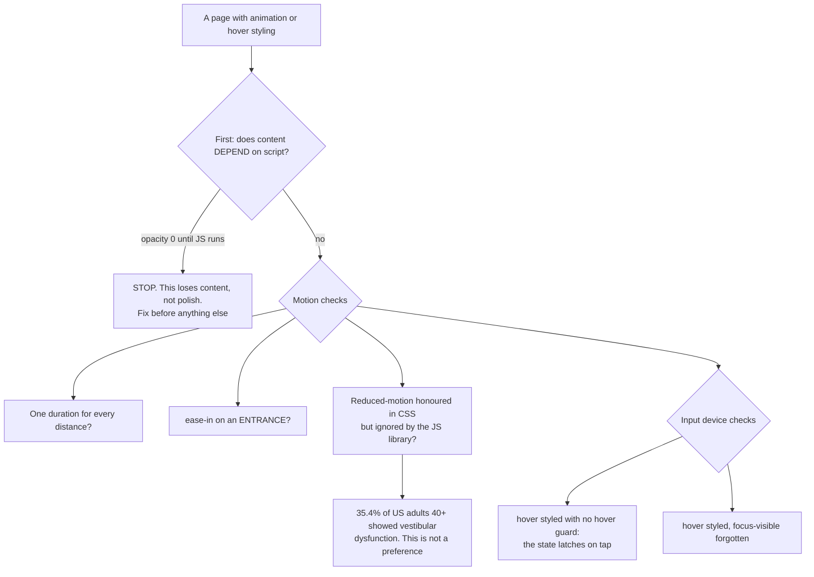

# Interaction and motion — the property a generator cannot watch

Motion is the one design property whose entire quality lives in TIME, and a generator emits it as a static string it can never watch run. That single fact predicts most of this file. Duration, easing and stagger are judgements made by watching, so the value that arrives is the corpus median applied uniformly — 300ms for a 2px hover tint and for a full-height sheet alike. And uniform motion is decoration by definition, because decoration is the only use of motion that needs no knowledge of what is actually happening on the page.

The second half of the file is about input devices. Hover is the state the author sees while building; focus only exists if you put the mouse down, and on a touchscreen hover latches on tap and never releases. None of that is visible in the source, which is why `hover-styles-without-a-hover-guard` and `hover-styled-focus-forgotten` are among the most reliable findings here.

Two items carry evidence rather than taste. Scroll capture: Nielsen Norman Group's usability testing found most participants at least mildly disoriented, several reading it as a bug rather than a design. And reduced motion: 35.4% of US adults aged 40 and over showed vestibular dysfunction in the 2001-2004 NHANES data, about 69 million people, which is why `prefers-reduced-motion` is not a nicety. Note the specific failure `reduced-motion-honoured-in-css-ignored-in-script` describes — the media query is satisfied while the parallax keeps running, because the query and the animation are two separately correct answers to two separately given instructions.

Read `initial-state-hidden-so-content-depends-on-script` first. It is the only item here that loses content rather than polish.

_26 items. Generated from catalog.json — edit there, then re-run `scripts/regenerate_references.py`. Do not hand-edit this file._

_Every item carries a **False positive when** line. Read it before you act on the item: these are cues for an editor, not evidence about an author._

<!-- humanize:ignore-start
     The diagram and index below quote the tells they document, and a
     mermaid label is not a sentence. -->

## When this file applies

## What is in this file

Severity reflects the consequence for the intended reader, never how sure you should be about who wrote it. **Automated** means these scripts implement the check; *no* means it is yours to ask in the judge pass.

| item | severity | family | automated |
| --- | --- | --- | --- |
| [`hover-is-the-only-route-to-the-information`](#hover-is-the-only-route-to-the-information) | HIGH | defect | yes |
| [`hover-styled-focus-forgotten`](#hover-styled-focus-forgotten) | HIGH | defect | yes |
| [`initial-state-hidden-so-content-depends-on-script`](#initial-state-hidden-so-content-depends-on-script) | HIGH | defect | yes |
| [`no-pending-state-on-the-primary-action`](#no-pending-state-on-the-primary-action) | HIGH | defect | yes |
| [`parallax-with-no-reduced-motion-path`](#parallax-with-no-reduced-motion-path) | HIGH | defect | yes |
| [`reduced-motion-honoured-in-css-ignored-in-script`](#reduced-motion-honoured-in-css-ignored-in-script) | HIGH | defect | yes |
| [`scroll-jacking`](#scroll-jacking) | HIGH | defect | yes |
| [`animating-a-layout-property`](#animating-a-layout-property) | med | defect | yes |
| [`ease-in-on-an-entrance`](#ease-in-on-an-entrance) | med | form | yes |
| [`fast-scroll-strands-the-reveal`](#fast-scroll-strands-the-reveal) | med | defect | **no** |
| [`hover-styles-without-a-hover-guard`](#hover-styles-without-a-hover-guard) | med | defect | yes |
| [`infinite-animation-with-no-off`](#infinite-animation-with-no-off) | med | defect | yes |
| [`modal-animation-delays-the-focus-move`](#modal-animation-delays-the-focus-move) | med | defect | yes |
| [`motion-on-everything-so-nothing-is-emphasised`](#motion-on-everything-so-nothing-is-emphasised) | med | shape | yes |
| [`one-duration-for-every-distance`](#one-duration-for-every-distance) | med | shape | yes |
| [`skeleton-that-does-not-match-what-arrives`](#skeleton-that-does-not-match-what-arrives) | med | defect | **no** |
| [`smooth-scroll-forced-globally`](#smooth-scroll-forced-globally) | med | form | yes |
| [`stagger-delay-outlasts-the-reader`](#stagger-delay-outlasts-the-reader) | med | shape | yes |
| [`toast-timeout-shorter-than-its-reading-time`](#toast-timeout-shorter-than-its-reading-time) | med | defect | yes |
| [`transition-all-as-the-default`](#transition-all-as-the-default) | med | form | yes |
| [`counter-animation-on-a-static-number`](#counter-animation-on-a-static-number) | low | form | yes |
| [`hover-scale-on-every-card`](#hover-scale-on-every-card) | low | form | yes |
| [`motion-does-not-track-the-gesture`](#motion-does-not-track-the-gesture) | low | shape | yes |
| [`reduced-motion-block-only-shortens-duration`](#reduced-motion-block-only-shortens-duration) | low | shape | yes |
| [`scroll-progress-bar-on-a-short-page`](#scroll-progress-bar-on-a-short-page) | low | shape | yes |
| [`will-change-left-on-everywhere`](#will-change-left-on-everywhere) | low | shape | yes |

<!-- humanize:ignore-end -->

<!-- humanize:ignore-start
     Everything below is a specimen catalog. It quotes the tells it documents,
     including literal machine residue, so reviewing it with humanize_review.py
     would flag the exhibits rather than the writing. -->

### `hover-is-the-only-route-to-the-information`  ·  high · generic-llm · web-ui · structural · family: defect · lane: interaction-and-motion

**Automated here:** yes, these scripts implement it.

Content or a control exists only in a hover state -- the tooltip with the real label, the row action that appears on hover, the definition behind a dotted underline. On a touchscreen it cannot be reached at all, and with a keyboard it can be reached only if the same styles are bound to :focus-visible, which they usually are not.

**Why it reads AI:** Unreviewed. Hover-reveal is a heavily represented desktop pattern and the failure mode is a property of the device, which the source does not describe.

**Detect:** Static: a :hover rule setting display, visibility or opacity on a descendant, with no matching :focus-within or :focus-visible selector. Assistive to settle: tab to the control and confirm the same content appears.

**Fix:** Bind the same reveal to :focus-within. Better, stop hiding it: if the action matters, it can be visible, and if it does not, it can be in a menu with a real trigger.

**False positive when:** A purely decorative hover flourish reveals no information and is not this. Ask whether a touchscreen user loses anything they could have acted on.

**Before**

> .row:hover .actions { opacity: 1 }

**After**

> .row:hover .actions, .row:focus-within .actions { opacity: 1 }

### `hover-styled-focus-forgotten`  ·  high · generic-llm · web-ui · structural · family: defect · lane: interaction-and-motion

**Automated here:** yes, these scripts implement it.

The stylesheet has a considered :hover state and no :focus-visible, so a keyboard user gets the browser's default ring where the ring was suppressed, or nothing at all where outline: none was set. Every interactive element in the file is styled for exactly one input device.

**Why it reads AI:** Model-flavoured at the edges and mostly unreviewed: hover is what the author sees while building, and focus is a state that only appears if you put the mouse down.

**Detect:** Static: count selectors carrying :hover against those carrying :focus-visible or :focus. A ratio above 3:1, or any outline: none without a replacement indicator, is the finding.

**Fix:** Every :hover gets a :focus-visible. If you remove the default outline, replace it with an indicator of at least equal visibility -- WCAG 2.2's 2.4.11 makes the size and contrast of that indicator testable.

**False positive when:** A design system may centralise focus rings in one place (a :where(:focus-visible) base rule or a Tailwind ring plugin default). Check for a global rule before counting selector pairs.

**Before**

> a:hover { color: var(--accent) } /* and nothing for focus */

**After**

> a:hover, a:focus-visible { color: var(--accent) } with a visible ring

### `initial-state-hidden-so-content-depends-on-script`  ·  high · generic-llm · web-ui · structural · family: defect · lane: interaction-and-motion

**Automated here:** yes, these scripts implement it.

Reveal-on-scroll is implemented as opacity: 0 in CSS with a class added by script. If the script does not run, or does not run in time, or the element never enters the viewport, the content is permanently invisible -- and it is invisible to in-page search, to print, and to anything reading the rendered page. It is the one animation bug that loses content rather than polish.

**Why it reads AI:** Unreviewed with a model-flavoured seam. The CSS half and the JS half are each correct, and nothing in either half encodes what happens when only one of them runs.

**Detect:** Static: a rule setting opacity: 0 or visibility: hidden on a content selector that is only cleared by a JS-added class. Rendered to confirm: load with JavaScript disabled, or scroll to the bottom in one jump, and diff visible text against the DOM's text.

**Fix:** Animate from a visible state, or gate the hidden initial state behind a class the script sets on <html> first, so the no-script path renders everything. @starting-style does this natively now.

**False positive when:** A loading skeleton or a modal that is legitimately absent until opened is not content loss. The finding is body content whose only route to visible is a script.

**Before**

> .reveal { opacity: 0 } /* cleared only by IntersectionObserver */

**After**

> html.js .reveal { opacity: 0 } -- the hidden state exists only once script is running

### `no-pending-state-on-the-primary-action`  ·  high · generic-llm · web-ui · structural · family: defect · lane: interaction-and-motion

**Automated here:** yes, these scripts implement it.

The submit button looks identical during the request. The user gets no acknowledgement that the click registered, so they click again -- and with no disabled-on-pending or idempotency the second click is a second request. It is the most common cause of duplicate submissions and it is invisible on a fast local machine.

**Why it reads AI:** Unreviewed. The pending state has no duration on localhost, so nothing about building the page surfaces it.

**Detect:** Static: a submit handler performing an async call with no pending/loading/isSubmitting state read by the button, and no aria-busy.

**Fix:** Set a pending state on click: change the label, show a spinner in the button, set aria-busy, and guard the handler against re-entry. Keep the button focusable so the state is announced.

**False positive when:** A form that navigates away immediately shows the browser's own loading state. The finding applies to in-page async submits.

**Before**

> onSubmit={async () => { await save() }} with a static button

**After**

> pending state driving label, aria-busy, and a re-entry guard

### `parallax-with-no-reduced-motion-path`  ·  high · generic-llm · web-ui · structural · family: defect · lane: interaction-and-motion

**Automated here:** yes, these scripts implement it.

A background moves at a different rate from the foreground, which is the example WCAG 2.3.3 names directly and the one most cited for vestibular reactions -- dizziness, nausea, headache. Implemented with background-attachment: fixed or a scroll-linked transform, and with no query guarding it.

**Why it reads AI:** Unreviewed. Parallax is well represented in the corpus of sites that look expensive, and the harm is a fact about bodies rather than about markup.

**Detect:** Static: background-attachment: fixed, or a scroll handler writing translate3d/translateY from scrollY, with no prefers-reduced-motion guard in the same file.

**Fix:** Guard it: @media (prefers-reduced-motion: reduce) { background-attachment: scroll }, and skip the scroll handler when the query matches.

**False positive when:** A subtle depth effect of a few pixels is less likely to trigger a reaction than a full-viewport one, but the guard costs two lines either way, so the finding stands on any unguarded scroll-linked transform.

**Before**

> background-attachment: fixed with no guard

**After**

> the same, plus a reduce block setting background-attachment: scroll

### `reduced-motion-honoured-in-css-ignored-in-script`  ·  high · generic-llm · web-ui · structural · family: defect · lane: interaction-and-motion

**Automated here:** yes, these scripts implement it.

The stylesheet has a prefers-reduced-motion block and the JavaScript animation library does not consult the query at all. The user's setting silences the CSS transitions and leaves the parallax, the scroll-triggered timeline and the spring physics running -- which is the motion that actually causes trouble. 35.4% of US adults aged 40 and over showed vestibular dysfunction in the 2001-2004 NHANES data, about 69 million people.

**Why it reads AI:** Unreviewed with a model-flavoured seam. "Add a reduced-motion media query" and "add scroll animations" are two instructions satisfied independently, and the media query is the one that can be satisfied without touching the animation.

**Detect:** Static: a prefers-reduced-motion at-rule present in the CSS while a motion library (gsap, framer-motion, lenis, locomotive, animejs, lottie, aos) is initialised with no matchMedia('(prefers-reduced-motion: reduce)') check in the same file or its config.

**Fix:** Read the query in JS and branch: skip the timeline, or set duration to 0. Bind it to the change event too, so toggling the OS setting takes effect without a reload.

**False positive when:** A library configured globally elsewhere (a provider component, a MotionConfig reducedMotion="user" wrapper) does honour it. Check for a central config before flagging.

**Before**

> @media (prefers-reduced-motion: reduce){...} plus an unconditional gsap timeline

**After**

> if (!matchMedia('(prefers-reduced-motion: reduce)').matches) buildTimeline()

### `scroll-jacking`  ·  high · generic-llm · web-ui · structural · family: defect · lane: interaction-and-motion

**Automated here:** yes, these scripts implement it.

The page overrides native scrolling to drive its own sequence, so a wheel notch or a trackpad flick no longer moves the page the distance the user asked for. Nielsen Norman Group usability testing found most participants became at least mildly disoriented, some reading the altered behaviour as a bug rather than a design, and task-focused visitors dropping off.

**Why it reads AI:** Unreviewed. Scroll-driven sequencing is heavily represented in award-site training data and reads as sophistication in source form; the cost only exists in the hand.

**Detect:** Static: a wheel/touchmove listener calling preventDefault, or a pinned-section scroll library (locomotive-scroll, fullpage.js, ScrollTrigger with pin: true, scroll-snap-type: y mandatory on a tall container). Rendered to confirm: dispatch a fixed wheel delta and measure whether scrollY moved by the platform default.

**Fix:** Let the page scroll. If a section must hold position, use CSS scroll-snap with proximity rather than mandatory, keep every keyboard route working, and never call preventDefault on wheel.

**False positive when:** A genuine full-screen presentation or a map/canvas surface that owns its own gesture space is a different contract and the user knows they are in it. The finding is scroll capture on an ordinary scrolling document.

**Before**

> window.addEventListener('wheel', e => { e.preventDefault(); ... })

**After**

> scroll-snap-type: y proximity, and the wheel event left alone

### `animating-a-layout-property`  ·  medium · generic-llm · web-ui · structural · family: defect · lane: interaction-and-motion

**Automated here:** yes, these scripts implement it.

height, width, top, left, margin or padding are animated instead of transform and opacity. Those properties force layout on every frame for the whole subtree, so the animation janks on exactly the hardware that is already struggling, and it is the most common cause of a motion that feels cheap without looking wrong in a screenshot.

**Why it reads AI:** Model-flavoured. Animating the property whose value you want to change is the intuitive reading of the CSS, and the compositor argument is knowledge about the browser rather than about the language.

**Detect:** Static: a transition-property or keyframe block naming height, width, top, left, right, bottom, margin or padding. Exclude cases already inside a prefers-reduced-motion block.

**Fix:** Animate transform and opacity. For a height change use a grid-template-rows 0fr-to-1fr transition or the interpolate-size / calc-size route, both of which stay off the layout path in current browsers.

**False positive when:** A one-off animation on a small, isolated element outside any list is cheap enough that this does not matter. Weight the finding by how many elements share the rule.

**Before**

> transition: height 300ms

**After**

> grid-template-rows: 0fr; transition: grid-template-rows 220ms ease-out

### `ease-in-on-an-entrance`  ·  medium · generic-llm · web-ui · structural · family: form · lane: interaction-and-motion

**Automated here:** yes, these scripts implement it.

Content arriving uses ease-in, which starts slow and accelerates -- so the element loiters exactly when the reader is waiting for it and then snaps. Entrances want ease-out (fast, then settling); exits want ease-in. A practitioner thread naming what makes scroll animation tiring landed on precisely this pair: a fade or translate lasting more than 0.2s and using ease-in.

**Why it reads AI:** Model-flavoured. `ease-in` reads like the right word for coming in, and the naming collision is a language fact rather than a motion fact -- exactly the kind of error a text model makes and a person watching the screen does not.

**Detect:** Static: an ease-in or cubic-bezier with a slow leading control point on a keyframe or transition whose name or properties mark it as an entrance (fade-in, slide-up, reveal, enter, opacity 0 to 1, translateY positive to 0).

**Fix:** ease-out on entrances, ease-in on exits, ease-in-out only for a move that both starts and ends on screen. Keep entrance durations at or under 200ms.

**False positive when:** A deliberately slow, weighted entrance can be a real choice on a splash or a hero. The finding is the default pairing applied across a file, not one considered exception.

**Before**

> animation: fade-in 400ms ease-in;

**After**

> animation: fade-in 180ms ease-out;

### `fast-scroll-strands-the-reveal`  ·  medium · generic-llm · web-ui · rendered · family: defect · lane: interaction-and-motion

**Automated here:** no — decidable mechanically, but this bundle does not implement it. Ask it yourself in the judge pass.

The reveal fires from an IntersectionObserver with no fallback, so a user who flings to the bottom of the page, follows an anchor link, or restores a scroll position passes the trigger without it firing -- and lands on blank sections. The faster the user, the more broken the page.

**Why it reads AI:** Unreviewed. The pattern is tested by scrolling slowly, which is how its author reads a page and not how a returning user does.

**Detect:** Rendered: jump scrollTop to the document height in one assignment, wait a frame, and count elements still at opacity 0. Static hint: an observer with no fallback timer and no check of the initial intersection state.

**Fix:** Check intersection on registration, add a timeout that reveals everything after a second or two regardless, and reveal on hashchange. Or use CSS scroll-driven animations, which have no trigger to miss.

**False positive when:** Below-the-fold lazy content that legitimately has not loaded yet is a different thing. This is content that is present in the DOM and invisible.

**Before**

> new IntersectionObserver(cb) with no initial check and no timeout

**After**

> reveal on intersection, on hashchange, and unconditionally after 1200ms

### `hover-styles-without-a-hover-guard`  ·  medium · generic-llm · web-ui · structural · family: defect · lane: interaction-and-motion

**Automated here:** yes, these scripts implement it.

Hover styles are declared with no @media (hover: hover) guard, so on a touchscreen the state latches on tap and stays until the user taps elsewhere. The card the user just tapped stays lit while they read the page they navigated to and come back.

**Why it reads AI:** Unreviewed. The behaviour does not exist on the machine the code was written for, and there is no way to notice it from the source.

**Detect:** Static: :hover rules that change background, colour, transform or shadow, with no (hover: hover) or (pointer: fine) media query anywhere in the stylesheet.

**Fix:** Wrap hover styling in @media (hover: hover) and pointer: fine. Note the known limit: a touchscreen laptop answers yes to both, so keep :active and :focus-visible carrying their own weight.

**False positive when:** A stylesheet that only ever ships to a desktop app shell has one input model. And a site with no hover styling at all is not this finding.

**Before**

> \.card:hover { transform: translateY(-4px) }

**After**

> @media (hover: hover) and (pointer: fine) { .card:hover { ... } }

### `infinite-animation-with-no-off`  ·  medium · generic-llm · web-ui · structural · family: defect · lane: interaction-and-motion

**Automated here:** yes, these scripts implement it.

Something moves forever -- a pulsing dot, a marquee, a floating blob, an animated gradient. Beyond five seconds of unattended motion WCAG 2.2.2 requires a mechanism to pause, stop or hide it, and an infinite CSS animation has none. It also keeps a compositor layer awake, which is a battery cost on a page doing nothing.

**Why it reads AI:** Model-flavoured. `animation: float 6s ease-in-out infinite` is a corpus staple for decorative blobs and arrives with no thought about how it stops.

**Detect:** Static: animation with `infinite` or iteration-count above a threshold, on an element that is not a loading indicator, with no pause control and no reduced-motion guard.

**Fix:** Stop it after a few cycles, or bind it to a control, or guard it with reduced-motion. A loading spinner is exempt because it ends when the load does -- as long as it actually ends.

**False positive when:** A busy indicator that terminates on load completion is exempt under 2.2.2. So is motion under about five seconds total.

**Before**

> animation: pulse 2s infinite;

**After**

> animation: pulse 2s 3; /* or guarded, or with a pause control */

### `modal-animation-delays-the-focus-move`  ·  medium · generic-llm · web-ui · structural · family: defect · lane: interaction-and-motion

**Automated here:** yes, these scripts implement it.

The dialog animates open over 300ms and focus is moved in an animation-complete callback, so for the length of the animation the keyboard is still on the page behind and a screen reader is still reading it. Tab during that window and you are in the background content, which the dialog now covers.

**Why it reads AI:** Unreviewed with a model-flavoured seam. "Animate the dialog" and "move focus into the dialog" are separately correct and their ordering is the part nobody specified.

**Detect:** Static: a focus() call inside an onAnimationComplete/transitionend/setTimeout tied to the open transition. Rendered to settle: open the dialog and read document.activeElement on the next frame.

**Fix:** Move focus on open, before or during the animation. The animation is decoration; the focus move is the state change.

**False positive when:** An animation under about 100ms is short enough that the window does not matter in practice. The finding is a focus move gated on a long transition.

**Before**

> onAnimationComplete={() => ref.current.focus()}

**After**

> focus on open; let the animation run underneath it

### `motion-on-everything-so-nothing-is-emphasised`  ·  medium · generic-llm · web-ui · structural · family: shape · lane: interaction-and-motion

**Automated here:** yes, these scripts implement it.

Every section, card and heading reveals on scroll. Motion is a contrast channel like size or weight, and spending it on all content spends it on none: if everything animates, the animation tells the reader nothing about what matters. Reviewers in one six-site teardown said the same thing each time -- the animation captured their attention while the product messaging went unread.

**Why it reads AI:** Unreviewed rather than machine-written. The instruction "add scroll animations" has no natural stopping point, and a generator applies an instruction to every element it can see rather than to the one that needed it.

**Detect:** Static: count distinct elements carrying a scroll-reveal trigger (data-aos, .animate-on-scroll, whileInView, IntersectionObserver add-class) against the number of top-level sections. A ratio at or above 0.8 with three or more sections is the finding.

**Fix:** Pick the one or two moments that deserve emphasis and let everything else be present on arrival. A reveal on the hero statistic means something; a reveal on the footer means the page is slow.

**False positive when:** A deliberate scroll-driven narrative (a product tour, a data story) uses motion as its structure and is not this finding. Check whether removing the motion removes information: if it does, keep it.

**Before**

> every <section> wrapped in data-aos="fade-up"

**After**

> one reveal on the single element the page is about; the rest render

### `one-duration-for-every-distance`  ·  medium · generic-llm · web-ui · structural · family: shape · lane: interaction-and-motion

**Automated here:** yes, these scripts implement it.

The same duration is used for a 2px hover tint and a full-height sheet sliding in. Perceived speed is distance over time, so a constant duration makes small moves feel sluggish and large moves feel abrupt. Real motion systems scale duration with the distance travelled and the size of the surface.

**Why it reads AI:** Model-flavoured, and the clearest case of the lane's mechanism: duration is a judgement made by watching, and a generator cannot watch. 300ms is the corpus median and it is emitted for everything.

**Detect:** Static: collect every transition-duration and animation-duration in the file. If three or more distinct animated contexts share one value and no duration token scale exists, that is the finding.

**Fix:** Two or three durations tied to distance: roughly 100-150ms for a hover or a tint, 200-250ms for a popover or a dropdown, 300-400ms for a full-screen or full-height surface. Put them in tokens so the choice is visible.

**False positive when:** A small component library that genuinely only has hover states has one distance and correctly has one duration. Require three or more distinct animated contexts before flagging.

**Before**

> every transition in the file is 300ms

**After**

> --dur-quick: 120ms; --dur-panel: 220ms; --dur-sheet: 360ms;

### `skeleton-that-does-not-match-what-arrives`  ·  medium · generic-llm · web-ui · rendered · family: defect · lane: interaction-and-motion

**Automated here:** no — decidable mechanically, but this bundle does not implement it. Ask it yourself in the judge pass.

The loading skeleton is three grey bars and the content that lands is a heading, an image and a table. Because the shapes do not match, the skeleton does not reserve the right space and the page shifts when it resolves -- so the skeleton has done the opposite of its job, which is to make the layout stable before the data exists.

**Why it reads AI:** Unreviewed. A generic skeleton is reusable and correct-looking, and only the resolved page shows the mismatch.

**Detect:** Rendered: measure the skeleton's box, measure the resolved content's box, and compare. Static hint: a generic skeleton component used for structurally different regions.

**Fix:** Shape the skeleton like the content, or reserve space with aspect-ratio and min-height instead. A skeleton that shifts is worse than a spinner that does not.

**False positive when:** A small variance is normal and invisible. Use a layout-shift threshold rather than an exact match.

**Before**

> <Skeleton /> (three bars) standing in for a media object with a table

**After**

> a skeleton whose boxes match the resolved layout, or reserved space

### `smooth-scroll-forced-globally`  ·  medium · generic-llm · web-ui · structural · family: form · lane: interaction-and-motion

**Automated here:** yes, these scripts implement it.

scroll-behavior: smooth on html or :root makes every programmatic jump animate, including ones the user did not ask to watch: skip links, an anchor into a long document, a scroll restore on back. A long page becomes a long animation, and a screen-reader user following a skip link has to wait for it.

**Why it reads AI:** Model-flavoured. It is a one-line global improvement in appearance and its cost only appears on the paths a generator does not exercise.

**Detect:** Static: scroll-behavior: smooth on html, :root or body with no prefers-reduced-motion guard.

**Fix:** Apply smooth scrolling to the specific interactions that want it, or keep the global rule and guard it with @media (prefers-reduced-motion: no-preference). Skip links should always jump.

**False positive when:** Guarded by a no-preference query, this is correct and common. The finding is the unguarded global rule.

**Before**

> html { scroll-behavior: smooth }

**After**

> @media (prefers-reduced-motion: no-preference) { html { scroll-behavior: smooth } }

### `stagger-delay-outlasts-the-reader`  ·  medium · generic-llm · web-ui · structural · family: shape · lane: interaction-and-motion

**Automated here:** yes, these scripts implement it.

A list animates in with a per-item delay, and nobody multiplied it out. 120ms across fourteen items is 1.7 seconds before the last one exists, during which the page is measurably incomplete and the reader is waiting on an effect rather than reading.

**Why it reads AI:** Model-flavoured. A per-item delay is written once and the item count arrives from data, so the total is never a number anyone saw.

**Detect:** Static: a per-index delay expression (index * N, animation-delay with a calc on a custom property, staggerChildren) where delay times the rendered item count exceeds the threshold, default 600ms.

**Fix:** Cap the total: divide the budget by the count, or stagger only the first few items and bring the rest in together. Keep the whole sequence inside about 400ms.

**False positive when:** A short list of three or four items never reaches the threshold. And a deliberately theatrical sequence on a splash screen is a choice; the finding is a list of content.

**Before**

> style={{ animationDelay: `${i * 120}ms` }} over 14 cards

**After**

> delay = Math.min(i, 4) * 60 -- the tail arrives together

### `toast-timeout-shorter-than-its-reading-time`  ·  medium · generic-llm · web-ui · structural · family: defect · lane: interaction-and-motion

**Automated here:** yes, these scripts implement it.

A notification dismisses itself on a fixed timer -- usually three seconds -- regardless of how much text it carries. WCAG 2.2.1 requires that time limits be adjustable or extendable, and a screen reader or a slower reader cannot get through a two-line message before it goes. If the message carried the only copy of an error, the information is now gone.

**Why it reads AI:** Unreviewed. Three seconds is the corpus default, and the mismatch only exists once real message text arrives.

**Detect:** Static: a setTimeout dismiss on a toast/snackbar/alert component with a fixed duration below the threshold (default 5000ms), or a duration constant that does not scale with message length.

**Fix:** Scale the timeout with the text, pause on hover and on focus, and never auto-dismiss anything carrying an error or an undo. Give every toast a close button.

**False positive when:** A purely confirmatory toast next to a visible result can be short-lived. The finding is a fixed short timer applied to errors and to long messages alike.

**Before**

> setTimeout(dismiss, 3000) for every toast

**After**

> duration scaled to length, paused on hover/focus, errors persistent

### `transition-all-as-the-default`  ·  medium · generic-llm · web-ui · structural · family: form · lane: interaction-and-motion

**Automated here:** yes, these scripts implement it.

transition: all applied broadly. It animates every property that ever changes, including ones that were never meant to -- a class swap that also changes height or padding now animates layout, and the browser cannot compositor-accelerate it. It is also a declaration that no one chose which property was changing.

**Why it reads AI:** Model-flavoured. `transition: all 0.3s ease` and `transition-all duration-300` are the single most reproduced motion lines in generated CSS, because they always work and never require knowing what is changing.

**Detect:** Static: count `transition: all` or `transition-property: all` declarations in the stylesheet, and Tailwind's `transition-all` utility in markup. Two or more is the finding.

**Fix:** Name the properties: transition: background-color 120ms ease-out, transform 160ms ease-out. If you cannot name them, the element does not need a transition.

**False positive when:** A tiny, fully-known component (an icon button whose only animatable properties are colour and transform) loses little to `all`. Two or more across a stylesheet is the signal, not one.

**Before**

> transition: all 0.3s ease;

**After**

> transition: background-color 120ms ease-out, transform 160ms ease-out;

### `counter-animation-on-a-static-number`  ·  low · generic-llm · web-ui · structural · family: form · lane: interaction-and-motion

**Automated here:** yes, these scripts implement it.

A statistic counts up from zero when it scrolls into view. The number did not change -- it is the same number it was before the animation, and for a few hundred milliseconds the page displays values that are not true. With a screen reader or in-page search the animated value is either unreadable or wrong.

**Why it reads AI:** Model-flavoured. It is a recognisable marketing-site flourish with an easy implementation, and it is emitted whenever a page has statistics on it.

**Detect:** Static: a scroll-triggered increment writing to textContent/innerText over an interval or requestAnimationFrame, with a numeric end value that is a literal in the source.

**Fix:** Render the number. If you keep the effect, put the true value in the DOM and animate a visual layer, or mark the animating node aria-hidden with the real figure in a visually hidden sibling.

**False positive when:** A live counter bound to real changing data is a different thing entirely. The finding is a literal whose display is animated.

**Before**

> el.textContent = Math.round(progress * 12000)

**After**

> the real figure in the DOM, the animation decorating it and aria-hidden

### `hover-scale-on-every-card`  ·  low · generic-llm · web-ui · structural · family: form · lane: interaction-and-motion

**Automated here:** yes, these scripts implement it.

Every card lifts and scales on hover by the same amount. It is the framer-motion whileHover default and the Tailwind hover:scale-105 idiom, applied to a grid, and it makes a page where nothing is more interactive than anything else -- plus, on text, a transform scale resamples the glyphs and they go soft.

**Why it reads AI:** Model-flavoured. It is the most reproduced single interaction in generated component code, because it is one attribute and always renders.

**Detect:** Static: hover:scale-* or whileHover={{ scale: ... }} or a :hover transform: scale() appearing on three or more sibling elements with the same value.

**Fix:** Use hover to signal what is clickable, not to decorate. A background shift or a border change says the same thing without resampling text; if you scale, scale the container and not the type.

**False positive when:** A single hero call to action with a considered lift is fine. The finding is the same value repeated across siblings.

**Before**

> className="hover:scale-105" on every card in the grid

**After**

> hover:bg-surface-raised, and scale reserved for the one primary action

### `motion-does-not-track-the-gesture`  ·  low · generic-llm · web-ui · structural · family: shape · lane: interaction-and-motion

**Automated here:** yes, these scripts implement it.

A swipe, drag or pull-to-refresh runs a fixed-duration animation instead of following the pointer. The surface does not move with the finger, so there is no sense of direct manipulation and no way to abort halfway -- the gesture is a trigger for a canned animation rather than a manipulation of an object.

**Why it reads AI:** Model-flavoured. Gesture-tracked motion needs the pointer stream and interruption handling; a timed animation is a single call and satisfies the same sentence.

**Detect:** Static: a touchstart/pointerdown handler that starts a timed animation without reading pointer deltas in the move handler.

**Fix:** Bind position to the pointer delta while the gesture is live, and hand the remainder to a spring on release with the gesture's velocity. Let the user drag it back.

**False positive when:** A tap-triggered transition is not a gesture and is not this finding. Restrict it to drag and swipe affordances.

**Before**

> onTouchStart={() => animateOut(300)}

**After**

> position follows pointer delta; release hands velocity to a spring

### `reduced-motion-block-only-shortens-duration`  ·  low · generic-llm · web-ui · structural · family: shape · lane: interaction-and-motion

**Automated here:** yes, these scripts implement it.

The reduced-motion block is the copy-pasted nuclear reset -- animation-duration: 0.01ms on everything -- which is a reasonable floor and is not a motion design. It leaves parallax offsets, auto-advancing carousels and large translate distances in place, because those are not durations, and it strips motion that was communicating state, like a focus move or an expanding row.

**Why it reads AI:** Model-flavoured. The universal reset is one of the most copied snippets on the web and is emitted as the complete answer to the query rather than as its floor.

**Detect:** Static: a prefers-reduced-motion block whose declarations are only duration, delay or iteration-count resets, with no transform, background-attachment or autoplay handling.

**Fix:** Keep the reset as a backstop, then handle the cases it cannot: set background-attachment: scroll, stop auto-advancing content, and replace large translations with a cross-fade rather than removing the transition entirely.

**False positive when:** The reset alone is genuinely sufficient on a page whose only motion is short CSS transitions. Flag it where parallax, autoplay or large translations are also present.

**Before**

> @media (prefers-reduced-motion: reduce) { * { animation-duration: 0.01ms !important } }

**After**

> the reset, plus parallax off, autoplay paused, and translations replaced with fades

### `scroll-progress-bar-on-a-short-page`  ·  low · generic-llm · web-ui · structural · family: shape · lane: interaction-and-motion

**Automated here:** yes, these scripts implement it.

A reading-progress indicator sits at the top of a document short enough to need no orientation, or of a page whose real content is one screen of marketing. It is a scroll listener, a fixed element and a repaint per frame, spent telling the reader something the scrollbar already told them.

**Why it reads AI:** Model-flavoured. It is a small self-contained feature that demonstrates competence and is emitted whenever the word "blog" appears.

**Detect:** Static: a scroll handler writing a width or transform to a fixed progress element, on a document whose text length is below the threshold (default 6000 characters).

**Fix:** Keep it for long-form reading where it orients, drop it elsewhere, and drive it with a CSS scroll-driven animation rather than a scroll listener where you keep it.

**False positive when:** A long documentation page or an article genuinely benefits. The finding is length-conditional, so read the text length before reporting.

**Before**

> a progress bar on a 400-word landing page

**After**

> no bar; or animation-timeline: scroll() on a genuinely long article

### `will-change-left-on-everywhere`  ·  low · generic-llm · web-ui · structural · family: shape · lane: interaction-and-motion

**Automated here:** yes, these scripts implement it.

will-change is declared broadly or permanently. It promotes elements to their own compositor layer and holds the memory for as long as the declaration applies, so used as a blanket optimisation it costs more than the jank it was meant to remove -- and on a long list it is the thing that makes a mid-range phone stutter.

**Why it reads AI:** Model-flavoured. It is presented in the corpus as a performance hint, and a hint reads as free.

**Detect:** Static: count will-change declarations. Three or more, or one on a broad selector (*, .card, section), is the finding.

**Fix:** Set it immediately before the animation and remove it after, or leave it out: transform and opacity animations are already composited without it.

**False positive when:** A single justified declaration on one heavily animated element is correct usage. Count, and weight by selector breadth.

**Before**

> .card { will-change: transform }

**After**

> set on the element at animation start, removed on finish

<!-- humanize:ignore-end -->
