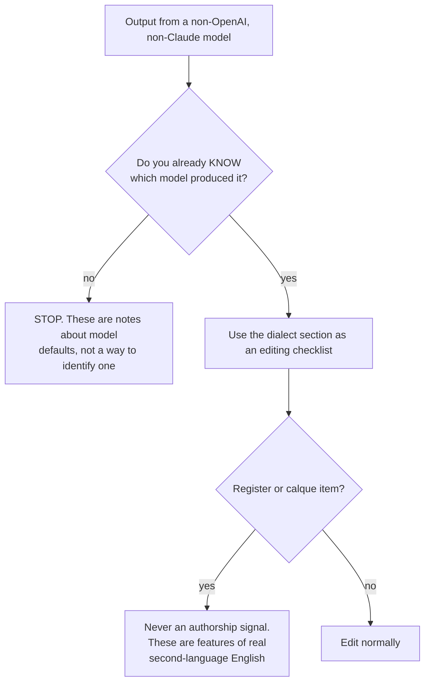

# Other model dialects — Gemini, Kimi, DeepSeek, Qwen, Llama, Grok — and cross-model translationese

Distinctive tics per model family, plus the affect and register tells that mark any machine output regardless of vendor.

_14 items. Generated from catalog.json — edit there, then re-run `scripts/regenerate_references.py`. Do not hand-edit this file._

_Every item carries a **False positive when** line. Read it before you act on the item: these are cues for an editor, not evidence about an author._

<!-- humanize:ignore-start
     The diagram and index below quote the tells they document, and a
     mermaid label is not a sentence. -->

## When this file applies

## What is in this file

Severity reflects the consequence for the intended reader, never how sure you should be about who wrote it. **Automated** means these scripts implement the check; *no* means it is yours to ask in the judge pass.

| item | severity | family | automated |
| --- | --- | --- | --- |
| [`as-an-ai-leakage`](#as-an-ai-leakage) | HIGH | residue | yes |
| [`gemini-important-to-note-stack`](#gemini-important-to-note-stack) | HIGH | form | **no** |
| [`gemini-safety-caveat-boilerplate`](#gemini-safety-caveat-boilerplate) | HIGH | form | n/a |
| [`llama-repetition-loop`](#llama-repetition-loop) | HIGH | form | **no** |
| [`register-leveling`](#register-leveling) | HIGH | form | n/a |
| [`deepseek-qwen-overformal-register`](#deepseek-qwen-overformal-register) | med | form | **no** |
| [`gemini-question-restatement`](#gemini-question-restatement) | med | form | n/a |
| [`grok-forced-irreverence`](#grok-forced-irreverence) | med | shape | n/a |
| [`kimi-linkedin-confident-slop`](#kimi-linkedin-confident-slop) | med | shape | n/a |
| [`qwen-deepseek-chinglish-calque`](#qwen-deepseek-chinglish-calque) | med | form | n/a |
| [`tense-and-perspective-drift`](#tense-and-perspective-drift) | med | form | **no** |
| [`kimi-longform-collapse`](#kimi-longform-collapse) | low | form | **no** |
| [`low-burstiness-uniform-rhythm`](#low-burstiness-uniform-rhythm) | low | rhythm | yes |
| [`zero-typo-zero-contraction-affect-flatness`](#zero-typo-zero-contraction-affect-flatness) | low | rhythm | yes |

<!-- humanize:ignore-end -->

<!-- humanize:ignore-start
     Everything below is a specimen catalog. It quotes the tells it documents,
     including literal machine residue, so reviewing it with humanize_review.py
     would flag the exhibits rather than the writing. -->

### `as-an-ai-leakage`  ·  high · generic-llm · prose · structural · family: residue

**Automated here:** yes, these scripts implement it.

**Currency:** Fading — still seen, but vendors have patched toward it and it is weakening.

Less RLHF-polished open models leak identity/disclaimer phrases mid-answer: 'As an AI language model, I...,' 'I do not have personal opinions, but...,' 'trained by [vendor]...'. Sometimes the wrong vendor is named.

**Why it reads AI:** This is the most unambiguous AI signature there is. No human writes 'as an AI language model'; its presence is a near-100% tell, and a wrong vendor name additionally exposes training-data contamination.

**Detect:** structural: high-precision exact/regex signature match on the leakage family ('As an AI( language model)?', 'I (do not|don't) have (personal )?(opinions|feelings|beliefs)', 'trained by (OpenAI|Google|...)'). This is a deterministic generation-artifact signature, not a fuzzy content classifier.

**Fix:** Delete the disclaimer entirely and answer in the first person or impersonally. If an opinion is wanted, give a defensible take with reasons.

**False positive when:** Writing about AI quotes these strings constantly, including this catalog. Quoted and fenced regions are excluded before the check runs. Note also that the phrase is close to extinct in current frontier output, so a hit usually means older text or a smaller model.

**Before**

> As an AI language model, I do not have personal opinions, but the best programming language for beginners is generally considered to be Python.

**After**

> For beginners, Python is the easiest entry point: readable syntax, huge ecosystem, forgiving error messages.

### `gemini-important-to-note-stack`  ·  high · gemini · prose · structural · family: form

**Automated here:** no — decidable mechanically, but this bundle does not implement it. Ask it yourself in the judge pass.

Gemini compulsively front-loads or interleaves hedging meta-clauses: 'It's important to note that...,' 'It's worth remembering that...,' 'Keep in mind that...,' often two or three stacked across a short answer.

**Why it reads AI:** Humans rarely announce that they are about to say something important; they just say it. The stacked frame is a trained safety reflex that reads as institutional throat-clearing.

**Detect:** structural: compute the density of the discourse-hedge meta-clause frame ('it's [adj] to [verb] that' plus 'keep/bear in mind') per 150 words as a stylometric feature; flag >~1 per 150 words or 2+ in an answer under 400 words.

**Fix:** Delete the meta-clause and state the fact directly. If a caveat is pivotal, fold it into the sentence as a clause.

**False positive when:** 'It is important to note' is standard academic and technical English and often marks a genuine caveat. Flag the stack: two or three such clauses in a short answer, several of them introducing nothing important.

**Before**

> It's important to note that compound interest grows faster than simple interest. It's also worth remembering that the rate matters. Keep in mind that time horizon is a major factor.

**After**

> Compound interest outpaces simple interest, and the gap widens with both the rate and the time horizon.

### `gemini-safety-caveat-boilerplate`  ·  high · gemini · prose · llm-judge · family: form

On any topic adjacent to health, law, finance, or relationships, Gemini appends defensive boilerplate ('consult a qualified professional,' 'this is not medical/legal/financial advice,' 'individual results may vary') even when the user asked a purely factual question.

**Why it reads AI:** Reflexive liability boilerplate stapled to ordinary answers is a corporate-safety artifact. A knowledgeable human gives a caveat when it's actually warranted, not as a ritual signature.

**Detect:** llm-judge: 'Does the response append an unsolicited professional-consultation or not-X-advice disclaimer to an ordinary informational answer?'

**Fix:** Remove unsolicited disclaimers. If a genuine risk warrants a caveat, make it specific and singular.

**False positive when:** Some of these disclaimers are required by regulation or platform policy for financial, medical and legal content, and there the boilerplate is the compliant behaviour. Flag it where no such requirement applies and the user asked something the caveat does not fit.

**Before**

> Magnesium can help with sleep. However, it's important to consult a qualified healthcare professional before starting any supplement, as individual results may vary and this is not medical advice.

**After**

> Magnesium glycinate around 200-400mg before bed helps many people sleep; it can loosen stool at higher doses, so ramp up slowly.

### `llama-repetition-loop`  ·  high · llama · prose · structural · family: form

**Automated here:** no — decidable mechanically, but this bundle does not implement it. Ask it yourself in the judge pass.

Llama-family models loop: restating the same point in slightly reworded sentences, recycling a transition ('In conclusion'), or circling a list back to its first item. Documented as higher repetition than Mixtral or OLMo.

**Why it reads AI:** Near-verbatim restatement is a decoding artifact (high-probability paths loop). Humans editing their own text delete the redundancy; the model doesn't.

**Detect:** structural: compute sentence-level n-gram overlap / cosine similarity between adjacent and near-adjacent sentences; flag when multiple pairs exceed ~0.8 similarity, or the same closing transition appears more than once.

**Fix:** Deduplicate: keep one statement of each idea, cut recycled transitions, end once. If length is needed, add evidence or examples, not paraphrases.

**False positive when:** Repetition is legitimate for emphasis, in teaching material, in specifications where restating beats a cross-reference, and in anything written to be read aloud. Flag near-identical restatement that adds nothing, in a piece with no reason to repeat.

**Before**

> Exercise is good for your health. Staying active benefits your wellbeing. In short, being physically active is good for your health and overall wellbeing.

**After**

> Exercise lowers resting heart rate, improves insulin sensitivity, and lifts mood within weeks of starting.

### `register-leveling`  ·  high · generic-llm · prose · llm-judge · family: form

The same voice regardless of genre: a Slack message, a postmortem and a wedding toast all arrive in the same measured explanatory register.

**Why it reads AI:** Instruction tuning produces a fixed, informationally dense register that models carry into every genre, even when explicitly prompted to match informal speech. The literature calls the result genre misalignment.

**Detect:** Name the genre this text is written in. Then name the genre it is FOR. Do they match?

**Fix:** Name the target genre out loud, then cut everything that belongs to a different one.

**False positive when:** Some writers genuinely have one register and use it everywhere, and house styles enforce uniformity on purpose. Judge against the destination, not against variety for its own sake.

**Evidence:** Reinhart et al., PNAS 2025; Muñoz-Ortiz et al., AI Review 57:267 (2024), on register leveling.

**Before**

> A Slack message reading: 'Great question. There are a few considerations worth weighing here. First,...'

**After**

> yeah it's the pool config. i'll patch it after standup

### `deepseek-qwen-overformal-register`  ·  medium · deepseek · prose · structural · family: form

**Automated here:** no — decidable mechanically, but this bundle does not implement it. Ask it yourself in the judge pass.

DeepSeek and Qwen default to a stiff, examination-essay register in English: elevated connectives, zero contractions, and an earnest formality mismatched to casual prompts. Tone reads as a translated academic abstract.

**Why it reads AI:** The uniformly elevated register with no tonal variance reads as machine-translated formal Chinese academic prose. Native casual English mixes registers and uses contractions.

**Detect:** structural: combine near-zero contraction rate, high frequency of formal sentence-initial connectives (>1 per 120 words), and high Latinate-formality lexical density. The conjunction of all three on an informal prompt is the signal.

**Fix:** Drop a register: use contractions, swap 'Moreover/Furthermore' for 'and/also' or a new sentence, and let some sentences be short and plain. Match the formality the user used.

**False positive when:** Formal register with no contractions is how English is taught across much of the world, and is the correct register for academic prose, legal writing and many second-language writers. This is one of the entries most likely to be turned against a person unfairly. Treat it as a note about a MODEL's default when you already know the source, never as a signal about an author.

**Before**

> Moreover, it is imperative to acknowledge that regular exercise confers substantial benefits. Furthermore, one must endeavor to maintain consistency to attain optimal results.

**After**

> Exercise pays off, but only if you keep at it. Consistency beats intensity here.

### `gemini-question-restatement`  ·  medium · gemini · prose · llm-judge · family: form

Gemini opens by restating the user's question as a thesis before answering: 'The question of whether X is Y is a nuanced one' or 'Understanding how to Z requires looking at several factors.'

**Why it reads AI:** Restating the prompt is a comprehension-display behavior from instruction tuning. Human writers assume shared context and start with substance.

**Detect:** llm-judge: 'Does the opening sentence echo or restate the prompt as a thesis before any substantive claim?'

**Fix:** Cut the restatement and lead with the answer's first real claim. The reader knows what they asked.

**False positive when:** Restating the question is required in exam answers, legal memos, consulting deliverables and RFP responses, where the reader must see the question addressed. Flag it in conversational reply where it only delays the answer.

**Before**

> The question of whether remote work improves productivity is a multifaceted one that depends on several factors. To understand this, we must consider...

**After**

> Remote work raises productivity for focused individual tasks and lowers it for fast-iteration collaboration. The split is the whole story.

### `grok-forced-irreverence`  ·  medium · grok · marketing-copy · llm-judge · family: shape

Grok is prompt-tuned for an 'edgy/spicy' persona, producing try-hard irreverence: shoehorned snark, winking asides ('Buckle up, buttercup'), and contrarian 'I'm not like other AIs' posturing that doesn't fit the topic.

**Why it reads AI:** Real voice is specific and situational; Grok's is a uniform costume applied regardless of context. The constancy of the irreverence outs it as a tuned mask, not a personality.

**Detect:** llm-judge: 'Is a uniform edgy/snarky persona applied regardless of subject, with manufactured irreverence and unlike-other-AIs framing rather than wit specific to the topic?'

**Fix:** Cut the persona scaffolding. Let wit emerge from a genuinely sharp observation about the specific subject, used sparingly.

**False positive when:** Irreverent brand voices genuinely exist and are deliberate, and some writers are actually funny. Flag snark that does not fit the topic or the audience, not the presence of a joke.

**Before**

> Oh, you want to know about compound interest? Buckle up, buttercup, because unlike those boring sanitized AIs, I'll give it to you straight: it's basically money making sweet love to time. Spicy, right?

**After**

> Compound interest is interest earning interest. Leave $1,000 at 7% alone and it doubles in about a decade without you lifting a finger.

### `kimi-linkedin-confident-slop`  ·  medium · kimi · marketing-copy · llm-judge · family: shape

Kimi K2 is RL-tuned to be confident and avoid self-qualification, producing punchy but hollow 'thought-leader' prose: short declarative power-sentences, manufactured insight, rhetorical fragments ('The result? Game-changing'), and assertion without evidence.

**Why it reads AI:** Anti-hedging training removes the qualifiers humans use when genuinely uncertain, so confidence becomes uniform and unearned, mimicking engagement-bait cadence rather than someone who knows the domain.

**Detect:** llm-judge: 'Is the passage uniformly confident with manufactured-insight framing (the-secret-nobody-tells-you, rhetorical fragment hooks) but no concrete number, example, or mechanism?'

**Fix:** Replace assertion with specifics: one concrete number, example, or mechanism beats three confident abstractions. Cut the rhetorical-fragment hooks.

**False positive when:** Punchy declarative prose is a real and effective style in advertising, op-eds and manifestos, and confidence is not a defect. Flag the hollow assertion -- a claim with no mechanism and no evidence -- not the rhythm that carries it.

**Before**

> Most people get productivity wrong. Here's the truth. It's not about doing more. It's about doing what matters. The result? You win back your life. Game-changing.

**After**

> I cut my task list to three items a day and finished more than when I tracked twenty, mostly because I stopped context-switching every forty minutes.

### `qwen-deepseek-chinglish-calque`  ·  medium · qwen · prose · llm-judge · family: form

Qwen and DeepSeek occasionally surface calques and idiom mistranslations from Chinese: 'more and more X' for 'increasingly,' 'play an important role,' odd article use ('the China'), and stray untranslated tokens. Grammatical but subtly non-native.

**Why it reads AI:** Calque idioms and article slips are L1-Chinese transfer patterns. A native English writer wouldn't produce 'more and more people pay attention to' as default register; clustered, they expose a Chinese-trained model.

**Detect:** llm-judge: 'Does the text show clustered L1-Chinese transfer patterns — more-and-more for increasingly, plays-an-important-role, article slips, or stray non-English tokens — that read as non-native?'

**Fix:** Replace calques with natural English ('increasingly' not 'more and more'; 'is central to' not 'plays an important role'), fix article usage, and read aloud for cadence.

**False positive when:** These are genuine features of Chinese-influenced English as written by people, and flagging them as machine markers is the documented failure mode of AI detectors against second-language writers. Never use this as an authorship signal. It is usable only as an editing note on text you already know to be machine-generated.

**Before**

> More and more people pay attention to the environment protection. Technology plays an important role and brings more and more convenience to our daily life.

**After**

> People increasingly care about the environment, and technology keeps making daily life more convenient.

### `tense-and-perspective-drift`  ·  medium · generic-llm · prose · structural · family: form

**Automated here:** no — decidable mechanically, but this bundle does not implement it. Ask it yourself in the judge pass.

In longer outputs, models drift unmotivated between tenses (past to present and back within one narrative) and between perspectives ('you' to 'one' to 'we' to 'the user') without intent.

**Why it reads AI:** Humans maintain tense and address consistency almost unconsciously; models track it only locally, so long outputs accumulate drift a careful reader registers as 'something's off.'

**Detect:** structural: parse main-verb tense and second-person/impersonal pronoun choice across paragraphs; flag unmotivated tense switches within a single narrative thread and pronoun-of-address changes not justified by a register shift.

**Fix:** Pick one tense and one mode of address up front and enforce it on a full read-through. Switch only with deliberate purpose.

**False positive when:** Drift is extremely common in human drafts, especially multi-author documents and anything assembled from older material. This is an editing cue and never an authorship signal.

**Before**

> You open the terminal and ran the script. One sees an error, and we should then check the logs. The user fixes the path and it works now.

**After**

> You open the terminal and run the script. You see an error, so you check the logs, fix the path, and run it again. This time it works.

### `kimi-longform-collapse`  ·  low · kimi · prose · structural · family: form

**Automated here:** no — decidable mechanically, but this bundle does not implement it. Ask it yourself in the judge pass.

Kimi K2 holds voice well under ~300 words but degrades past ~3000: structure loosens, the assertive register flattens into repetition, and it loses the thread it opened with.

**Why it reads AI:** The quality cliff at length is a generation artifact (context drift, repetition pressure). A human writer's last third is usually their tightest after revision; the model's is its weakest, inverting the normal signal.

**Detect:** structural: measure coherence decay across the document — declining type-token ratio and rising inter-paragraph similarity in the final third versus the first third; flag a sharp degradation gradient after ~3k words.

**Fix:** For long pieces, generate in bounded sections with a fixed outline and a maintained through-line, then hand-edit the back half where coherence drops.

**False positive when:** Long human drafts also lose their thread; this is a property of length and fatigue, not of machines. Weak on its own and not usable as evidence about an author. Treat it as a cue to re-read the back half of a long piece.

**Before**

> [A 4,000-word essay whose final third re-explains intro points in vaguer terms and trails into generic summary.]

**After**

> [The same essay cut to 1,500 words with each section earning its place and a conclusion that synthesizes rather than recycles.]

### `low-burstiness-uniform-rhythm`  ·  low · generic-llm · prose · structural · family: rhythm

**Automated here:** yes, these scripts implement it.

Near-identical sentence lengths may produce monotonous pacing. Length variance alone does not determine readability or an appropriate voice.

**Why it reads AI:** Human texts scatter more widely across sentence lengths; models cluster in the 10-30 token band. All human-vs-model sentence-length differences in the reference study were significant at p<0.001.

**Detect:** Coefficient of variation of sentence length (standard deviation over mean), not an absolute standard deviation — absolute spread is scale-dependent, so a document with a 30-word mean and a 4.5-word spread is very machine and used to pass. Never reported as a proprietary 'burstiness score'.

**Thresholds** (read by `scripts/humanize_review.py`): `min_sentences` = 12, `cue_cv` = 0.42, `baseline_ratio` = 0.7

**Fix:** Let sentence length follow the thought. Connect dependent clauses with because, if, when, so or but where that relation is needed. Split at a real change of step and preserve the relation. Never insert fragments, arbitrary length alternation or invented anecdotes to raise variance.

**False positive when:** Instructional, procedural and reference writing is legitimately uniform, because each step is one sentence. Low variance in a how-to is competence, not a machine.

**Evidence:** Muñoz-Ortiz, Gómez-Rodríguez & Vilares, Artificial Intelligence Review 57:265 (2024), studied English news. Observed length distributions do not prescribe a drafting formula.

**Before**

> The system processes requests quickly. It handles errors gracefully and retries failed calls. The queue manages backpressure when load increases. Monitoring alerts the team to issues.

**After**

> When a call fails, the system retries it. If the queue fills, it sheds lower-priority work so the remaining calls can finish. Monitoring alerts the team when retries fail.

### `zero-typo-zero-contraction-affect-flatness`  ·  low · generic-llm · prose · structural · family: rhythm

**Automated here:** yes, these scripts implement it.

A register with no relaxed setting: no contractions, no typos, no asides, and emotional vocabulary that is generic rather than situated.

**Why it reads AI:** Directional rather than absolute. LLM editing cuts contraction density about 31% overall, but the effect concentrates where the source was most speech-like (oral history d=-1.15) and REVERSES on already-formal sources. The affect half of this entry needs care too: LLM editing raises positive sentiment 37-54% and emotion-word density 14%. What flattens is not the quantity of feeling but its situatedness — enacted experience becomes summarized experience.

**Detect:** structural: combine near-zero contraction rate, zero orthographic noise, absence of first-person stance markers, and low sentiment variance across an emotionally varied topic. The conjunction signals machine authorship more than any single feature.

**Thresholds** (read by `scripts/humanize_review.py`): `min_words` = 250, `baseline_ratio` = 0.5

**Fix:** Use contractions where a person saying the sentence aloud would. For the affect half: replace the emotion word with the thing that caused it.

**False positive when:** Formal, academic, legal and encyclopedic registers have no contractions by convention, and many excellent writers simply do not use them. Zero contractions is meaningful only against this author's own baseline in this genre.

**Evidence:** van Nuenen, arXiv:2604.22142 (d=-0.48, genre-dependent, reverses on formal sources); Abdulhai et al., arXiv:2603.18161 (sentiment and emotion-word increases).

**Before**

> I am very excited about this opportunity. It is a wonderful chance to grow. I do not have any concerns. The team is great and I am sure it will be successful.

**After**

> Honestly I'm thrilled about this, with one nagging worry: the timeline's tight and we've under-scoped tighter ones before. The team's strong though, so I think we pull it off.

<!-- humanize:ignore-end -->
