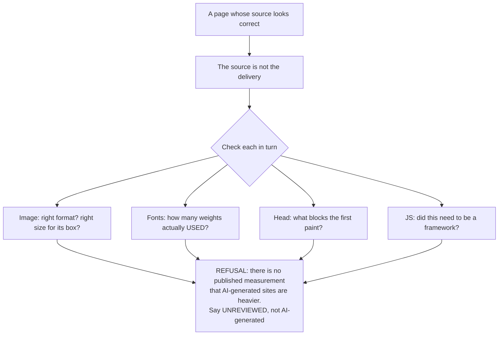

# Performance and payload as a design tell

**The organising idea.** A generator can see the markup it is writing. It cannot see a network waterfall, a byte count, a decode time, or which element wins LCP. So the tells cluster precisely where correctness-in-source and correctness-in-delivery come apart: the `` is valid and the format is wrong; the font stack is tasteful and six weights ship; the component is correct React and it did not need to be React.

**Say UNREVIEWED, not AI-generated, and mean it.** None of this reads "AI" the way a triplet fragment does. Three or four entries here are genuinely model-flavoured and say so in their own line; the rest would look identical coming from a person who shipped without watching the page load once. Be especially careful with the population-level claim, because it is the one that will get repeated: the mechanism is well understood and every individual tell in this file is measurable on any given page, but **there is no published measurement that AI-generated sites are heavier**. What exists measures AI-adjacent signals — builder subdomains, the spread of the indigo palette — and explicitly does not measure page weight. The blog posts asserting otherwise carry no methodology and recycle a mutated statistic from 2017.

**Before using this file, read `references/performance-budget-and-folklore.md`.** It carries the budget a designer can hold — eleven numbers you can check in a design review without opening a profiler — and ten pieces of circulating folklore to drop, including the Lighthouse score, the parse-time constant, the shared font cache and the weight claim above. The budget is the more useful half: a score tells you where you landed, a budget tells a designer what they can spend before they spend it.

_29 items. Generated from catalog.json — edit there, then re-run `scripts/regenerate_references.py`. Do not hand-edit this file._

_Every item carries a **False positive when** line. Read it before you act on the item: these are cues for an editor, not evidence about an author._

<!-- humanize:ignore-start
     The diagram and index below quote the tells they document, and a
     mermaid label is not a sentence. -->

## When this file applies

## What is in this file

Severity reflects the consequence for the intended reader, never how sure you should be about who wrote it. **Automated** means these scripts implement the check; *no* means it is yours to ask in the judge pass.

| item | severity | family | automated |
| --- | --- | --- | --- |
| [`autoplay-background-video-no-poster`](#autoplay-background-video-no-poster) | HIGH | defect | yes |
| [`consent-manager-is-the-lcp`](#consent-manager-is-the-lcp) | HIGH | defect | **no** |
| [`default-third-party-stack`](#default-third-party-stack) | HIGH | shape | yes |
| [`gradient-mesh-shipped-as-raster`](#gradient-mesh-shipped-as-raster) | HIGH | defect | yes |
| [`hero-image-as-full-resolution-png`](#hero-image-as-full-resolution-png) | HIGH | defect | yes |
| [`late-injected-bar-shifts-content`](#late-injected-bar-shifts-content) | HIGH | defect | **no** |
| [`lazy-loaded-lcp-image`](#lazy-loaded-lcp-image) | HIGH | defect | yes |
| [`optimised-the-source-never-the-delivery`](#optimised-the-source-never-the-delivery) | HIGH | shape | **no** |
| [`render-blocking-head-stack`](#render-blocking-head-stack) | HIGH | defect | yes |
| [`single-source-full-bleed-image`](#single-source-full-bleed-image) | HIGH | defect | yes |
| [`spa-shell-for-a-brochure-site`](#spa-shell-for-a-brochure-site) | HIGH | defect | yes |
| [`stock-photo-at-source-resolution`](#stock-photo-at-source-resolution) | HIGH | defect | yes |
| [`use-client-on-a-static-page`](#use-client-on-a-static-page) | HIGH | defect | yes |
| [`webgl-library-for-decoration`](#webgl-library-for-decoration) | HIGH | shape | yes |
| [`animation-library-for-css-effects`](#animation-library-for-css-effects) | med | shape | yes |
| [`figma-export-svg-unoptimised`](#figma-export-svg-unoptimised) | med | defect | **no** |
| [`font-display-absent-or-block`](#font-display-absent-or-block) | med | defect | yes |
| [`font-weights-ordered-not-used`](#font-weights-ordered-not-used) | med | residue | yes |
| [`google-fonts-cdn-render-blocking`](#google-fonts-cdn-render-blocking) | med | defect | yes |
| [`icon-webfont-for-a-handful-of-icons`](#icon-webfont-for-a-handful-of-icons) | med | shape | yes |
| [`lcp-font-not-preloaded`](#lcp-font-not-preloaded) | med | defect | **no** |
| [`lcp-image-without-fetchpriority`](#lcp-image-without-fetchpriority) | med | defect | yes |
| [`multiple-display-families-one-page`](#multiple-display-families-one-page) | med | shape | **no** |
| [`no-modern-image-format-anywhere`](#no-modern-image-format-anywhere) | med | shape | yes |
| [`same-video-to-every-device`](#same-video-to-every-device) | med | defect | **no** |
| [`sizes-attribute-that-lies`](#sizes-attribute-that-lies) | med | defect | **no** |
| [`smooth-scroll-library-on-a-brochure`](#smooth-scroll-library-on-a-brochure) | med | shape | yes |
| [`icon-library-dependency-for-six-icons`](#icon-library-dependency-for-six-icons) | low | shape | **no** |
| [`variable-font-single-static-weight`](#variable-font-single-static-weight) | low | defect | **no** |

<!-- humanize:ignore-end -->

<!-- humanize:ignore-start
     Everything below is a specimen catalog. It quotes the tells it documents,
     including literal machine residue, so reviewing it with humanize_review.py
     would flag the exhibits rather than the writing. -->

### `autoplay-background-video-no-poster`  ·  high · generic-llm · performance · structural · family: defect · lane: performance

**Automated here:** yes, these scripts implement it.

A looping muted video behind the hero copy with no poster and no preload discipline. The most expensive decoration on the web: a ten-second 1080p loop is routinely eight to fifteen megabytes, it downloads before anything the visitor asked for, and on mobile it frequently does not even play.

**Why it reads AI:** UNREVIEWED, with a specific texture: generators reach for background video because it is a well-represented “premium landing page” pattern, and they emit the minimal correct element — which is the maximally expensive one, because poster and preload are the attributes you add AFTER watching it load.

**Detect:** A video element with autoplay and no poster attribute, or with preload set to auto or left unset.

**Fix:** A poster image is the default and the video is the upgrade. Set preload to none, start playback on readiness or on interaction, skip video on slow connections and under a reduced-motion preference. Budget a decorative loop at 2 MB, ten seconds, 720p.

**False positive when:** Video IS the product on a video-hosting, film or motion-design site, and the loop is the content. A short, well-encoded loop under a megabyte with a poster is a legitimate choice. Above-the-fold video behind an explicit play button is not this finding.

**Before**

> <video autoplay loop muted playsinline src="/hero.mp4">

**After**

> <video poster="/hero-poster.avif" preload="none" …> with playback started on canplaythrough

### `consent-manager-is-the-lcp`  ·  high · generic-llm · performance · rendered · family: defect · lane: performance

**Automated here:** no — decidable mechanically, but this bundle does not implement it. Ask it yourself in the judge pass.

The cookie banner is the largest painted element in the viewport, so LCP measures when the BANNER appears rather than when the page content does. The cause is a design decision: the banner's size and position.

**Why it reads AI:** UNREVIEWED — not an AI tell. Include it because it is the highest-leverage LCP finding with a purely visual cause, and because it is exactly the kind of thing only a RENDERED audit can find. Naming it teaches the reviewer that LCP is a design property.

**Detect:** Rendered: capture the LCP element and check whether it sits inside a consent container. Flag unconditionally if so, and report the LCP delta measured with and without the banner. Static pre-filter: a consent script in the head without async or defer, plus a fixed full-width banner container with a heading.

**Fix:** Make the banner smaller than the hero — a compact bottom bar with body-sized text, no banner image, no web font of its own. Load the script asynchronously, render the banner after the hero paints, and skip it entirely for returning consenters.

**False positive when:** On a text-light page the banner may legitimately be the largest element and still be fast — the finding is the DELAY, not the identity. Some consent managers are iframe-based and their content is not measured as LCP at all.

**Before**

> a full-screen modal with a large heading and a background image; LCP 3.6s

**After**

> a compact bottom bar in the system font, script async; LCP 1.4s

### `default-third-party-stack`  ·  high · generic-llm · performance · structural · family: shape · lane: performance

**Automated here:** yes, these scripts implement it.

A one-page marketing site shipping analytics, a tag manager, a consent manager, a chat widget, a session recorder and a pixel — each added by a different person for a different reason, none ever removed. Each is a third-party origin, most execute on the main thread, and several load further scripts after they run.

**Why it reads AI:** UNREVIEWED, EXPLICITLY — THIS IS NOT AN AI TELL AT ALL AND THE REPORT SHOULD SAY SO PLAINLY. No generator installs six SaaS widgets; people do. It belongs here because the audit is of the shipped artefact, and because it is very often the single largest controllable cost on a marketing page after the hero image. Flag it as an operational finding, never an authorship one.

**Detect:** Count distinct third-party script origins in the HTML; flag four or more on a marketing page. Rendered: sum third-party JavaScript bytes and main-thread time and attribute long tasks by origin, so the finding names names.

**Fix:** Budget third parties as a countable design constraint — three origins on a marketing page. Load everything non-essential deferred, after consent, or on interaction. Server-side tagging removes the client cost of the tag manager entirely. Delete anything nobody has opened a dashboard for in ninety days.

**False positive when:** Ecommerce and ad-supported publishing legitimately carry more, and the COUNT alone is not the finding — the cost is. A consent manager is legally required in some jurisdictions and cannot be deleted. Tag managers correctly configured to fire nothing before consent cost far less than the raw count suggests.

**Before**

> six third-party origins, roughly half a megabyte and nearly a second of main thread

**After**

> two origins, with chat loaded on click

### `gradient-mesh-shipped-as-raster`  ·  high · generic-llm · performance · structural · family: defect · lane: performance

**Automated here:** yes, these scripts implement it.

The decorative blurred blob or mesh gradient behind the hero — the commonest ornament on a generated marketing page — is a multi-megabyte raster rather than a CSS gradient. It is pure decoration and it is frequently the LCP element.

**Why it reads AI:** Genuinely model-flavoured. The indigo-violet wash is the signature ornament of a palette whose spread across the open web has been measured: Tailwind's indigo-500 rose from 0.03% of all sites in late 2022 to 0.54% in late 2025, and the matching purple from 0.02% to 0.49%. When that ornament arrives as a multi-megabyte raster you have the taste tell and the delivery tell in one element.

**Detect:** Static: an image or background whose filename matches gradient, mesh, blob, aurora, glow, blur or hero-bg, positioned absolute or fixed with a negative z-index or pointer-events none, and carrying an empty alt. Rendered: any image over 150 KB whose element is aria-hidden or has an empty alt. A stronger rendered signal: sample the decoded image and check for high-frequency detail — a gradient has none, and should not be a raster at all.

**Fix:** CSS. A radial-gradient costs zero bytes and zero requests. If the shape is genuinely irregular, export it small, blur it in CSS and scale it up — a gradient carries no detail to lose.

**False positive when:** A real photograph or painted artwork used as a background is not a gradient, even soft-focus. Brand assets with mandated exact colour reproduction, and grain textures that genuinely need per-pixel data — though a tiling noise PNG is a few kilobytes, not a few megabytes.

**Before**

>  (1.8 MB)

**After**

> a div with a radial-gradient background and aria-hidden (0 bytes)

### `hero-image-as-full-resolution-png`  ·  high · generic-llm · performance · structural · family: defect · lane: performance

**Automated here:** yes, these scripts implement it.

The largest image on the page is delivered as PNG at source resolution. PNG is lossless and has no chroma subsampling, so a photographic hero lands at many times the bytes of the same image in a modern format.

**Why it reads AI:** UNREVIEWED rather than model-flavoured. A designer who exported a PNG would still have watched it load once, and the tell is the absence of that single moment. The genuinely model-shaped part is narrower: a generator writing an image tag has no way to know whether that file is 40 KB or 4 MB, so it never has the thought.

**Detect:** Static: an image or background whose URL ends .png and which appears in the first screenful of markup, or is preloaded as an image. Rendered: fetch the LCP element's resource and flag above 300 KB, hard above 800 KB; and compare the image's natural width against its rendered width times device pixel ratio, flagging above 2.0.

**Fix:** Modern format first with fallbacks, inside a picture element. Budget the LCP image at 200 KB or under. Re-export at twice the largest CSS width it will ever occupy, not at camera resolution.

**False positive when:** PNG is CORRECT for screenshots, UI captures, logos, pixel art and anything with hard edges or genuine transparency — a 30 KB PNG screenshot is the right call and a lossy format may look worse. Also fine when a CDN negotiates format by Accept header and the .png URL is an alias: check the response content type, not the extension. Does not apply to a manuscript figure. Journals want vector, and where they take a raster they set a high minimum -- PLOS states a 789px minimum figure width -- so a large file is compliance rather than waste.

**Before**

> 

**After**

> <picture> with AVIF and WebP sources at real widths, an honest sizes, and width/height plus fetchpriority="high" on the img

### `late-injected-bar-shifts-content`  ·  high · generic-llm · performance · structural · family: defect · lane: performance

**Automated here:** no — decidable mechanically, but this bundle does not implement it. Ask it yourself in the judge pass.

An announcement bar, promo strip or newsletter ribbon injected at the top of the DOM after first paint, pushing everything below it down. Layout shift with a purely editorial cause: someone wanted a bar, and the bar was added to the page rather than designed into it.

**Why it reads AI:** UNREVIEWED. Same family as image-without-dimensions but with an EDITORIAL rather than an asset cause, which is why it deserves a separate entry: the fix is a design one — reserve the space, or overlay instead of push — not an attribute.

**Detect:** An element inserted into the top of the body by script with no reserved height, or a banner hidden and flipped on after a fetch. Rendered: observe layout shifts and attribute each to its source node, flagging any single shift above 0.05 sourced above the fold.

**Fix:** Reserve the space server-side, rendered in the initial HTML, or overlay the bar with fixed positioning so it never participates in layout. If the bar's presence is conditional, render it and hide it — do not inject it.

**False positive when:** Shifts within half a second of a user interaction are excluded from the metric by design and must not be flagged. A bar appearing below the fold causes no visible shift. Genuinely conditional content such as an outage notice is worth a small shift.

**Before**

> useEffect(() => setShowBanner(true), []) rendering a 56px bar above the hero

**After**

> the bar rendered server-side inside a container that exists whether or not the bar does

### `lazy-loaded-lcp-image`  ·  high · generic-llm · performance · structural · family: defect · lane: performance

**Automated here:** yes, these scripts implement it.

loading="lazy" applied uniformly to every image including the hero. The rule was applied without its exception, and this unconditionally delays LCP: the browser will not even START the request until layout proves the element is in view.

**Why it reads AI:** PARTLY MODEL-FLAVOURED, and the uniformity is the signature. A person applies lazy loading where they remember to; a generator applies a rule everywhere it syntactically fits. “Add lazy loading to images” is one of the most repeated pieces of web-performance advice in the training corpus, and it is stated without its exception roughly as often as with it.

**Detect:** loading="lazy" on the first image in the markup, or on an image inside the first screenful. The uniformity is the corroborating signal: every image carrying it.

**Fix:** Delete loading, or set it eager, on the LCP candidate, and add fetchpriority="high". Keep lazy for everything below the fold. Rule of thumb: nothing in the first viewport is lazy.

**False positive when:** The LCP element may legitimately be below the fold on a page whose first viewport is text. On a carousel the later slides SHOULD be lazy and only the first should not. And if the hero is a CSS background image, loading does not apply at all — a preload is the right fix instead.

**Before**

> every img on the page carrying loading="lazy", hero included

**After**

> the hero with fetchpriority="high" and no loading attribute; everything below it lazy

### `optimised-the-source-never-the-delivery`  ·  high · generic-llm · performance · structural · family: shape · lane: performance

**Automated here:** no — decidable mechanically, but this bundle does not implement it. Ask it yourself in the judge pass.

The organising idea for this lane. A generator can see the markup it is writing. It cannot see a network waterfall, a byte count, a decode time, or which element wins LCP. So the tells cluster precisely where correctness-in-source and correctness-in-delivery come apart: the img tag is valid and the format is wrong; the font stack is tasteful and six weights ship; the component is correct React and it did not need to be React.

**Why it reads AI:** NONE OF THIS READS “AI” THE WAY A TRIPLET FRAGMENT DOES. IT READS UNREVIEWED, and saying so is not a hedge — it is the accurate finding. Three or four entries in this file are genuinely model-flavoured and say so; the rest would look identical from a human who shipped without watching the page load once. Be especially careful with the population-level claim: the mechanism is well understood and every individual tell here is measurable on any given page, but there is NO published measurement that AI-generated sites are heavier. What exists is a chapter measuring AI-ADJACENT signals — builder subdomains, the spread of the indigo palette — which explicitly does not measure page weight. Blog posts asserting otherwise carry no methodology and recycle a mutated 2017 statistic.

**Detect:** Not a single check. The pattern is a page that is right in every way you can read and wrong in every way you have to measure. Each symptom has its own entry.

**Fix:** Audit the delivery, not the source. Open the network panel once. The single highest-leverage habit this lane can install is watching the page load on a throttled connection before calling it done — almost every entry here is a thing that one minute would have surfaced.

**False positive when:** This is a framing item, not a detector. And it cuts against over-claiming as much as under-claiming: a slow page is evidence about a workflow, never about an author.

**Before**

> “The markup is clean and the Lighthouse score is 94.”

**After**

> “The hero is a 2.3 MB PNG, the fonts block the first paint, and the banner is the largest painted element. Here is what each costs.”

### `render-blocking-head-stack`  ·  high · generic-llm · performance · structural · family: defect · lane: performance

**Automated here:** yes, these scripts implement it.

Every stylesheet and several scripts sitting synchronously in the head, so nothing paints until all of them arrive — typically a font stylesheet, an icon-font stylesheet, a framework CSS bundle, a tag manager and a consent script. Five origins, five blocking resources, one blank screen.

**Why it reads AI:** UNREVIEWED. Nothing about the head order is visible in the design, and a generator assembling a head from remembered snippets has no model of the critical path. This is the roll-up finding that several others contribute to, and the one a reviewer can most easily act on.

**Detect:** Count stylesheets without media gating plus scripts without async or defer before the head closes. Flag three or more blocking resources, or two or more that are cross-origin. Rendered: measure first paint against time-to-first-byte and flag a gap above 600ms on an emulated slow device.

**Fix:** Inline the critical CSS for the first viewport and load the rest asynchronously. Defer every script not needed for first paint. Self-host fonts to remove the cross-origin blocking stylesheet. Target: one render-blocking resource, same-origin.

**False positive when:** A single small same-origin stylesheet is the correct, fast shape and must not be flagged. Consent scripts sometimes must run before anything else for legal reasons. Sites on a very fast CDN pay much less for the same structure — measure the milliseconds, not the count.

**Before**

> three cross-origin stylesheets and two synchronous scripts in the head

**After**

> inlined critical CSS, one deferred stylesheet, every script deferred

### `single-source-full-bleed-image`  ·  high · generic-llm · performance · structural · family: defect · lane: performance

**Automated here:** yes, these scripts implement it.

An image styled full-width with exactly one source. Every visitor gets the desktop file, so the phone on cellular downloads a 2400px asset to paint it 390px wide. The design decision was made; its delivery consequence was not.

**Why it reads AI:** UNREVIEWED. srcset requires knowing the layout's breakpoints and the asset's variants — two facts a generator writing a single component does not have, so it writes the valid single-source tag.

**Detect:** An img with a full-width or object-cover class, or a 100vw sizing, and no srcset.

**Fix:** srcset with width descriptors at the widths the layout actually uses, plus an honest sizes. Three widths is usually enough.

**False positive when:** SVGs and small icons need no srcset. Images under about 30 KB do not repay the variants. An image CDN doing server-side device detection achieves the same result without srcset — check for the client-hint headers. Art-directed crops belong in a picture element, and that is correct.

**Before**

> 

**After**

> the same image with 640/1280/2400 candidates and a sizes that matches the layout

### `spa-shell-for-a-brochure-site`  ·  high · generic-llm · performance · structural · family: defect · lane: performance

**Automated here:** yes, these scripts implement it.

View source and the body is a single empty mount point. Every word on the page — the headline, the pricing, the FAQ — exists only after a JavaScript bundle downloads, parses, executes and renders.

**Why it reads AI:** UNREVIEWED, and mostly TOOL-FLAVOURED rather than model-flavoured — it is what a default client-side scaffold produces and what several site builders export. Worth flagging precisely because it is invisible in the rendered page and visible only in the delivery, which is the theme of this whole lane.

**Detect:** A document body containing a single empty root div and script tags, with no rendered content. Check the FULL response body, not the first chunk, because streaming server rendering sends a shell first and fills it.

**Fix:** Prerender. Any static-site generator turns the same components into HTML at build time. For a brochure site the honest answer is often that no framework was needed.

**False positive when:** Genuine applications behind a login are correctly client-rendered and must not be audited by this rule. Pages that are prerendered AND hydrate look fine to this check and should — that is the correct shape.

**Before**

> <body>

</body>

**After**

> the same page prerendered to HTML, hydrating only where it needs to

### `stock-photo-at-source-resolution`  ·  high · generic-llm · performance · structural · family: defect · lane: performance

**Automated here:** yes, these scripts implement it.

The stock download went into the public directory at four to six thousand pixels and got referenced directly. It looks fine — it always looks fine, that is the trap — and it is several megabytes.

**Why it reads AI:** UNREVIEWED. Combine it with the existing stock-photography tell and you get a compound finding much stronger than either alone: a generic stock photo, shipped at source resolution. That pair is a good composite signal for a page assembled rather than made.

**Detect:** A stock-host URL with no resize parameters, or a local asset whose filename or path suggests a stock download. Rendered: natural width far above rendered width.

**Fix:** Resize on the way in — nothing enters the public directory above twice its largest display width. If the source host is itself an image CDN, use its resize parameters.

**False positive when:** A photography portfolio, a print-download page or a zoomable product viewer legitimately serves high-resolution originals — but behind an interaction, not in the initial payload. A large file lazily loaded far below the fold is a smaller problem than the same file in the hero.

**Before**

> images.unsplash.com/photo-... with no width or format parameters

**After**

> the same URL with width, quality and format parameters, or a resized local asset

### `use-client-on-a-static-page`  ·  high · generic-llm · performance · structural · family: defect · lane: performance

**Automated here:** yes, these scripts implement it.

A client directive at the top of a page or layout that renders text, images and links and holds no state. Everything below that boundary ships to the browser and is re-executed there to produce markup the server already produced.

**Why it reads AI:** GENUINELY MODEL-FLAVOURED. The directive is the fastest way to make a build error go away, and generators reach for it as an error-suppression move rather than an architecture decision. The signature is exactly that: a fix applied to a symptom the model COULD see (a build error) rather than a cost it could not (the shipped bundle).

**Detect:** A client directive with no client-only API anywhere beneath it — no state hook, no effect, no event handler, no browser global.

**Fix:** Move the boundary down. Keep the page a server component and mark only the interactive leaf as a client component, interleaving through children so the server-rendered content stays server-rendered.

**False positive when:** Animation libraries, analytics wrappers, theme providers and third-party widgets legitimately require a client boundary, and putting it in the layout is sometimes the pragmatic answer. Pages with a genuinely interactive shell. And frameworks without server components cannot express this distinction and must not be flagged for it.

**Before**

> "use client" at the top of a static marketing page

**After**

> the page left as a server component, with only the mobile nav marked client

### `webgl-library-for-decoration`  ·  high · generic-llm · performance · structural · family: shape · lane: performance

**Automated here:** yes, these scripts implement it.

A 3D library loaded so that a shape can rotate slowly behind the headline — a hundred and fifty kilobytes gzipped before any scene code, plus a WebGL context, plus a continuous animation loop that runs whether or not anyone is looking at it.

**Why it reads AI:** UNREVIEWED, and the honest framing is that this is an agency aesthetic generators reproduce because it is well-represented in “impressive landing page” training data. It is not a model invention. What IS model-shaped is the mismatch: a generator will import a 3D engine for an effect CSS can do, because the engine version is the one it has seen more examples of.

**Detect:** A 3D library import or script tag on a page with no 3D content beyond a decorative background.

**Fix:** Ask what the effect actually is. A rotating gradient blob is CSS keyframes on a gradient plus a blur. A particle field is a canvas and forty lines. A parallax layer is a transform on scroll. If you genuinely need WebGL, import from the source paths rather than the barrel, code-split it behind an observer, and stop the loop when the tab is hidden and under a reduced-motion preference.

**False positive when:** 3D configurators, data visualisation, games, map renderers and product viewers are the correct use of these libraries, as is a site whose SUBJECT is 3D work. And a properly code-split engine behind an interaction, off the critical path, is a much smaller finding.

**Before**

> three.js imported to rotate a torus behind the hero

**After**

> a CSS gradient with a keyframe rotation, and no dependency

### `animation-library-for-css-effects`  ·  medium · generic-llm · performance · structural · family: shape · lane: performance

**Automated here:** yes, these scripts implement it.

An animation library imported so that cards fade up on scroll. Every one of those effects is a CSS transition plus an intersection observer, under a kilobyte. The library version costs tens of kilobytes gzipped and runs its orchestration on the main thread, where it competes with event handlers — compositor-driven CSS transforms do not.

**Why it reads AI:** PARTLY MODEL-FLAVOURED, and this is the payload half of reveal-animation-on-everything. The uniformity is the tell: the same in-view animation applied to EVERY section, with the same half-second duration, is a template being filled rather than a motion design being made.

**Detect:** An animation library import whose only use is entrance animations on scroll. The uniformity is the corroborating signal: the same property set, the same duration and a staggered delay on every section.

**Fix:** A CSS transition behind a reduced-motion guard plus a six-line intersection observer. Keep the library only where you need layout animation, shared-element transitions, drag or exit animations — things CSS genuinely cannot do. If you keep it, its lazy-loading entry point cuts it by most of its weight.

**False positive when:** Layout animations, exit animations on unmount, drag and drop, spring physics and complex scroll-linked timelines are real reasons to take the dependency. An app rather than a page, with substantial motion design. A library on a site whose CRAFT is motion.

**Before**

> every section wrapped in an in-view animation from a motion library

**After**

> a reveal class with a CSS transition and one observer

### `figma-export-svg-unoptimised`  ·  medium · generic-llm · performance · structural · family: defect · lane: performance

**Automated here:** no — decidable mechanically, but this bundle does not implement it. Ask it yourself in the judge pass.

An SVG straight out of a design tool: full float precision, every group and clip path preserved, editor metadata, hidden layers, and sometimes an embedded base64 raster. A 12 KB icon becomes 340 KB.

**Why it reads AI:** UNREVIEWED, and more a DESIGNER tell than a model tell. Worth carrying anyway, because the audit is of the artefact rather than the author, and because a workflow that pipes a design tool's export straight into markup never runs an optimiser.

**Detect:** An SVG containing editor namespace attributes, coordinates at six or more decimal places, or an embedded image element. That last one is the sharpest: an SVG containing a raster is a raster wearing a costume.

**Fix:** Run SVGO in the build at precision 2, stripping metadata and IDs. Typical saving is 40–80%. If the SVG contains a raster, extract it and treat it as an image.

**False positive when:** Genuinely complex illustrations and maps are legitimately large SVGs, and rasterising them would be worse. Animated SVGs need their IDs preserved and blind stripping breaks them. Some brand-mandated logo files may not be re-exportable. Does not apply to a manuscript figure. Nature asks that submitted vector art retain all editing capabilities, so SVGO-style ID stripping and precision reduction is the wrong move on a submission asset.

**Before**

> a 340 KB icon.svg with editor metadata and eight-decimal coordinates

**After**

> the same icon at 4 KB

### `font-display-absent-or-block`  ·  medium · generic-llm · performance · structural · family: defect · lane: performance

**Automated here:** yes, these scripts implement it.

No font-display, or font-display: block. Both produce a flash of invisible text — the page is blank where the headline should be, which reads as “the site is broken” rather than “the font is loading”.

**Why it reads AI:** UNREVIEWED. font-display is a one-line descriptor that only matters on a slow connection, and a generator is never on one.

**Detect:** A font-face rule with no font-display descriptor, or with block, on a non-icon family.

**Fix:** swap for body and display faces. optional where the swap itself is the problem, because it never shifts. Pair either with metric overrides on the fallback so the swap does not move the layout.

**False positive when:** ICON FONTS genuinely want block — a swapped-in fallback renders as garbage letters where a glyph should be, which is worse than a brief blank. optional is correct where layout stability matters more than brand fidelity, and will read as a missing swap to a naive detector.

**Before**

> @font-face with no font-display

**After**

> @font-face { font-display: swap; size-adjust: 104% }

### `font-weights-ordered-not-used`  ·  medium · generic-llm · performance · structural · family: residue · lane: performance

**Automated here:** yes, these scripts implement it.

The font request asks for six or eight weights; the stylesheet uses two. Each unused weight is a separate file, and on a hosted-font URL they are all in one render-blocking request.

**Why it reads AI:** PARTLY MODEL-FLAVOURED. The specific weight list in a hosted-font URL is a copy-paste artefact that appears verbatim across generated pages — the shape of a well-represented snippet, not a decision. A designer who chose six weights would have used six.

**Detect:** Compare the weights the font request declares against the weights the CSS actually uses. Flag when the declared set is substantially larger.

**Fix:** Request only the weights the CSS uses. Two is usually right for a marketing page. Each dropped weight is a request removed from the critical path.

**False positive when:** A design system with genuine weight range across many surfaces. A CMS where editors can apply arbitrary weights. A variable font, where many weights is ONE file — a different finding. And weights used only in components absent from the audited page are a false positive of page-scoped auditing: check the whole CSS.

**Before**

> wght@300;400;500;600;700;800 with the CSS using 400 and 700

**After**

> wght@400;700

### `google-fonts-cdn-render-blocking`  ·  medium · generic-llm · performance · structural · family: defect · lane: performance

**Automated here:** yes, these scripts implement it.

A hosted-font stylesheet link in the head. It is a render-blocking stylesheet on a third-party origin, and the font files it names live on a SECOND origin — so the critical path is DNS, TCP, TLS and CSS on one host, then DNS, TCP, TLS and the font on another, before a single glyph paints.

**Why it reads AI:** UNREVIEWED, with a real model-shaped component: this link is one of the highest-frequency single lines in the HTML training corpus. It is what a model emits when asked for “nice typography”, and it is emitted without the preconnect that makes it tolerable.

**Detect:** A stylesheet link to a font CDN in the head, with no preconnect to the font file origin.

**Fix:** Self-host. Download the subsets once, serve from your own origin with a long cache header, and the second-origin chain disappears. If you must use the CDN, preconnect to the font origin as the FIRST element in the head.

**False positive when:** The shared-cache argument for hosted fonts died when browsers partitioned the HTTP cache by top-level site, so it is no longer a defence — but a site already behind a fast CDN with warm connections pays much less than the worst case. And a preconnected, swap-enabled, two-weight link is a defensible tradeoff on a small site with no build step.

**Before**

> a font CDN stylesheet in the head with no preconnect

**After**

> self-hosted WOFF2 with a preload, or at minimum a preconnect first in the head

### `icon-webfont-for-a-handful-of-icons`  ·  medium · generic-llm · performance · structural · family: shape · lane: performance

**Automated here:** yes, these scripts implement it.

An icon font loaded to draw six icons. The whole glyph set downloads — often a hundred kilobytes plus a render-blocking stylesheet — and until it arrives the icons are invisible or render as tofu.

**Why it reads AI:** UNREVIEWED and TEMPLATE-INHERITED. Icon fonts are the 2015 pattern; their persistence in new output is a strong signal that a template or a corpus snippet, rather than a decision, chose the icon strategy.

**Detect:** An icon-font stylesheet or font-face, with fewer than a dozen distinct icon class names used.

**Fix:** Inline SVG for the icons you actually use — six inline sprites are a kilobyte or two total, paint with the first HTML byte, inherit currentColor and are addressable by assistive technology. For many icons, a sprite sheet beats a font.

**False positive when:** An application UI with hundreds of icons across many routes may genuinely be better served by a font or a sprite sheet than by inlining. Legacy sites where the icon font is structural to an existing CSS architecture. And icon fonts with font-display: block are doing the right thing for their medium.

**Before**

> an icon-font stylesheet for a chevron, a check and four others

**After**

> six inline SVGs

### `lcp-font-not-preloaded`  ·  medium · generic-llm · performance · structural · family: defect · lane: performance

**Automated here:** no — decidable mechanically, but this bundle does not implement it. Ask it yourself in the judge pass.

On a page whose LCP element is a headline, the font that renders it is discovered at the end of a chain — HTML, then CSS, then the font-face rule, then the file. Three round trips before the most important text on the page can paint in its intended face.

**Why it reads AI:** UNREVIEWED. Preload requires knowing which font the LCP element uses — a rendered fact, again.

**Detect:** A self-hosted web font with no preload link for the face used above the fold.

**Fix:** Preload exactly the one or two faces used above the fold. The crossorigin attribute is mandatory even for same-origin fonts, or the browser fetches twice.

**False positive when:** Preloading the WRONG font is worse than not preloading — a footer face or a below-fold weight steals bandwidth from the actual LCP element. Sites on system fonts need no preload. Sites using font-display: optional with a well-matched fallback may deliberately not preload.

**Before**

> a font-face chain with no preload

**After**

> <link rel="preload" as="font" type="font/woff2" href="/f/display.woff2" crossorigin>

### `lcp-image-without-fetchpriority`  ·  medium · generic-llm · performance · structural · family: defect · lane: performance

**Automated here:** yes, these scripts implement it.

The hero image is discovered late and fetched at default priority, behind stylesheets and scripts, because nothing told the browser it was the most important byte on the page.

**Why it reads AI:** UNREVIEWED. fetchpriority requires knowing which element wins LCP — a rendered fact a generator cannot compute.

**Detect:** A hero-sized image in the first screenful with no fetchpriority anywhere in the document, and no image preload in the head.

**Fix:** fetchpriority="high" on exactly one image, the LCP candidate. For a CSS background, a preload link in the head. Do not apply it to more than one or two images or the signal is worthless.

**False positive when:** On a text-LCP page a font preload is the right fix and prioritising an image is wrong. If the image is inlined as a data URI, or already prioritised by a framework's image component, it is handled.

**Before**

> seventeen images, none prioritised

**After**

> one image carrying fetchpriority="high"

### `multiple-display-families-one-page`  ·  medium · generic-llm · performance · structural · family: shape · lane: performance

**Automated here:** no — decidable mechanically, but this bundle does not implement it. Ask it yourself in the judge pass.

Three or more families loaded — a serif display face, a sans body face, and a mono for the code block or the “technical” accent — on a page with maybe four hundred words. Each family is its own set of files and its own connection cost, and the third is usually decoration.

**Why it reads AI:** Partly model-flavoured, and it complements the existing default-typeface tells. The failure mode differs by generator: some ship one family with no contrast, some ship three to MANUFACTURE contrast. Three families on a short page is a taste tell with a byte cost.

**Detect:** Count distinct font families the page loads, excluding icon fonts.

**Fix:** Two families maximum on a marketing page; one family with real weight and size contrast is often better. Use the system mono stack for code — it costs nothing and looks native.

**False positive when:** Editorial and publishing sites legitimately use a display serif plus a text face plus a mono for captions and data. Icon fonts count as a family in a naive detector and must be excluded. Multilingual sites need per-script families — three covering Latin, CJK and Arabic is correct.

**Before**

> a display serif, a body sans and a loaded mono, on four hundred words

**After**

> one family with real contrast, plus the system mono stack for code

### `no-modern-image-format-anywhere`  ·  medium · generic-llm · performance · structural · family: shape · lane: performance

**Automated here:** yes, these scripts implement it.

Not one AVIF or WebP on the page and no format negotiation. Every image is JPEG or PNG. A site-level absence rather than a per-image mistake: nobody ever set up the pipeline.

**Why it reads AI:** UNREVIEWED. Format negotiation is a build-pipeline decision, invisible in the markup a generator writes, and exactly the class of thing a model omits because omitting it produces working output.

**Detect:** Zero matches for the modern extensions or source type attributes across the HTML and CSS, while the image count is five or more. Rendered: group image responses by content type and flag when modern formats carry none of the image bytes and the total exceeds 500 KB.

**Fix:** Put an image CDN or a build step in front of every raster. Target: modern formats carry at least 80% of image bytes.

**False positive when:** Genuinely all-SVG sites correctly have no AVIF. A site behind a CDN doing transparent negotiation will show .jpg URLs returning a modern content type — check the response header before flagging. One or two logos do not justify a pipeline. Manuscript figures INVERT this: Nature rejects PNG/JPEG/TIFF for main figures and asks for AI/EPS/PDF, PLOS accepts TIFF or EPS only, and WebP and AVIF are accepted by neither. For a journal submission, having no modern web format is the correct state and this finding does not apply.

**Before**

> eleven .jpg and .png images, no picture elements

**After**

> the same images served as AVIF with WebP and JPEG fallbacks

### `same-video-to-every-device`  ·  medium · generic-llm · performance · structural · family: defect · lane: performance

**Automated here:** no — decidable mechanically, but this bundle does not implement it. Ask it yourself in the judge pass.

One source, one encode, one resolution — the desktop file — served to phones on cellular. The single-source disease in the medium where it costs the most.

**Why it reads AI:** UNREVIEWED. Same mechanism as srcset: responsive media requires knowing the variants exist.

**Detect:** A video element with exactly one source and no adaptive manifest.

**Fix:** Two encodes minimum, selected with a media attribute on the sources, or an adaptive stream if the video is long enough to justify it.

**False positive when:** A very short, very small loop does not repay multiple encodes. Adaptive streams handle this internally — do not flag a manifest.

**Before**

> a single 1080p MP4 source

**After**

> a 720p modern encode and a 480p fallback, selected by media query

### `sizes-attribute-that-lies`  ·  medium · generic-llm · performance · structural · family: defect · lane: performance

**Automated here:** no — decidable mechanically, but this bundle does not implement it. Ask it yourself in the judge pass.

srcset is present and sizes is wrong — nearly always a full-viewport value on an image occupying a third of a grid. The browser trusts sizes over the layout, picks the largest candidate, and the srcset work is thrown away.

**Why it reads AI:** UNREVIEWED and FRAMEWORK-DEFAULTED, which is worth separating. A popular image component defaults sizes to 100vw when told to fill its container and only warns; a generator adding fill to satisfy the layout inherits the wrong default silently. As much a framework tell as a model one.

**Detect:** A sizes of 100vw on an image inside a multi-column grid or a constrained container.

**Fix:** Write sizes to match the grid, and verify it with a linting bookmarklet rather than by reading it.

**False positive when:** 100vw is CORRECT for a genuinely full-bleed hero, and for an image in a container that is full-width at every breakpoint. On a page whose only images are below the fold and lazy, a mis-sized sizes costs bytes but no LCP, so the severity drops.

**Before**

> sizes="100vw" on a three-up card grid

**After**

> sizes="(min-width: 1024px) 33vw, (min-width: 640px) 50vw, 100vw"

### `smooth-scroll-library-on-a-brochure`  ·  medium · generic-llm · performance · structural · family: shape · lane: performance

**Automated here:** yes, these scripts implement it.

A scroll-momentum library installed so the page scrolls with easing — a per-frame JavaScript interpolation layer between the visitor's input and the page's response, on a page with five sections.

**Why it reads AI:** UNREVIEWED and AESTHETIC-INHERITED. Same family as the 3D case: a portfolio convention reproduced without the context that justified it.

**Detect:** A smooth-scroll library import on a page with no scroll-driven narrative.

**Fix:** For anchor navigation, native smooth scroll behaviour is free and respects a reduced-motion preference automatically. Take the library only if the page has a scroll-driven narrative that genuinely needs interpolation, and gate it behind the motion preference.

**False positive when:** The better-behaved modern implementations keep native scroll alive, so sticky positioning, anchors and assistive technology continue to work — that is a materially smaller finding. Scroll-driven narrative sites have a real reason. And never flag native smooth scroll behaviour on its own; that is correct.

**Before**

> a momentum-scroll library on a five-section brochure page

**After**

> html { scroll-behavior: smooth }

### `icon-library-dependency-for-six-icons`  ·  low · generic-llm · performance · structural · family: shape · lane: performance

**Automated here:** no — decidable mechanically, but this bundle does not implement it. Ask it yourself in the judge pass.

The design half of barrel-icon-import. That entry catches the import and says to import the leaf instead; this one asks the prior question — the page uses six icons, and a dependency was added rather than six SVGs being pasted.

**Why it reads AI:** UNREVIEWED. Even correctly tree-shaken, the library brings a runtime wrapper, a prop API and a build-graph cost; and where the barrel is not shaken, it brings everything.

**Detect:** An icon-library dependency with fewer than about ten distinct icons used across the build.

**Fix:** Paste the six SVGs. Keep the library when the icon count is genuinely large or the set changes often.

**False positive when:** A large application with icons across many routes. Teams that value the consistency and update path of a maintained set. And a correctly tree-shaken library at ten or twenty icons is a small cost, not a finding.

**Before**

> an icon package added for a chevron, a check and four others

**After**

> six inline SVG components in the repo

### `variable-font-single-static-weight`  ·  low · generic-llm · performance · structural · family: defect · lane: performance

**Automated here:** no — decidable mechanically, but this bundle does not implement it. Ask it yourself in the judge pass.

A variable font is loaded — paying for the whole weight axis — and then used at exactly one weight. All the axis data is downloaded and discarded. The inverse mistake to over-ordering weights, and increasingly common as variable fonts become the default download.

**Why it reads AI:** UNREVIEWED. “Use variable fonts, they're more efficient” is true only when you use the axis, and a generator repeating the advice cannot check whether the axis is used.

**Detect:** A variable font file loaded with exactly one font-weight used across the stylesheet and no variation settings.

**Fix:** Either use the axis — a variable font pays for itself at roughly three weights — or instance a static cut at the one weight you use.

**False positive when:** The axis may be used in a way a static scan misses — variation settings, an animated weight, or an optical-size axis driven automatically, which IS using the axis. Multi-weight usage in components not on the audited page. And shipping a variable font for future-proofing on a design-system site is defensible.

**Before**

> a variable font loaded and used only at 400

**After**

> a static instance at 400, or real use of the weight axis

<!-- humanize:ignore-end -->
