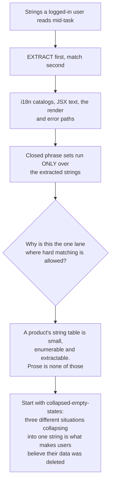

# UX writing inside the product

The strings a logged-in user reads mid-task: errors, empty states, button labels, confirmations, notifications, field hints. Their quality bar is not whether they read well — it is whether they unblock someone who is stuck.

**The mechanism that runs through the whole file, and the reason its findings are legible.** Under uncertainty about what failed, every substantive clause a model could write risks being wrong, and exactly one clause carries zero risk: the one about how sorry everyone is. So the generated string is optimised for the WRITER'S UNCERTAINTY rather than for the READER'S BLOCKAGE — and the two are anti-correlated. The less the system knows about the failure, the warmer the copy gets. A person who does not know what went wrong writes something terse and slightly embarrassed; a model writes something fluent and kind.

**Why hard string matching is defensible here and nowhere else in this skill.** In prose a closed phrase list is a bad detector: the words have honest uses and the list ages out in months. UI strings are different in kind. A product's user-facing string table is small, enumerable and extractable — from i18n catalogs, from string literals in the render path, from the error and empty and toast slots in the rendered DOM. Within that surface the phrase space is genuinely narrow, because there are only so many ways to say nothing. "Something went wrong" is not a phrase with a good use at a different frequency; it is a phrase with no good use at all in a product that knows what went wrong. So these sets are hard matches rather than frequency cues, and where a set does not close, the item says so and routes to a judge pass.

**One entry is the headline.** `collapsed-empty-states` is not a wording problem and wording cannot repair it: three unrelated situations — the user has never had data, their filter matched nothing, the fetch failed — produce the same observable in the component and collapse into one string. It needs a three-way probe, because the defect is a missing branch rather than a present string, and the condition that matters most is the third: an empty list after a failed load is what makes users believe their data was deleted.

_35 items. Generated from catalog.json — edit there, then re-run `scripts/regenerate_references.py`. Do not hand-edit this file._

_Every item carries a **False positive when** line. Read it before you act on the item: these are cues for an editor, not evidence about an author._

<!-- humanize:ignore-start
     The diagram and index below quote the tells they document, and a
     mermaid label is not a sentence. -->

## When this file applies

## What is in this file

Severity reflects the consequence for the intended reader, never how sure you should be about who wrote it. **Automated** means these scripts implement the check; *no* means it is yours to ask in the judge pass.

| item | severity | family | automated |
| --- | --- | --- | --- |
| [`apology-in-place-of-explanation`](#apology-in-place-of-explanation) | HIGH | form | yes |
| [`are-you-sure-without-the-object`](#are-you-sure-without-the-object) | HIGH | form | yes |
| [`assistant-register-in-product-chrome`](#assistant-register-in-product-chrome) | HIGH | form | yes |
| [`collapsed-empty-states`](#collapsed-empty-states) | HIGH | defect | **no** |
| [`confirmation-without-loss-inventory`](#confirmation-without-loss-inventory) | HIGH | form | n/a |
| [`destructive-action-labelled-like-a-benign-one`](#destructive-action-labelled-like-a-benign-one) | HIGH | form | **no** |
| [`empty-state-without-an-on-ramp`](#empty-state-without-an-on-ramp) | HIGH | form | **no** |
| [`error-blames-the-user`](#error-blames-the-user) | HIGH | form | yes |
| [`error-names-the-system-not-the-situation`](#error-names-the-system-not-the-situation) | HIGH | form | n/a |
| [`error-with-no-recovery-action`](#error-with-no-recovery-action) | HIGH | form | n/a |
| [`forced-cheer-interjection`](#forced-cheer-interjection) | HIGH | form | yes |
| [`generic-failure-string`](#generic-failure-string) | HIGH | form | yes |
| [`inverted-confirmation-coverage`](#inverted-confirmation-coverage) | HIGH | defect | **no** |
| [`permission-ask-without-a-why`](#permission-ask-without-a-why) | HIGH | form | yes |
| [`politeness-is-the-safe-completion`](#politeness-is-the-safe-completion) | HIGH | form | **no** |
| [`raw-exception-text-in-ui`](#raw-exception-text-in-ui) | HIGH | residue | **no** |
| [`rules-revealed-only-after-failure`](#rules-revealed-only-after-failure) | HIGH | defect | **no** |
| [`unresolved-token-in-ui-string`](#unresolved-token-in-ui-string) | HIGH | residue | yes |
| [`widget-named-action-label`](#widget-named-action-label) | HIGH | form | yes |
| [`cancel-cancel-ambiguity`](#cancel-cancel-ambiguity) | med | form | **no** |
| [`emoji-in-system-status-strings`](#emoji-in-system-status-strings) | med | form | yes |
| [`exclamation-in-system-strings`](#exclamation-in-system-strings) | med | rhythm | yes |
| [`helper-text-restates-the-label`](#helper-text-restates-the-label) | med | form | **no** |
| [`http-status-as-user-prose`](#http-status-as-user-prose) | med | form | yes |
| [`invalid-as-the-entire-diagnosis`](#invalid-as-the-entire-diagnosis) | med | form | yes |
| [`joke-in-a-failure-state`](#joke-in-a-failure-state) | med | form | yes |
| [`locale-ambiguous-and-unitless-values`](#locale-ambiguous-and-unitless-values) | med | defect | **no** |
| [`no-data-available-string`](#no-data-available-string) | med | form | yes |
| [`no-reference-for-support`](#no-reference-for-support) | med | defect | **no** |
| [`objectless-notification`](#objectless-notification) | med | form | yes |
| [`success-toast-for-a-visible-result`](#success-toast-for-a-visible-result) | med | defect | yes |
| [`tour-narrates-the-obvious`](#tour-narrates-the-obvious) | med | form | n/a |
| [`welcome-tour-boilerplate`](#welcome-tour-boilerplate) | med | form | yes |
| [`zero-results-without-the-query`](#zero-results-without-the-query) | med | form | **no** |
| [`gamified-setup-checklist`](#gamified-setup-checklist) | low | shape | **no** |

<!-- humanize:ignore-end -->

<!-- humanize:ignore-start
     Everything below is a specimen catalog. It quotes the tells it documents,
     including literal machine residue, so reviewing it with humanize_review.py
     would flag the exhibits rather than the writing. -->

### `apology-in-place-of-explanation`  ·  high · generic-llm · microcopy · structural · family: form · lane: microcopy

**Automated here:** yes, these scripts implement it.

The message opens with regret and never arrives at information. The apology occupies the first clause — the most-read position — and the diagnosis never comes.

**Why it reads AI:** Apology is the single safest completion an assistant can produce. It cannot be factually incorrect, it cannot offend, and it scores well on helpfulness ratings in conversation. So under uncertainty about what failed, the model reaches for the token that costs nothing to assert. That is exactly backwards at the moment of use. And the apology does not merely waste the slot — it INFLATES the perceived severity, because a system that apologises signals that something serious happened.

**Detect:** Static, closed set in error, empty and toast strings: we're sorry, we are sorry, sorry about that, sorry for the inconvenience, we apologize, our apologies, please accept our apologies, inconvenience (the noun is near-diagnostic on its own in product copy), bear with us, thank you for your patience. Rank higher when the apology is sentence-initial and the remainder carries no cause and no action.

**Fix:** Delete the apology. Lead with what happened, follow with what to do. If the outage is genuinely severe and genuinely your fault, one short acknowledgement AFTER the facts is defensible.

**False positive when:** The sharpest school split in this lane, and the audit must respect it. Consumer brands with an established warm voice legitimately apologise. A real, large, self-inflicted failure — data loss, a billing error, a multi-hour outage — warrants one, and omitting it reads as cold. The tell is not the apology's presence but its POSITION AND ITS COMPANY: an apology arriving before the facts, or instead of them, or on a routine validation error. Never flag apologies in incident communications, support replies or refund flows.

**Before**

> We're sorry for the inconvenience. Something went wrong. Please try again later.

**After**

> Checkout is down. Your cart is saved and no payment was taken. We'll email you when it's back. [Check status]

### `are-you-sure-without-the-object`  ·  high · generic-llm · microcopy · structural · family: form · lane: microcopy

**Automated here:** yes, these scripts implement it.

The contentless confirmation. "Are you sure?" "This action cannot be undone. Are you sure?" The dialog interrupts without adding information.

**Why it reads AI:** "Are you sure?" is the safe completion for a dialog whose contents the model does not know. It is valid for deleting a file, ending a subscription and dropping a database, which is exactly the property that makes it worthless: a question carrying no new information can only be answered one way.

**Detect:** Static, closed set over dialog titles and bodies: are you sure, are you sure you want to continue, are you sure you want to proceed, are you sure you want to do this, please confirm, confirm action, "this action cannot be undone" as the ENTIRE body, do you want to continue. Weight higher when the body names no object and no quantity.

**Fix:** Replace the question with the consequence. Name the object, the quantity and the irreversibility, then let the buttons carry the two outcomes.

**False positive when:** A short confirmation is adequate when the object is unmistakable from immediate context — a row already selected and highlighted, an item whose name is in the heading. "Are you sure?" appended AFTER a full consequence statement is redundant but not harmful. Do not flag native OS dialogs whose wording the app does not control.

**Before**

> “Are you sure? This action cannot be undone.” with OK / Cancel

**After**

> “Delete 1,240 files in Q3 Archive? They won't go to Trash and can't be restored.” with [Delete 1,240 files] / [Keep files]

### `assistant-register-in-product-chrome`  ·  high · generic-llm · microcopy · structural · family: form · lane: microcopy

**Automated here:** yes, these scripts implement it.

The chat assistant's voice leaking into the product. “Let's get you set up!” “I'll help you connect your account.” The product starts talking like the model that wrote it.

**Why it reads AI:** Literal register bleed. The model's own conversational voice — first-person plural cohortative, offers of help, reassurance — is its strongest prior, and when it writes UI strings without a voice spec it writes in that voice. The result is a product addressing the user as a HELPER rather than as a TOOL, which is a category error. “Don't worry” is the worst of them, because it instructs the user about their emotional state. The giveaway is that the same voice appears in a settings screen, an error and an onboarding step.

**Detect:** Static, closed set — the highest-precision set in this lane, because these constructions are near-absent from human-written UI: let's get you, let's get started, let's dive in, let's take a look, let's begin, let's set up, let's make sure, I'll help you, I can help you, I've gone ahead and, feel free to, happy to help, great choice, great question, no worries, don't worry, “just” plus an imperative, and first-person SINGULAR anywhere in product chrome.

**Fix:** Strip the cohortative and the first person singular. State what the screen is and what to do.

**False positive when:** Products that ARE assistants legitimately speak in the first person, and so do genuine conversational surfaces inside a product. Some consumer brands use “let's” deliberately in onboarding and have tested it. “We” referring to the company is endorsed by major style guides and should not be flagged — the finding is first-person SINGULAR and the cohortative, not all first person.

**Before**

> Let's get you set up! I'll walk you through connecting your first data source. Don't worry, it only takes a minute.

**After**

> Connect a data source. Zenith reads from Postgres, Snowflake and BigQuery. You'll need a read-only connection string.

### `collapsed-empty-states`  ·  high · generic-llm · web-ui · rendered · family: defect · lane: microcopy

**Automated here:** no — decidable mechanically, but this bundle does not implement it. Ask it yourself in the judge pass.

The headline entry of this lane. One blank-list component serving three unrelated situations: the user has never had data, their filter matched nothing, and the request to load data failed. Three different messages and three different actions are needed, and the generated UI ships one.

**Why it reads AI:** Three causes, one observable. In the component's props they are all a zero count, and a model writing from the data shape rather than from the user's situation sees one condition. No screenshot in the training distribution shows the difference, because a design mock shows the POPULATED table. The politeness mechanism appears here too: the one string it writes is the one inoffensive under all three readings, and a string true in three incompatible situations cannot direct anyone in any of them.

**Detect:** Rendered, and it needs a three-way probe, because the defect is a MISSING BRANCH rather than a present string. Load the list in three conditions: a fresh account with no records; a query guaranteed to match nothing; a failed fetch. Capture the rendered text and controls in each. If any two of the three are identical, that is the finding. Cheap static secondary: an empty branch of the form if (!items.length) return <Empty/> with no error and no isFiltered discriminator — one condition covering three states.

**Fix:** Discriminate in the component's contract. The empty renderer needs at minimum hasError, isFiltered and isLoading, not just a count. Then write three strings and three actions.

**False positive when:** A surface with no filtering and no remote fetch genuinely has one empty state, and demanding three is wrong. Do not flag a component that discriminates correctly but happens to use similar WORDING across two states where the situations really are similar.

**Before**

> all three states render "No data available."

**After**

> never-had-data: "No invoices yet. Invoices appear here once you send your first one. [Create invoice]" · filtered-to-nothing: "No invoices match ‘acme’ with status Paid. [Clear filters]" · failed-to-load: "We couldn't load your invoices — the billing service isn't responding. Your data is safe. [Retry]"

### `confirmation-without-loss-inventory`  ·  high · generic-llm · microcopy · llm-judge · family: form · lane: microcopy

The dialog names the action but not the collateral. "Delete project?" without saying it takes 40 files, 3 integrations and the deploy history with it. The user consents to the headline and not to the consequences.

**Why it reads AI:** Cascade knowledge is the most expensive knowledge in the product and the least available to a generator. Enumerating what a delete takes with it requires understanding the schema's foreign keys and the product's semantics; writing “Delete project?” requires understanding the button's name. The model writes what it can see — and the courteous brevity reads as clean design, which is why it survives review.

**Detect:** Judge, because it requires reading the handler: what does the underlying operation actually remove or change, and does the dialog enumerate it? Structural assist: a destructive confirmation whose body contains no numeral and no list.

**Fix:** Count the consequences and state them. If the count is expensive to compute, compute it anyway: it is the whole value of the dialog.

**False positive when:** Trivially reversible actions should not be dressed with an inventory. Where the cascade is genuinely unbounded, an honest “we can't list everything this affects” plus an export-first offer is better than a fabricated list. Do not require an inventory where the object has no dependents.

**Before**

> Delete project? This cannot be undone.

**After**

> Delete “Northwind”? This removes 40 files, 3 connected integrations and 6 months of deploy history. Nothing goes to Trash.

### `destructive-action-labelled-like-a-benign-one`  ·  high · generic-llm · microcopy · structural · family: form · lane: microcopy

**Automated here:** no — decidable mechanically, but this bundle does not implement it. Ask it yourself in the judge pass.

The irreversible action and the harmless one wear the same label and often the same styling. Nothing distinguishes a one-way door from a revolving one.

**Why it reads AI:** Model output is stylistically consistent by construction, and consistency is usually a virtue. Here it erases the one distinction that matters. A model generating a dialog reuses the dialog it generated ten lines earlier, including its button labels, because nothing in the prompt said that this one ends a customer's account. Consequence-awareness is not a property of text generation; it is a property of knowing what the function does.

**Detect:** Static assist: enumerate handlers calling destructive operations — delete, destroy, revoke, remove, purge, cancelSubscription, drop — and check the label of the control bound to each; a generic label on a destructive handler is the finding. Rendered: confirm the destructive control's label contains the destructive verb and is visually distinguished.

**Fix:** Put the destructive verb and its object in the label, and make the safe option the easy one. A staged pattern — an ordinary button to open, a warning button to commit — is the strongest version.

**False positive when:** Reversible destructive-LOOKING actions should not be dressed as catastrophic — removing an item from a cart, unstarring, archiving with restore available. Over-flagging here produces the confirmation fatigue that makes real confirmations fail. Some destructive actions in expert tools are deliberately fast and undo-backed; if a real undo exists and is discoverable, a plain label is correct.

**Before**

> “Are you sure?” with Confirm / Cancel

**After**

> “Delete the Northwind workspace?” with [Delete workspace and 1,240 files] / [Keep workspace]

### `empty-state-without-an-on-ramp`  ·  high · generic-llm · microcopy · rendered · family: form · lane: microcopy

**Automated here:** no — decidable mechanically, but this bundle does not implement it. Ask it yourself in the judge pass.

An empty state that explains the emptiness and offers no way out of it. Prose and possibly an illustration, but no control, no link, no next step. The user is told the room is empty and not where the door is.

**Why it reads AI:** The empty state is generated as a MESSAGE COMPONENT, because that is its shape in the corpus — an icon, a heading, a line of muted text. The affordance that would resolve it belongs to a different part of the app and the generator is not holding both. The courtesy instinct layers on top: "Nothing here yet!" is friendly, and friendliness is what gets optimised when there is nothing substantive to add.

**Detect:** Rendered: in the never-had-data condition, check whether the empty region contains any interactive element. Absence is the finding. Pair with a judge pass on the text: does this say how to make the state non-empty?

**Fix:** One primary action in the empty state, wired to the real creating flow. If creation happens elsewhere, link to it explicitly and name the place.

**False positive when:** Read-only surfaces genuinely have no action the viewer can take — an audit log for an account with no activity, a report for a period with no transactions, a shared view for a viewer without write permission. There the right content is an explanation and possibly an escalation, not a fabricated button. Do not flag when the action lives in a persistent toolbar directly above the empty region.

**Before**

> You don't have any projects yet.

**After**

> No projects yet. A project holds your repos, runs and reports. [Create a project] · [Import from GitHub]

### `error-blames-the-user`  ·  high · generic-llm · microcopy · structural · family: form · lane: microcopy

**Automated here:** yes, these scripts implement it.

The error makes the user the grammatical agent of the failure. "You entered an invalid email address." "You forgot to select a date."

**Why it reads AI:** Second person is the house style of an assistant. Models are tuned to address a single addressee directly and helpfully, so "you" is the default subject of any sentence they write about a person. That instinct is right in chat and wrong in a validation message, where it converts a system constraint into a personal accusation. The failure is not rudeness — the model is trying to be warm — it is that warmth and accusation share a grammatical form, and telling them apart needs to know whose fault the constraint is. It is the product's: the form permitted the input.

**Detect:** Static, closed set — the blame constructions are a small closed family, because they all need a second-person subject plus a failure predicate: you entered, you forgot, you failed to, you did not, you didn't, you have not, you provided, you selected, your entry is invalid, you incorrectly. Also flag illegal, forbidden, prohibited and not permitted used of user input.

**Fix:** Drop the agent. An imperative for an empty field, a neutral description for a constraint violation — GOV.UK's split is the cleanest rule available.

**False positive when:** Second person is correct and not blaming when it describes the user's STATE rather than their error: "You don't have permission to edit this", "You have 2 seats left". Security and quota messages often must name the user. And in some domains the user really did do the thing and pretending otherwise is evasive — an audit-log entry should say who acted.

**Before**

> You entered an invalid postal code.

**After**

> Enter a postal code in the format SW1A 1AA.

### `error-names-the-system-not-the-situation`  ·  high · generic-llm · microcopy · llm-judge · family: form · lane: microcopy

The message describes what the software's internals were doing at the moment of failure rather than what the user was trying to do. The grammatical subject is a subsystem the user has never heard of.

**Why it reads AI:** The model writes the error at the layer where the exception is caught, because that is the layer it is editing. A person writes it at the layer where the user is standing. The generated string is a faithful translation of the call stack into English, which is precisely the wrong translation — the user's model of the system does not contain the call stack. It is the in-product twin of comment-narrates-next-line: the text restates the mechanism instead of supplying meaning.

**Detect:** Judge, because the phrasing is open-ended and no set closes it: name the grammatical subject of each error string, and flag it when the subject is a component, request, service or process rather than the user's object — their file, their payment, their invite. Narrow the judge's input with a static pre-filter on internals vocabulary: fetch, request failed, endpoint, null, undefined, token, payload, deserialize, handler, middleware, upstream, socket, initialize.

**Fix:** Rewrite with the user's object as the subject and their intent as the verb. Keep the technical cause available but subordinate — a disclosure toggle, a log line, a support reference — which also satisfies the developers who want the detail.

**False positive when:** Developer-facing products legitimately name internals, because the internals ARE the user's object: a CLI, an API console, a CI log, a database client. Audience decides the verdict, so check who the surface is for. And do not flag an internals term the product has TAUGHT the user — a workspace, a run, a webhook — those are domain nouns, not leaked implementation.

**Before**

> Failed to fetch resource. Request returned an error.

**After**

> We couldn't load your invoices. The billing service isn't responding. [Retry] · [Show technical details]

### `error-with-no-recovery-action`  ·  high · generic-llm · microcopy · llm-judge · family: form · lane: microcopy

The message correctly and specifically states the problem and then stops. No verb the user can perform, no control to press, no route onward. Diagnosis without prescription — and the failure mode that survives a naive "be specific" fix, so it is what a shallow audit leaves behind.

**Why it reads AI:** Naming the cause is a describing task and models are excellent at describing. Naming the fix is a MODELLING task: it needs to know what state the system is in, what the user can reach from here, and which of several remedies applies. The model writes the half it can write, then pads the gap with a courtesy, because a bare sentence feels abrupt. The apology-shaped filler is literally occupying the slot where the action belongs.

**Detect:** Judge: does this contain an imperative the user can execute right now, or an adjacent control that performs it? Structural assist: an error string with no imperative verb and no sibling button or link in the same component. "Please try again later" counts as NO action — it is a verb the user cannot execute at a time they cannot know.

**Fix:** Append the remedy and wire the control. If there are two remedies, give both. If there are genuinely none, say so honestly and give the escalation path.

**False positive when:** Some failures genuinely have no user action, and inventing one is worse than omitting it. The correct content there is a status commitment plus an escalation route, which an automated judge may misread as actionless — treat a reference number or a status link as satisfying the requirement. Transient inline validation the user is actively typing through needs no separate action.

**Before**

> Your session has expired.

**After**

> Your session expired after 30 minutes of inactivity. Sign in again — your draft is saved. [Sign in]

### `forced-cheer-interjection`  ·  high · generic-llm · microcopy · structural · family: form · lane: microcopy

**Automated here:** yes, these scripts implement it.

An interjection prepended to a system message to soften it. Oops. Uh oh. Whoops. Yay. The word carries no information and sets a tone the user is not in.

**Why it reads AI:** The interjection is emotional hedging: it signals that the message is not the reader's fault before the message says anything. That is a conversational move, appropriate between people and inert in a system string. The model reaches for it because a bare failure sentence reads harsh and harshness is what alignment training discourages. And it is FREE — it costs nothing to produce and it makes the string feel authored, which is why it appears in so much generated UI.

**Detect:** Static, closed set — interjections are a genuinely closed word class, which makes this the most defensible hard match in the lane. Flag string-initial: Oops, Whoops, Uh oh, Oh no, Oh snap, Yikes, Eek, Yay, Woohoo, Hooray, Bummer, Darn, “well, this is awkward”, and standalone Nice!/Awesome!/Sweet!/Great!. In an error or empty-state slot, any hit is a finding.

**Fix:** Delete the interjection. Nothing replaces it.

**False positive when:** Games, entertainment, children's products and genuine celebration moments can carry cheer honestly, and stripping it would flatten a deliberate voice. The rule that survives every school: cheer is defensible on success and indefensible on failure, so weight the finding by which slot the string occupies.

**Before**

> Oops! Something went wrong.

**After**

> We couldn't upload chart-q3.png — it's 18 MB and the limit is 10 MB. [Choose a smaller file]

### `generic-failure-string`  ·  high · generic-llm · microcopy · structural · family: form · lane: microcopy

**Automated here:** yes, these scripts implement it.

The contentless failure. A string announcing that something failed without naming what, why or what to do, usually with "please try again later" bolted on as a non-action.

**Why it reads AI:** A model generating an error handler writes the string before the failure exists. There is no caught exception it has inspected, so it emits the string valid for every possible cause — which is the string carrying no cause. And it is self-reinforcing: the generic string is the only one that never needs updating when the code changes, so nothing in the loop ever pressures it.

**Detect:** Static, closed set, case-insensitive over extracted UI strings: something went wrong; an error occurred; an unexpected error occurred; oops something went wrong; we're having trouble; we ran into a problem; unable to complete your request; an error has occurred; unknown error; error loading data; failed to load (bare); we couldn't process your request. Any hit is a finding unless it is the LAST branch of a real error taxonomy.

**Fix:** Branch on the cause you already have in hand. The handler knows whether it caught a 401, a timeout, a validation rejection or a quota. One string per branch, each naming the cause and the next action, plus one true fallback carrying a support reference.

**False positive when:** A genuine terminal fallback for an unclassified exception is legitimate and every mature system has one — the test is whether it is ONE branch of several, not the only branch. Auth surfaces deliberately generalise ("Incorrect email or password") to avoid account enumeration, and some payment and health flows are contractually limited in what they may say. Never flag a generic string that carries a correlation ID.

**Before**

> Oops! Something went wrong. Please try again later.

**After**

> We couldn't save your changes — the connection dropped. Your draft is still here. [Retry save]

### `inverted-confirmation-coverage`  ·  high · generic-llm · web-ui · rendered · family: defect · lane: microcopy

**Automated here:** no — decidable mechanically, but this bundle does not implement it. Ask it yourself in the judge pass.

Confirmations distributed by convenience rather than consequence. Every routine save asks “Are you sure?”; the one irreversible operation fires on click. Includes the decorative variant: type-to-confirm on something trivially undoable, which teaches users that the ceremony is meaningless.

**Why it reads AI:** Confirmations get attached where the pattern is easy to attach, not where the consequence is severe, because the generator has no reversibility model — nothing in a function signature says whether an operation can be undone. So confirmation is distributed by code shape, which produces uniform ceremony and uniform inattention. The type-to-confirm case is sharpest: the model has learned that serious deletes use it, so it applies the SIGNAL of seriousness without the underlying fact.

**Detect:** Rendered, matrix-style: enumerate every mutating action, mark each reversible or not, and mark each confirmed or not. The finding is any cell in the wrong quadrant — reversible-and-confirmed is a friction tax, irreversible-and-unconfirmed is the dangerous one.

**Fix:** Build the reversibility matrix explicitly. Prefer undo over confirmation for anything recoverable; reserve confirmation, and type-to-confirm above it, for the genuine one-way doors. Removing needless confirmations is what restores the meaning of the remaining ones.

**False positive when:** Regulated and high-stakes domains legitimately confirm reversible actions because the audit trail or the regulation requires it. Multi-user surfaces may confirm actions reversible for the actor but disruptive to others. Do not flag a confirmation that exists because user research demanded it — check for a rationale before calling it friction.

**Before**

> renaming a file asks “Are you sure?”; deleting the account deletes on click

**After**

> renaming renames with an undo strip; deleting the account opens a dialog naming what is lost plus a typed confirmation

### `permission-ask-without-a-why`  ·  high · generic-llm · microcopy · structural · family: form · lane: microcopy

**Automated here:** yes, these scripts implement it.

A request for access that states what is wanted and not why. The reason is either absent or a non-reason — one that would be true of any app.

**Why it reads AI:** The model knows what the API call requires and not what the feature is for, so it writes the REQUEST precisely and the RATIONALE generically. “To improve your experience” is the maximally safe justification: true of everything, committing to nothing, impossible to contradict. It is the generic-failure mechanism applied to consent — the string valid in every case and informative in none.

**Detect:** Judge, with a static assist for the non-reason family, which is closed and highly diagnostic: to improve your experience, to enhance your experience, for a better experience, to provide better service, for personalization, to help us serve you better, to improve our services. Judge prompt: does this name a concrete capability the user gains, or only a category of benefit?

**Fix:** One sentence naming the capability unlocked, shown before the system prompt, at the moment the user reaches for the feature.

**False positive when:** System-level prompt text is often not fully controllable, and the app's own priming screen is the right place to judge — check for one before flagging the system dialog. Legally mandated consent wording may be fixed. Where the reason is unmistakable from immediate context, a short ask is fine.

**Before**

> Zenith would like to access your location. This helps us improve your experience.

**After**

> Zenith can use your location to show job sites within 25 miles instead of making you type postcodes. You can turn this off in Settings at any time. [Use my location] / [Not now]

### `politeness-is-the-safe-completion`  ·  high · generic-llm · microcopy · structural · family: form · lane: microcopy

**Automated here:** no — decidable mechanically, but this bundle does not implement it. Ask it yourself in the judge pass.

The governing mechanism for this whole lane, and the reason its findings are legible. Under uncertainty about what failed, every substantive clause a model could write risks being wrong, and exactly one clause carries zero risk: the one about how sorry everyone is. So the generated string is optimised for the WRITER'S UNCERTAINTY rather than for the READER'S BLOCKAGE — and the two are anti-correlated. The less the system knows about the failure, the warmer the copy gets.

**Why it reads AI:** A person who does not know what went wrong writes something terse and slightly embarrassed. A model writes something fluent and kind. That is the whole tell, and it is why this lane's static sets are defensible as hard matches where a prose word list would not be: a product's user-facing string table is small, enumerable and extractable, and within it the phrase space is genuinely narrow. "Something went wrong" is not a phrase with a good use at a different frequency; it is a phrase with no good use at all in a product that knows what went wrong.

**Detect:** Not a single check. The pattern to look for is warmth rising as information falls: an interjection where a cause belongs, an apology in the first clause, "please try again later" where an action belongs, a cheerful empty state that does not say what fills it. Each has its own entry; the correlation is the diagnosis.

**Fix:** Test every string against the reader's situation rather than the writer's. The reader is blocked, their attention budget is one sentence long, and the sentence they get should be about their object and their next move — not about the company's feelings.

**False positive when:** Consumer brands with an established warm voice legitimately sound warm, and their own guidance permits it. The tell is never warmth on its own — it is warmth standing where information should be.

**Before**

> Oops! Something went wrong. We're sorry for the inconvenience. Please try again later.

**After**

> We couldn't save your changes — the connection dropped 30 seconds ago. Your edits are kept on this device and will sync when you're back online. [Retry now]

### `raw-exception-text-in-ui`  ·  high · generic-llm · web-ui · rendered · family: residue · lane: microcopy

**Automated here:** no — decidable mechanically, but this bundle does not implement it. Ask it yourself in the judge pass.

Language-runtime error text reaching the screen: a TypeError, a traceback, an unhandled promise rejection rendered into a component.

**Why it reads AI:** Generated code catches broadly and renders the exception message straight into the view, because that is the shortest path from a caught error to something on screen and it is what the corpus's tutorials do. Nobody in the loop has SEEN the failure render, so the substitution of a developer artifact for a user message is never noticed. It is swallow-exception-pass with the opposite sign: one discards the error, this one publishes it raw.

**Detect:** Rendered, because the string is produced at runtime and is not in the string table. Trigger failure paths — a bad route, offline, a malformed response, an expired token — and regex the rendered text for TypeError, ReferenceError, SyntaxError, Unexpected token, Cannot read propert, undefined is not, Traceback (most recent call last), a .js:line:col reference, NullPointerException, panicked at. Also check whether an error boundary exists at all.

**Fix:** An error boundary that maps known causes to user strings and logs the exception with a reference. Never interpolate an exception message into user-facing copy.

**False positive when:** Development and staging builds SHOULD show the raw error — check the build target before flagging. Developer tools, log viewers and CI output display exceptions as their content. A deliberately surfaced exception inside a collapsed technical-details block is the recommended pattern, not a defect.

**Before**

> TypeError: Cannot read properties of undefined (reading 'map')

**After**

> We couldn't load your team list. This has been logged (ref 8f2c1a). [Reload] · [Contact support]

### `rules-revealed-only-after-failure`  ·  high · generic-llm · web-ui · rendered · family: defect · lane: microcopy

**Automated here:** no — decidable mechanically, but this bundle does not implement it. Ask it yourself in the judge pass.

A constraint the user could not have known and learns only by breaking it — password rules disclosed one at a time across successive rejections, a file-size limit announced by the upload that fails. The rulebook is hidden until it is broken.

**Why it reads AI:** The validator and the hint are written at different moments and nothing reconciles them. Generating a validation rule is a code task; surfacing it before submission is a design decision requiring the author to hold both surfaces at once. The generated form has complete validation and empty hints, which is the exact inverse of what the user needs — and it looks correct in review, because the rules ARE all implemented.

**Detect:** Rendered: for each constrained input, submit a deliberately non-conforming value and compare the error text against what was visible before submission. Any requirement appearing ONLY in the error is a finding. The severe variant — several requirements revealed one per attempt — is detectable by iterating.

**Fix:** Derive the hint from the validator. Show every requirement before submission, keep it visible while the field is focused, and show live satisfaction as the user types.

**False positive when:** Security rules that would aid an attacker if disclosed — rate-limit thresholds, lockout counts, fraud heuristics — are correctly hidden. Server-side uniqueness cannot be checked client-side and can only be reported on submission. Rules that genuinely depend on other fields may not be statable until those are filled.

**Before**

> attempt 1: must include an uppercase character · attempt 2: must include a number · attempt 3: must include a special character

**After**

> visible from the start: “At least 12 characters · one uppercase · one number · one of ! ? $ #”, each ticking off live

### `unresolved-token-in-ui-string`  ·  high · generic-llm · web-ui · structural · family: residue · lane: microcopy

**Automated here:** yes, these scripts implement it.

Template or runtime scaffolding reaching the screen: “Welcome back, undefined!”, an unsubstituted handlebars token, [object Object], NaN items, a raw i18n key shown instead of its translation.

**Why it reads AI:** Generated code assumes the happy shape of its own data. A name field is always present in the mock, so the fallback is never written; a formatter is never given an empty array; the i18n key is added to the component and not to the locale file. These are defects of NEVER HAVING LOOKED at the running screen with imperfect data — the failure profile of code written from a specification rather than from use.

**Detect:** Regex the rendered text for standalone undefined, null, NaN, [object Object], {{token}}, ${expr}, printf placeholders, Infinity, and a dotted lowercase identifier in a text node, which is an untranslated i18n key. Probe with an account missing optional profile fields, which is what surfaces most of these.

**Fix:** Fallbacks at every interpolation, a locale-key linter in CI, and a probe suite that renders every screen with null-heavy fixtures.

**False positive when:** Developer tools and debug panels display these as content. Documentation and code samples contain template syntax. User-generated content can legitimately contain these strings. Check whether the text is inside a code, log or inspector surface before flagging.

**Before**

> Welcome back, undefined! You have NaN unread messages.

**After**

> Welcome back. You have no unread messages.

### `widget-named-action-label`  ·  high · generic-llm · microcopy · structural · family: form · lane: microcopy

**Automated here:** yes, these scripts implement it.

A button labelled for the mechanism rather than the outcome. Submit. OK. Confirm. Done. Apply. The label names the act of pressing, not what the user will have afterwards.

**Why it reads AI:** "Submit" is the HTML default — literally the most frequent button string in the web corpus — and a model generating a form emits the corpus mode. The deeper reason is that a model which has not modelled the next screen cannot name it, so it names the interaction instead. Distinct from cta-names-the-click-not-the-outcome: a landing CTA is vague because it is selling to a stranger; an in-product button is vague because the generator never determined what happens on click.

**Detect:** Static, closed set — button labels are the most enumerable string surface in a product. Flag exact trimmed matches on interactive elements: Submit, OK, Okay, Confirm, Done, Apply, Proceed, Go, bare Send, and Yes/No as a pair. Weight higher when the button sits in a dialog whose title is a question, and when both buttons in a dialog come from the set.

**Fix:** Verb plus object, naming the result. Make the label answer the dialog's question so the pair reads as call and response.

**False positive when:** "Save" and "Send" are outcome words and are fine where the object is unambiguous. Platform conventions bind — a native alert's dismiss is "OK" by convention on Apple platforms and deviating is worse. GOV.UK explicitly endorses bare "Continue" for a step that does not save. Dense toolbars and inline table actions use short labels for good reasons.

**Before**

> Dialog “Discard changes?” with buttons OK / Cancel

**After**

> Dialog “Discard changes?” with buttons [Discard changes] / [Keep editing]

### `cancel-cancel-ambiguity`  ·  medium · generic-llm · microcopy · structural · family: form · lane: microcopy

**Automated here:** no — decidable mechanically, but this bundle does not implement it. Ask it yourself in the judge pass.

A dialog about cancelling something whose dismiss button is labelled Cancel. The user cannot tell whether it abandons the dialog or abandons their subscription.

**Why it reads AI:** Cancel is the dialog primitive's default, emitted without reading the dialog's content — the label comes from the component library, the content comes from the prompt, and no pass reconciles them. A pure instance of two correct fragments composed into an incoherent whole because nothing in the loop reads the assembled surface.

**Detect:** Flag any dialog whose title or body contains cancel, unsubscribe, stop or end as the SUBJECT ACTION and which also has a control labelled Cancel. Broader: any dialog whose two controls are Cancel plus OK, Confirm or Yes. Also flag a bare close control on a dialog containing unsaved edits with no save-on-close and no confirm.

**Fix:** Never let the dismiss verb collide with the subject verb. Name both outcomes.

**False positive when:** A Cancel button in a dialog that has nothing to do with cancelling is conventional and clear — do not flag on the word alone, only on the collision or the OK/Cancel pair on a consequential action. Platform-native alerts use Cancel as a standard affordance and users read it correctly there.

**Before**

> “Cancel your subscription?” with Cancel / OK

**After**

> “Cancel your Pro subscription?” with [Cancel subscription] / [Keep subscription]

### `emoji-in-system-status-strings`  ·  medium · generic-llm · microcopy · structural · family: form · lane: microcopy

**Automated here:** yes, these scripts implement it.

Emoji embedded in product chrome: a check in a success toast, a warning triangle in an error, a sad face on an empty state. Distinct from emoji-as-ui-icons, which covers emoji standing in for an icon SYSTEM; this is emoji inside running status text.

**Why it reads AI:** Emoji are the highest-density warmth-per-token available and they survive every style constraint a prompt imposes, so they are what a model reaches for when told to make copy friendly or modern. They also make generated UI LOOK designed in a screenshot without requiring an icon system, which is why they cluster in exactly the products that have no icon system. In a failure state the effect inverts: the emoji reads as the product being pleased with itself while the user is stuck.

**Detect:** Static: regex the UI string corpus for emoji codepoint ranges plus the variation selector. Any hit in an error, warning or confirmation string is a hard finding; hits elsewhere are weighted by density.

**Fix:** Replace with a real icon from the product's set, or with nothing. An error state should carry no emoji at all. Note screen readers announce emoji names aloud mid-sentence.

**False positive when:** Messaging, social and creative products where emoji are the medium. User-generated content is obviously exempt. Emoji in a status the USER chose — a custom status, a reaction — is content, not chrome.

**Before**

> ⚠️ Oops! We couldn't save your changes 😞

**After**

> Couldn't save — you're offline. We'll retry automatically when you reconnect.

### `exclamation-in-system-strings`  ·  medium · generic-llm · microcopy · structural · family: rhythm · lane: microcopy

**Automated here:** yes, these scripts implement it.

Exclamation marks in status, error, empty and confirmation copy. The punctuation applies emphasis the situation does not contain.

**Why it reads AI:** Exclamation is the cheapest available warmth — one character that makes a flat string feel friendly — so a model rewarded for warmth applies it uniformly, which destroys the contrast it is reaching for. Human-written string tables are UNEVEN: a couple of exclamations at real milestones and none anywhere else. Generated tables are flat, and the flatness is the tell, exactly as in low-burstiness-uniform-rhythm.

**Detect:** Static and threshold-based. Two findings: any exclamation in an ERROR or WARNING string is a hard match; and an exclamation rate above roughly one in twelve strings across the whole corpus, or more than one in a single string. The threshold matters, because one celebratory “Welcome!” is a choice and forty is a default.

**Thresholds** (read by `scripts/humanize_review.py`): `max_rate` = 0.083

**Fix:** Remove all of them from errors and warnings. Keep at most one or two in the whole product, at genuine milestones.

**False positive when:** Consumer and social products with a deliberately animated voice use exclamations by design. Localised strings may carry punctuation conventions from the source language. Genuine celebrations earn one. Judge by rate and by slot, never by a single instance.

**Before**

> Success! Your settings have been saved!

**After**

> Settings saved.

### `helper-text-restates-the-label`  ·  medium · generic-llm · microcopy · structural · family: form · lane: microcopy

**Automated here:** no — decidable mechanically, but this bundle does not implement it. Ask it yourself in the judge pass.

Hint text under a field that repeats the field's own name. Label “Email address”, hint “Enter your email address”. The helper occupies the slot where the RULE should be.

**Why it reads AI:** A form generator fills every slot the component exposes, because an empty prop looks unfinished. Having nothing to say, it restates the only thing it knows — the label. Same defect as docstring-restates-signature, transposed to a form. The tell is that the helper is present EVERYWHERE, on fields that need it and fields that do not, because the driver is the schema and not the difficulty.

**Detect:** Static: for each field, compare label, placeholder and hint after lowercasing and stripping stop words and leading imperatives (enter, type, input, provide, please). Flag when helper and label share their head noun with no added token. Also flag a placeholder identical to the label, which is the degenerate case.

**Fix:** Helper text carries the rule, the format or the reason — or it is removed. Remove it more often than you write it.

**False positive when:** Accessible descriptions sometimes legitimately restate for screen-reader clarity. Some compliance contexts mandate redundant instruction text. A placeholder showing a formatted EXAMPLE is not a restatement and is good practice. Overlaps input-without-label, which covers the accessibility half of the placeholder problem.

**Before**

> Label “Phone number”, hint “Enter your phone number”

**After**

> Label “Phone number”, hint “Include the country code, e.g. +44 7700 900123. We only use this for delivery updates.”

### `http-status-as-user-prose`  ·  medium · generic-llm · microcopy · structural · family: form · lane: microcopy

**Automated here:** yes, these scripts implement it.

A raw HTTP status line rendered to an end user as if it were a sentence. The number is shown where the explanation should be.

**Why it reads AI:** The status code is the one piece of vocabulary guaranteed correct, so a model with no knowledge of the product's domain reaches for it: the highest-confidence, lowest-value token available. The giveaway is that the protocol's word choice leaks through unedited — "Forbidden" is a term of art no person writing a permissions message would choose, because in English it implies moral prohibition rather than a missing grant.

**Detect:** Static, closed set — the status vocabulary is finite and fully enumerable. Flag any user-visible string with a 4xx or 5xx number adjacent to Internal Server Error, Bad Gateway, Service Unavailable, Forbidden, Unauthorized, Not Found, Bad Request, Gateway Timeout, Unprocessable Entity, Too Many Requests, Request Timeout, Conflict or Payload Too Large. Also flag a bare status name with no surrounding explanation.

**Fix:** Keep the number for support and lead with the situation. Map each status you actually emit to a sentence about the user's world.

**False positive when:** Developer tooling, API consoles, network inspectors and status pages should show the code — it is the payload. A 404 page showing "404" as branding alongside a real explanation and a route back is conventional and fine. Never flag status codes inside an expandable technical-details block.

**Before**

> 403 Forbidden

**After**

> You don't have access to this project. Ask its owner to add you. [Request access] (ref 403 / req 8f2c1a)

### `invalid-as-the-entire-diagnosis`  ·  medium · generic-llm · microcopy · structural · family: form · lane: microcopy

**Automated here:** yes, these scripts implement it.

The word "invalid" doing all the work. The string asserts that the input is wrong without stating the rule it broke or echoing what was entered.

**Why it reads AI:** "Invalid" is the model's word for THE PREDICATE RETURNED FALSE, and it is available without knowing which predicate. Writing the real message means reading the validator — the regex, the range, the allowed set — and restating it in English. The generated string summarises the boolean rather than the rule.

**Detect:** Static, closed set: flag any user-visible string where invalid, not valid or valid is the only diagnostic content — it opens with Invalid / Not a valid / Please enter a valid and contains no numeral, no format example and no rule statement. "Please enter a valid <field>" as a whole phrase is the single most-generated validation string in existence.

**Fix:** State the rule, and quote the value back where it helps. Showing the user's input beside the requirement is the strongest version, because it makes the mismatch visible rather than asserted.

**False positive when:** Where the rule is genuinely unstatable in one line — a checksum, a signature, a server-side uniqueness check — "invalid" plus a next action is acceptable; flag only if there is also no action. Security contexts may deliberately refuse to say which part failed. Machine-to-machine API error bodies are out of scope.

**Before**

> Invalid postal code.

**After**

> The postal code for the US must be five or nine digits. You entered seven (4872953).

### `joke-in-a-failure-state`  ·  medium · generic-llm · microcopy · llm-judge · family: form · lane: microcopy

Humour deployed in an error, an outage, a payment failure or a data-loss warning: the 404 with a pun, the failed upload with a quip about gremlins.

**Why it reads AI:** Humour is one of the few ways a model can make a string feel authored, and the corpus of “delightful 404 pages” is large. But the joke is generated without knowledge of stakes: the same quip is emitted for a mistyped URL and a failed medical-record upload, because the generator sees an error SLOT, not a SITUATION. The three standard objections are not taste: frustration resists humour, humour does not localise, and the joke crowds out the information.

**Detect:** Judge, scoped to failure surfaces: does this string contain a joke, a pun, a pop-culture reference or self-deprecation, and does it state the cause and the action? Static pre-filter on high-frequency joke vocabulary in error slots: gremlins, hamsters, on vacation, took a coffee break, our bad, this is embarrassing, sad panda, blame the interns.

**Fix:** Reserve humour for low-stakes, low-frequency, genuinely harmless failures, and only where the page still says what happened and offers a route back. Never on data, money, or a blocked task.

**False positive when:** A 404 from a stale bookmark is the case where a light touch is defensible and widely loved. Games and entertainment products have a different contract with the reader. The severity should track the stakes of the surface, not the presence of the joke.

**Before**

> Our hamsters stopped running! Give them a minute and try again.

**After**

> Payment didn't go through — your card was declined by the issuer. No charge was made. [Try another card] · [Contact your bank]

### `locale-ambiguous-and-unitless-values`  ·  medium · generic-llm · microcopy · structural · family: defect · lane: microcopy

**Automated here:** no — decidable mechanically, but this bundle does not implement it. Ask it yourself in the judge pass.

Values rendered without the information needed to read them: a slashed date with no month name, a size with no unit, a timeout with no unit, a currency symbol with no currency in a multi-currency product.

**Why it reads AI:** A locale-less date call, or a hard-coded slashed format, is the default path. Units live in the variable's name and are dropped at render, because the template interpolates the VALUE and not the NAME. The model is writing from the data model where the unit is implicit into a context where it is not — a single-audience assumption baked in by the corpus's default.

**Detect:** Static: display-format strings of the MM/DD/YYYY or DD/MM/YYYY shape; numeric interpolations in UI strings with no adjacent unit token; currency symbols with no ISO code where the product handles more than one currency. Rendered: check a date field's hint against the format the parser accepts.

**Fix:** Spell the month. Carry the unit into the string. Name the currency. State the timezone on any displayed time.

**False positive when:** ISO-8601 is unambiguous and should never be flagged. Properly localised rendering driven by the user's locale is correct even when it looks ambiguous to one audience. Units are legitimately hoisted to a column header in dense tables. Single-currency products need no ISO code.

**Before**

> Renewal date: 10/11/2025 · Limit: 2048 · Total: $1,200

**After**

> Renews 10 November 2025 · Limit: 2,048 MB per file · Total: US$1,200.00

### `no-data-available-string`  ·  medium · generic-llm · microcopy · structural · family: form · lane: microcopy

**Automated here:** yes, these scripts implement it.

The empty state's contentless string, sibling of the generic failure. It reports the count and says nothing about the situation.

**Why it reads AI:** "No data" is a restatement of the render condition — the English translation of a zero-length array, which is the only fact the generating model has. It is describing the array, not the user's situation, and those are different subjects. Same pathology as kpi-card-without-comparison: a number reported without the context that makes it mean anything.

**Detect:** Static, closed set in empty-state slots: no data, no data available, no data to display, no records, no records found, no items, no items found, no results (bare, with no query echoed), nothing here yet, nothing to see here, it's empty here, nothing found, no content available.

**Fix:** Say what belongs here, why it is empty and what fills it. Status, learning cue, pathway — three short clauses.

**False positive when:** Dense analytical tables deliberately use a terse "No data" because a paragraph inside a cell is worse than a label; the teaching belongs at the container level. Internal tools with a single expert user may not need the on-ramp. Do not flag a terse string sitting beside a clear heading and a visible action.

**Before**

> No data available.

**After**

> No saved searches yet. Save a search from the filter bar and it'll appear here. [Save current search]

### `no-reference-for-support`  ·  medium · generic-llm · web-ui · rendered · family: defect · lane: microcopy

**Automated here:** no — decidable mechanically, but this bundle does not implement it. Ask it yourself in the judge pass.

A failure that leaves neither the user nor the support team anything to hold: no error code, no correlation ID, no timestamp — nothing connecting the screen the user saw to the log line the engineer needs.

**Why it reads AI:** The generated app has a UI and no operations story. There is no logger, no tracing and no support desk in the model's context, so there is nothing to reference — and because the polite string READS complete, the absence is invisible. This is the entry that reveals the deeper pattern: generated error handling optimises the sentence and omits the system the sentence is supposed to point into.

**Detect:** Rendered: force a server-side failure and inspect the error surface for a code, a reference or trace id, an ISO timestamp, or a copy control. Absence across ALL error paths is the finding. Cross-check that the same identifier appears in the log payload.

**Fix:** Emit a short correlation ID with every unhandled failure, render it, make it copyable, and log it alongside the stack. This also resolves the security objection to detailed errors: the detail lives in the log and the key lives on screen.

**False positive when:** Client-side validation and other errors the user can fix unaided do not need a reference, and cluttering them with one is worse. Products with no support channel have nobody to quote it to. Some regulated environments restrict displaying identifiers.

**Before**

> Something went wrong. Please try again.

**After**

> We couldn't complete that. We've logged it — quote ref 8F2C-1A94 if you contact support. [Copy ref] · [Retry]

### `objectless-notification`  ·  medium · generic-llm · microcopy · structural · family: form · lane: microcopy

**Automated here:** yes, these scripts implement it.

A notification reporting a completed event without naming what it happened to, when, or what to do about it. No object, no timestamp, no action.

**Why it reads AI:** The notification is written at the point where the job finishes, where the object is a variable the string does not interpolate and the time is implicit because the message is emitted synchronously. Both omissions are invisible at write time and obvious at read time — a notification centre is read hours later, out of order, in a stack. The model has the writing context and not the reading context.

**Detect:** Static set for the objectless family: update complete, sync complete, sync finished, import complete, export complete, processing complete, task completed, operation successful, “Done!”, finished, all set. Then check the notification surface for three properties: does each item name a specific object, carry a time, and offer an action from within the notification?

**Fix:** Object, time, action. Every notification names what happened to what, when, and gives the user somewhere to go.

**False positive when:** A toast fired immediately after a user-initiated action needs no timestamp — the user knows when. Where only one object could possibly be meant, naming it is redundant. Progress notifications for a single ongoing job the user is watching are fine terse.

**Before**

> Update complete.

**After**

> Import finished: 1,204 contacts added, 12 skipped as duplicates · 4 minutes ago · [View import log]

### `success-toast-for-a-visible-result`  ·  medium · generic-llm · web-ui · structural · family: defect · lane: microcopy

**Automated here:** yes, these scripts implement it.

A confirmation toast for an action whose result is already on screen. The row disappears AND a toast says “Item deleted”. The toast duplicates evidence the user already has, in a corner they are not looking at.

**Why it reads AI:** Every mutation handler gets the same completion block, because a model writing handlers writes them uniformly and a success toast is the idiomatic ending. No pass asks whether the user can already SEE the outcome, because answering that requires knowing what is rendered at that moment. And “Saved successfully!” is the maximally reassuring string, which is the safe completion: it confirms, it reassures, it cannot be wrong.

**Detect:** For each toast trigger, check whether the same action produces a visible change in the user's current viewport; if it does, the toast is redundant. Static assist on the string set: Saved!, Saved successfully, Success!, Successfully saved, Changes saved successfully, Updated successfully, Operation completed successfully — “successfully” is near-diagnostic, since people rarely write the adverb.

**Fix:** Toast only when the result is invisible, off-screen, asynchronous or reversible — and when it is reversible, put the undo IN the toast so it earns its interruption.

**False positive when:** An optimistic UI genuinely needs a toast to confirm the SERVER accepted what the client already drew — that carries new information even though the screen already changed. Background and off-screen operations need confirmation. Accessibility can justify an announcement, though a live region is usually the better instrument.

**Before**

> the row vanishes from the table, plus a corner toast: “Success! Item deleted successfully.”

**After**

> the row vanishes, with an inline strip where it was: “Q3 forecast deleted. [Undo]”

### `tour-narrates-the-obvious`  ·  medium · generic-llm · microcopy · llm-judge · family: form · lane: microcopy

A coach-mark sequence labelling self-evident controls: a tooltip on the search box saying “Use this to search”. The tour explains the parts of the interface that are already labelled.

**Why it reads AI:** The generator produces a step per UI element because element enumeration is what it can do; selecting the two things that are genuinely non-obvious requires knowing what a new user already assumes, which is empirical knowledge the model does not have. The tour's length ends up proportional to the DOM rather than to the learning required — exactly the mechanism of comment-narrates-next-line and docstring-restates-signature.

**Detect:** Judge: does this step tell the user something the labelled control does not already say? Structural assist that catches the majority mechanically: flag a tour step whose text shares its head noun with the target element's own label.

**Fix:** Cut the tour to the one or two things a competent user would get wrong, and deliver those in context at the moment of use rather than up front.

**False positive when:** Genuinely novel interactions need narration — a canvas gesture, a non-standard direct manipulation model, a domain concept with no common referent. First-run guidance for users who cannot discover by exploration is a real need. A tour that has been tested and retained is evidence, not a defect.

**Before**

> Step 3 of 7 — “This is your dashboard. Here you can see all your data at a glance.”

**After**

> no tour; one contextual tip the first time the filter panel opens: “Filters stack. Add a second filter to narrow rather than replace.”

### `welcome-tour-boilerplate`  ·  medium · generic-llm · microcopy · structural · family: form · lane: microcopy

**Automated here:** yes, these scripts implement it.

The modal that greets a new user with nothing in it. It consumes the first screen and transmits no information.

**Why it reads AI:** A welcome modal is the most templated artifact in software and it is what “add onboarding” retrieves. It is also content-free by construction: the model has no idea what THIS user should do first, so it writes the greeting, which is true of every product. The cheer serves the same function as the apology in an error — it fills the slot where substance would go with something that cannot be wrong.

**Detect:** Static, closed set: “Welcome to” plus a product name as a standalone heading; let's get started; let's get you started; getting started is easy; we're glad you're here; we're excited to have you; “thanks for signing up!” as the whole message; here's a quick tour; take a quick tour; welcome aboard; “you're all set!” before the user has done anything.

**Fix:** Delete it and make the first real screen teach. If something genuinely must be said before the user starts, say the one thing and get out of the way.

**False positive when:** Genuinely novel interaction models need an introduction, and so does a screen that collects a real configuration choice — that is a setup step, not boilerplate. Consumer apps with a deliberate brand moment are a judgement call.

**Before**

> Welcome to Zenith! Let's get you started. We're so glad you're here. [Get Started]

**After**

> no modal; the empty dashboard reads “Connect a data source to see your first report. [Connect a source] · [Use sample data]”

### `zero-results-without-the-query`  ·  medium · generic-llm · microcopy · rendered · family: form · lane: microcopy

**Automated here:** no — decidable mechanically, but this bundle does not implement it. Ask it yourself in the judge pass.

A search or filter returns nothing and the message does not say WHAT returned nothing. No echo of the query, no statement of which filters are active, no control to relax them. The user cannot tell whether they mistyped, whether a forgotten filter is excluding everything, or whether the thing genuinely does not exist.

**Why it reads AI:** Echoing the query means interpolating runtime state into the string, and the generated string is a static literal. "No results found" is a constant; naming the query and the active filters is a computation the model does not reach for, because the empty component was written without knowing the query was in scope. The static literal is also the only version safe under every state, which is the same safety-seeking that produces the generic failure string.

**Detect:** Rendered: query a known-absent term with a filter active, and check the rendered text for the query string, the active filter names, and a clear-filters or broaden control. Missing any of the three is a finding.

**Fix:** Interpolate the query and the active filters, and give a one-click way to drop them. Where you have a spelling correction, offer it.

**False positive when:** Where the query is long, sensitive or user-supplied markup, echoing it verbatim can be a hazard — a truncated or escaped echo still satisfies the rule. A search over a single implicit corpus with no filters needs only the query echo. Do not flag a zero count shown in a header that already displays the query in the search box directly above.

**Before**

> No results found.

**After**

> Nothing matches “onbaording” with Status: Archived. [Search for “onboarding” instead] · [Clear filters]

### `gamified-setup-checklist`  ·  low · generic-llm · microcopy · structural · family: shape · lane: microcopy

**Automated here:** no — decidable mechanically, but this bundle does not implement it. Ask it yourself in the judge pass.

A setup checklist with a progress ring and a percentage where the items are trivial or already complete and reaching 100% means nothing.

**Why it reads AI:** The checklist is a well-known activation pattern and the model reproduces its FORM — the ring, the ticks, the percentage — without the thing that makes it work, which is a researched ordering of the steps that actually predict retention. Padding the list with already-done items to show early progress is the giveaway: it optimises the appearance of momentum, which is the shape of the pattern rather than its function.

**Detect:** Look for a progress indicator over a task list on a first-run surface, then check the items: flag when any item is satisfied by the act of signing up, when items are not ordered by value, or when completion produces no state change beyond a celebration. Static assist: “you're N% …”, “% complete”, “complete your profile”, “finish setting up”, “setup progress”.

**Fix:** Either drop it, or make each item a real activation step with a real payoff, ordered by what predicts retention, and make completion unlock something.

**False positive when:** Well-designed activation checklists are a legitimate, evidence-backed pattern and many teams have measured them. Genuine multi-step compliance flows need progress indication. Do not flag a checklist whose items are all substantive and correctly ordered.

**Before**

> You're 40% set up! ✓ Create account · ✓ Verify email · ○ Add a photo · ○ Invite a teammate

**After**

> Two things left before Zenith is useful: connect a data source (required for any report), and set your billing timezone (affects every total). [Connect a source]

<!-- humanize:ignore-end -->
