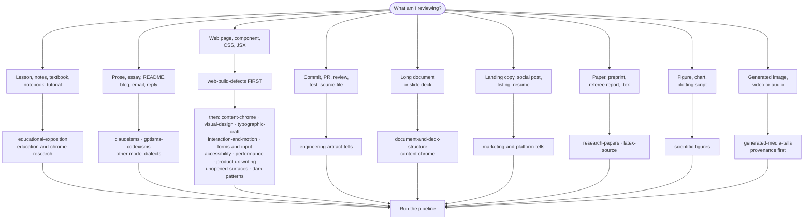
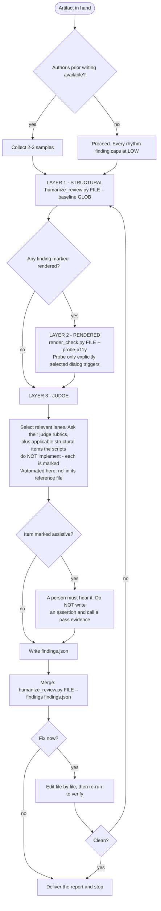

# Review workflow and maintenance

Load this file when running a review, selecting medium-specific checks, writing
findings or maintaining the catalog. The entrypoint keeps the drafting defaults;
this file supplies the detailed mechanics.

## Start here: what am I looking at?

Answer one question — what kind of artifact is in front of you — and this
says which files to open. Every reference file then opens with its own decision
diagram for when it applies, and an index of its contents.



**Open `references/web-build-defects.md` before anything else on a web page.**
Everything in it is reproducible by opening the page, so it carries no fairness
caveat and no claim about authorship — and a page that scrolls sideways at
390px has a bigger problem than reading a bit generated.

## The pipeline

Three layers. The script is layer one; you are layer three.



## Process

### Scope the input and find a baseline

Identify the medium and the stakes. A tweet gets the judge pass only; a marketing
site gets both layers plus a render check. Then go looking for the author's own
earlier work, because it turns the weakest half of the catalog into the strongest.
Two or three published pieces are enough. For a repo, the baseline is the repo:
read `git log --oneline -30` and three recently merged PRs before you judge a
commit or a description.

For decks, dump the text and speaker notes first with python-pptx, review that as
prose, then review the visual idiom separately.

### Run the structural layer

```bash
python3 scripts/humanize_review.py FILE... --baseline 'posts/*.md' \
    --out report.html --json structural.json
```

It measures countable things only: densities, variances, ratios, codepoints, hex
values, font names, identifier overlap. Thresholds come from
`references/catalog.json`, so the rubric and the code cannot drift apart. Run
`--validate` if you ever doubt that they agree.

### Render the page before you judge it

For anything that ships as a web page, the static pass is half the story. It can
tell you there are no responsive variants; it cannot tell you the pricing table
is 1180px wide inside a 390px screen, or which element is at fault.

```bash
python3 scripts/render_check.py URL_OR_FILE --json render.json
python3 scripts/humanize_review.py page.html --findings render.json --out report.html
```

That script is the one thing in this bundle with a dependency, on Playwright, and
it says so when it is missing rather than failing obscurely. It opens the page at
390, 768 and 1280, and reports horizontal overflow with the offending elements
named, tap targets under 44px, text under 12px, and contrast below AA on flat backgrounds. Check the rendered pixels manually for text over gradients or background images. Those
findings merge into the same report through the normal `--findings` path.

If you cannot run it, open the page yourself at phone width. Half the findings in
`references/web-build-defects.md` are visible in ten seconds that way.

Two of its flags turn a source-level guess into a verdict, and both cover states
the author's own browser is never in:

```bash
python3 scripts/render_check.py FIXTURE.html --probe-a11y
python3 scripts/render_check.py FIXTURE.html --probe-modals --modal-trigger '#open-dialog'
```

Use `--probe-modals` only in a disposable fixture or test environment. Each
`--modal-trigger` selector must identify one control whose activation you
have verified opens only the target dialog. The probe checks whether focus
enters, tests Tab containment while the dialog is open, then checks whether
Escape closes it and focus returns to the selected control.
`--probe-a11y` applies the WCAG 1.4.12 text-spacing values and measures what
stops fitting, then switches to forced colors and confirms which elements lost
their only visible boundary. Both matter because a static pass reports success on
exactly these: the Escape handler is present in source whether or not it runs,
and a gradient looks like a boundary right up until the OS reverts it.

### The mechanism of each lane, one line each

Each lane file opens with its own mechanism and a decision diagram for when it
applies, then an index of its contents with severity, family, and whether the
scripts already automate the check. This table is the index; the file is the
argument.

| lane | the mechanism in one sentence |
| --- | --- |
| [web build defects](web-build-defects.md) | Reproducible by opening the page. No authorship claim, no fairness caveat — act on this file first. |
| [visual design](visual-design-tells.md) | One default is a coincidence; the cluster is the finding. |
| [generated media](generated-media-tells.md) | Provenance first, pixels last — the artifact heuristics age in months. |
| [document and deck structure](document-and-deck-structure.md) | Assembly survives a full rewrite of the prose, which is why a reader feels it without being able to name it. |
| [marketing and platform](marketing-and-platform-tells.md) | The venue has a house form, and the tell is the form arriving complete. |
| [engineering artifacts](engineering-artifact-tells.md) | The diff is already visible; a commit that restates it says nothing. |
| [unopened surfaces](unopened-surfaces.md) | Not that the output is strange — that a whole class of output was never looked at. |
| [dark patterns](dark-patterns-the-model-inherits.md) | The violation is usually not in either component but in the gap between them. |
| [accessibility](accessibility-beyond-the-checklist.md) | A machine fully verifies roughly 30% of the criteria; a clean scan is not a clean page. |
| [product UX writing](product-ux-writing.md) | The less the system knows about the failure, the warmer the copy gets. |
| [typographic craft](typographic-craft-and-tokens.md) | Never a wrong value — one value where a function of context belonged. |
| [performance](performance-as-a-design-tell.md) | The generator can see the markup and cannot see the waterfall. |
| [interaction and motion](interaction-and-motion.md) | Motion's quality lives in time, and it is emitted as a string nobody watches run. |
| [forms and input](forms-and-input.md) | The one surface where the output is the START of the user's work. |
| [research papers](research-papers.md) | Prose and checkable commitments arrive at the same confidence, and nothing marks which is which. |
| [LaTeX source](latex-source.md) | Never that it failed to compile — it compiled, and nobody opened the PDF. |
| [scientific figures](scientific-figures.md) | The render is on the far side of a step the author never watched, so the defect is in the code. |
| [tool fingerprints](tool-fingerprints.md) | What made the page. Never who wrote it, never whether it is good. |

### Provenance is a separate question, and a separate mode

```bash
python3 scripts/humanize_review.py page.html --provenance
```

This reports which tool published the page and stops. It writes no report and
carries no severity, and that separation is the point: **a fingerprint tells you
what made the page, never who wrote it and never whether it is any good.**

Three collapses to refuse. Provenance is not authorship — a scaffold
dependency proves where a project started, not who has committed since.
Provenance is not defect — a CDN host is infrastructure, and stripping it
gains nothing. And absence proves nothing, because every badge in that table is
removable by paying, so "no badge" is not evidence of hand-building. Wix and
Squarespace are the sharpest case: their AI flows now seed the ordinary editor,
so AI-built and hand-built output are identical in markup, and "this is
AI-generated because it is on Wix" is false.

What does earn a finding is the overlap set, where a provenance string and a
craft problem are the same bytes: a meta description reading `Generated by v0`,
a share card that is the builder's logo or an auto-screenshot of a preview
build, a favicon that is a build tool's logo, a palette still at a library's
exact default values, a generated headshot on an author byline. The structural
pass reports those as ordinary findings. For every one of them the fix is to do
the work the string points at, never to hide the string — after which the
string disappears on its own. An audit that says "strip the generator meta" is
teaching concealment.

`references/dark-patterns-the-model-inherits.md` is about shapes the commercial
web supplied. A model producing a fake countdown or an accept-only cookie banner
is not choosing to deceive; Princeton found 1,818 dark-pattern instances across
1,254 of 11,000 shopping sites, so these ARE the majority pattern. The output is
still deceptive and sometimes unlawful, which makes it the author's decision, not
yours. The useful thing to notice is that the violation usually lives in the gap
BETWEEN two correct components rather than inside either one: the analytics
snippet is right, the consent banner is right, nothing gates one on the other.
So the checks that matter most there are relational and rendered — load the
page in a fresh profile and watch the network, rather than reading either half.

### Run the judge pass

Select the reference lanes relevant to the artifact and review their applicable
rubrics. Use `references/catalog.json` when machine-readable details are needed;
do not load the whole catalog for a small review. Ask the selected `llm-judge`
questions and the relevant unimplemented `structural` questions yourself. The
script covers a countable subset, not all of them.

For outward-facing prose, always run the paragraph review under "Keep the
reasoning visible in public copy," including on passages with no mechanical
findings. Meaning-based checks in `references/connected-prose.md` are judge
rubrics; this bundle does not automatically detect missing premises, causal
relations, redundant maxims or grammatical fragments.

Each catalog item carries a `detection_type` — the kind of evidence that
settles it. Three of the four are mechanical: `structural` (decidable from the
source text), `rendered` (needs a real browser at a real viewport), and
`llm-judge` (needs you to read it and answer the item's rubric question).

The fourth is `assistive`, and it means what it says: a headless browser cannot
settle it, because the finding is what a person *hears*.
Do not write an assertion for one and treat a pass as evidence — that is how a
manual check gets laundered into a green tick, which is the failure this whole
skill exists to name. Report those as "not checked" unless someone actually put a
screen reader on, and point them at `references/five-minute-manual-pass.md`.

Read as a hostile editor with taste, not as a checklist executor. Then do one
free-form pass asking what else smells generated, because the catalog is a floor
rather than a ceiling.

Write findings to JSON matching `templates/output-template.md`. Each one needs a
file, a line, an excerpt, an ism that exists in the catalog, a dialect, a
severity, an explanation, and a rewrite. A high-severity finding without a
rewrite is a complaint, not a fix.

### Merge, render, fix, re-run

```bash
python3 scripts/humanize_review.py FILE... --findings judge.json --out report.html
```

Work `templates/rewrite-checklist.md` top-down, highest severity first. Then run
both layers again. Use `--fail-on high` if you want this in CI. Never call
something clean without the re-run.

### Validate an update

[README.md](../README.md) contains the runnable entry points;
[CHANGELOG.md](../CHANGELOG.md) records revision scope. Read
[the teaching and title examples](../examples/before-after-learning-and-chrome.md)
when a rubric needs a concrete repair. Run
`scripts/test_learning_structure.py` for parser and annotation counterexamples,
and `scripts/test_review_regressions.py` for the Unicode, citation-URL, and
eyebrow judgment boundaries. These are offline checks; learner outcomes and
rendered teaching quality still require direct review.

### Maintaining the catalog

`references/catalog.json` is the source of truth for rubrics, thresholds, false
positives, and currency. Edit it, then run
`python3 scripts/regenerate_references.py`, which rebuilds every per-dialect
markdown view and refuses to write if any item would land in no file. The
markdown files are generated, so do not hand-edit them.

Every item carries a `currency` field, because tells decay. Vendors patch the
famous ones: one provider's em-dash rate fell from 10.62 per thousand words to
0.29 across model generations. Items marked `obsolete` stay in the catalog as
cautions rather than tests. The entry on mangled hands in generated images is
already one of them.


## Dos and don'ts

Do quantify before you flag rhythm, and get a baseline whenever you can. Do
preserve meaning exactly when you rewrite, since you are removing an accent
rather than content. Do read two or three adjacent published pieces to learn the
property's voice first. Do run this pipeline over your own draft before you
deliver it. Do say "clean" when it is clean, because a zero-finding report is a
real result.

Don't paraphrase-launder. Running text through one more model adds a second
accent on top of the first, and the fixes have to be surgical instead: edit the
flagged span and leave the rest byte-identical.

Don't build keyword lists to catch phrases. Don't strip personality along with
tropes, since contractions, opinions and irregularity are the goal rather than
the casualties. Don't treat low-severity items as a to-do list; they are taste
calls the author gets to keep. Don't add findings as comments in the source file,
because the HTML report is the deliverable.

Don't strip an agent attribution trailer without checking the repo first. Roughly
forty projects in the public contribution-policy survey require disclosure, so
removing an honest one can violate policy. Detect it and ask.

## Failure modes

**Paraphrase laundering.** You spot it when the fixed text has new tropes the
original lacked. Rewrites should touch only the flagged span.

**Voice flattening.** The post-fix text is clean but beige, because the author's
tics went out with the machine's. Diff against their known-human writing and put
the fingerprints back. A baseline run makes this visible instead of a matter of
taste.

**Checklist myopia.** The judge pass returns only catalog items and no novel
observations. The free-form pass is not optional.

**Flagging quoted evidence.** A document that demonstrates AI-isms will flag the
AI-isms it demonstrates. Wrap those regions in `<!-- humanize:ignore-start -->`
and `<!-- humanize:ignore-end -->`, which is what this bundle's own examples do.

**Stale advice.** Acting on an `obsolete` catalog item produces confident wrong
answers. Check the currency line, especially on image forensics, where hands and
garbled text stopped working as tests around 2025. Lead with provenance instead.

**Forensics drift.** Someone asks whether a student or employee used AI, and the
skill answers. It is out of scope. Detection-for-accusation has miserable
false-positive economics, and the fairness reference exists so you can say why.

Worked examples live alongside those: `examples/before-after-prose.md` is a
launch announcement in machine accent and then edited,
`examples/before-after-landing-page.md` walks the v0 look token by token, and
`examples/sample-report.html` shows what a finished fix plan looks like.
