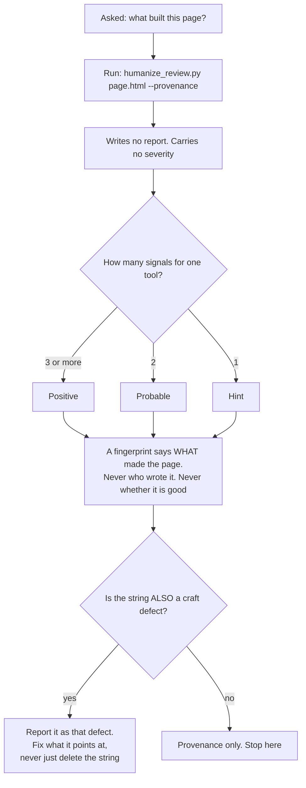

# Tool fingerprints — provenance, and the few that are also defects

Read the first two items in this file before the other nineteen, because they are the rules the rest depends on.

**A fingerprint tells you what made the page. It never tells you who wrote it, and it never tells you whether the page is any good.** Three collapses to refuse. Provenance is not authorship: a scaffold dependency in a repo proves where a project STARTED and says nothing about six months of commits since. Provenance is not defect: a CDN host and a server header are infrastructure, and stripping them is either impossible or pointless. And absence proves nothing, because every badge in the table below is removable by paying, so "no badge" is never evidence of hand-building. Wix and Squarespace are the sharpest case — their AI flows now seed the ordinary editor, so AI-built and hand-built output are provably identical in markup, and any finding of the form "this is AI-generated because it is on Wix" is simply false.

So most of this file is NOT findings. `scripts/humanize_review.py --provenance` reports it as a separate mode that writes no report and carries no severity, and that separation is deliberate.

**What earns this file its place is the overlap set**: a handful of cases where the provenance string and a craft problem are the same bytes. An unwritten meta description that reads `Generated by v0`. A share card that is the builder's logo, or an auto-screenshot of a preview build. A favicon that is a build tool's logo. A palette nobody chose, still at the library's exact default oklch values. A generated headshot on an author byline. For those, the fix is never to hide the string — it is to do the work the string is pointing at, after which the string disappears as a side effect. That is the only removal that is honest, and it is the only advice that survives contact with someone who has to defend the site to their boss.

One entry in this file is about honesty rather than craft: invented clients, unverifiable testimonials and generated headshots on team pages. Everything else here is a quality judgement where reasonable people differ and "I used a tool" is a complete defence. That one is different — not because you should accuse anyone, but because being specific about what is unverifiable is an edit, and "an empty Trusted by section is better than a fabricated one" happens to be true.

_21 items. Generated from catalog.json — edit there, then re-run `scripts/regenerate_references.py`. Do not hand-edit this file._

_Every item carries a **False positive when** line. Read it before you act on the item: these are cues for an editor, not evidence about an author._

<!-- humanize:ignore-start
     The diagram and index below quote the tells they document, and a
     mermaid label is not a sentence. -->

## When this file applies

## What is in this file

Severity reflects the consequence for the intended reader, never how sure you should be about who wrote it. **Automated** means these scripts implement the check; *no* means it is yours to ask in the judge pass.

| item | severity | family | automated |
| --- | --- | --- | --- |
| [`agency-proof-gap`](#agency-proof-gap) | HIGH | shape | n/a |
| [`ai-image-default-filenames`](#ai-image-default-filenames) | HIGH | residue | yes |
| [`builder-default-og-image`](#builder-default-og-image) | HIGH | defect | yes |
| [`case-study-process-without-artifacts`](#case-study-process-without-artifacts) | HIGH | shape | n/a |
| [`invented-clients-and-generated-bylines`](#invented-clients-and-generated-bylines) | HIGH | defect | n/a |
| [`per-character-text-spans`](#per-character-text-spans) | HIGH | defect | yes |
| [`scaffold-title-and-favicon-residue`](#scaffold-title-and-favicon-residue) | HIGH | residue | yes |
| [`supabase-anon-surface-unprotected`](#supabase-anon-surface-unprotected) | HIGH | defect | **no** |
| [`unclaimed-default-subdomain`](#unclaimed-default-subdomain) | HIGH | shape | **no** |
| [`agent-instruction-shipped-to-production`](#agent-instruction-shipped-to-production) | med | residue | yes |
| [`builder-lockin-and-export-illusion`](#builder-lockin-and-export-illusion) | med | shape | **no** |
| [`design-pattern-is-not-provenance`](#design-pattern-is-not-provenance) | med | shape | **no** |
| [`fix-what-the-fingerprint-points-at`](#fix-what-the-fingerprint-points-at) | med | defect | **no** |
| [`selected-works-of-three-and-third-person-about`](#selected-works-of-three-and-third-person-about) | med | shape | **no** |
| [`shadcn-default-tokens-untouched`](#shadcn-default-tokens-untouched) | med | residue | yes |
| [`single-file-cdn-tailwind-page`](#single-file-cdn-tailwind-page) | med | shape | **no** |
| [`client-first-class-system`](#client-first-class-system) | low | shape | **no** |
| [`fingerprint-is-not-authorship`](#fingerprint-is-not-authorship) | low | residue | **no** |
| [`keywords-meta-placeholder`](#keywords-meta-placeholder) | low | residue | yes |
| [`status-code-only-file-probe`](#status-code-only-file-probe) | low | defect | **no** |
| [`template-versus-generated`](#template-versus-generated) | low | shape | n/a |

<!-- humanize:ignore-end -->

<!-- humanize:ignore-start
     Everything below is a specimen catalog. It quotes the tells it documents,
     including literal machine residue, so reviewing it with humanize_review.py
     would flag the exhibits rather than the writing. -->

### `agency-proof-gap`  ·  high · generic-llm · marketing-copy · llm-judge · family: shape · lane: provenance

An agency or freelancer site that claims capability its own build contradicts. The pitch and the page were written by the same process, so neither checked the other.

**Why it reads AI:** This is the one finding that costs money directly, and it is the clearest case of the generation loop having no outside reader. Every claim is plausible in isolation; the page itself is the counter-evidence.

**Detect:** The contradiction test, run against the site's own artifacts: "we build high-performance websites" on a page shipping 127 font files; "custom design, no templates" on a page with an unmodified shadcn chart token; "we refuse to be boring" on a violet-gradient glass-card hero; "bespoke" on a builder subdomain with a build tool's favicon. Static support: any builder badge on a site selling web services, and the builder's default share card.

**Fix:** In order: fix the contradiction the site makes about itself before touching the copy — remove the badge, set the share card, buy the domain. Then replace every unevidenced superlative with one checkable fact. If you build with these tools, say so as a positioning choice rather than hiding it badly.

**False positive when:** Using a builder for your own agency site is a defensible efficiency decision and many good agencies do it openly. The finding is the GAP between claim and artifact, never the tool. Small agencies legitimately have few public case studies early on, and "no proof yet" is a different thing from "invented proof".

**Before**

> "Award-winning digital studio crafting bespoke experiences" — on a builder subdomain, with the builder's logo as the share card

**After**

> "We build marketing sites in about a week. Three recent ones, with what each cost and what it does now: [links]."

### `ai-image-default-filenames`  ·  high · generic-llm · image · structural · family: residue · lane: provenance

**Automated here:** yes, these scripts implement it.

Image generators assign distinctive default download filenames and site builders preserve them, so the filename in the img src names the model that made the picture. Midjourney's format contains the prompt.

**Why it reads AI:** The strongest content-provenance signal available, and it survives every rebuild, migration and badge removal, because the filename travels with the file. It has already been used in published investigative reporting to establish that author headshots on a network of sites were generated, alongside credentials the named university confirmed never existed.

**Detect:** Grep src, srcset and content attributes for: Gemini_Generated_Image_ (and WordPress's derived cropped-Gemini_Generated_Image); the concatenated ChatGPT form ChatGPTImage<Mon><DD><YYYY><HH>_<MM>_<SS><AM|PM>.png and the hyphenated WordPress-sanitised ChatGPT-Image-Oct-20-2025-11_57_34-AM; Midjourney's <discorduser>_<prompt_words_underscored>_<uuid>.png; and, weakly, a UUID-only filename where every other asset is descriptively named.

**Fix:** Rename every image to a descriptive slug before upload — worth doing on search grounds regardless. But if the image is a person or a proof artifact, renaming is the wrong fix: replace it, or remove it.

**False positive when:** Generated imagery is routine and legitimate for illustration and background art. The finding is AI imagery used WHERE A HUMAN OR A PROOF IS IMPLIED — bylines, team pages, testimonials, client work. And a descriptive filename proves nothing in the other direction: absence of this tell is not evidence the image is real.

**Before**

> 

**After**

> a real photograph at /team/marta-oleszek.jpg, or no photo at all

### `builder-default-og-image`  ·  high · generic-llm · web-ui · structural · family: defect · lane: provenance

**Automated here:** yes, these scripts implement it.

The Open Graph image is the builder's property rather than the site's: Bolt's own logo, or a Cloudflare-hosted screenshot of a Lovable preview build. Every share of the business's site posts somebody else's picture.

**Why it reads AI:** The share card is invisible in every preview the builder shows, so nothing in the loop surfaces it. In the Lovable case it is worse than a default: the card was auto-generated by screenshotting a preview environment, so every link posts a robot's snapshot of an unfinished build.

**Detect:** content="https://bolt.new/static/og_default.png" on og:image or twitter:image. And Lovable's auto-screenshot, matched as pub-[0-9a-f]{32}\.r2\.dev/[0-9a-f]{32}/id-preview-[0-9a-f-]+\.lovable\.app-\d{13}\.png — which is the most durable fingerprint in this lane, because it survives badge removal AND a custom domain.

**Fix:** Ship a real 1200x630 og:image on your own domain. One change fixes the share card and removes the fingerprint, which is the right order to do it in.

**False positive when:** None for the string. A deliberate demo or a tutorial page may honestly carry the builder's card.

**Before**

> <meta property="og:image" content="https://bolt.new/static/og_default.png">

**After**

> <meta property="og:image" content="https://yourdomain.com/og.png">

### `case-study-process-without-artifacts`  ·  high · generic-llm · marketing-copy · llm-judge · family: shape · lane: provenance

A portfolio case study that narrates a process and shows nothing from it. Discovery, personas, a double-diamond diagram, a journey map — then a hero mockup and a metric with no source.

**Why it reads AI:** Process language is the easiest thing in the world to generate and the hardest thing to fake evidence for. A model can write "we synthesised insights across 14 stakeholder interviews"; it cannot produce the interview notes. In a portfolio this is not a detail — it is the whole product.

**Detect:** For each case study, ask: does it contain at least one artifact that could only exist if the work happened — a screenshot of the shipped product, a before-and-after of a specific screen, a sketch in somebody's handwriting, a redline, a rejected direction? If the only images are a device mockup of the final screen plus generic diagrams, flag it. Supporting static tells: stock sticky-note-wall imagery, a double-diamond SVG, a journey map shaped like a zoomed-out spreadsheet, and percentage claims with no methodology.

**Fix:** Add one artifact per case study that could not have been generated: a photo of the whiteboard, the actual design file, the rejected direction and one sentence on why it lost, a screenshot of the dashboard behind the metric. One real artifact beats three paragraphs of process.

**False positive when:** Work under NDA genuinely cannot show artifacts — but the honest version is a one-line statement of the constraint plus a redacted artifact, not generic process prose. Junior and student portfolios legitimately foreground process because that is what they have; do not review one the way you would review a senior portfolio.

**Before**

> "Through extensive user research and iterative prototyping, I identified key pain points… Result: conversion increased 34%."

**After**

> "We shipped the one-field checkout in March. Here is the funnel before and after [screenshot]. 34% is the completed-checkout rate over six weeks; the sample is 11,200 sessions."

### `invented-clients-and-generated-bylines`  ·  high · generic-llm · marketing-copy · llm-judge · family: defect · lane: provenance

The one place in this whole catalog where a finding is about honesty rather than craft: a "Trusted by" wall, a testimonial, a team grid or an author byline where the entities cannot be verified and the supporting image is generated.

**Why it reads AI:** Generators fill proof slots with plausible content because the slot exists in the template. The template asked for six client logos, so six client logos appeared. Published reporting has already found this in the wild: generated author headshots, profiles all created within days of each other, and claimed Oxford degrees the university confirmed never existed.

**Detect:** Run the AI-image filename check against every image inside a testimonial, team, author or client section. Check whether logo-wall marks are all the same optical weight and grid aligned (generated) or varied (real). Then for each named client or person, look for off-site corroboration: a link, a case study on the client's own site, a profile, a press mention. Cross-check testimonials attributed only to a first name and a job title, and "as featured in" with no links.

**Fix:** Delete every unverifiable claim. An empty "Trusted by" section is better than a fabricated one. Replace with what is true and checkable — one named client with a link, or a plain statement of how long you have been doing this and for whom.

**False positive when:** Concept and spec work is legitimate in a portfolio — the defect is UNLABELLED concept work presented as client work. A stock or illustrated avatar is fine if it does not claim to be a person. And logo walls sometimes honestly show tools used rather than clients: read the heading before you read the logos.

**Before**

> six logo marks of companies with no relationship to the business; a team page of four generated headshots

**After**

> one real client with a linked case study; a photograph of the actual person, or no photograph

### `per-character-text-spans`  ·  high · generic-llm · web-ui · structural · family: defect · lane: provenance

**Automated here:** yes, these scripts implement it.

Per-character text animation emits one span per glyph, often with an inline colour on each. The result is visually fine and semantically shredded: screen readers, copy-paste, text extraction and search engines all see letter-spaced garbage.

**Why it reads AI:** It reads effect-first: the animation was chosen before the content was considered, which is the hallmark of a page assembled from motion presets rather than written. Note this is a DEFECT fingerprint rather than a TOOL fingerprint — GSAP SplitText, Webflow text-split interactions and several React libraries produce the same shape, so pair it with a generator string before naming a tool.

**Detect:** Strip tags from the body and look for runs of isolated single characters — (?:(?:^|\s)\S(?=\s)){6,}. On a live Framer template this extracted as "W e   B u i l d   B r a n d s". Confirm by finding adjacent single-character spans in the markup.

**Fix:** Turn per-character animation off for anything that is real page copy — headings, value propositions, body. Reserve it for decorative marquees, and give those aria-hidden with a plain-text sibling. If it must stay on an H1, add a visually hidden un-split copy of the same string.

**False positive when:** Deliberate typographic art where the letters are the content, and elements already marked aria-hidden with a readable sibling.

**Evidence:** Corrects a widely repeated claim. A heavily upvoted r/TechSEO comment holds that Framer "essentially create SPAs like Gmail or Netflix uses — there is only an empty div in the body". That is false: a Framer template page was measured at 11,126 characters of server-rendered visible text and 51 headings in the body. The real problem is narrower and more interesting, and it is this one.

**Before**

> We&nbsp;B…

**After**

> the heading is one text node; the animation runs on a wrapping element, not on split children

### `scaffold-title-and-favicon-residue`  ·  high · generic-llm · web-ui · structural · family: residue · lane: provenance

**Automated here:** yes, these scripts implement it.

The scaffold's own title, favicon, description and share image shipped to production. A law firm with the Vite logo in the browser tab; a business whose social card is the builder's own logo.

**Why it reads AI:** The favicon and the share card are the two most-seen bytes of any site and the two nobody looks at during a chat-driven build, because the preview pane renders neither. The title that restates the prompt is the same failure one level up: the page is named after the request that produced it.

**Detect:** Exact literals: <link rel="icon" type="image/svg+xml" href="/vite.svg"> and <title>Vite + React</title>; <title>Create Next App</title> and content="Generated by create next app"; <title>v0 App</title>, content="Generated by v0", content="Created with v0"; <title>React App</title> and a stray %PUBLIC_URL%; og:image at bolt.new/static/og_default.png. Also worth flagging: a <title> that restates the build prompt rather than naming a brand — "Trading Mitra Financial Website", "AI-Powered CRM Dashboard".

**Fix:** Four lines: a real title, a real meta description, a real favicon, and a real og:image on your own domain. Verify against the DEPLOYED HTML rather than the builder's preview — on v0 the metadata change appears only in the deployed project.

**False positive when:** Genuine scaffolds, starter repos, boilerplate and tutorial demos, where "Create Next App" is the honest title of the thing. Filter to sites with a custom domain or real business content.

**Before**

> <title>v0 App</title> + <meta name="description" content="Generated by v0"> + href="/vite.svg"

**After**

> <title>Prolific Pours — mobile bartending in NYC</title> + a description saying what the page is for + the brand mark as favicon + a 1200x630 card on the site's own domain

### `supabase-anon-surface-unprotected`  ·  high · generic-llm · code · rendered · family: defect · lane: provenance

**Automated here:** no — decidable mechanically, but this bundle does not implement it. Ask it yourself in the judge pass.

The default data layer of several builders is Supabase called straight from the browser with an anon key, and scaffold-created tables land with Row Level Security disabled unless somebody turns it on.

**Why it reads AI:** The scaffold cannot infer who should see which rows, so it ships the permissive default and the human never revisits it. One scan of a builder's own showcase found 10.3% of apps with critical RLS failures exposing names, addresses, phone numbers and financial records; a wider scan of 1,072 vibe-coded apps found 98% with security issues and 16% critical.

**Detect:** In network traffic or the bundle: a <ref>.supabase.co/rest/v1/ origin with an apikey header carrying a JWT. Then TEST it — issue an unauthenticated GET /rest/v1/<table>?select=* with the public anon key from an incognito session. The finding is the response, not the architecture.

**Fix:** Enable RLS on every table and write explicit policies. Verify with the anon key from an incognito session, not by reading the dashboard.

**False positive when:** The presence of Supabase calls is normal architecture and not a defect. Only an actual unauthenticated read of private data is a finding — do not report "uses Supabase" as a security issue, test it.

**Before**

> GET /rest/v1/leads?select=* with the public anon key returns every customer record

**After**

> the same request returns []; authenticated requests return only the caller's rows

### `unclaimed-default-subdomain`  ·  high · generic-llm · marketing-copy · structural · family: shape · lane: provenance

**Automated here:** no — decidable mechanically, but this bundle does not implement it. Ask it yourself in the judge pass.

A commercial site whose only address is the builder's auto-assigned subdomain. In v0's case the URL publishes the prompt: v0-ai-powered-crm-for-dentists.vercel.app tells a visitor exactly what was typed to make their vendor's website.

**Why it reads AI:** Nobody decided the address; the builder assigned it. It is the cheapest credibility problem to describe and the cheapest to fix.

**Detect:** The address itself: *.lovable.app, *.bolt.host (including raw 25-character base36 ids), *.base44.app, v0-<prompt-slug>.vercel.app, *.framer.website/.media/.app, *.replit.app, durable.site, and Hostinger's <css-colour-name>-<animal>-<6 digits>.hostingersite.com.

**Fix:** Buy the domain. For v0 specifically, rename the project too — the slug is a louder tell than any meta tag, because it is a transcription of the prompt.

**False positive when:** Prototypes, internal tools, hackathon entries, demos and staging URLs all legitimately live on default subdomains. Only a finding when the page is transacting or soliciting.

**Before**

> a law firm's contact page at eqovo83f889a4stmo1auvr4u9.bolt.host

**After**

> firmname.com

### `agent-instruction-shipped-to-production`  ·  medium · generic-llm · web-ui · structural · family: residue · lane: provenance

**Automated here:** yes, these scripts implement it.

A comment addressed to a language model, left in the artifact a visitor downloads. Lovable ships one telling the model not to delete a script tag; Replit ships one explaining a dev-only banner to a reader who was never supposed to exist.

**Why it reads AI:** Nothing announces machine authorship more plainly than a literal instruction to a machine, shipped. This is the residue family in its purest form: near-zero human source, because no person writes a comment addressed to a model and then publishes it.

**Detect:** Exact literals, both verified at scale by code search: the Lovable comment "IMPORTANT: DO NOT REMOVE THIS SCRIPT TAG OR THIS VERY COMMENT!" next to https://cdn.gpteng.co/gptengineer.js (36,032 hits), and the Replit comment "This is a replit script which adds a banner on the top of the page when opened in development mode outside the replit environment" next to replit.com/public/js/replit-dev-banner.js (7,296 hits in HTML files). Either half alone is sufficient.

**Fix:** Delete the comment and the script from the production template. For Replit's dev banner this is also a real fix — it is a third-party script on every pageview of a live site. For Lovable's, confirm the editor still works first.

**False positive when:** Prompt-collection and documentation repositories carry these strings as their subject matter, not as a site. Filter to HTML actually served from an origin.

**Before**

> <!-- IMPORTANT: DO NOT REMOVE THIS SCRIPT TAG OR THIS VERY COMMENT! -->

**After**

> neither the comment nor the script in the shipped HTML

### `builder-lockin-and-export-illusion`  ·  medium · generic-llm · web-ui · structural · family: shape · lane: provenance

**Automated here:** no — decidable mechanically, but this bundle does not implement it. Ask it yourself in the judge pass.

The recurring complaint after the fact is not "it looks bad" but "I cannot leave, and the export is not what I thought". Worth naming because it is a real cost of the category that the sales page does not mention.

**Why it reads AI:** Not a machine tell at all. It is the structural cost of hosted builders, and a skill that reviews these sites should be able to name it honestly rather than only critiquing the pixels.

**Detect:** Readable from the fingerprints: a site whose content lives inside a platform context object or a hydration payload has no portable content layer, and there is no export that reconstructs the design. Practitioners put it plainly — once you export and touch the code, you usually lose the visual editor workflow completely.

**Fix:** Advice rather than a code change. Before committing, verify three things: can you export content as structured data, can you export or self-host the rendered site, and what happens to your URLs. Several major platforms fail the second. The durable arrangement is content in a portable store with the builder as a rendering layer.

**False positive when:** Lock-in is a legitimate trade for speed. For a site that will be replaced in eighteen months anyway it costs nothing. Only a finding where longevity matters.

**Before**

> three years of content on a hosted builder, and moving means a full rebuild

**After**

> content authored in markdown or a headless store; the builder renders it

### `design-pattern-is-not-provenance`  ·  medium · generic-llm · web-ui · structural · family: shape · lane: provenance

**Automated here:** no — decidable mechanically, but this bundle does not implement it. Ask it yourself in the judge pass.

How much to trust the public "is this AI" detectors, and which half of their method to steal. The string layer is sound; the aesthetic layer is not.

**Why it reads AI:** It is the failure mode this entire skill is built to avoid, appearing in tools that claim to do what this skill refuses to do. Naming it here keeps the boundary visible.

**Detect:** The credible layer is generator metas, script paths, CDN hosts, known CNAMEs and HTTP headers — the same signals technology-profiling tools have used for a decade, with near-zero false positives. The layer to refuse is the aesthetic one: "purple-to-blue gradients, shadcn components, Lucide icons, glassmorphism cards, sparkle emoji in headings, a recently registered domain" describes thousands of well-made hand-built sites, and domain age is not evidence of authorship at all.

**Fix:** Two things worth adopting. Detect in a rendered DOM, because attributes like the Lovable tagger's only exist after hydration. And band your confidence: three or more signals in the same category is a positive, two is probable, one is a hint and usually not enough. Weight the fingerprint strings and the design patterns at different tiers and never let the second promote the first.

**False positive when:** Any detector scoring aesthetics as authorship evidence will misfire on a large fraction of good 2024–2026 product sites. Report tool provenance from strings, report craft from craft, and never infer one from the other.

**Before**

> "Purple gradient plus Inter plus rounded cards, therefore AI."

**After**

> "Three Tier-A strings put this on Lovable. Separately, the palette is unmodified, which is a craft finding whoever built it."

### `fix-what-the-fingerprint-points-at`  ·  medium · generic-llm · web-ui · structural · family: defect · lane: provenance

**Automated here:** no — decidable mechanically, but this bundle does not implement it. Ask it yourself in the judge pass.

The overlap set, and the reason this lane earns its place: a handful of fingerprints are ALSO defects, where the provenance string and the craft problem are the same bytes. These are the only ones worth editing, and the fix is never to hide the string.

**Why it reads AI:** In each case the string survived because the surface it sits on is one nobody looks at during a chat-driven build: the browser tab, the share card, the meta description, the chart palette. The preview pane shows none of them.

**Detect:** The set: content="Generated by v0" (provenance AND no meta description); og:image at bolt.new/static/og_default.png (provenance AND every share posts the builder's logo); Lovable's R2 screenshot og:image (provenance AND the share card was never authored); <meta name="keywords" content="keyword"> (provenance AND a shipped placeholder); href="/vite.svg" (provenance AND the favicon is a build tool's logo); shadcn's exact default oklch tokens (provenance AND nobody chose the palette); Framer's per-glyph spans (provenance AND screen readers hear "W e   B u i l d"); Gemini_Generated_Image_*.png as an author headshot (provenance AND a person who does not exist).

**Fix:** Fix the thing the fingerprint points at, never the fingerprint. Write the description. Make the OG image. Choose the palette. Replace the headshot with a real one. The string disappears as a side effect, which is the only removal that is honest — an audit that says "strip the generator meta" is teaching concealment, and it will not survive contact with someone who has to defend the site to their boss.

**False positive when:** None. This item is a routing rule, not a detector.

**Before**

> "Remove the v0 generator tag before launch."

**After**

> "Your meta description is the string 'Generated by v0', so search results and every shared link describe the tool instead of the product. Here is a 155-character description."

### `selected-works-of-three-and-third-person-about`  ·  medium · generic-llm · marketing-copy · structural · family: shape · lane: provenance

**Automated here:** no — decidable mechanically, but this bundle does not implement it. Ask it yourself in the judge pass.

The exact skeleton portfolio generators emit, published in their own marketing: a Selected Works grid of exactly three projects, an About written in the third person about a first-person subject, and a "Let's work together" close.

**Why it reads AI:** Three is the generator's default cardinality, not a curatorial decision, and the vendors say so outright — one advertises producing "case-study pages, a selected-work gallery, an about section, and contact" from a short description of your discipline. That is the skeleton, named by the people selling it.

**Detect:** A heading matching /^(Selected Works?|Featured Work|Recent Work)$/i directly above a grid of exactly three cards; a heading matching /Let'?s (work together|build something|create something|talk)/i; and an About section whose first sentence uses the subject's own name in the third person while the rest of the page says "I". The person mismatch is the sharpest of the three.

**Fix:** Show a number of projects that is not three — two if you have two good ones, seven if you do; the number should look like a decision. Pick one grammatical person and hold it. Replace "Let's work together" with what you actually want.

**False positive when:** Three genuinely good projects is a normal and defensible edit, and many excellent portfolios show exactly three. Third-person About is a real convention for agencies and for people who get press-quoted. Flag only when both appear together, or when the person shifts within the page.

**Before**

> "Selected Works" / three cards / "Maya is a multidisciplinary designer based in Lisbon." / "Let's work together."

**After**

> "Four projects I'd defend" / four cards / "I'm Maya. I design onboarding for fintech, mostly." / "I have one project slot open in March — here is what a good fit looks like."

### `shadcn-default-tokens-untouched`  ·  medium · generic-llm · color · structural · family: residue · lane: provenance

**Automated here:** yes, these scripts implement it.

The mechanism behind "every AI site is the same purple", and it is measurable as exact constants. shadcn/ui's default theme ships specific oklch values; finding them unmodified proves the palette was never chosen.

**Why it reads AI:** The tokens are identical across thousands of sites because nobody replaced them. Note that swapping the hue does not change the system — practitioners report newer models reaching for orange instead of violet, with the same gradient and the same card, which is the point: the palette is a default whichever colour it defaults to.

**Detect:** Grep the shipped CSS for the literal defaults: --radius: 0.625rem; oklch(0.769 0.188 70.08) (--chart-5); oklch(0.828 0.189 84.429) (--chart-4); oklch(0.398 0.07 227.392) (--chart-3); oklch(0.6 0.118 184.704) (--chart-2); --sidebar-ring: oklch(0.708 0 0). Any one of the chart values is a near-unique literal; code search returns 164,352 files carrying the block byte-identical.

**Fix:** Replace the whole token block with real brand values — including --chart-* and --sidebar-*, which are the ones people forget. Changing only --primary leaves five default chart colours that appear the first time anyone renders a graph.

**False positive when:** Using shadcn/ui is not a defect — it is a mainstream, well-engineered library used by large teams. The finding is UNMODIFIED DEFAULTS, never the library's presence. A project that renders no charts may reasonably leave the chart tokens alone; check whether they are used before reporting.

**Before**

> --chart-5: oklch(0.769 0.188 70.08);  in a fintech dashboard's production CSS

**After**

> a five-value brand chart ramp, contrast-checked against the surface it draws on

### `single-file-cdn-tailwind-page`  ·  medium · generic-llm · web-ui · structural · family: shape · lane: provenance

**Automated here:** no — decidable mechanically, but this bundle does not implement it. Ask it yourself in the judge pass.

The shape a chat surface produces, because a chat surface can only hand you one file: everything inlined, Tailwind loaded from the Play CDN, React from a UMD build with Babel in the browser, no build artifacts, no favicon. Recorded here as an honest negative result — ChatGPT Canvas leaves NO provenance marker at all, and this catalog will not invent one.

**Why it reads AI:** It does not, reliably, and that is the point of the entry. The Play CDN in production is a genuine performance defect — an uncached third-party script that must run before first paint and generates CSS at runtime — and that is the finding worth making. The authorship inference is not available and should not be attempted.

**Detect:** By shape, not by string:  in a production head

**After**

> <link rel="stylesheet" href="/assets/app.<hash>.css"> from a real build

### `client-first-class-system`  ·  low · generic-llm · web-ui · structural · family: shape · lane: provenance

**Automated here:** no — decidable mechanically, but this bundle does not implement it. Ask it yourself in the judge pass.

A negative finding, included because suppressing a false positive is worth as much as raising a true one. Finsweet's Client-First is a human naming convention for Webflow. Generated output does not produce it and neither do code generators, so finding it is positive evidence of a human starting point.

**Why it reads AI:** It does not — that is the entire point. Use it to lower confidence in other signals on the same page.

**Detect:** Class literals: padding-global, container-large/medium/small, padding-section-small/medium/large, max-width-large, spacer-*, text-size-*, and components named in the section_hero / hero_component form.

**Fix:** Nothing to fix. Record it and weigh the other findings accordingly.

**False positive when:** Client-First can be applied to a bought template that was barely touched, so it evidences that a human system was used, not that a human designed this site. And a Client-First site can still have machine-written copy — this signal covers markup provenance only.

**Before**

> hashed one-off class names throughout

**After**

> padding-global, container-large, section_hero — a system somebody chose and applied

### `fingerprint-is-not-authorship`  ·  low · generic-llm · web-ui · structural · family: residue · lane: provenance

**Automated here:** no — decidable mechanically, but this bundle does not implement it. Ask it yourself in the judge pass.

The governing rule for every fingerprint in this lane, and the one most often broken. A generator meta, a CDN host or a scaffold dependency tells you WHAT MADE the page. It does not tell you who wrote it, and it does not tell you whether the page is any good.

**Why it reads AI:** Three collapses to refuse. Provenance is not authorship: lovable-tagger in a repo proves a project STARTED in Lovable and says nothing about six months of commits since. Provenance is not defect: server: Pepyaka and framerusercontent.com are infrastructure, and deleting them is either impossible or pointless. And absence proves nothing: every badge in this lane is removable by paying, so "no badge" is not evidence of hand-building. The sharpest case is Wix and Squarespace, whose AI flows now seed the ordinary editor — their AI-built and hand-built output is provably identical in markup, so any finding of the form "this is AI-generated because it is on Wix" is false.

**Detect:** Not a check. A posture applied to every other item in this lane: report the platform if asked, never infer the author, and never report a provenance string as a quality finding.

**Fix:** When a pure provenance string is all you have, say one line: this page is served by X, that is information rather than a problem, decide whether you want it visible. Then move on to the craft findings, which are where the value is.

**False positive when:** There is no false positive on the strings themselves — they are exact literals. The false positive is always in the inference drawn from them.

**Before**

> "This site was AI-generated — it has a Framer generator meta."

**After**

> "This site is published from Framer. That is a design tool used by professional teams and by Framer's own AI agent, and the markup is identical either way. Separately, here are six things about the page that are worth fixing."

### `keywords-meta-placeholder`  ·  low · generic-llm · marketing-copy · structural · family: residue · lane: provenance

**Automated here:** yes, these scripts implement it.

A meta keywords tag — an element search engines have ignored since 2009 — shipped with the literal placeholder value "keyword", or stuffed with a comma-salad of service-plus-location phrases that are four restatements of one idea.

**Why it reads AI:** The keyword list is a fossil of the generation prompt. Repetition without variation is the same pattern that shows up in the visible body copy, which is why this tag is worth reading even though it does nothing.

**Detect:** <meta name="keywords" content="keyword"> is the unmistakable form, verified live on a production business site. The generated form looks like "bartending service NYC, bartender for hire NYC, private bartending NY, mobile bar NYC" — flag the repetition, not the tag.

**Fix:** Delete the tag. Then check whether the visible section headings are that same list in sentence form; if they are, rewrite to one specific claim per section.

**False positive when:** Many content management systems still emit a keywords tag from an SEO plugin. The literal value "keyword" is the part with no innocent explanation.

**Before**

> <meta name="keywords" content="keyword"/>

**After**

> tag removed; each section makes one claim the others do not

### `status-code-only-file-probe`  ·  low · generic-llm · web-ui · rendered · family: defect · lane: provenance

**Automated here:** no — decidable mechanically, but this bundle does not implement it. Ask it yourself in the judge pass.

A methodology warning, recorded because implementing the naive version makes an audit wrong in public. Probing for leaked agent files by HTTP status alone returns a false positive on every single-page-app host, because they serve index.html for all unknown paths.

**Why it reads AI:** A genuinely exposed CLAUDE.md or .cursorrules at the web root is both a strong provenance signal and a real information leak, so it is worth checking — correctly.

**Detect:** Measured directly: /CLAUDE.md, /AGENTS.md, /.cursorrules, /.env and /package.json ALL returned HTTP 200 on live Bolt and Base44 sites, and all of them returned the site's index.html. The rule: a probe counts only if the content-type is not text/html AND the body does not begin with <!DOCTYPE or <html AND the body parses as the expected format. In the sample, exactly one probe survived that test and it was a real package.json.

**Fix:** For the site owner: make sure the build output excludes agent config and the host does not serve repository files. For anyone auditing: implement the content check before shipping the probe.

**False positive when:** By default, on every Vite or Next single-page host. Never ship a status-code-only probe.

**Before**

> GET /.env → 200 → "the environment file is exposed"

**After**

> GET /.env → 200, content-type text/html, body starts <!DOCTYPE → not a finding

### `template-versus-generated`  ·  low · generic-llm · layout · llm-judge · family: shape · lane: provenance

The disambiguation rule between "somebody bought a starting point" and "a model wrote this". It matters because a template is a human choosing a starting point — often a good decision — and misreporting it as generation destroys trust in the whole audit.

**Why it reads AI:** Neither, necessarily. The useful contrast is that templates ship DEMO content and generators ship PLAUSIBLE INVENTED content. Lorem ipsum is a template; a fabricated testimonial from a named person at a named company is not.

**Detect:** Template signals: a theme name or author credit in the markup; systematic class naming (Client-First, BEM, a theme prefix) rather than hashed one-offs; demo-content residue (Lorem ipsum, John Doe, Your Company Name, "Blog post title"); and feature surplus — a pricing table, a team grid, a blog and a shop on a site that needs none of them, because templates include everything. Generated signals: hashed one-off class names, no theme header, no demo residue but heavy invented specificity — named fake clients, invented metrics — and exactly the sections that were asked for and no more.

**Fix:** Report as "this appears to be template X, lightly customised" if you can name it. Otherwise say nothing about provenance and review the craft.

**False positive when:** The two categories overlap heavily now: AI builders ship template libraries and template marketplaces ship AI-assisted templates, so the sameness predates the generators and is partly a marketplace effect.

**Before**

> "AI-generated — it looks like every other agency site."

**After**

> "This is a marketplace template with the demo content still in three sections. Those sections are the finding."

<!-- humanize:ignore-end -->

---

## The greppable table

Every literal below was verified against a live production page or by code search with a hit count. This table is generated from `FINGERPRINTS` in `scripts/humanize_review.py`, which is what `--provenance` scans, so the two cannot drift apart.

Tier A is a near-unique literal. Tier B is strong but shared or removable. Band your confidence: three or more signals for one tool is a positive, two is probable, one is a hint.

| Tool | Tier | What it marks | Pattern |
|---|---|---|---|
| 10Web | A | theme / plugin | `10web-theme\|tenweb-speed-optimizer\|tenweb-[a-z-]+-js` |
| Base44 | A | media CDN / token | `media\.base44\.com/images/public/\|base44_access_token` |
| Bolt.new | A | badge / default card | `bolt\.new/badge\.js\|bolt\.new/static/og_default\.png` |
| ChatGPT image | A | image filename | `ChatGPTImage[A-Z][a-z]{2}\d\|ChatGPT-Image-[A-Z][a-z]{2}-\d` |
| Claude Artifacts | A | artifact origin | `frame\.claudeusercontent\.com\|claude\.ai/public/artifacts/` |
| Client-First (HUMAN signal) | A | evidence AGAINST generation -- a naming system somebody chose | `\bpadding-global\b\|\bcontainer-large\b\|\bpadding-section-(?:small\|medium\|large)\b` |
| create-next-app | A | untouched scaffold | `<title>Create Next App</title>\|Generated by create next app` |
| Durable | A | stock block CDN | `cdn\.durable\.co/(?:blocks\|covers\|getty\|logos\|services)/` |
| Durable | A | page JSON | `"madeWithDurable"\|utm_source=Durable\.co` |
| Framer | A | generator meta | `<meta[^>]+content="Framer\s+[0-9a-f]{7}"` |
| Framer | A | build comment | `<!--[^>]*\bFramer\b[^>]*-->` |
| Framer | A | hydration / badge | `data-framer-hydrate-v2\|__framer-badge-container` |
| Framer | A | default font stack | `Inter Placeholder` |
| Framer | A | asset host | `framerusercontent\.com\|events\.framer\.com/script` |
| Gemini / Imagen | A | image filename | `Gemini_Generated_Image_` |
| Lovable | A | instruction addressed to a model | `DO NOT REMOVE THIS SCRIPT TAG OR THIS VERY COMMENT` |
| Lovable | A | scaffold script | `cdn\.gpteng\.co/gptengineer\.js` |
| Lovable | A | auto-screenshot og:image (survives badge removal AND a custom domain) | `pub-[0-9a-f]{32}\.r2\.dev/[0-9a-f]{32}/id-preview-[0-9a-f-]+\.lovable\.app-\d{13}\.png` |
| Lovable | A | badge | `id="lovable-badge"\|CameraPlainVariable` |
| Replit | A | dev banner | `replit-dev-banner\.js\|replit-badge-v2\.js` |
| Replit | A | self-describing comment | `This is a replit script which adds a banner` |
| shadcn/ui defaults | A | unmodified theme tokens | `oklch\(0\.769 0\.188 70\.08\)\|oklch\(0\.828 0\.189 84\.429\)\|oklch\(0\.398 0\.07 227\.392\)\|--sidebar-ring:\s*oklch\(0\.708 0 0\)` |
| Squarespace | A | header comment / context object | `<!-- This is Squarespace\.\|Static\.SQUARESPACE_CONTEXT` |
| v0 / Vercel | A | generator meta | `content="v0\.app"\|generator:\s*"v0\.app"` |
| v0 / Vercel | A | unedited scaffold metadata | `Generated by v0\|Created with v0\|<title>v0 App</title>` |
| Vite scaffold | A | untouched scaffold | `href="/vite\.svg"\|<title>Vite \+ React</title>` |
| Webflow | A | generator meta (attribute order is REVERSED here -- parse, do not regex the tag) | `name=["\']generator["\'][^>]*Webflow\|content=["\']Webflow["\']` |
| Webflow | A | site attributes | `data-wf-(?:page\|site)\|cdn\.prod\.website-files\.com` |
| Wix | A | generator meta / asset host | `content="Wix\.com Website Builder"\|static\.parastorage\.com\|wixstatic\.com` |
| Framer | B | publish timestamp | `data-framer-(?:ssr-released-at\|page-optimized-at)=` |
| Hostinger | B | asset host (secondhand, not fetch-verified) | `assets\.zyrosite\.com` |
| Lovable | B | visual-editor tagger | `data-lov-id\|componentTagger\|lovable-tagger` |
| Replit | B | scaffold plugin | `@replit/vite-plugin-(?:cartographer\|dev-banner\|runtime-error-modal)` |
| v0 / Vercel | B | font stack | `--font-geist-sans\|Geist Fallback` |

**Two implementation warnings.** Attribute order is not stable — Webflow ships `<meta content="Webflow" name="generator"/>` while others put `name` first, so parse the tag rather than matching it whole. And never probe for leaked agent files by HTTP status alone: `/CLAUDE.md`, `/AGENTS.md`, `/.cursorrules`, `/.env` and `/package.json` all return 200 on single-page-app hosts, because they serve `index.html` for every unknown path.
