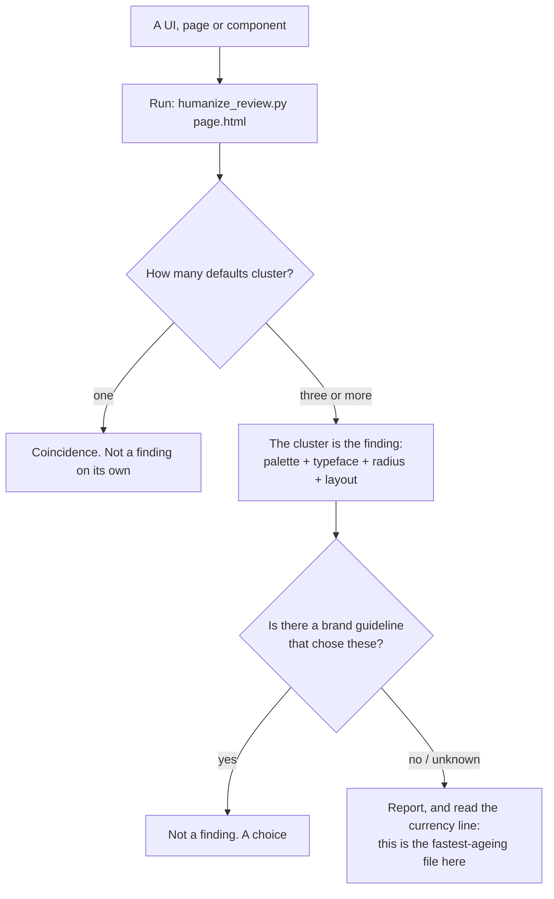

# Visual design tells — the v0/Lovable look

What makes a UI read as generated: the defaults nobody chose, clustering together. A single default is a coincidence; the cluster is the finding, because choosing even one of them deliberately usually means choosing the others too. Read the currency line on every item — this is the fastest-ageing file in the catalog.

_33 items. Generated from catalog.json — edit there, then re-run `scripts/regenerate_references.py`. Do not hand-edit this file._

_Every item carries a **False positive when** line. Read it before you act on the item: these are cues for an editor, not evidence about an author._

<!-- humanize:ignore-start
     The diagram and index below quote the tells they document, and a
     mermaid label is not a sentence. -->

## When this file applies

## What is in this file

Severity reflects the consequence for the intended reader, never how sure you should be about who wrote it. **Automated** means these scripts implement the check; *no* means it is yours to ask in the judge pass.

| item | severity | family | automated |
| --- | --- | --- | --- |
| [`emoji-as-ui-icons`](#emoji-as-ui-icons) | HIGH | visual | yes |
| [`hero-with-nothing-to-look-at`](#hero-with-nothing-to-look-at) | HIGH | form | yes |
| [`pull-quote-that-quotes-nothing`](#pull-quote-that-quotes-nothing) | HIGH | form | yes |
| [`tailwind-indigo-default-palette`](#tailwind-indigo-default-palette) | HIGH | visual | yes |
| [`ai-default-token-repetition`](#ai-default-token-repetition) | med | visual | yes |
| [`allcaps-letterspaced-eyebrow`](#allcaps-letterspaced-eyebrow) | med | visual | **no** |
| [`ambient-background-stack`](#ambient-background-stack) | med | visual | **no** |
| [`badge-pill-now-in-beta`](#badge-pill-now-in-beta) | med | visual | **no** |
| [`centred-body-copy`](#centred-body-copy) | med | form | yes |
| [`curly-straight-quote-mixing`](#curly-straight-quote-mixing) | med | residue | yes |
| [`fade-up-on-scroll-everything`](#fade-up-on-scroll-everything) | med | visual | **no** |
| [`fixed-section-order`](#fixed-section-order) | med | form | n/a |
| [`glassmorphism-card-stack`](#glassmorphism-card-stack) | med | visual | **no** |
| [`inter-geist-default-typeface`](#inter-geist-default-typeface) | med | visual | yes |
| [`measure-past-75-characters`](#measure-past-75-characters) | med | form | yes |
| [`mixed-icon-sets-one-view`](#mixed-icon-sets-one-view) | med | visual | **no** |
| [`numerology-of-three`](#numerology-of-three) | med | form | n/a |
| [`reveal-animation-on-everything`](#reveal-animation-on-everything) | med | form | yes |
| [`shadcn-defaults-unmodified`](#shadcn-defaults-unmodified) | med | visual | **no** |
| [`sparkle-motif-for-ai`](#sparkle-motif-for-ai) | med | visual | **no** |
| [`triplicate-grid`](#triplicate-grid) | med | form | yes |
| [`undifferentiated-section-padding`](#undifferentiated-section-padding) | med | form | yes |
| [`centered-hero-three-card-skeleton`](#centered-hero-three-card-skeleton) | low | visual | **no** |
| [`cream-serif-sage-tasteful-default`](#cream-serif-sage-tasteful-default) | low | visual | **no** |
| [`dark-mode-radial-glow-blobs`](#dark-mode-radial-glow-blobs) | low | visual | **no** |
| [`debug-residue-in-production`](#debug-residue-in-production) | low | residue | yes |
| [`invisible-unicode-artifacts`](#invisible-unicode-artifacts) | low | form | yes |
| [`obligatory-dual-cta`](#obligatory-dual-cta) | low | form | yes |
| [`one-family-no-contrast`](#one-family-no-contrast) | low | form | yes |
| [`purple-blue-gradient-text-headline`](#purple-blue-gradient-text-headline) | low | visual | **no** |
| [`stock-mesh-gradient-background`](#stock-mesh-gradient-background) | low | visual | **no** |
| [`uncanny-padding-rhythm-uniformity`](#uncanny-padding-rhythm-uniformity) | low | visual | **no** |
| [`untouched-default-icon-set`](#untouched-default-icon-set) | low | form | yes |

<!-- humanize:ignore-end -->

<!-- humanize:ignore-start
     Everything below is a specimen catalog. It quotes the tells it documents,
     including literal machine residue, so reviewing it with humanize_review.py
     would flag the exhibits rather than the writing. -->

### `emoji-as-ui-icons`  ·  high · generic-llm · iconography · structural · family: visual

**Automated here:** yes, these scripts implement it.

Emoji stand in for a real icon system: rocket in 'Get started' buttons, check bullets in feature lists, lock next to 'Secure,' lightning for 'Fast.' Rendered as OS emoji glyphs rather than SVG icons.

**Why it reads AI:** Emoji as UI elements vary per OS, don't inherit color, and can't be sized to the grid; no design system ships them as iconography. It's the fastest visual giveaway of zero design investment.

**Detect:** structural: scan rendered text nodes and button labels for emoji codepoints in UI chrome (U+1F300-1FAFF, U+2600-27BF, U+2705, U+1F680, U+26A1, U+1F512). Any emoji codepoint inside a button, nav, feature-card title, or list marker is a defect; distinguish from user-generated content.

**Fix:** Replace every UI emoji with a consistent SVG icon set (Lucide, Heroicons, Phosphor). Icons inherit currentColor and share stroke weight. Reserve emoji for actual content.

**False positive when:** Emoji are legitimate in informal products, chat interfaces, changelogs and release notes, and are a reasonable choice where a full icon set would be overkill. Flag them in product chrome where they render inconsistently across platforms and carry no accessible name.

**Before**

> Feature card: 🚀 Lightning fast / 🔒 Bank-grade security / ✅ No setup required; CTA reads Get started 🚀.

**After**

> Feature card: a 20px Lucide Rocket, ShieldCheck, Check icon in brand color above each title; CTA reads Get started with an inline ArrowRight SVG.

### `hero-with-nothing-to-look-at`  ·  high · generic-llm · layout · structural · family: form

**Automated here:** yes, these scripts implement it.

A hero with no screenshot, photograph, illustration, diagram or video — only type on a gradient or a flat ground. The visual budget goes entirely to a background treatment carrying no information about the product.

**Why it reads AI:** Two causes, both diagnostic. A generator cannot screenshot a product it has never run, so the visual slot resolves to the only thing it can synthesise from CSS: a gradient. And placeholder copy produces placeholder layout — the hero has no image because there is nothing real to show yet. An image-less hero is a claim that nothing is worth showing, which for a working product is always false, and the reader correctly infers that the product does not exist, is ugly, or has not been used by anyone involved.

**Detect:** Within the hero region, count img, picture, video, canvas, iframe and substantial svg elements, excluding logos and small icons. Zero is the signal.

**Thresholds** (read by `scripts/humanize_review.py`): `min_count` = 1

**Fix:** Show the product, in descending order of what it proves. A real screenshot of a real screen with real data in it, cropped to the one view that makes the value legible, shipped at 2x through a picture element. Or a five-to-fifteen second silent loop of it doing its one thing, which beats a still for anything streaming or animated. Or a diagram of the mechanism, which is the honest answer for infrastructure with no interface. If there genuinely is no product yet, say so and make the hero the argument for the waitlist — that is not a tell. Hiding pre-product status behind a gradient and a Get Started button is. Never fix this by generating an illustration.

**False positive when:** Products with no visual surface (a DNS provider, a payments API, a law firm); type-led brand systems that commit fully, where the typography IS the demonstration and is doing something rather than being Inter at 64px; deliberately minimal utility pages where the working tool is the hero, which is the strongest version of this pattern rather than a fault; search-first homepages; and pre-launch pages that admit it.

**Before**

> <section class="bg-gradient-to-br from-indigo-500 to-violet-700"><h1>...</h1>
...
</section>

**After**

> The same hero plus a screenshot of the actual migration diff view, three real table names visible, one shadow, no device frame.

### `pull-quote-that-quotes-nothing`  ·  high · generic-llm · typography · structural · family: form

**Automated here:** yes, these scripts implement it.

A styled pull-quote block containing a sentence that appears nowhere else on the page and is attributed to nobody. An aphorism in quotation marks that no one ever said.

**Why it reads AI:** The pull quote is the one typographic device whose definition is a provenance relation, and a generator emitting it as visual rhythm breaks that relation invisibly. A pull quote is an excerpt; a block quotation cites something external. Generated text is neither — it is new text, from nowhere, wearing the costume of a quotation. The form makes a promise the content cannot keep, and a reader who goes looking for the speaker and finds none has learned something true about the page.

**Detect:** Unusually clean, because a pull quote is DEFINED by a provenance relation: it is an excerpt of the document it sits in. So normalise the quote's text and search for a six-word window of it in the rest of the body. Flag when it appears zero times elsewhere AND carries no cite, figcaption or trailing attribution.

**Thresholds** (read by `scripts/humanize_review.py`): `min_count` = 1

**Fix:** In an article, replace it with the sharpest eight to fifteen words already in your body copy, and leave them in the body too: the pull quote is a trailer, not a scene. On a landing page there is no document to pull from, so it is a testimonial with a full name, role and company, or it is the founder's words attributed to the founder, or it is deleted. There is no fourth option. Mechanically: make the component require a source prop and fail the build when it is absent or does not appear in the page body.

**False positive when:** Epigraphs — a quotation at the head of a chapter from an external source, correctly attributed — are legitimate and by definition do not appear in the body, so a quote carrying a cite naming an external author is never flagged. Also quote-collection pages, walls of love, Tufte-style marginalia (authorial commentary, not quotation), and lyric fragments used as section openers. The discriminator: cited-but-external is an epigraph, uncited-and-internal is a pull quote, uncited-and-external-to-everything is the tell.

**Before**

> <blockquote class="pullquote">"The best products don't just solve problems — they anticipate them."</blockquote>

**After**

> <figure><blockquote>"We cut a 40-minute maintenance window to zero."</blockquote><figcaption>Priya Raman, Staff SRE, Calder</figcaption></figure>

### `tailwind-indigo-default-palette`  ·  high · generic-llm · color · structural · family: visual

**Automated here:** yes, these scripts implement it.

The most reliable web AI-ism: the brand/primary color is Tailwind's default indigo-500 #6366F1 (or violet-500 #8B5CF6, blue-500 #3B82F6). Buttons, links, focus rings, and accents land on the unmodified Tailwind palette.

**Why it reads AI:** Defaults cluster. The causal story is credible and the origin is on the record — Tailwind's creator has said publicly that making every Tailwind UI button indigo-500 is why generated UI is indigo — but no published study has measured font or color defaults in generated interfaces. State the mechanism, not a frequency.

**Detect:** structural: scan CSS/computed background-color of primary buttons for exact hex #6366F1, #8B5CF6, #4F46E5, #3B82F6 or classes `bg-indigo-500/600`, `bg-violet-500`; also flag any primary/accent in the indigo-violet hue band (~250-275deg). Exact-hex match against the Tailwind default ramp is a high-precision signal.

**Fix:** Define a bespoke brand hue — shift H/S/L off the default ramp, build a custom 50-950 scale, and never ship the literal #6366F1. Even rotating 20-40 degrees of hue and adjusting saturation breaks the tell.

**False positive when:** Indigo is a legitimate brand color that predates all of this, and a design system may have chosen it deliberately years ago. The tell is indigo co-occurring with Inter, a gradient headline, and rounded-2xl — never indigo alone.

**Confidence:** anecdotal

**Evidence:** Adam Wathan (Tailwind CSS), public statement, August 2025. Anecdotal origin, not a measurement — do not cite a study, because there isn't one.

**Before**

> Primary CTA bg-indigo-600 hover:bg-indigo-700, links text-blue-500, focus ring ring-indigo-500.

**After**

> Custom brand token --brand: oklch(0.62 0.17 28) (a warm terracotta) with a hand-tuned scale; CTA, links, and focus ring all derive from it; zero default-Tailwind swatches.

### `ai-default-token-repetition`  ·  medium · generic-llm · web-ui · structural · family: visual

**Automated here:** yes, these scripts implement it.

Utility-class tokens repeated across every surface: backdrop-blur, rounded-2xl, bg-gradient-to-r, bg-clip-text, from-indigo, bg-grid-, animate-pulse.

**Why it reads AI:** The unstyled style of generated UI: the treatment was applied everywhere rather than designed once. Defaults cluster, and the cluster is the tell, not any single token.

**Detect:** Count occurrences of each token in markup. These are structured code identifiers, so counting them is not free-text classification.

**Thresholds** (read by `scripts/humanize_review.py`): `min_count` = 3

**Fix:** Keep each effect where it earns its place. Design one deliberate surface treatment and reuse that one.

**False positive when:** A design system that deliberately standardizes on a radius token will repeat it everywhere, correctly. Check whether a token file defines the choice.

**Evidence:** Observed across v0/Lovable/Bolt output; see the AI Design Slop catalog in sources.

**Before**

> Every card: rounded-2xl backdrop-blur bg-gradient-to-r

**After**

> One elevated surface with a chosen radius and a real shadow; everything else flat.

### `allcaps-letterspaced-eyebrow`  ·  medium · generic-llm · typography · structural · family: visual

**Automated here:** no — decidable mechanically, but this bundle does not implement it. Ask it yourself in the judge pass.

A small all-caps, wide-tracked, often monospace label above the H1, repeated above every section on the page.

**Why it reads AI:** Free-looking hierarchy. It adds a level above the headline without requiring a decision, and because it costs nothing it appears above every section, destroying the hierarchy it was meant to create.

**Detect:** Count elements combining uppercase, wide tracking, small size and a mono family. More than two on a page is the fire condition.

**Thresholds** (read by `scripts/humanize_review.py`): `min_count` = 3

**Fix:** Allow one eyebrow per page, and only where it carries information the H1 cannot: a category, a date, an issue number.

**False positive when:** Editorial layouts where a kicker is a real typographic convention, conference sites where it carries track and date, and Swiss-modernist systems that use caps labels as a grid element.

**Before**

> A mono uppercase tracked kicker above each of six sections.

**After**

> No eyebrows; section boundaries carried by whitespace and H2 size.

### `ambient-background-stack`  ·  medium · generic-llm · color · structural · family: visual

**Automated here:** no — decidable mechanically, but this bundle does not implement it. Ask it yourself in the judge pass.

Two or more decorative background layers stacked behind the hero: a dot or line grid, a noise overlay, an aurora or spotlight wash, a blurred gradient orb.

**Why it reads AI:** Each layer individually is a legitimate technique. Stacking them is what happens when nobody decided which one the page needed.

**Detect:** Count decorative absolutely-positioned background layers behind the hero that carry no content.

**Thresholds** (read by `scripts/humanize_review.py`): `min_layers` = 2

**Fix:** Keep at most one, and only if it does something for legibility or depth.

**False positive when:** Some design systems genuinely layer texture, and a grid plus noise is a real and old print-derived treatment.

**Before**

> Grid background, plus noise, plus two blurred orbs, plus a radial spotlight.

**After**

> A flat ground and one well-judged shadow.

### `badge-pill-now-in-beta`  ·  medium · generic-llm · web-ui · structural · family: visual

**Automated here:** no — decidable mechanically, but this bundle does not implement it. Ask it yourself in the judge pass.

A small rounded-full pill above the headline with a tiny dot or sparkle and text like 'Now in beta,' 'Introducing X,' or 'New.' Subtle border, muted background, centered — the reflexive hero garnish.

**Why it reads AI:** The announcement pill is a Linear/Vercel-ism every generator prepends to heroes automatically, whether or not there's anything to announce. Its presence as default garnish signals templated output.

**Detect:** structural: detect a rounded-full inline-flex element directly preceding the h1 with a small status dot/icon plus short text (often border-white/10 bg-white/5 text-xs). Its position above a centered h1 plus pill styling is the pattern; also flag text-xs here as failing the 14px legibility floor.

**Fix:** Only show an announcement pill when there is a genuine linkable announcement, and make it a real link. Otherwise delete it. If kept, ensure label text is >=14px or a proper >=600-weight uppercase eyebrow, not text-xs.

**False positive when:** A product that IS in beta saying so is useful and honest, and a genuine 'New' badge on something new is doing its job. Flag the pill that has been there for a year, or one announcing a beta on a generally available product.

**Before**

> ✨ Now in beta above the centered h1, linking nowhere.

**After**

> Either no pill, or a real link pill at 14px to a dated launch post: 'Read: v2 is live ->' — and only when that post exists.

### `centred-body-copy`  ·  medium · generic-llm · typography · structural · family: form

**Automated here:** yes, these scripts implement it.

Centring applied to paragraphs and not just headings, so every block has a ragged left edge.

**Why it reads AI:** It looks balanced in a thumbnail, which is the view the generation loop optimises. It reads badly at full size because the eye loses the line start.

**Detect:** Count centred text blocks across the page.

**Thresholds** (read by `scripts/humanize_review.py`): `min_count` = 6

**Fix:** Centre headings if you like; left-align anything over two lines. The left edge is what the eye returns to, and a ragged one costs the reader on every line.

**False positive when:** Short hero subheads, pull quotes, and genuinely centred editorial layouts. The threshold is set high because a few centred blocks are ordinary.

**Before**

> Every card body centred.

**After**

> Headings centred, bodies left-aligned.

### `curly-straight-quote-mixing`  ·  medium · generic-llm · typography · structural · family: residue

**Automated here:** yes, these scripts implement it.

Straight and curly quotation marks or apostrophes both used within one document.

**Why it reads AI:** Two sources were pasted together. Typed text uses whatever the editor produces; model output uses the other. Consistency is the default within any single writing process.

**Detect:** Count straight vs curly singles and doubles; flag when both appear at least twice.

**Thresholds** (read by `scripts/humanize_review.py`): `min_of_each` = 2

**Fix:** Normalize to one style across the document, then keep it.

**False positive when:** Code samples and technical documentation legitimately mix, because code requires straight quotes and prose wants curly. Exclude fenced regions before counting — the detector does.

**Evidence:** Widely-reported paste artifact; corroborates the invisible-codepoint family.

**Before**

> The team's “big bet” was the company's "only bet".

**After**

> The team's “big bet” was the company's “only bet”.

### `fade-up-on-scroll-everything`  ·  medium · generic-llm · layout · structural · family: visual

**Automated here:** no — decidable mechanically, but this bundle does not implement it. Ask it yourself in the judge pass.

Every section, card and heading enters with the same fade-and-rise animation on scroll, usually staggered.

**Why it reads AI:** Motion applied as a finish rather than as meaning. When everything animates, the animation stops telling the reader anything.

**Detect:** Count elements carrying the same scroll-triggered entrance variant. Uniformity is the tell, not animation.

**Fix:** Animate the one thing whose arrival matters. Let the rest be present when the page is.

**False positive when:** Motion systems with a documented entrance token are doing this on purpose, and a long marketing page can legitimately use entrance motion for pacing.

**Before**

> Twelve elements sharing one fade-up variant with a 0.1s stagger.

**After**

> A static page with one deliberate transition where state actually changes.

### `fixed-section-order`  ·  medium · generic-llm · layout · llm-judge · family: form

Hero, logo bar, three features, testimonial, pricing, CTA, in that order, regardless of what the product is or what a visitor needs to believe first.

**Why it reads AI:** The order is the template's, not the argument's. Deciding what a reader must believe first requires knowing who the reader is.

**Detect:** Classify top-level sections and compare the sequence against the canonical order. Report once per page rather than per section.

**Fix:** Decide the one thing a visitor must believe before anything else, and put the section that establishes it first. For a product nobody has heard of that is usually the demonstration, not the logo bar.

**False positive when:** The canonical order is canonical because it often works, and a page following it deliberately is not at fault. The tell is following it without having considered an alternative.

**Before**

> The canonical six-section stack.

**After**

> Demonstration, then the objection it raises, then the answer, then pricing.

### `glassmorphism-card-stack`  ·  medium · generic-llm · web-ui · structural · family: visual

**Automated here:** no — decidable mechanically, but this bundle does not implement it. Ask it yourself in the judge pass.

Cards use the identical recipe: semi-transparent fill, backdrop-blur, rounded-2xl/3xl corners, soft drop shadow, and a 1px white-at-10%-opacity inset border. Every card shares the exact token combo.

**Why it reads AI:** It's the default 'premium' card generators emit, copy-pasted across v0/Lovable output. Real systems vary radius, elevation, and surface treatment by component role.

**Detect:** structural: flag the co-occurring quadruple `backdrop-filter: blur` + `border-radius: 16-24px` + `border: 1px solid rgba(255,255,255,0.1)` + soft box-shadow + `background: rgba(...,0.05-0.1)` (Tailwind `backdrop-blur-xl rounded-2xl border border-white/10 shadow-xl bg-white/5`).

**Fix:** Choose a surface treatment that fits the brand and vary radius/elevation by hierarchy. If using glass, restrict it to one intentional layer (a sticky nav), not every card.

**False positive when:** A deliberate visual style with real precedent in shipping operating systems, and correct where the blur does depth work. Flag the identical token recipe applied to every card with no variation for importance.

**Before**

> Every feature, pricing, and testimonial card: bg-white/5 backdrop-blur-xl rounded-2xl border border-white/10 shadow-2xl.

**After**

> Feature cards flat with a 1px solid neutral-200 border and 8px radius; the 'popular' pricing card steps up to a real elevation-3 shadow and solid surface; no backdrop-blur except the pinned header.

### `inter-geist-default-typeface`  ·  medium · generic-llm · typography · structural · family: visual

**Automated here:** yes, these scripts implement it.

AI site builders default to Inter (or Vercel's Geist) for every text role with no contrasting display or serif face. Sora, Manrope, and Space Grotesk are the secondary fallbacks that signal the same generator.

**Why it reads AI:** Human designers almost always pair a display face with a text face or pick a typeface with brand intent. One geometric grotesk doing 100% of the work is the statistical-average choice.

**Detect:** structural: inspect computed font-family on h1/h2/body/button. Flag a single family (Inter/Geist/Sora/Manrope/Space Grotesk) used across all text roles with zero pairing; grep CSS for `font-family:.*Inter`, `--font-geist`, `next/font/google` importing Inter. One family doing every job is the signal.

**Fix:** Pair an opinionated display face for headlines with a neutral text face for body, or commit to one face but vary weight/optical-size/tracking with intent. Anything but unmodified Inter-everywhere.

**False positive when:** Inter is a genuinely good UI typeface chosen deliberately by many teams, including before generative tooling existed. It is only a tell inside the default cluster.

**Confidence:** anecdotal

**Before**

> All headings, body, and buttons render in font-family: Inter, sans-serif at weights 400/500/600.

**After**

> Headlines in a high-contrast serif (e.g. GT Sectra) at 600; body in Inter at 400 with -0.011em tracking; clear hierarchy between display and text.

### `measure-past-75-characters`  ·  medium · generic-llm · typography · rendered · family: form

**Automated here:** yes, these scripts implement it.

Body text running the full width of a wide container: 100, 130, 160 characters per line. No constraint on the text column, so the layout's width became the text's width.

**Why it reads AI:** Nobody decided the width. A generator sets a container and puts prose in it; constraining the text column is a separate decision that only matters once someone reads a full paragraph on a wide screen, which nothing in the loop does.

**Detect:** Rendered: measure a sample string in each paragraph's own computed font on a canvas, divide the element's content width by the resulting advance width. scripts/render_check.py reports the actual characters-per-line rather than estimating from font size.

**Fix:** Constrain the text column rather than the page: max-width around 65ch on the element holding prose, or a grid whose text column is narrower than its media column. 45 to 75 characters is the conventional range and 66 the usual target. Note ch units track the font's zero-width, so check the result rather than trusting the number.

**False positive when:** Data tables, code blocks, and dashboard cells are not prose and want the width. Deliberately wide editorial layouts with large type can exceed the range legibly, which is why this measures characters rather than pixels.

**Before**

> .wrap { padding: 2rem }   /* measured 167 characters per line at 1280px */

**After**

> .wrap { padding: 2rem; max-width: 65ch; margin-inline: auto }

### `mixed-icon-sets-one-view`  ·  medium · generic-llm · iconography · structural · family: visual

**Automated here:** no — decidable mechanically, but this bundle does not implement it. Ask it yourself in the judge pass.

A single view mixes icon vocabularies: some Lucide line icons, some Heroicons solid, a couple of emoji, maybe a Font Awesome glyph — different stroke weights, corner radii, and fill styles side by side.

**Why it reads AI:** Generators pull icons from whatever import is handy per snippet, so a page accretes mismatched sets. Humans standardize on one family and weight.

**Detect:** structural: inventory icon sources in the DOM (lucide-react, @heroicons, react-icons/fa, emoji codepoints, inline SVGs with differing stroke-width). More than one icon system in a viewport, or mixed stroke-width among adjacent icons, is the tell.

**Fix:** Standardize on a single icon library and one style (e.g. Lucide, 1.5px stroke, 24px grid) across the app. Remove emoji from UI. Audit every icon for shared weight, size, and alignment.

**False positive when:** A product mid-migration between icon sets legitimately shows both for a while, and a third-party embed brings its own iconography that you do not control. Flag mixed stroke weights and fill styles inside first-party chrome.

**Before**

> Feature row pairs a Lucide outline Zap (stroke 2), a Heroicons solid LockClosed, and a 🔒 emoji — three visual languages in one line.

**After**

> All three are Lucide outline icons at 24px / 1.5px stroke in brand color, optically centered on a shared baseline.

### `numerology-of-three`  ·  medium · generic-llm · layout · llm-judge · family: form

Three features, three tiers, three testimonials, three steps — regardless of how many real ones exist.

**Why it reads AI:** Three is what you pick when the number of real things is unknown, and it happens to fill a grid. The layout chose the content rather than the other way round.

**Detect:** Judge: is three the true count, or the count that fills a row? Ask what the fourth would be and whether the third earns its place.

**Fix:** Count the real things and show that many. Two strong features beat three where the third is padding, and a five-item list that does not fit a grid is a reason to change the grid.

**False positive when:** Plenty of products genuinely have three tiers, and the rule of three is a real compositional device. The tell is a third item that restates or pads.

**Before**

> Three feature cards, the third of which restates the first.

**After**

> Two features, each with a screenshot.

### `reveal-animation-on-everything`  ·  medium · generic-llm · web-ui · structural · family: form

**Automated here:** yes, these scripts implement it.

Every element fades and rises into view on scroll, so the motion marks nothing and delays everything.

**Why it reads AI:** Motion applied by rule rather than to direct attention. Deciding which one element deserves an entrance requires knowing which one matters.

**Detect:** Count scroll-entrance animation usages.

**Thresholds** (read by `scripts/humanize_review.py`): `min_count` = 8

**Fix:** Animate the one element whose arrival is the point and let the rest be present when the page is. Then add the prefers-reduced-motion guard, which a page with this much motion needs and almost never has.

**False positive when:** Motion systems with a documented entrance token, and long marketing pages that use entrance motion deliberately for pacing.

**Before**

> Twelve elements sharing one fade-up variant with a stagger.

**After**

> A static page with one deliberate transition where state actually changes.

### `shadcn-defaults-unmodified`  ·  medium · generic-llm · web-ui · structural · family: visual

**Automated here:** no — decidable mechanically, but this bundle does not implement it. Ask it yourself in the judge pass.

shadcn/ui shipped exactly as generated: default radius, default zinc neutrals, default hairline borders, lucide as the only icon set, no token overrides.

**Why it reads AI:** The library is excellent and the defaults are fine, which is why nobody changes them. A site that has not overridden one token has not made one decision.

**Detect:** Check whether components.json and the CSS variable block differ from the scaffold defaults at all. Zero diff is the signal.

**Fix:** Change the radius, the neutral ramp, and the primary. Three token edits move a page further than a redesign.

**False positive when:** Internal tools, admin panels and prototypes are exactly what unmodified defaults are for.

**Before**

> A components.json and theme block byte-identical to the scaffold.

**After**

> Custom radius scale, a neutral ramp mixed toward the brand hue, one real accent.

### `sparkle-motif-for-ai`  ·  medium · generic-llm · iconography · structural · family: visual

**Automated here:** no — decidable mechanically, but this bundle does not implement it. Ask it yourself in the judge pass.

The four-point sparkle (Lucide Sparkles, Material's AI sparkle) slapped on anything AI-related: 'AI' badges, generate buttons, magic-wand affordances, and decorative confetti around headlines.

**Why it reads AI:** The sparkle became the universal, unimaginative shorthand for AI 'magic.' Reaching for it signals the design followed the herd rather than inventing a brand-specific affordance.

**Detect:** structural: detect U+2728, Lucide Sparkles/Sparkle/WandSparkles usage, or four-point-star SVG paths near text containing 'AI'/'generate'/'magic'. Count sparkle glyphs per view; any on an AI feature is the cliche, multiple is severe.

**Fix:** Design a distinct affordance for AI actions — a custom glyph, a labeled button, a motion cue. If a sparkle is unavoidable, make it bespoke and use it once.

**False positive when:** The sparkle has become the conventional affordance for a generative action, and using a convention users already recognise is a legitimate design decision. Flag it as decoration on things that are not generative, not as the icon on a generate button.

**Before**

> <button>✨ Generate with AI</button> plus floating ✨ sparkles scattered around the hero headline.

**After**

> <button>Generate</button> with a custom monoline glyph unique to the product; no decorative sparkles; the AI capability is communicated by a short label and a subtle hover shimmer.

### `triplicate-grid`  ·  medium · generic-llm · layout · structural · family: form

**Automated here:** yes, these scripts implement it.

The same three-column card grid used for features, then benefits, then testimonials, then pricing. One layout answering every content shape.

**Why it reads AI:** The grid was chosen once and reused, because choosing per section requires knowing what each section contains. It is the layout equivalent of one register for every genre.

**Detect:** Count three-column grid containers on the page.

**Thresholds** (read by `scripts/humanize_review.py`): `min_sections` = 3

**Fix:** Let each content shape pick its own container. Two features with screenshots want something different from five testimonials, and a pricing table is not a card grid. When every section looks the same the reader stops distinguishing them.

**False positive when:** A deliberate modular system, and pages where the content genuinely is three parallel things three times over.

**Before**

> Four sections, all grid-cols-3.

**After**

> Features as two wide rows with screenshots; testimonials as a single quote; pricing as a table.

### `undifferentiated-section-padding`  ·  medium · generic-llm · layout · structural · family: form

**Automated here:** yes, these scripts implement it.

Every section on the page padded identically. Hero, feature grid, testimonial, FAQ and footer all get the same vertical space.

**Why it reads AI:** Spacing used as a constant rather than as a relationship. Nothing is grouped with anything and nothing is separated from anything, so the page becomes a stack of equally weighted slabs and the reader gets no signal about what belongs together. Choosing one value is what you do when you have not decided which sections matter.

**Detect:** Collect vertical padding values across sections; flag when four or more sections share exactly one value.

**Thresholds** (read by `scripts/humanize_review.py`): `min_sections` = 4

**Fix:** Vary it by role. Give the hero more room than it needs and the sections after it less; tighten the gap between a heading and the thing it introduces; widen it between unrelated sections. A three-step scale used deliberately reads as designed. One value everywhere reads as a default, which is what it is.

**False positive when:** Documentation and long-form article templates legitimately use one rhythm throughout, and a design system with a documented spacing scale may deliberately standardise section padding.

**Before**

> Five sections, every one py-24.

**After**

> Hero py-32, feature grid py-20, and eight of those units between a heading and its own paragraph.

### `centered-hero-three-card-skeleton`  ·  low · generic-llm · layout · structural · family: visual

**Automated here:** no — decidable mechanically, but this bundle does not implement it. Ask it yourself in the judge pass.

The whole-page template: centered badge pill ('Now in beta'), giant centered headline with one gradient word, one-line subhead, two buttons (solid + ghost), then a 3-column grid of icon-title-blurb cards (icons often emoji). Section order and centering are near-identical across generated sites.

**Why it reads AI:** This is the statistical mean of every landing page in the training set; generators reproduce the skeleton verbatim. The giveaway is that the structure, not just the styling, is interchangeable with a thousand other AI sites.

**Detect:** structural: DOM-pattern match a hero with text-align:center, a pill above an h1, an h1 with a gradient span, a subhead, exactly two sibling CTAs, then a grid-cols-3 of 3-4 icon+heading+paragraph cards. The full sequence co-occurring is the tell.

**Fix:** Break the symmetry: asymmetric/left-aligned hero, a product screenshot or demo doing the talking, one primary CTA, and feature sections with varied layouts (alternating media-text rows, a bento grid) rather than a uniform 3-up.

**False positive when:** A centered hero with three feature cards converts well and is genuinely the right layout for a great many products. Flag it where it is the only layout the page knows -- the tell is the whole-page template with no section that breaks it, not the hero.

**Evidence:** Practitioner/editorial hypothesis. No calibrated individual-authorship inference or universal quality threshold is established here. Escalate only after demonstrating a reader or task failure.

**Before**

> Centered 'Now in beta' pill -> 'The future of <gradient>work</gradient>' -> subhead -> Get started + Learn more -> 3 identical icon cards.

**After**

> Left-aligned hero with a live product canvas on the right, one CTA (Start building), then an alternating sequence: a wide demo, a 2x2 bento of differentiated capabilities, a metric strip.

### `cream-serif-sage-tasteful-default`  ·  low · generic-llm · color · structural · family: visual

**Automated here:** no — decidable mechanically, but this bundle does not implement it. Ask it yourself in the judge pass.

The SECOND-generation default: what models produce when you ask them not to look AI-generated. A warm off-white ground (#faf8f5, #f5f1e8, bg-stone-50, bg-amber-50), a display serif (Instrument Serif, Fraunces, Playfair Display, Spectral, Cormorant, DM Serif), and a deep sage or forest primary (#15573a, #1a4d3a, emerald-800).

**Why it reads AI:** It is the model's stored idea of taste, the look of a well-funded 2024 DTC brand, applied without reference to what the product is. A payroll API and a meditation app get the same cream-and-Fraunces treatment, so it reads as a costume rather than an identity.

**Detect:** Grep for those grounds, for the serif list in font imports, and for a primary in the emerald 700-900 band. All three together is close to conclusive.

**Fix:** Treat it as a palette you have to earn. If the product has no reason to be warm, don't be warm. Choose the serif for what it does to your longest headline, and don't pair cream with green unless the brand is about growing things.

**False positive when:** Editorial and publishing sites, food and hospitality, wellness and skincare, independent bookshops. Cream, serif and green is a genuinely correct and long-standing set there. Also any brand whose guidelines predate 2023 and happen to land here.

**Evidence:** Practitioner/editorial hypothesis. No calibrated individual-authorship inference or universal quality threshold is established here. Escalate only after demonstrating a reader or task failure.

**Before**

> bg-[#faf8f5], Instrument Serif h1, --primary #15573a, one generated photo of hands holding a ceramic mug.

**After**

> White ground, one grotesque at two optical sizes, the brand's actual color, and a real screenshot of the product.

### `dark-mode-radial-glow-blobs`  ·  low · generic-llm · color · structural · family: visual

**Automated here:** no — decidable mechanically, but this bundle does not implement it. Ask it yourself in the judge pass.

Dark-mode-by-default near-black background (#0A0A0A / slate-950) decorated with large blurred radial-gradient glow blobs in indigo/violet/cyan bleeding from the corners, plus a faint grid or dot overlay.

**Why it reads AI:** Linear/Vercel-style dark hero with ambient purple glows is the default 'looks expensive' move. When every AI site has the same two violet smudges on near-black, it reads as templated.

**Detect:** structural: detect a body background near #000-#0B0F1A combined with absolutely-positioned divs carrying `radial-gradient` + heavy `blur()` (>60px) in indigo/violet/cyan, and/or a repeating grid/dot background SVG. The dark-bg + corner glow-blob + grid-overlay triple is the signature.

**Fix:** Justify the color mode by the product. If dark, build a real neutral scale and use lighting with intent; drop the corner glow-blobs or replace with a meaningful brand visual. Consider light or a distinctive non-black dark.

**False positive when:** A dark product surface with deliberate accent lighting is a real design, and glow is correct where it directs attention. Flag the corner-bleeding default with a grid overlay and no relationship to the content. Measured against complaint volume this signal is weak: a ranked analysis of ~3.2M posts across 47 subreddits puts mesh, blob and aurora backgrounds at roughly 0.1% of comments naming AI slop and advises against chasing them. Read that as a bound on the signal rather than a refutation -- comment share measures what irritates people, not what predicts generation -- and do not let this carry a verdict alone.

**Before**

> bg-slate-950 with two blur-3xl violet/indigo radial blobs top-left and bottom-right and a faint dot-grid overlay behind the hero.

**After**

> Warm off-white (#F7F5F2) light theme with a single hand-made hero illustration; or a deliberate deep-green dark theme with one structural light source and no ambient glow blobs.

### `debug-residue-in-production`  ·  low · generic-llm · web-ui · structural · family: residue

**Automated here:** yes, these scripts implement it.

console.log, console.debug and debugger statements on a shipped page.

**Why it reads AI:** Working notes shipped to visitors. Harmless in itself, and a reliable sign nothing was reviewed on the way out.

**Detect:** Count console and debugger calls.

**Thresholds** (read by `scripts/humanize_review.py`): `min_count` = 3

**Fix:** Strip them, or route logging through something that compiles out in production. While you are there, check whether any of them log a request or user object.

**False positive when:** Deliberate console banners (hiring messages, self-XSS warnings) are a long-standing convention, and development builds are expected to be noisy.

**Before**

> console.log("user", user)

**After**

> (removed)

### `invisible-unicode-artifacts`  ·  low · generic-llm · typography · structural · family: form

**Automated here:** yes, these scripts implement it.

**Currency:** Fading — still seen, but vendors have patched toward it and it is weakening.

Unicode spacing or formatting characters merit inspection only when they cause a concrete layout or text-processing problem.

**Why it reads AI:** It does not establish AI use. Locale formatting and direct keyboard input can produce these characters.

**Detect:** Count codepoints as an inspection cue; do not infer copying, transformation, or authorship.

**Thresholds** (read by `scripts/humanize_review.py`): `min_count` = 1

**Fix:** Inspect language and rendered output; preserve meaningful non-breaking spaces and script joiners. Repair a demonstrated defect rather than normalizing blindly.

**False positive when:** French locale formatting, Mongolian text, deliberate no-break typography, script shaping, and ordinary authored Unicode text use these characters legitimately.

**Evidence:** Unicode CLDR 34 documents U+202F in French number and unit formatting: https://cldr.unicode.org/downloads/cldr-34

**Before**

> A sentence — with residue in it.

**After**

> A sentence — with the residue removed.

### `obligatory-dual-cta`  ·  low · generic-llm · web-ui · structural · family: form

**Automated here:** yes, these scripts implement it.

The hero always carries exactly two buttons side by side, one solid and one ghost: 'Get Started Free' plus 'Learn More'.

**Why it reads AI:** The hero component has two button slots, so two buttons appear. It is not two audiences with two next steps; the secondary almost always points at the section immediately below it, which the reader would have reached by scrolling.

**Detect:** Count buttons and anchors in the hero; flag a pair where one is filled and one is outline or ghost.

**Thresholds** (read by `scripts/humanize_review.py`): `min_count` = 1

**Fix:** Decide what the one next step is and offer that. Keep a second action only when it serves a genuinely different reader, and then make its label name that reader's outcome rather than 'Learn more'.

**False positive when:** Products with two genuinely distinct entry points (self-serve and sales-assisted) legitimately offer both, and a documented design system may standardise the pair.

**Before**

> <a class="btn">Get Started Free</a><a class="btn-outline">Learn More</a>

**After**

> <a class="btn">Start a 14-day trial — no card</a>

### `one-family-no-contrast`  ·  low · generic-llm · typography · structural · family: form

**Automated here:** yes, these scripts implement it.

Display and body set in the same typeface, differentiated only by size and weight. Headlines are body text made large.

**Why it reads AI:** Pairing is a decision and a single family is a default. Nothing in the generation loop rewards the second choice.

**Detect:** Count distinct non-monospace font families in use; flag a page with exactly one and a display heading.

**Thresholds** (read by `scripts/humanize_review.py`): `min_count` = 1

**Fix:** Pair a display face with the text face, or at minimum set an optical-size axis so the headline is drawn for headline sizes. One good pairing does more for a page than any amount of spacing work.

**False positive when:** Single-family systems are a real and respected choice, especially with a variable font carrying genuine optical sizing. This is low severity for exactly that reason.

**Before**

> Inter for everything, 400 and 700.

**After**

> A display serif at the headline, the grotesque kept for body.

### `purple-blue-gradient-text-headline`  ·  low · generic-llm · color · structural · family: visual

**Automated here:** no — decidable mechanically, but this bundle does not implement it. Ask it yourself in the judge pass.

The headline (or one hero word) uses a linear-gradient clipped to text running indigo-to-violet or violet-to-cyan, with the same gradient on hero buttons and blobs. The 'gradient word' in an otherwise solid headline is a signature move.

**Why it reads AI:** Gradient text was a 2021-2023 SaaS trend the models over-learned; combined with indigo-violet stops it screams template. Real brands use gradient text sparingly with custom stops.

**Detect:** structural: look for `background: linear-gradient(...); -webkit-background-clip: text; color: transparent` or `bg-gradient-to-r from-indigo-500 to-purple-500 bg-clip-text text-transparent`, with gradient stops in the indigo/violet/blue hue range (H 220-280). Presence on the H1 is the tell.

**Fix:** Make the headline a solid, confident color. If a gradient is truly wanted, use unexpected stops tied to brand and apply it to one deliberate element, not every accent.

**False positive when:** A brand whose actual palette is violet is entitled to use it, and a gradient chosen against a real brand guideline is a decision rather than a default. Flag the indigo-to-violet default arriving with no brand behind it.

**Evidence:** Practitioner/editorial hypothesis. No calibrated individual-authorship inference or universal quality threshold is established here. Escalate only after demonstrating a reader or task failure.

**Before**

> <h1>Build faster</h1> with a matching gradient CTA.

**After**

> <h1>Build faster</h1> in solid near-black; a single restrained accent underline in the brand terracotta; buttons are flat brand fill.

### `stock-mesh-gradient-background`  ·  low · generic-llm · color · structural · family: visual

**Automated here:** no — decidable mechanically, but this bundle does not implement it. Ask it yourself in the judge pass.

The hero or full-page background is a soft multi-stop mesh gradient (pink-purple-blue-teal blend), often the literal default from a mesh-gradient generator, used as decoration unrelated to the brand.

**Why it reads AI:** Mesh gradients had a moment, so models emit them as instant 'modern' backdrop. A pastel mesh that doesn't echo any brand color is decoration-by-default.

**Detect:** structural: detect large conic/radial multi-stop gradients or a mesh-gradient SVG/PNG covering the hero with 3+ pastel stops in the magenta-violet-blue-cyan range, frequently with blur.

**Fix:** Make the background earn its place: a solid brand-tinted surface, a real product visual, a subtle texture, or a gradient built from actual brand colors. Avoid the default rainbow-pastel mesh.

**False positive when:** A mesh gradient built from the brand's own palette is a design decision, and the style is genuinely popular on hand-built sites. Flag the literal untouched output of a generator. Measured against complaint volume this signal is weak: a ranked analysis of ~3.2M posts across 47 subreddits puts mesh, blob and aurora backgrounds at roughly 0.1% of comments naming AI slop and advises against chasing them. Read that as a bound on the signal rather than a refutation -- comment share measures what irritates people, not what predicts generation -- and do not let this carry a verdict alone.

**Before**

> Full-bleed hero behind the headline is a blurred pink-to-purple-to-cyan mesh gradient lifted from a generator preset.

**After**

> Hero sits on a flat warm-neutral surface with a single duotone product screenshot; any gradient uses only the two brand hues at low contrast.

### `uncanny-padding-rhythm-uniformity`  ·  low · generic-llm · layout · structural · family: visual

**Automated here:** no — decidable mechanically, but this bundle does not implement it. Ask it yourself in the judge pass.

Every section uses the exact same vertical padding, every card the same internal padding and gap, every element the same radius token — mechanically uniform rhythm with no focal emphasis or intentional density change.

**Why it reads AI:** Generators apply one spacing scale uniformly because they have no editorial sense of pacing. Designed pages breathe — heroes get more air, dense data less. Perfect evenness feels machine-laid.

**Detect:** structural: measure section vertical padding and card padding/radius/gap across the page; flag near-zero variance in spacing and radius tokens across semantically different sections (e.g. every section py-20, every card p-6 rounded-2xl gap-6).

**Fix:** Introduce intentional rhythm: vary section padding by importance, let a hero be spacious and a table tight, use radius/elevation to signal hierarchy, and add one deliberate irregularity.

**False positive when:** A design system's entire job is consistent spacing, and a spacing scale is correct, not suspicious. Flag the ABSENCE of any emphasis anywhere -- no section denser or airier than another -- rather than the presence of a scale.

**Before**

> Eight consecutive sections all py-20, every card p-6 rounded-2xl gap-6, identical column widths throughout.

**After**

> Hero py-32, feature bento py-24, dense pricing table py-16; a full-bleed quote section breaks the column grid; card radii and padding step with hierarchy.

### `untouched-default-icon-set`  ·  low · generic-llm · iconography · structural · family: form

**Automated here:** yes, these scripts implement it.

The default icon library at default stroke width, with the worn glyph set: Sparkles beside anything AI, Zap beside anything fast, ArrowRight on every button.

**Why it reads AI:** Not the library, which is good, but the glyph choice. These are the icons a generator picks because they are the icons the training data picks, and they name the adjective rather than the thing.

**Detect:** Library import signature plus the specific glyph names.

**Thresholds** (read by `scripts/humanize_review.py`): `min_count` = 1

**Fix:** Choose glyphs that name the actual noun: if the feature is scheduling, the icon is a calendar, not a lightning bolt. Drop Sparkles entirely, which now reads as a label saying AI went here.

**False positive when:** A well-chosen icon set used consistently is good practice, and these libraries are genuinely good. The tell is the specific worn triad, not the library.

**Before**

> Sparkles, Zap, ArrowRight across the feature grid.

**After**

> Calendar, Database, ArrowUpRight — each naming what its card is about.

<!-- humanize:ignore-end -->
