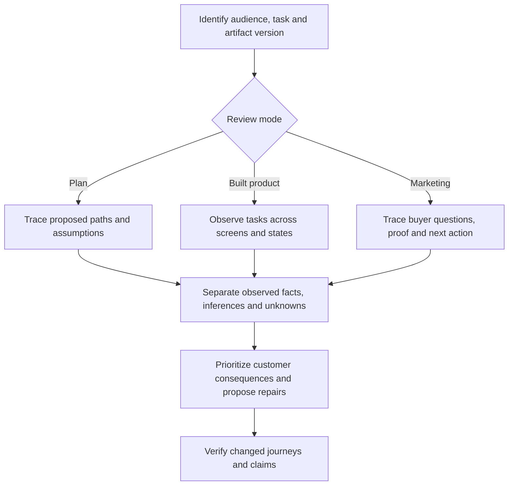

# Product Reality Reviewer

Review the product from what the customer knows, wants and can actually do.
Inspect plans as plans and built experiences through their actual screens and
states. Find missing behavior and weak buyer communication before polishing copy.

## Use This For

- Reviewing a vibe-coded project plan, PRD, prototype, or feature proposal.
- Asking "what will confuse or block a first-time user immediately?"
- Checking account creation, missing provider access, permissions, cost, support, and recovery paths.
- Producing must-fix findings before build work starts.
- Reviewing an existing web or native app across first-time, returning and power-user tasks.
- Reviewing whether a marketing page communicates relevant value and earns its next action.

## Do Not Use This For

- Reviewing code correctness or test coverage.
- General competitive research without a concrete product artifact.
- Pure UI style critique. Use a UX/design skill for visual execution.

## Review Process

1. Choose `plan`, `experience`, `marketing`, or a clearly scoped combination. Name
   the audience, job, entry point, version and successful outcome. Mark assumed
   audience needs as hypotheses; do not fabricate customer interviews or quotes.
   For plan mode, load `references/review-questions.md`. Review ownership,
   permissions, secrets, retention, approval boundaries, rollback and support
   whenever those affect the proposed product's actions or stored data.
2. For built experiences or sales pages, load `references/audience-and-customer-review.md`.
   Follow concrete tasks using only information the customer has encountered.
   Source code can explain a failure but cannot establish that a customer can use it.
3. Review first-time orientation and first value, returning-user continuity,
   power-user efficiency, and applicable failure/recovery paths. Include buyers
   and end users separately when their decisions differ. Do not invent irrelevant
   personas to fill a matrix.
4. Identify missing paths, uncertain state, unnecessary setup, hidden costs and
   builder privileges. Check account, provider, permissions, support and recovery
   needs only when applicable to this product. A local utility may need no account.
5. For marketing, work from the buyer's problem through outcome, mechanism, proof,
   material conditions, objections and next action. Classify engineering details
   by whether they help this buyer choose. Inspect the CTA destination and actual
   product behavior; do not replace truthful detail with unsupported benefit claims.
6. Label evidence `observed`, `inferred`, or `unknown`. For every important gap,
   name the affected audience, task, location, consequence, repair and verification.
   Distinguish absent behavior from behavior that exists but cannot be found.
7. Prioritize by task impact. Plan findings may use the existing build-stage
   severity vocabulary. For an existing product, use `blocks-task`, `adds-friction`
   or `improvement`, with the actual consequence; these are recommendations, not
   new approval gates. Record unvisited states and avoid whole-product verdicts
   from a homepage-only review.
8. Use `scripts/reality_check.mjs` only for its original structured agentic-product
   planning manifest. It checks field presence and selected assumptions; it does
   not run an app, validate audience reasoning or establish conversion readiness.

## Output Contract

Return:

For a plan, retain the existing contract below. For an experience or marketing
review, return the audience/task matrix, observed journey, located findings,
proposed repairs or authorized edits, and coverage/validation limits. Use
`templates/output-template.md` for the mode-specific shape.

- `verdict`: `build-ready`, `build-with-risk`, or `not-ready`.
- `mustFix`: user-blocking issues that should stop implementation.
- `riskRegister`: important but non-blocking risks with owner and evidence.
- `missingQuestions`: questions a real user or support person will ask immediately.
- `recommendedPlanChanges`: concrete edits to the project plan.

Do not report a predicted conversion lift or fabricated user-success percentage.
Propose a measurable hypothesis and an appropriate user trial or experiment when
the expected sales or usability effect remains uncertain. Model role-play is an
expert-review technique, not evidence that customers will respond as imagined.

## Anti-Patterns

### Builder Privilege Blindness

**Novice**: "It works because it works on my machine with my paid AI accounts."
**Expert**: Review from the user's cold machine, no tokens, no MCP, no repo state, no context, and no trust yet.
**Timeline**: In 2026, AI-product onboarding is often a provider-access problem before it is a feature problem.
**Detection**: The artifact requires a paid model account but has no demo, fallback, or guided credential setup.

### Account Creation Deferred

**Novice**: "Auth can come later."
**Expert**: When shared accounts or cloud ownership are part of the product,
account creation shapes collaboration, billing, audit logs, deletion and support.
A local or anonymous workflow can be appropriate when its ownership and recovery
behavior satisfy the intended task.
**Timeline**: Agentic products create durable work; anonymous state becomes a migration and trust problem quickly.
**Detection**: Plan mentions saved work, teams, billing, or history but no account lifecycle.

### Supportless Magic

**Novice**: "The agent succeeded, so support is just logs."
**Expert**: Users need receipts they can understand: what happened, what changed, what failed, how to retry, and how to ask for help.
**Timeline**: As agent autonomy increases, support artifacts become core product UX, not an afterthought.
**Detection**: No failure state, no transcript, no user-facing error, no escalation path.

### Customer Role-Play With Builder Knowledge

**Novice**: "A first-time user would click the correct control because I know it is there."
**Expert**: At each decision, name the visible cue that connects the user's goal
to the next action. Record a missing cue or uncertain choice instead of silently
supplying project context.
**Detection**: The walkthrough uses an internal term, preloaded account, hidden
URL, prepared data or undocumented action the audience has not encountered.

### Architecture Presented as a Sales Argument

**Novice**: "Listing the stack and every capability explains why someone should buy."
**Expert**: Give each section a buyer question. Retain technical detail that
answers it, and connect a supported capability to an outcome the buyer values.
**Detection**: A section explains how the system was built but supplies no reason
this audience would choose it; proof, price, objection or next step is missing.

### Imagined Customers Become Measured Evidence

**Novice**: "Three simulated personas passed, so this will convert."
**Expert**: Keep reviewer inference distinct from observed use and measured
behavior. State the test that would confirm the proposed improvement.
**Detection**: The report gives invented customer quotes, conversion lifts or
success rates without a recorded study or experiment.

## References

| File | Load When |
| --- | --- |
| `references/review-questions.md` | Need the canonical skeptical questions for first-run, account, provider, and trust review. |
| `references/audience-and-customer-review.md` | Existing apps, first-time/returning/power-user journeys, customer language and sales-page reasoning. |
| `references/activation-examples.md` | Checking selection boundaries and overlap with copy, design and code-review skills. |
| `references/severity-rubric.md` | Need to classify findings without over-blocking the build. |
| `examples/expected-output.md` | Need the shape of a finished skeptical product review. |
| `templates/output-template.md` | Need a reusable review report template. |
| `schemas/product-reality.schema.json` | Need the JSON input contract for the checker. |
| `scripts/reality_check.mjs` | Need deterministic product-risk findings from a manifest. |
| `agents/openai.yaml` | Need a subagent descriptor for delegated product review. |

<!-- BEGIN BUNDLE INDEX (manual) -->

## Skill Bundle Index

**root**
- [`CHANGELOG.md`](CHANGELOG.md) - Changelog for this skill.
- [`README.md`](README.md) - Quick start and purpose.

**`agents/`**
- [`agents/openai.yaml`](agents/openai.yaml) - OpenAI/Codex-style agent descriptor for skeptical product review.

**`examples/`**
- [`examples/expected-output.md`](examples/expected-output.md) - Example review output with severity-ranked findings.

**`references/`**
- [`references/review-questions.md`](references/review-questions.md) - Canonical product-reality questions.
- [`references/severity-rubric.md`](references/severity-rubric.md) - Severity definitions and escalation rules.

**`schemas/`**
- [`schemas/product-reality.schema.json`](schemas/product-reality.schema.json) - JSON contract for `reality_check.mjs`.

**`scripts/`**
- [`scripts/reality_check.mjs`](scripts/reality_check.mjs) - Produces deterministic findings from a product manifest.

**`templates/`**
- [`templates/output-template.md`](templates/output-template.md) - Copyable product review template.

<!-- END BUNDLE INDEX -->

<!-- BEGIN BUNDLE INDEX (auto: index_references.py) -->

## Skill Bundle Index

*Every file in this skill, and when to open it. Auto-generated. Maintainers: from the source repository root, run
`python3 skills/skill-architect/scripts/index_references.py skills/product-reality-reviewer --fix`.*

**root**
- [`CHANGELOG.md`](CHANGELOG.md) — Product Reality Reviewer - Changelog — - Added built-product and marketing review modes, grounded in audience knowledge, first-time/returning/power-user tasks and buyer decisions.
- [`README.md`](README.md) — Product Reality Reviewer — Use this skill for skeptical review of a plan, built web/native app, or marketing page.

**`agents/`**
- [`agents/openai.yaml`](agents/openai.yaml) — openai (data/schema)

**`examples/`**
- [`examples/expected-output.md`](examples/expected-output.md) — Example Output — `not-ready` | Finding | User Impact | Evidence | Recommended Plan Change | | --- | --- | --- | --- | | No missing-provider fallback | New us

**`references/`**
- [`references/activation-examples.md`](references/activation-examples.md) — Selection examples — Use these when checking description boundaries.
- [`references/audience-and-customer-review.md`](references/audience-and-customer-review.md) — Audience, customer journeys and buyer decisions — Use for built apps and marketing pages.
- [`references/review-questions.md`](references/review-questions.md) — Review Questions — Use this when performing a skeptical product review.
- [`references/severity-rubric.md`](references/severity-rubric.md) — Severity Rubric — Use this when classifying product-review findings.

**`schemas/`**
- [`schemas/product-reality.schema.json`](schemas/product-reality.schema.json) — product reality.schema (data/schema)

**`scripts/`**
- [`scripts/reality_check.mjs`](scripts/reality_check.mjs)

**`templates/`**
- [`templates/output-template.md`](templates/output-template.md) — Product Reality Review — Choose the applicable mode below.

<!-- END BUNDLE INDEX -->
